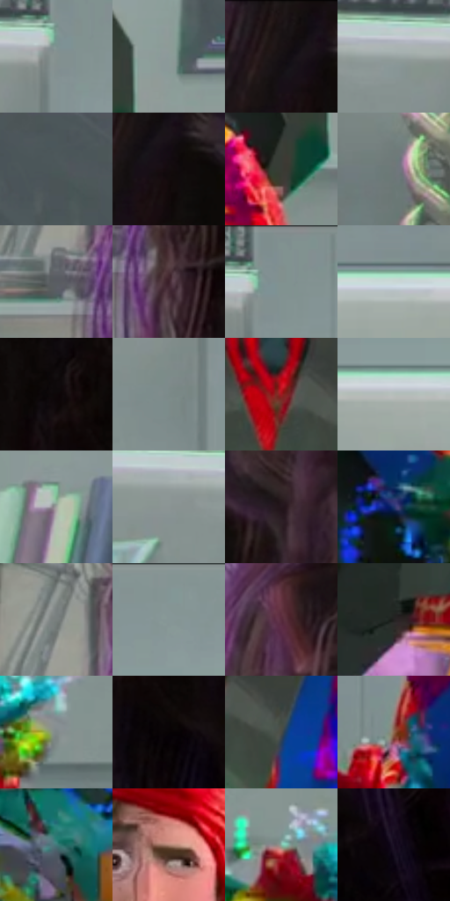

# 电影参考 352

- 状态：条件／活跃；来源世界：miles-home。
- 视角：near-level；景别：medium；场景：portrait。
- 时段：event-time-unknown（外观依据，中置信度；具体时间／晨昏未知）；光照：event-light。
- 材质候选：skin, hair, fabric, glass, metal（帧级，不是像素分割）。
- 明暗组：middle；L* P5/P50/P95：2.89224 / 47.27313 / 76.4833。
- 资格门禁：glitch。
- 原截图 SHA-256：`995441a9be86a71b344b16f1b535975432d3b4cd44f1b3a1ae09841c23227444`；尺寸：2880 × 1210。
- sRGB 像素 SHA-256：`e467130de29cf77c594ce7e352271602061a9c857bef5478755013d6cd8e4bf9`。

## 观察与迁移

人体彩块碎裂与正常实验室分开，脸部稳定性不可照搬异常。

352  /  人物故障／稳定背景  /  头颈与身体局部彩块错接，椅子和实验室提供稳定参照；面部断层不是常规动画脸

本公开版保存32个128×128原像素色卡上下文；图集格子并非原场景相邻位置。原rect、图集tile和像素SHA见 `data/palette-crops.json`。上下文不足时不得批准替色，不能以小样推断完整构图。

## 实测色卡

颜色比例分母为保留采样像素，不是材料面积；全部 32 色参与全库匹配。表内四舍五入仅用于阅读，原精度在 JSON。

| ID | HEX | Lab | 原图 xy | 像素数 | 比例 | 明度角色 |
| --- | --- | --- | --- | ---: | ---: | --- |
| 352-S01 | #85918F | [59.17759, -4.733143, -0.422583] | [484, 88] | 10758 | 5.544103% | midtone |
| 352-S02 | #8C9A99 | [62.495933, -5.181715, -1.178687] | [1368, 548] | 10613 | 5.469378% | light |
| 352-S03 | #191314 | [6.530313, 2.985809, 0.372288] | [2540, 44] | 10262 | 5.288491% | deep-shadow |
| 352-S04 | #98A3A2 | [66.119185, -4.088363, -0.820279] | [376, 92] | 10142 | 5.226650% | light |
| 352-S05 | #4B5758 | [36.016317, -4.441793, -2.162528] | [1608, 360] | 9011 | 4.643792% | shadow |
| 352-S06 | #130C0E | [3.912293, 2.770252, -0.03018] | [2576, 96] | 8327 | 4.291295% | deep-shadow |
| 352-S07 | #383C35 | [24.732145, -3.272846, 3.753069] | [1276, 656] | 8162 | 4.206262% | shadow |
| 352-S08 | #6D7778 | [49.253472, -3.514668, -1.827252] | [200, 860] | 7498 | 3.864072% | midtone |
| 352-S09 | #5A5C61 | [39.054992, 0.305132, -3.134186] | [2096, 616] | 7144 | 3.681639% | shadow |
| 352-S10 | #3B202A | [16.156097, 14.671711, -1.073923] | [2188, 664] | 6648 | 3.426027% | deep-shadow |
| 352-S11 | #819090 | [58.627323, -5.381164, -1.834497] | [508, 28] | 6591 | 3.396652% | midtone |
| 352-S12 | #C9D7D6 | [84.931477, -4.891209, -1.126588] | [1428, 172] | 6575 | 3.388407% | highlight |
| 352-S13 | #0D0708 | [2.304004, 1.775864, 0.198579] | [2704, 488] | 6526 | 3.363155% | deep-shadow |
| 352-S14 | #7B8988 | [55.966935, -5.283554, -1.195291] | [432, 200] | 5985 | 3.084352% | midtone |
| 352-S15 | #9F181F | [34.242915, 52.876899, 33.151086] | [984, 816] | 5957 | 3.069922% | shadow |
| 352-S16 | #B4BEB9 | [76.089309, -4.400423, 1.329368] | [756, 184] | 5951 | 3.066830% | light |
| 352-S17 | #A6A8A3 | [68.574589, -1.654206, 2.332122] | [340, 540] | 5949 | 3.065800% | light |
| 352-S18 | #8A9494 | [60.534518, -3.597811, -1.238489] | [280, 112] | 5916 | 3.048793% | light |
| 352-S19 | #23151D | [8.844086, 8.788978, -2.75187] | [2712, 88] | 5444 | 2.805549% | deep-shadow |
| 352-S20 | #213571 | [23.872898, 13.966219, -37.111491] | [1276, 996] | 5265 | 2.713302% | shadow |
| 352-S21 | #797F7E | [52.674695, -2.435247, -0.229142] | [2092, 496] | 5077 | 2.616417% | midtone |
| 352-S22 | #839594 | [60.300095, -6.604986, -1.642596] | [776, 28] | 4954 | 2.553029% | light |
| 352-S23 | #582B3D | [24.128443, 23.095487, -2.004694] | [2272, 156] | 4953 | 2.552514% | shadow |
| 352-S24 | #232222 | [13.332594, 0.465472, 0.166541] | [756, 1060] | 4933 | 2.542207% | deep-shadow |
| 352-S25 | #818B8B | [57.071689, -3.636137, -1.250407] | [1572, 984] | 4873 | 2.511286% | midtone |
| 352-S26 | #080304 | [1.133851, 1.446488, 0.082368] | [2756, 584] | 4538 | 2.338645% | deep-shadow |
| 352-S27 | #474B46 | [31.379484, -2.733592, 2.415851] | [1068, 852] | 4427 | 2.281441% | shadow |
| 352-S28 | #8F654D | [46.557176, 13.835067, 20.305146] | [604, 896] | 3376 | 1.739812% | midtone |
| 352-S29 | #41797B | [47.271712, -17.838978, -6.834151] | [1168, 1136] | 2748 | 1.416174% | midtone |
| 352-S30 | #B38675 | [59.816349, 14.870022, 15.872053] | [1080, 308] | 2669 | 1.375461% | midtone |
| 352-S31 | #86B6A4 | [70.318079, -19.726383, 4.03466] | [1440, 912] | 1957 | 1.008534% | light |
| 352-S32 | #170D21 | [5.23737, 9.037305, -11.431557] | [2796, 812] | 815 | 0.420008% | deep-shadow |

## 色阶与空间分布

- 采样 ROI：`[0.01, 0.02, 0.98, 0.94]`；步长：4；样本数：194044。
- 排除区：`[]`。
- 深暗、暗、中、亮、高光五段计数：`[51000, 37048, 54069, 45177, 6750]`。
- RGB 各 256 箱、L* 100 箱、13×5 色相明度表和 3×3 空间统计全部保存在 [总数据](../film-library.json)。
- [可视化档案](../../references/library.html)按需绘制直方图，不存 2,094 张重复图表图片。

## 纹理特征占比

**这是分块图像特征的面积占比，不是波点／排线／丝网／错版的精确语义覆盖率。** 窗格、发丝、织物也会产生方向或周期特征。
原图 ROI 像素 3109722；已测块覆盖 3109722（100.0000%）；未测 0。

| 特征 | 块覆盖像素 | 占已测面积 | 阈值敏感范围 |
| --- | ---: | ---: | --- |
| low-contrast | 91354 | 2.9377% | 0.5269% ~ 5.8272% |
| directional-structure | 1176832 | 37.8436% | 26.5490% ~ 52.7111% |
| periodic-structure | 1731840 | 55.6912% | 45.7083% ~ 58.5519% |
| mixed-detail | 109696 | 3.5275% | 1.0537% ~ 9.0719% |

阈值敏感范围不是统计置信区间。逐块坐标、尺度、对比、方向一致性、频谱集中度、频率与角度见 [全量特征记录](../texture-features.jsonl)，以帧号定位。
四种印刷层的真实像素覆盖仍标为 `null`，不能填 0，也不能拿上表代替。不得据这些代理测量删除唯一证据。

[测量方法与保留策略](../../references/library-retention.md) · [分类索引](../archive/README.md)
