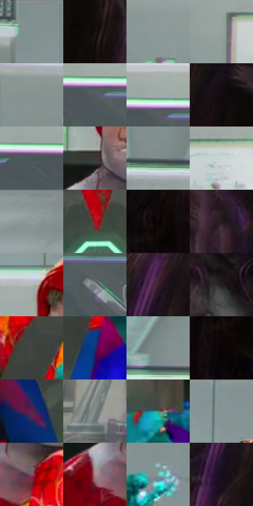

# 电影参考 353

- 状态：条件／活跃；来源世界：miles-home。
- 视角：near-level；景别：medium；场景：portrait。
- 时段：event-time-unknown（外观依据，中置信度；具体时间／晨昏未知）；光照：event-light。
- 材质候选：skin, hair, fabric, glass, metal（帧级，不是像素分割）。
- 明暗组：middle；L* P5/P50/P95：2.90053 / 46.66316 / 76.10683。
- 资格门禁：glitch。
- 原截图 SHA-256：`66cb53eb7d5358c5d8cec25166cbda922d3f91d5ad99bdd6080a7c535770e5a6`；尺寸：2880 × 1208。
- sRGB 像素 SHA-256：`e4c06f39045cd98aff16f5392036cbab6c394d9f985a442986f9b9edd2ce3a3c`。

## 观察与迁移

人体彩块碎裂与正常实验室分开，脸部稳定性不可照搬异常。

353  /  人物故障／局部拉伸  /  眼口与下颌异常拉伸、身体彩片；只学异常区域的形状差异，不学成长脸标准

本公开版保存32个128×128原像素色卡上下文；图集格子并非原场景相邻位置。原rect、图集tile和像素SHA见 `data/palette-crops.json`。上下文不足时不得批准替色，不能以小样推断完整构图。

## 实测色卡

颜色比例分母为保留采样像素，不是材料面积；全部 32 色参与全库匹配。表内四舍五入仅用于阅读，原精度在 JSON。

| ID | HEX | Lab | 原图 xy | 像素数 | 比例 | 明度角色 |
| --- | --- | --- | --- | ---: | ---: | --- |
| 353-S01 | #82908F | [58.672412, -5.240215, -1.188344] | [508, 60] | 10077 | 5.211900% | midtone |
| 353-S02 | #191313 | [6.498806, 2.764403, 0.974869] | [2652, 168] | 9783 | 5.059841% | deep-shadow |
| 353-S03 | #8C9A99 | [62.495933, -5.181715, -1.178687] | [308, 456] | 9098 | 4.705554% | light |
| 353-S04 | #96A19F | [65.339148, -4.29723, -0.302276] | [728, 292] | 8984 | 4.646592% | light |
| 353-S05 | #869290 | [59.561547, -4.727536, -0.422426] | [56, 120] | 8776 | 4.539013% | midtone |
| 353-S06 | #565A60 | [38.083959, -0.230606, -3.989685] | [1716, 284] | 8430 | 4.360059% | shadow |
| 353-S07 | #A3A9A6 | [68.68999, -2.699797, 0.809182] | [1716, 240] | 8256 | 4.270065% | light |
| 353-S08 | #130C0E | [3.912293, 2.770252, -0.03018] | [2576, 92] | 8239 | 4.261273% | deep-shadow |
| 353-S09 | #4A5658 | [35.627229, -4.208473, -2.744912] | [1624, 276] | 7857 | 4.063699% | shadow |
| 353-S10 | #3A3735 | [23.30102, 0.869553, 1.720041] | [1008, 388] | 7714 | 3.989739% | shadow |
| 353-S11 | #6D7779 | [49.283274, -3.296922, -2.37463] | [44, 316] | 7480 | 3.868712% | midtone |
| 353-S12 | #C8D6D4 | [84.548278, -5.085137, -0.634846] | [860, 292] | 7077 | 3.660277% | highlight |
| 353-S13 | #899494 | [60.458998, -3.951972, -1.358035] | [1980, 28] | 6602 | 3.414604% | light |
| 353-S14 | #A4171B | [35.176654, 54.425401, 36.714551] | [964, 868] | 6549 | 3.387192% | shadow |
| 353-S15 | #0D0708 | [2.304004, 1.775864, 0.198579] | [2744, 476] | 6500 | 3.361849% | deep-shadow |
| 353-S16 | #24151D | [8.992811, 9.261044, -2.514455] | [2772, 32] | 5895 | 3.048938% | deep-shadow |
| 353-S17 | #B4BBB6 | [75.215027, -3.372122, 1.686105] | [988, 188] | 5796 | 2.997735% | light |
| 353-S18 | #797F81 | [52.761284, -1.812547, -1.853805] | [1848, 336] | 5764 | 2.981184% | midtone |
| 353-S19 | #3B1F2C | [15.961844, 15.698454, -2.788729] | [2432, 152] | 5650 | 2.922222% | deep-shadow |
| 353-S20 | #242222 | [13.439535, 0.93476, 0.335374] | [2324, 1072] | 5450 | 2.818781% | deep-shadow |
| 353-S21 | #404541 | [28.715198, -2.969713, 1.707319] | [1100, 644] | 5364 | 2.774301% | shadow |
| 353-S22 | #133672 | [23.641873, 11.653423, -38.154214] | [1124, 784] | 5339 | 2.761371% | shadow |
| 353-S23 | #7B8A88 | [56.252729, -5.843555, -0.776784] | [220, 284] | 5235 | 2.707581% | midtone |
| 353-S24 | #080304 | [1.133851, 1.446488, 0.082368] | [2720, 556] | 4405 | 2.278299% | deep-shadow |
| 353-S25 | #662044 | [24.563244, 35.136337, -5.839035] | [836, 864] | 4337 | 2.243129% | shadow |
| 353-S26 | #828B8B | [57.148322, -3.277425, -1.129107] | [2064, 560] | 3995 | 2.066244% | midtone |
| 353-S27 | #467C78 | [48.351265, -18.956957, -3.432115] | [1112, 1024] | 3325 | 1.719715% | midtone |
| 353-S28 | #819593 | [60.130141, -7.508495, -1.340166] | [1032, 40] | 3180 | 1.644720% | light |
| 353-S29 | #865468 | [41.859478, 23.779833, -2.77698] | [1064, 500] | 3133 | 1.620411% | midtone |
| 353-S30 | #B08284 | [58.847106, 18.012435, 5.887393] | [960, 504] | 2033 | 1.051483% | midtone |
| 353-S31 | #64BDA9 | [70.847975, -31.616027, 1.86026] | [1568, 896] | 1911 | 0.988384% | light |
| 353-S32 | #170D1F | [5.139166, 8.347219, -10.031589] | [2404, 268] | 1112 | 0.575135% | deep-shadow |

## 色阶与空间分布

- 采样 ROI：`[0.01, 0.02, 0.98, 0.94]`；步长：4；样本数：193346。
- 排除区：`[]`。
- 深暗、暗、中、亮、高光五段计数：`[50768, 38351, 52965, 44708, 6554]`。
- RGB 各 256 箱、L* 100 箱、13×5 色相明度表和 3×3 空间统计全部保存在 [总数据](../film-library.json)。
- [可视化档案](../../references/library.html)按需绘制直方图，不存 2,094 张重复图表图片。

## 纹理特征占比

**这是分块图像特征的面积占比，不是波点／排线／丝网／错版的精确语义覆盖率。** 窗格、发丝、织物也会产生方向或周期特征。
原图 ROI 像素 3104134；已测块覆盖 3104134（100.0000%）；未测 0。

| 特征 | 块覆盖像素 | 占已测面积 | 阈值敏感范围 |
| --- | ---: | ---: | --- |
| low-contrast | 91142 | 2.9361% | 1.0556% ~ 5.8309% |
| directional-structure | 1131392 | 36.4479% | 22.8856% ~ 50.6287% |
| periodic-structure | 1799680 | 57.9769% | 47.7878% ~ 65.6467% |
| mixed-detail | 81920 | 2.6391% | 0.5278% ~ 5.6369% |

阈值敏感范围不是统计置信区间。逐块坐标、尺度、对比、方向一致性、频谱集中度、频率与角度见 [全量特征记录](../texture-features.jsonl)，以帧号定位。
四种印刷层的真实像素覆盖仍标为 `null`，不能填 0，也不能拿上表代替。不得据这些代理测量删除唯一证据。

[测量方法与保留策略](../../references/library-retention.md) · [分类索引](../archive/README.md)
