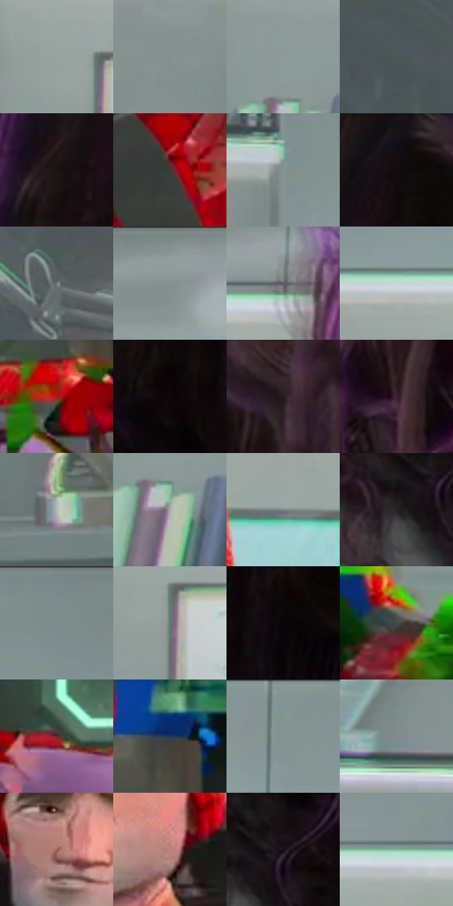

# 电影参考 354

- 状态：条件／活跃；来源世界：miles-home。
- 视角：near-level；景别：medium；场景：portrait。
- 时段：event-time-unknown（外观依据，中置信度；具体时间／晨昏未知）；光照：event-light。
- 材质候选：skin, hair, fabric, glass, metal（帧级，不是像素分割）。
- 明暗组：middle；L* P5/P50/P95：2.92649 / 48.27023 / 75.85109。
- 资格门禁：glitch。
- 原截图 SHA-256：`cab52f8f99ba44d2388ac4e66d2a12d421286fdf16c146ae6477ab1739f9851f`；尺寸：2880 × 1208。
- sRGB 像素 SHA-256：`dfab987c5542fa655ed97fdd579cf0c29e132a89ce8242fb57846b13cd57ef23`。

## 观察与迁移

人体彩块碎裂与正常实验室分开，脸部稳定性不可照搬异常。

354  /  人物故障／压扁错位  /  头部宽窄与眼位异常、明亮切片并存；不是正常表情夸张模板

本公开版保存32个128×128原像素色卡上下文；图集格子并非原场景相邻位置。原rect、图集tile和像素SHA见 `data/palette-crops.json`。上下文不足时不得批准替色，不能以小样推断完整构图。

## 实测色卡

颜色比例分母为保留采样像素，不是材料面积；全部 32 色参与全库匹配。表内四舍五入仅用于阅读，原精度在 JSON。

| ID | HEX | Lab | 原图 xy | 像素数 | 比例 | 明度角色 |
| --- | --- | --- | --- | ---: | ---: | --- |
| 354-S01 | #98A3A1 | [66.091855, -4.287881, -0.30208] | [696, 260] | 10632 | 5.498950% | light |
| 354-S02 | #82908F | [58.672412, -5.240215, -1.188344] | [340, 160] | 10174 | 5.262069% | midtone |
| 354-S03 | #8C9A99 | [62.495933, -5.181715, -1.178687] | [324, 464] | 10140 | 5.244484% | light |
| 354-S04 | #4A5858 | [36.251823, -5.42148, -1.824765] | [1608, 364] | 9252 | 4.785204% | shadow |
| 354-S05 | #1A1413 | [6.927945, 2.650909, 1.615534] | [2436, 308] | 8622 | 4.459363% | deep-shadow |
| 354-S06 | #3E3A38 | [24.751948, 1.301324, 1.863319] | [848, 616] | 8583 | 4.439192% | shadow |
| 354-S07 | #869290 | [59.561547, -4.727536, -0.422426] | [480, 84] | 8477 | 4.384368% | midtone |
| 354-S08 | #130C0E | [3.912293, 2.770252, -0.03018] | [2576, 100] | 8395 | 4.341957% | deep-shadow |
| 354-S09 | #717A7B | [50.52256, -3.136347, -1.697161] | [1940, 372] | 7257 | 3.753375% | midtone |
| 354-S10 | #899495 | [60.487285, -3.745576, -1.884777] | [1708, 28] | 7187 | 3.717170% | light |
| 354-S11 | #5B5C64 | [39.238928, 1.364949, -4.704116] | [2144, 152] | 6925 | 3.581662% | shadow |
| 354-S12 | #C8D7D6 | [84.860847, -5.222668, -1.238333] | [712, 168] | 6872 | 3.554250% | highlight |
| 354-S13 | #AB1B1E | [37.000775, 55.578251, 37.309069] | [1100, 1068] | 6848 | 3.541837% | shadow |
| 354-S14 | #0D0708 | [2.304004, 1.775864, 0.198579] | [2616, 604] | 6341 | 3.279613% | deep-shadow |
| 354-S15 | #26171E | [9.943244, 8.965765, -1.824943] | [2716, 88] | 5989 | 3.097556% | deep-shadow |
| 354-S16 | #3D2231 | [17.264222, 15.522303, -4.363888] | [2356, 608] | 5959 | 3.082039% | deep-shadow |
| 354-S17 | #B2BBB7 | [75.091718, -3.878153, 0.944624] | [216, 976] | 5850 | 3.025664% | light |
| 354-S18 | #AEAAA8 | [69.877449, 1.055463, 1.537293] | [340, 544] | 5589 | 2.890673% | light |
| 354-S19 | #7C8182 | [53.596957, -1.649945, -1.182972] | [1156, 300] | 5382 | 2.783611% | midtone |
| 354-S20 | #272223 | [13.807946, 2.585199, 0.190964] | [2316, 1072] | 5302 | 2.742234% | deep-shadow |
| 354-S21 | #7C8C89 | [56.926044, -6.394233, -0.358519] | [1412, 60] | 4798 | 2.481562% | midtone |
| 354-S22 | #63796E | [48.825597, -10.446662, 3.367402] | [740, 300] | 4618 | 2.388464% | midtone |
| 354-S23 | #080305 | [1.153638, 1.585532, -0.296056] | [2716, 572] | 4317 | 2.232785% | deep-shadow |
| 354-S24 | #474C47 | [31.723377, -3.139816, 2.273559] | [1356, 960] | 4250 | 2.198132% | shadow |
| 354-S25 | #6D2730 | [26.495715, 31.917305, 10.623244] | [912, 1036] | 4162 | 2.152618% | shadow |
| 354-S26 | #233759 | [23.035236, 3.635042, -22.874549] | [1128, 932] | 3767 | 1.948321% | shadow |
| 354-S27 | #839592 | [60.243956, -7.026714, -0.588554] | [1032, 44] | 3745 | 1.936942% | light |
| 354-S28 | #838A8C | [56.973445, -2.148405, -1.951406] | [224, 304] | 3700 | 1.913668% | midtone |
| 354-S29 | #966058 | [46.386165, 20.978456, 13.694684] | [904, 384] | 3306 | 1.709888% | midtone |
| 354-S30 | #B8827C | [59.537241, 20.013743, 11.5762] | [1036, 428] | 2848 | 1.473007% | midtone |
| 354-S31 | #170D1A | [4.91933, 6.802407, -6.449758] | [2368, 1032] | 2522 | 1.304397% | deep-shadow |
| 354-S32 | #81B79C | [70.128979, -23.463937, 8.109251] | [1252, 160] | 1537 | 0.794948% | light |

## 色阶与空间分布

- 采样 ROI：`[0.01, 0.02, 0.98, 0.94]`；步长：4；样本数：193346。
- 排除区：`[]`。
- 深暗、暗、中、亮、高光五段计数：`[48340, 37590, 55121, 46021, 6274]`。
- RGB 各 256 箱、L* 100 箱、13×5 色相明度表和 3×3 空间统计全部保存在 [总数据](../film-library.json)。
- [可视化档案](../../references/library.html)按需绘制直方图，不存 2,094 张重复图表图片。

## 纹理特征占比

**这是分块图像特征的面积占比，不是波点／排线／丝网／错版的精确语义覆盖率。** 窗格、发丝、织物也会产生方向或周期特征。
原图 ROI 像素 3104134；已测块覆盖 3104134（100.0000%）；未测 0。

| 特征 | 块覆盖像素 | 占已测面积 | 阈值敏感范围 |
| --- | ---: | ---: | --- |
| low-contrast | 107526 | 3.4640% | 0.5278% ~ 5.8309% |
| directional-structure | 1175296 | 37.8623% | 26.4896% ~ 50.7978% |
| periodic-structure | 1744640 | 56.2038% | 48.6744% ~ 59.9314% |
| mixed-detail | 76672 | 2.4700% | 0.0000% ~ 7.7481% |

阈值敏感范围不是统计置信区间。逐块坐标、尺度、对比、方向一致性、频谱集中度、频率与角度见 [全量特征记录](../texture-features.jsonl)，以帧号定位。
四种印刷层的真实像素覆盖仍标为 `null`，不能填 0，也不能拿上表代替。不得据这些代理测量删除唯一证据。

[测量方法与保留策略](../../references/library-retention.md) · [分类索引](../archive/README.md)
