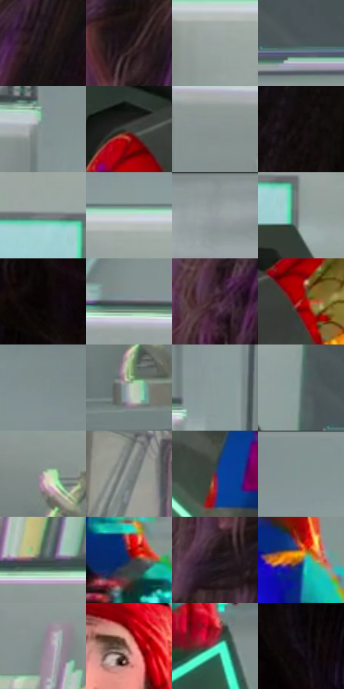

# 电影参考 355

- 状态：条件／活跃；来源世界：miles-home。
- 视角：near-level；景别：medium；场景：portrait。
- 时段：event-time-unknown（外观依据，中置信度；具体时间／晨昏未知）；光照：event-light。
- 材质候选：skin, hair, fabric, glass, metal（帧级，不是像素分割）。
- 明暗组：middle；L* P5/P50/P95：2.86045 / 48.94897 / 76.45113。
- 资格门禁：glitch。
- 原截图 SHA-256：`5edcd4ae557aa79513f2760926aca0137f2243bd2f445f8e7d14c91119a05744`；尺寸：2880 × 1204。
- sRGB 像素 SHA-256：`dfc460a653b309aa96fe083474174bc90238fe5f6641ab84b9aa232afeee1356`。

## 观察与迁移

人体彩块碎裂与正常实验室分开，脸部稳定性不可照搬异常。

355  /  人物故障／正常头部对照  /  头部较完整而颈身彩块明显，碎片大小和方向不同；异常不必均匀铺满全身

本公开版保存32个128×128原像素色卡上下文；图集格子并非原场景相邻位置。原rect、图集tile和像素SHA见 `data/palette-crops.json`。上下文不足时不得批准替色，不能以小样推断完整构图。

## 实测色卡

颜色比例分母为保留采样像素，不是材料面积；全部 32 色参与全库匹配。表内四舍五入仅用于阅读，原精度在 JSON。

| ID | HEX | Lab | 原图 xy | 像素数 | 比例 | 明度角色 |
| --- | --- | --- | --- | ---: | ---: | --- |
| 355-S01 | #171112 | [5.661366, 2.755317, 0.347113] | [2484, 104] | 10170 | 5.279058% | deep-shadow |
| 355-S02 | #251C1E | [11.398052, 4.83429, 0.295845] | [2332, 144] | 10168 | 5.278020% | deep-shadow |
| 355-S03 | #99A4A2 | [66.467564, -4.283251, -0.30198] | [668, 224] | 9981 | 5.180952% | light |
| 355-S04 | #4B575D | [36.180589, -3.222222, -5.044821] | [1484, 520] | 9012 | 4.677962% | shadow |
| 355-S05 | #839190 | [59.056915, -5.23419, -1.187364] | [484, 84] | 8842 | 4.589718% | midtone |
| 355-S06 | #3D3F39 | [26.281332, -2.168488, 3.391107] | [720, 572] | 8466 | 4.394543% | shadow |
| 355-S07 | #869290 | [59.561547, -4.727536, -0.422426] | [56, 120] | 8465 | 4.394024% | midtone |
| 355-S08 | #10090B | [2.978251, 2.392044, -0.022546] | [2556, 424] | 8460 | 4.391429% | deep-shadow |
| 355-S09 | #747A7D | [50.818643, -1.611887, -2.411146] | [1168, 304] | 7384 | 3.832897% | midtone |
| 355-S10 | #C7D6D5 | [84.503647, -5.226954, -1.239161] | [708, 168] | 7072 | 3.670944% | highlight |
| 355-S11 | #8A9495 | [60.562749, -3.392539, -1.765236] | [1880, 28] | 6992 | 3.629417% | light |
| 355-S12 | #909C9A | [63.375078, -4.67353, -0.420759] | [1240, 360] | 6669 | 3.461754% | light |
| 355-S13 | #0A0405 | [1.466333, 1.70797, 0.17454] | [2772, 524] | 6646 | 3.449815% | deep-shadow |
| 355-S14 | #5E5D67 | [39.894648, 2.57408, -5.549638] | [244, 324] | 6639 | 3.446182% | shadow |
| 355-S15 | #3F222F | [17.489226, 16.000658, -2.585048] | [2252, 492] | 6633 | 3.443067% | deep-shadow |
| 355-S16 | #AA241A | [37.635479, 52.701155, 39.978807] | [852, 588] | 6514 | 3.381296% | shadow |
| 355-S17 | #7E8D8C | [57.442291, -5.611673, -1.307896] | [1404, 76] | 5965 | 3.096321% | midtone |
| 355-S18 | #B4BBB6 | [75.215027, -3.372122, 1.686105] | [216, 968] | 5770 | 2.995100% | light |
| 355-S19 | #8A9998 | [62.042528, -5.536506, -1.295437] | [524, 312] | 5132 | 2.663926% | light |
| 355-S20 | #617773 | [48.22527, -8.932601, -0.478573] | [1384, 468] | 5067 | 2.630186% | midtone |
| 355-S21 | #B2A6A2 | [69.001566, 3.618397, 3.6279] | [212, 772] | 4924 | 2.555957% | light |
| 355-S22 | #7C8383 | [54.192343, -2.582779, -0.892273] | [2084, 500] | 4706 | 2.442797% | midtone |
| 355-S23 | #602B49 | [25.85085, 28.092099, -7.368163] | [1064, 880] | 4670 | 2.424110% | shadow |
| 355-S24 | #839593 | [60.271914, -6.816469, -1.115763] | [656, 44] | 4631 | 2.403866% | light |
| 355-S25 | #484F51 | [33.057103, -2.337654, -2.137935] | [224, 668] | 4522 | 2.347286% | shadow |
| 355-S26 | #252B57 | [19.26183, 11.88646, -27.534549] | [1328, 944] | 3860 | 2.003654% | deep-shadow |
| 355-S27 | #1E131B | [7.415377, 7.380418, -3.435432] | [2280, 268] | 3670 | 1.905029% | deep-shadow |
| 355-S28 | #9E6A3F | [49.420515, 16.166247, 32.285564] | [1268, 816] | 3268 | 1.696358% | midtone |
| 355-S29 | #87858F | [55.996623, 2.756658, -5.084524] | [160, 468] | 2846 | 1.477306% | midtone |
| 355-S30 | #BD8378 | [60.257001, 20.92057, 14.948534] | [1000, 296] | 2148 | 1.114987% | light |
| 355-S31 | #77C0AA | [72.575663, -27.867872, 3.922026] | [1480, 1096] | 1715 | 0.890225% | light |
| 355-S32 | #150B18 | [4.197897, 6.22856, -5.954725] | [2708, 664] | 1641 | 0.851813% | deep-shadow |

## 色阶与空间分布

- 采样 ROI：`[0.01, 0.02, 0.98, 0.94]`；步长：4；样本数：192648。
- 排除区：`[]`。
- 深暗、暗、中、亮、高光五段计数：`[48975, 35634, 54960, 46481, 6598]`。
- RGB 各 256 箱、L* 100 箱、13×5 色相明度表和 3×3 空间统计全部保存在 [总数据](../film-library.json)。
- [可视化档案](../../references/library.html)按需绘制直方图，不存 2,094 张重复图表图片。

## 纹理特征占比

**这是分块图像特征的面积占比，不是波点／排线／丝网／错版的精确语义覆盖率。** 窗格、发丝、织物也会产生方向或周期特征。
原图 ROI 像素 3092958；已测块覆盖 3092958（100.0000%）；未测 0。

| 特征 | 块覆盖像素 | 占已测面积 | 阈值敏感范围 |
| --- | ---: | ---: | --- |
| low-contrast | 107102 | 3.4628% | 1.0594% ~ 5.9293% |
| directional-structure | 1123072 | 36.3106% | 25.2403% ~ 49.0901% |
| periodic-structure | 1721088 | 55.6454% | 47.9178% ~ 56.7627% |
| mixed-detail | 141696 | 4.5812% | 1.9326% ~ 12.0677% |

阈值敏感范围不是统计置信区间。逐块坐标、尺度、对比、方向一致性、频谱集中度、频率与角度见 [全量特征记录](../texture-features.jsonl)，以帧号定位。
四种印刷层的真实像素覆盖仍标为 `null`，不能填 0，也不能拿上表代替。不得据这些代理测量删除唯一证据。

[测量方法与保留策略](../../references/library-retention.md) · [分类索引](../archive/README.md)
