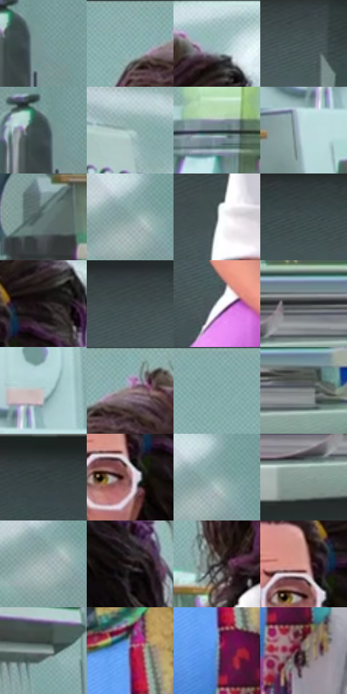

# 电影参考 356

- 状态：常规／活跃；来源世界：miles-home。
- 视角：near-level；景别：medium；场景：portrait。
- 时段：interior-time-unknown（外观依据，中置信度；具体时间／晨昏未知）；光照：cool-interior。
- 材质候选：skin, hair, fabric, glass, metal, paint（帧级，不是像素分割）。
- 明暗组：middle；L* P5/P50/P95：16.21924 / 59.99505 / 84.79981。
- 资格门禁：无附加门禁。
- 原截图 SHA-256：`5e7f861ec0d42c673e266195026a58d26c5931a54633653dd60273edd2bae82f`；尺寸：2880 × 1202。
- sRGB 像素 SHA-256：`1a456e96b13ff0c3b572efeb16bcce3b4dd1443cb1244e216e8bcc754eb962ed`。

## 观察与迁移

近景表情与轻接触，不凭背景星形制造撞击爆点。

336、356研究员正面  /  偏长的颅面、收束下颌、明确眉形与眼睑；鼻体由侧面色阶和小暗面组织。卷发先大轮廓与卷曲群，唇保留体积而非一条黑线  /  学体块分工，不把每个人拉成长脸或移植巨大卷发；原照眉形、眼距、鼻唇与脸宽仍是身份锚点

356  /  稳定面部／织物  /  正面研究员、白衣、彩色拼布围巾与卷发清楚；围巾色块是织物图案不是故障片

本公开版保存32个128×128原像素色卡上下文；图集格子并非原场景相邻位置。原rect、图集tile和像素SHA见 `data/palette-crops.json`。上下文不足时不得批准替色，不能以小样推断完整构图。

## 实测色卡

颜色比例分母为保留采样像素，不是材料面积；全部 32 色参与全库匹配。表内四舍五入仅用于阅读，原精度在 JSON。

| ID | HEX | Lab | 原图 xy | 像素数 | 比例 | 明度角色 |
| --- | --- | --- | --- | ---: | ---: | --- |
| 356-S01 | #789998 | [60.818343, -11.600625, -3.235703] | [2700, 268] | 10513 | 5.457103% | light |
| 356-S02 | #8EB2B1 | [70.010733, -12.323951, -3.503804] | [1304, 32] | 10466 | 5.432706% | light |
| 356-S03 | #96B9B8 | [72.655131, -11.94216, -3.395471] | [1664, 48] | 9893 | 5.135273% | light |
| 356-S04 | #455455 | [34.521702, -5.583337, -2.5349] | [508, 880] | 8408 | 4.364437% | shadow |
| 356-S05 | #3B484A | [29.560299, -4.681374, -2.933234] | [2668, 252] | 7696 | 3.994851% | shadow |
| 356-S06 | #A4C2C0 | [76.241233, -10.471446, -2.374246] | [400, 68] | 7627 | 3.959034% | light |
| 356-S07 | #495C62 | [37.756627, -5.69716, -5.824646] | [1908, 564] | 7582 | 3.935675% | shadow |
| 356-S08 | #BCDADB | [84.969486, -9.675928, -3.823083] | [628, 532] | 7429 | 3.856256% | highlight |
| 356-S09 | #657777 | [48.625716, -6.613708, -2.227331] | [140, 588] | 7414 | 3.848470% | midtone |
| 356-S10 | #87A1A0 | [64.304702, -9.226334, -2.503143] | [2524, 96] | 7033 | 3.650700% | light |
| 356-S11 | #575E5F | [39.33983, -2.505692, -1.509808] | [1216, 916] | 6970 | 3.617998% | shadow |
| 356-S12 | #3E4E4F | [31.891491, -6.004827, -2.67291] | [72, 876] | 6545 | 3.397388% | shadow |
| 356-S13 | #2A2325 | [14.556952, 3.743101, -0.112248] | [1680, 196] | 6379 | 3.311220% | deep-shadow |
| 356-S14 | #425052 | [32.929035, -4.99579, -3.015508] | [376, 864] | 6197 | 3.216748% | shadow |
| 356-S15 | #DDE7E8 | [90.939202, -3.142538, -1.636704] | [1280, 1116] | 5883 | 3.053756% | highlight |
| 356-S16 | #2B2F30 | [19.055841, -1.496363, -1.241008] | [736, 672] | 5882 | 3.053237% | deep-shadow |
| 356-S17 | #BEC8CB | [79.935429, -2.837664, -2.674084] | [684, 444] | 5762 | 2.990947% | light |
| 356-S18 | #84AEAE | [68.19145, -14.015192, -4.598313] | [1372, 28] | 5753 | 2.986275% | light |
| 356-S19 | #80A7A5 | [65.703531, -13.602321, -3.292757] | [948, 28] | 5333 | 2.768261% | light |
| 356-S20 | #878B8A | [57.512243, -1.667382, 0.024126] | [908, 692] | 5176 | 2.686765% | midtone |
| 356-S21 | #323D3F | [24.872351, -3.997792, -2.743365] | [2680, 848] | 4897 | 2.541942% | shadow |
| 356-S22 | #97696F | [49.290846, 19.318787, 4.065035] | [1612, 280] | 4843 | 2.513911% | midtone |
| 356-S23 | #8DACA9 | [68.043715, -11.205329, -1.982795] | [2544, 88] | 4787 | 2.484843% | light |
| 356-S24 | #879B94 | [62.280059, -8.500363, 1.283912] | [648, 752] | 4708 | 2.443835% | light |
| 356-S25 | #A1B2B2 | [71.304198, -5.874733, -2.006593] | [2516, 120] | 4492 | 2.331714% | light |
| 356-S26 | #191011 | [5.58015, 4.104991, 0.850165] | [1724, 328] | 4389 | 2.278248% | deep-shadow |
| 356-S27 | #3E3A3B | [24.846439, 1.945806, 0.002997] | [1244, 516] | 4369 | 2.267867% | shadow |
| 356-S28 | #D89F95 | [70.571832, 19.813863, 13.550669] | [1596, 232] | 4286 | 2.224783% | light |
| 356-S29 | #9AA9A8 | [68.074093, -5.444715, -1.279534] | [444, 348] | 3923 | 2.036356% | light |
| 356-S30 | #6A2B58 | [28.106574, 34.085898, -13.704497] | [1572, 672] | 3721 | 1.931502% | shadow |
| 356-S31 | #6D94B5 | [59.676455, -4.837147, -21.455702] | [1572, 772] | 2381 | 1.235933% | midtone |
| 356-S32 | #56484A | [32.05099, 6.298504, 1.010823] | [1628, 864] | 1911 | 0.991965% | shadow |

## 色阶与空间分布

- 采样 ROI：`[0.01, 0.02, 0.98, 0.94]`；步长：4；样本数：192648。
- 排除区：`[]`。
- 深暗、暗、中、亮、高光五段计数：`[15041, 57256, 24047, 78993, 17311]`。
- RGB 各 256 箱、L* 100 箱、13×5 色相明度表和 3×3 空间统计全部保存在 [总数据](../film-library.json)。
- [可视化档案](../../references/library.html)按需绘制直方图，不存 2,094 张重复图表图片。

## 纹理特征占比

**这是分块图像特征的面积占比，不是波点／排线／丝网／错版的精确语义覆盖率。** 窗格、发丝、织物也会产生方向或周期特征。
原图 ROI 像素 3087370；已测块覆盖 3087370（100.0000%）；未测 0。

| 特征 | 块覆盖像素 | 占已测面积 | 阈值敏感范围 |
| --- | ---: | ---: | --- |
| low-contrast | 191370 | 6.1985% | 1.8162% ~ 8.5658% |
| directional-structure | 685312 | 22.1973% | 9.9917% ~ 36.7619% |
| periodic-structure | 2164352 | 70.1034% | 60.8912% ~ 76.4218% |
| mixed-detail | 46336 | 1.5008% | 0.5307% ~ 5.0207% |

阈值敏感范围不是统计置信区间。逐块坐标、尺度、对比、方向一致性、频谱集中度、频率与角度见 [全量特征记录](../texture-features.jsonl)，以帧号定位。
四种印刷层的真实像素覆盖仍标为 `null`，不能填 0，也不能拿上表代替。不得据这些代理测量删除唯一证据。

[测量方法与保留策略](../../references/library-retention.md) · [分类索引](../archive/README.md)
