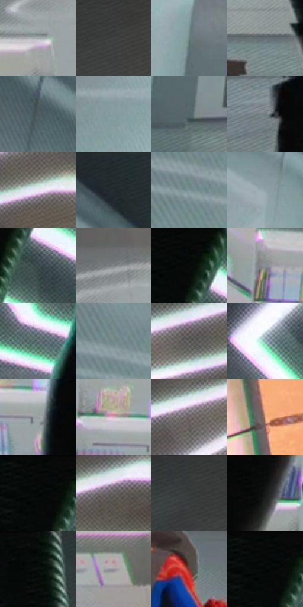

# 电影参考 357

- 状态：常规／活跃；来源世界：miles-home。
- 视角：low-angle；景别：environment-wide；场景：interior。
- 时段：interior-time-unknown（外观依据，中置信度；具体时间／晨昏未知）；光照：cool-interior。
- 材质候选：skin, hair, fabric, glass, metal, plastic（帧级，不是像素分割）。
- 明暗组：middle；L* P5/P50/P95：2.37073 / 49.06282 / 80.8198。
- 资格门禁：无附加门禁。
- 原截图 SHA-256：`41083bf03cfef4742fa04b806c7bd95b6dbbcf66db5de2e4ff56fa051d65ac21`；尺寸：2880 × 1204。
- sRGB 像素 SHA-256：`fb289cb8fc4e1476234c7c7f6ef5f4118eca3bd0eac65168c39ebeaa5dd74758`。

## 观察与迁移

软管透亮、硬壳暗面和金属接头不同光泽，结构肋不叫排线。

357  /  低机位空间／材质  /  前景黑靴与腿构成框景，远处椅子和顶灯仍按透视；大前景遮挡不授权换构图

本公开版保存32个128×128原像素色卡上下文；图集格子并非原场景相邻位置。原rect、图集tile和像素SHA见 `data/palette-crops.json`。上下文不足时不得批准替色，不能以小样推断完整构图。

## 实测色卡

颜色比例分母为保留采样像素，不是材料面积；全部 32 色参与全库匹配。表内四舍五入仅用于阅读，原精度在 JSON。

| ID | HEX | Lab | 原图 xy | 像素数 | 比例 | 明度角色 |
| --- | --- | --- | --- | ---: | ---: | --- |
| 357-S01 | #A4A9AF | [69.013625, -0.588933, -3.69328] | [2036, 600] | 10998 | 5.708858% | light |
| 357-S02 | #3D4140 | [27.137843, -1.898067, 0.033707] | [2112, 88] | 9623 | 4.995121% | shadow |
| 357-S03 | #677C7B | [50.368005, -7.850944, -2.01002] | [588, 604] | 7770 | 4.033263% | midtone |
| 357-S04 | #646F72 | [46.032725, -3.473229, -3.077568] | [1704, 912] | 7494 | 3.889996% | midtone |
| 357-S05 | #4B595E | [36.833886, -4.191609, -4.697468] | [264, 88] | 7317 | 3.798119% | shadow |
| 357-S06 | #849D9F | [62.94575, -8.271082, -3.965008] | [304, 440] | 7102 | 3.686516% | light |
| 357-S07 | #556667 | [41.865131, -6.163019, -2.710827] | [620, 908] | 7094 | 3.682364% | midtone |
| 357-S08 | #747E81 | [52.084387, -3.051976, -2.894307] | [924, 980] | 7027 | 3.647585% | midtone |
| 357-S09 | #EBE7F0 | [92.178513, 2.951242, -3.876003] | [2688, 200] | 7008 | 3.637723% | highlight |
| 357-S10 | #262D30 | [17.928473, -2.231421, -2.956843] | [464, 48] | 6795 | 3.527158% | deep-shadow |
| 357-S11 | #7D9396 | [59.369111, -7.115879, -4.198961] | [84, 368] | 6764 | 3.511067% | midtone |
| 357-S12 | #91A3A7 | [65.751387, -5.45999, -4.21171] | [528, 308] | 6693 | 3.474212% | light |
| 357-S13 | #3D4B4F | [30.851318, -4.517311, -4.221777] | [1344, 152] | 6326 | 3.283709% | shadow |
| 357-S14 | #808285 | [54.28897, -0.136854, -1.874572] | [2084, 480] | 6323 | 3.282152% | midtone |
| 357-S15 | #070909 | [2.350944, -0.523155, -0.18398] | [1296, 36] | 6199 | 3.217786% | deep-shadow |
| 357-S16 | #868F90 | [58.720406, -3.055889, -1.654194] | [872, 484] | 6197 | 3.216748% | midtone |
| 357-S17 | #5A6D70 | [44.632405, -6.342345, -4.029007] | [1028, 348] | 6168 | 3.201694% | midtone |
| 357-S18 | #768C8C | [56.585553, -7.833541, -2.63215] | [88, 316] | 6067 | 3.149267% | midtone |
| 357-S19 | #4F4D4C | [32.901382, 0.607616, 0.884867] | [2588, 180] | 5926 | 3.076077% | shadow |
| 357-S20 | #94B4B2 | [70.97536, -11.240592, -2.591557] | [760, 208] | 5739 | 2.979008% | light |
| 357-S21 | #959E9E | [64.412431, -3.206314, -1.106536] | [972, 700] | 5600 | 2.906856% | light |
| 357-S22 | #D2BCC3 | [78.233237, 8.983716, -0.67001] | [904, 652] | 5529 | 2.870001% | light |
| 357-S23 | #776D6C | [46.898512, 3.707268, 1.970822] | [2448, 204] | 5479 | 2.844047% | midtone |
| 357-S24 | #DDA581 | [72.141752, 16.131964, 26.718336] | [2680, 584] | 5459 | 2.833666% | light |
| 357-S25 | #050807 | [1.998675, -0.923681, 0.102272] | [1264, 28] | 5296 | 2.749055% | deep-shadow |
| 357-S26 | #625D5C | [39.912265, 1.792, 1.288571] | [2820, 100] | 5272 | 2.736597% | shadow |
| 357-S27 | #353737 | [22.879079, -0.859812, -0.298195] | [2016, 28] | 3972 | 2.061791% | shadow |
| 357-S28 | #171A19 | [8.91728, -1.693856, 0.209879] | [1132, 768] | 3967 | 2.059196% | deep-shadow |
| 357-S29 | #070E0D | [3.507395, -2.121135, -0.230401] | [1760, 28] | 3768 | 1.955899% | deep-shadow |
| 357-S30 | #978E96 | [60.003743, 4.849615, -3.034328] | [2392, 836] | 3504 | 1.818861% | light |
| 357-S31 | #703D37 | [31.94065, 21.600625, 13.509307] | [1552, 520] | 2150 | 1.116025% | shadow |
| 357-S32 | #040707 | [1.744288, -0.78462, -0.276185] | [1264, 40] | 2022 | 1.049583% | deep-shadow |

## 色阶与空间分布

- 采样 ROI：`[0.01, 0.02, 0.98, 0.94]`；步长：4；样本数：192648。
- 排除区：`[]`。
- 深暗、暗、中、亮、高光五段计数：`[27214, 39315, 66045, 50027, 10047]`。
- RGB 各 256 箱、L* 100 箱、13×5 色相明度表和 3×3 空间统计全部保存在 [总数据](../film-library.json)。
- [可视化档案](../../references/library.html)按需绘制直方图，不存 2,094 张重复图表图片。

## 纹理特征占比

**这是分块图像特征的面积占比，不是波点／排线／丝网／错版的精确语义覆盖率。** 窗格、发丝、织物也会产生方向或周期特征。
原图 ROI 像素 3092958；已测块覆盖 3092958（100.0000%）；未测 0。

| 特征 | 块覆盖像素 | 占已测面积 | 阈值敏感范围 |
| --- | ---: | ---: | --- |
| low-contrast | 81920 | 2.6486% | 1.0594% ~ 5.1110% |
| directional-structure | 812800 | 26.2791% | 11.0041% ~ 41.5943% |
| periodic-structure | 2144222 | 69.3259% | 57.0028% ~ 80.3921% |
| mixed-detail | 54016 | 1.7464% | 0.3435% ~ 3.4928% |

阈值敏感范围不是统计置信区间。逐块坐标、尺度、对比、方向一致性、频谱集中度、频率与角度见 [全量特征记录](../texture-features.jsonl)，以帧号定位。
四种印刷层的真实像素覆盖仍标为 `null`，不能填 0，也不能拿上表代替。不得据这些代理测量删除唯一证据。

[测量方法与保留策略](../../references/library-retention.md) · [分类索引](../archive/README.md)
