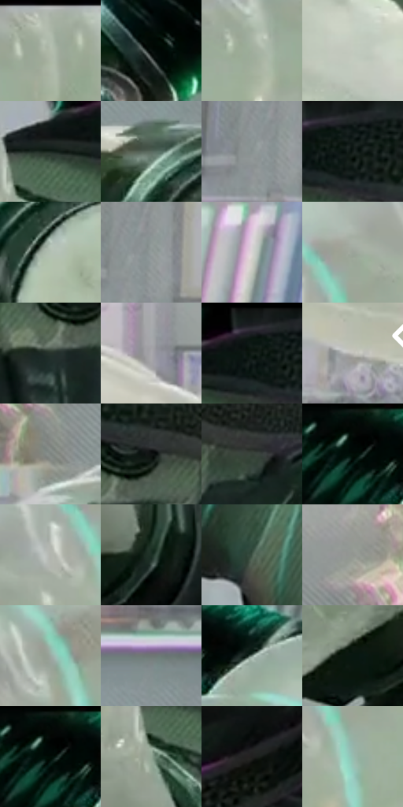

# 电影参考 358

- 状态：常规／活跃；来源世界：miles-home。
- 视角：near-level；景别：detail；场景：interior。
- 时段：interior-time-unknown（外观依据，中置信度；具体时间／晨昏未知）；光照：cool-interior。
- 材质候选：skin, hair, fabric, glass, metal, plastic（帧级，不是像素分割）。
- 明暗组：middle；L* P5/P50/P95：3.3061 / 57.82832 / 80.80641。
- 资格门禁：无附加门禁。
- 原截图 SHA-256：`c935e858b59c1461caf1370035f56e6b56d8574d4c1f7ec742b5a0f82acd4439`；尺寸：2880 × 1214。
- sRGB 像素 SHA-256：`846378fdd32bd98340d2ca6700b3c88767dfb8b5507041ded3cd3b41d09a689c`。

## 观察与迁移

软管透亮、硬壳暗面和金属接头不同光泽，结构肋不叫排线。

358  /  材质近景／装置  /  浅色半透明肋管、深色硬壳、金属环与细软线光泽各异；不推断确切聚合物或参数，管线不是速度线

本公开版保存32个128×128原像素色卡上下文；图集格子并非原场景相邻位置。原rect、图集tile和像素SHA见 `data/palette-crops.json`。上下文不足时不得批准替色，不能以小样推断完整构图。

## 实测色卡

颜色比例分母为保留采样像素，不是材料面积；全部 32 色参与全库匹配。表内四舍五入仅用于阅读，原精度在 JSON。

| ID | HEX | Lab | 原图 xy | 像素数 | 比例 | 明度角色 |
| --- | --- | --- | --- | ---: | ---: | --- |
| 358-S01 | #A9B3A5 | [71.820006, -6.126809, 5.948596] | [988, 28] | 9945 | 5.106757% | light |
| 358-S02 | #08100D | [4.076091, -2.902287, 0.607017] | [2688, 116] | 8378 | 4.302102% | deep-shadow |
| 358-S03 | #9FAD9C | [69.225337, -8.148153, 7.071826] | [876, 112] | 8259 | 4.240996% | light |
| 358-S04 | #C3CABF | [80.518485, -4.412239, 4.657565] | [2196, 216] | 7784 | 3.997083% | highlight |
| 358-S05 | #18251F | [13.328509, -7.288256, 2.197409] | [1208, 104] | 7743 | 3.976030% | deep-shadow |
| 358-S06 | #596A5F | [43.149319, -8.815626, 4.045285] | [2520, 984] | 7702 | 3.954976% | midtone |
| 358-S07 | #889291 | [59.740342, -3.810828, -0.712639] | [2456, 660] | 7408 | 3.804007% | midtone |
| 358-S08 | #141D19 | [9.779469, -5.21051, 1.426343] | [1344, 72] | 7227 | 3.711064% | deep-shadow |
| 358-S09 | #B2C0B2 | [76.300862, -7.449053, 5.409284] | [1996, 172] | 7227 | 3.711064% | light |
| 358-S10 | #939C9B | [63.628039, -3.413937, -0.586726] | [2492, 644] | 6716 | 3.448665% | light |
| 358-S11 | #D5D3D2 | [84.68324, 0.50147, 0.738978] | [508, 704] | 6675 | 3.427612% | highlight |
| 358-S12 | #9CA39A | [66.209533, -4.216753, 3.811173] | [620, 108] | 6550 | 3.363424% | light |
| 358-S13 | #27322C | [19.61562, -6.183177, 2.283776] | [1396, 224] | 6462 | 3.318236% | deep-shadow |
| 358-S14 | #A9A8AC | [69.053559, 1.115227, -1.927609] | [2784, 444] | 6380 | 3.276129% | light |
| 358-S15 | #0F1A15 | [8.079355, -6.080388, 1.84441] | [1304, 56] | 6291 | 3.230428% | deep-shadow |
| 358-S16 | #C0BFB9 | [77.263499, -0.741617, 3.147473] | [2784, 632] | 6252 | 3.210401% | light |
| 358-S17 | #7E8581 | [54.861088, -3.389546, 1.262309] | [448, 1120] | 5979 | 3.070216% | midtone |
| 358-S18 | #0F1312 | [5.518793, -1.707472, 0.051559] | [1456, 156] | 5881 | 3.019893% | deep-shadow |
| 358-S19 | #364138 | [26.303987, -6.63093, 3.99947] | [1572, 176] | 5849 | 3.003461% | shadow |
| 358-S20 | #040B07 | [2.533599, -2.397075, 0.876388] | [140, 36] | 5771 | 2.963408% | deep-shadow |
| 358-S21 | #B2B5AE | [73.264804, -2.352419, 3.196951] | [544, 176] | 5753 | 2.954165% | light |
| 358-S22 | #1B2F25 | [17.457961, -10.883877, 3.898579] | [1236, 368] | 5467 | 2.807304% | deep-shadow |
| 358-S23 | #435749 | [34.984279, -10.926521, 5.645525] | [744, 480] | 5221 | 2.680983% | shadow |
| 358-S24 | #939591 | [61.431199, -1.500078, 1.85651] | [112, 948] | 5026 | 2.580851% | light |
| 358-S25 | #9CA8A2 | [67.785208, -5.399079, 1.645749] | [216, 348] | 5022 | 2.578797% | light |
| 358-S26 | #6F7675 | [49.032642, -2.839747, -0.357896] | [2508, 808] | 4976 | 2.555176% | midtone |
| 358-S27 | #809089 | [58.359787, -7.190157, 1.766228] | [256, 80] | 4688 | 2.407288% | midtone |
| 358-S28 | #081710 | [6.339246, -6.841627, 2.359372] | [988, 1104] | 4321 | 2.218833% | deep-shadow |
| 358-S29 | #010503 | [1.098059, -1.324172, 0.388458] | [144, 48] | 3882 | 1.993407% | deep-shadow |
| 358-S30 | #91A593 | [65.776835, -10.558237, 6.982162] | [1168, 176] | 3838 | 1.970813% | light |
| 358-S31 | #20201F | [12.215087, -0.246956, 0.679713] | [1828, 592] | 3697 | 1.898409% | deep-shadow |
| 358-S32 | #96BDAF | [73.528121, -15.912736, 2.790987] | [628, 216] | 2372 | 1.218022% | light |

## 色阶与空间分布

- 采样 ROI：`[0.01, 0.02, 0.98, 0.94]`；步长：4；样本数：194742。
- 排除区：`[]`。
- 深暗、暗、中、亮、高光五段计数：`[61434, 15300, 27067, 78976, 11965]`。
- RGB 各 256 箱、L* 100 箱、13×5 色相明度表和 3×3 空间统计全部保存在 [总数据](../film-library.json)。
- [可视化档案](../../references/library.html)按需绘制直方图，不存 2,094 张重复图表图片。

## 纹理特征占比

**这是分块图像特征的面积占比，不是波点／排线／丝网／错版的精确语义覆盖率。** 窗格、发丝、织物也会产生方向或周期特征。
原图 ROI 像素 3120898；已测块覆盖 3120898（100.0000%）；未测 0。

| 特征 | 块覆盖像素 | 占已测面积 | 阈值敏感范围 |
| --- | ---: | ---: | --- |
| low-contrast | 0 | 0.0000% | 0.0000% ~ 0.0000% |
| directional-structure | 1294592 | 41.4814% | 17.0002% ~ 57.4071% |
| periodic-structure | 1793538 | 57.4687% | 42.5929% ~ 81.4248% |
| mixed-detail | 32768 | 1.0500% | 0.0000% ~ 1.5749% |

阈值敏感范围不是统计置信区间。逐块坐标、尺度、对比、方向一致性、频谱集中度、频率与角度见 [全量特征记录](../texture-features.jsonl)，以帧号定位。
四种印刷层的真实像素覆盖仍标为 `null`，不能填 0，也不能拿上表代替。不得据这些代理测量删除唯一证据。

[测量方法与保留策略](../../references/library-retention.md) · [分类索引](../archive/README.md)
