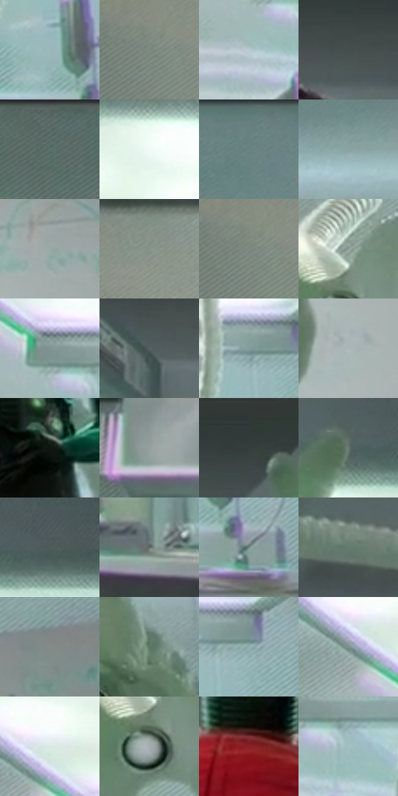

# 电影参考 359

- 状态：常规／活跃；来源世界：miles-home。
- 视角：low-angle；景别：full-body；场景：interior。
- 时段：interior-time-unknown（外观依据，中置信度；具体时间／晨昏未知）；光照：cool-interior。
- 材质候选：skin, hair, fabric, glass, metal, plastic（帧级，不是像素分割）。
- 明暗组：middle；L* P5/P50/P95：26.00025 / 57.84967 / 92.04719。
- 资格门禁：无附加门禁。
- 原截图 SHA-256：`694298fe7a6f8c1227f463e1957e3ac5d3ef720083d34d470ac33d6aa54e034a`；尺寸：2880 × 1204。
- sRGB 像素 SHA-256：`d6d6e6b0cf0cac908360039ef6e3d82eafedfd6fff33bcc7128138eb6e50c417`。

## 观察与迁移

软管透亮、硬壳暗面和金属接头不同光泽，结构肋不叫排线。

359  /  稳定角色／机械曲线  /  身体较静而弯曲实体管线构图明显；不将装置移植用户身体，不把所有曲线叫动效

本公开版保存32个128×128原像素色卡上下文；图集格子并非原场景相邻位置。原rect、图集tile和像素SHA见 `data/palette-crops.json`。上下文不足时不得批准替色，不能以小样推断完整构图。

## 实测色卡

颜色比例分母为保留采样像素，不是材料面积；全部 32 色参与全库匹配。表内四舍五入仅用于阅读，原精度在 JSON。

| ID | HEX | Lab | 原图 xy | 像素数 | 比例 | 明度角色 |
| --- | --- | --- | --- | ---: | ---: | --- |
| 359-S01 | #9AB8B8 | [72.634739, -10.133653, -3.39613] | [1928, 684] | 9534 | 4.948922% | light |
| 359-S02 | #7B8980 | [55.746288, -6.935733, 3.095394] | [64, 348] | 8196 | 4.254391% | midtone |
| 359-S03 | #B8CAD0 | [80.170908, -4.886089, -5.060668] | [864, 500] | 7826 | 4.062331% | highlight |
| 359-S04 | #464F4F | [32.828587, -3.588031, -1.222528] | [1500, 116] | 7817 | 4.057660% | shadow |
| 359-S05 | #596865 | [42.708671, -6.341819, -0.223439] | [352, 48] | 7410 | 3.846393% | midtone |
| 359-S06 | #F0FAF7 | [97.475169, -3.822826, 0.2986] | [988, 188] | 7382 | 3.831859% | highlight |
| 359-S07 | #688281 | [52.389764, -9.510866, -2.543415] | [2772, 40] | 7376 | 3.828745% | midtone |
| 359-S08 | #8CA5A4 | [65.877127, -8.859758, -2.391187] | [2568, 236] | 7069 | 3.669387% | light |
| 359-S09 | #9AA9A6 | [68.019625, -5.847168, -0.249744] | [2676, 628] | 6437 | 3.341327% | light |
| 359-S10 | #879389 | [59.72963, -6.320147, 3.81543] | [232, 308] | 6388 | 3.315892% | midtone |
| 359-S11 | #738178 | [52.620885, -7.010555, 3.135065] | [32, 348] | 6329 | 3.285266% | midtone |
| 359-S12 | #909F9A | [64.208049, -6.313351, 0.794965] | [640, 472] | 6281 | 3.260350% | light |
| 359-S13 | #809591 | [60.004088, -8.278532, -0.396295] | [880, 408] | 6247 | 3.242702% | light |
| 359-S14 | #52605F | [39.556173, -5.587923, -1.238159] | [1280, 148] | 6018 | 3.123832% | shadow |
| 359-S15 | #829D9B | [62.697573, -9.81199, -2.092536] | [1956, 424] | 5994 | 3.111374% | light |
| 359-S16 | #AAB8B9 | [73.758666, -4.630125, -2.164059] | [2644, 856] | 5985 | 3.106702% | light |
| 359-S17 | #111612 | [6.654109, -2.987924, 1.728467] | [1480, 684] | 5948 | 3.087496% | deep-shadow |
| 359-S18 | #8B9695 | [61.195312, -4.147583, -0.829453] | [616, 36] | 5719 | 2.968627% | light |
| 359-S19 | #343E3C | [25.26445, -4.613391, -0.159064] | [1620, 64] | 5548 | 2.879864% | shadow |
| 359-S20 | #697B71 | [49.93122, -8.75263, 3.25137] | [1904, 96] | 5538 | 2.874673% | midtone |
| 359-S21 | #4D5B59 | [37.446511, -5.866846, -0.667802] | [2020, 92] | 5519 | 2.864810% | shadow |
| 359-S22 | #656C6B | [45.016102, -2.882977, -0.361584] | [1736, 816] | 5400 | 2.803040% | midtone |
| 359-S23 | #718984 | [55.141726, -9.651423, -0.17882] | [2000, 768] | 5195 | 2.696628% | midtone |
| 359-S24 | #637B6E | [49.428074, -11.563676, 4.235814] | [1928, 984] | 5007 | 2.599041% | midtone |
| 359-S25 | #828B88 | [57.064143, -3.891049, 0.471683] | [2732, 412] | 4969 | 2.579316% | midtone |
| 359-S26 | #5D7766 | [47.59771, -13.196799, 6.27509] | [2396, 352] | 4921 | 2.554400% | midtone |
| 359-S27 | #91AFAE | [69.280126, -10.422336, -2.902306] | [2004, 436] | 4888 | 2.537270% | light |
| 359-S28 | #77908C | [57.809768, -9.701264, -0.827866] | [776, 340] | 4694 | 2.436568% | midtone |
| 359-S29 | #D9EAE5 | [91.348959, -6.544554, 0.495612] | [812, 312] | 4686 | 2.432416% | highlight |
| 359-S30 | #A6ACB0 | [69.997836, -1.330201, -2.78056] | [632, 552] | 4436 | 2.302645% | light |
| 359-S31 | #8A2125 | [30.940438, 43.963726, 24.618089] | [1356, 996] | 4014 | 2.083593% | shadow |
| 359-S32 | #A3C2C4 | [76.286252, -9.954291, -4.481701] | [948, 464] | 3877 | 2.012479% | light |

## 色阶与空间分布

- 采样 ROI：`[0.01, 0.02, 0.98, 0.94]`；步长：4；样本数：192648。
- 排除区：`[]`。
- 深暗、暗、中、亮、高光五段计数：`[6479, 25602, 75984, 67672, 16911]`。
- RGB 各 256 箱、L* 100 箱、13×5 色相明度表和 3×3 空间统计全部保存在 [总数据](../film-library.json)。
- [可视化档案](../../references/library.html)按需绘制直方图，不存 2,094 张重复图表图片。

## 纹理特征占比

**这是分块图像特征的面积占比，不是波点／排线／丝网／错版的精确语义覆盖率。** 窗格、发丝、织物也会产生方向或周期特征。
原图 ROI 像素 3092958；已测块覆盖 3092958（100.0000%）；未测 0。

| 特征 | 块覆盖像素 | 占已测面积 | 阈值敏感范围 |
| --- | ---: | ---: | --- |
| low-contrast | 135168 | 4.3702% | 2.7148% ~ 5.5869% |
| directional-structure | 1146206 | 37.0586% | 17.9225% ~ 51.0837% |
| periodic-structure | 1727616 | 55.8564% | 45.1420% ~ 70.9659% |
| mixed-detail | 83968 | 2.7148% | 1.0594% ~ 5.5248% |

阈值敏感范围不是统计置信区间。逐块坐标、尺度、对比、方向一致性、频谱集中度、频率与角度见 [全量特征记录](../texture-features.jsonl)，以帧号定位。
四种印刷层的真实像素覆盖仍标为 `null`，不能填 0，也不能拿上表代替。不得据这些代理测量删除唯一证据。

[测量方法与保留策略](../../references/library-retention.md) · [分类索引](../archive/README.md)
