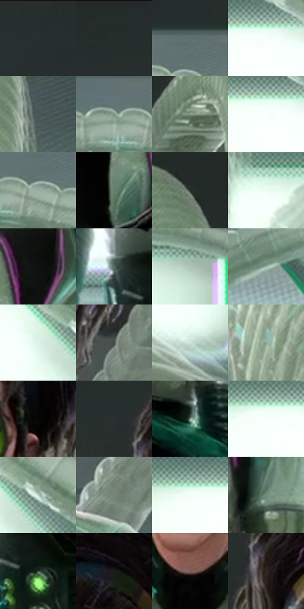

# 电影参考 360

- 状态：常规／活跃；来源世界：miles-home。
- 视角：low-angle；景别：medium；场景：interior。
- 时段：interior-time-unknown（外观依据，中置信度；具体时间／晨昏未知）；光照：cool-interior。
- 材质候选：skin, hair, fabric, glass, metal, plastic（帧级，不是像素分割）。
- 明暗组：middle；L* P5/P50/P95：5.17857 / 55.36446 / 99.39409。
- 资格门禁：无附加门禁。
- 原截图 SHA-256：`ea491f7b7367876d779c26238777e59e86db347599a17ad662b33389bd1ca10d`；尺寸：2880 × 1208。
- sRGB 像素 SHA-256：`a0734e43a5a5d40d130728669f6c8e589a3d5d2f5f012b192a16d39076621e68`。

## 观察与迁移

软管透亮、硬壳暗面和金属接头不同光泽，结构肋不叫排线。

360  /  眼镜遮挡／光泽  /  绿护目镜降低眼部可见度，黑手套窄亮形与浅色肋管不同；眼睛不可凭空透镜补出

本公开版保存32个128×128原像素色卡上下文；图集格子并非原场景相邻位置。原rect、图集tile和像素SHA见 `data/palette-crops.json`。上下文不足时不得批准替色，不能以小样推断完整构图。

## 实测色卡

颜色比例分母为保留采样像素，不是材料面积；全部 32 色参与全库匹配。表内四舍五入仅用于阅读，原精度在 JSON。

| ID | HEX | Lab | 原图 xy | 像素数 | 比例 | 明度角色 |
| --- | --- | --- | --- | ---: | ---: | --- |
| 360-S01 | #252E2D | [18.083807, -4.128893, -0.651477] | [88, 28] | 10862 | 5.617908% | deep-shadow |
| 360-S02 | #242C2B | [17.229964, -3.733906, -0.519207] | [984, 28] | 8260 | 4.272134% | deep-shadow |
| 360-S03 | #60716F | [46.236989, -6.760997, -1.017545] | [600, 236] | 8094 | 4.186277% | midtone |
| 360-S04 | #F5FFFB | [99.181074, -3.987379, 0.773952] | [740, 496] | 7782 | 4.024909% | highlight |
| 360-S05 | #4C5A57 | [36.997847, -6.109573, -0.09039] | [2260, 344] | 7420 | 3.837680% | shadow |
| 360-S06 | #7A907F | [57.670757, -11.3492, 6.428715] | [504, 292] | 7106 | 3.675276% | midtone |
| 360-S07 | #859785 | [60.616164, -10.002826, 7.337115] | [1972, 224] | 6920 | 3.579076% | light |
| 360-S08 | #F9FFFD | [99.515133, -2.32393, 0.269824] | [720, 504] | 6753 | 3.492702% | highlight |
| 360-S09 | #98AD9F | [68.798487, -10.05817, 4.737926] | [584, 304] | 6708 | 3.469428% | light |
| 360-S10 | #66806D | [51.113677, -13.447257, 7.261386] | [1256, 772] | 6584 | 3.405294% | midtone |
| 360-S11 | #202A26 | [16.018222, -5.395511, 1.182692] | [2172, 132] | 6578 | 3.402191% | deep-shadow |
| 360-S12 | #E8FCF2 | [97.303238, -8.337754, 2.554426] | [2284, 500] | 6513 | 3.368572% | highlight |
| 360-S13 | #0F100F | [4.576331, -0.534171, 0.382145] | [1356, 676] | 6346 | 3.282199% | deep-shadow |
| 360-S14 | #546A5E | [42.764367, -10.895089, 4.048911] | [1312, 1044] | 6108 | 3.159103% | midtone |
| 360-S15 | #ADC4B7 | [77.150469, -10.322565, 3.889864] | [2760, 492] | 6077 | 3.143070% | light |
| 360-S16 | #9FB9AA | [72.872404, -11.841368, 4.640287] | [84, 904] | 5933 | 3.068592% | light |
| 360-S17 | #DDF4E8 | [94.269033, -9.732481, 3.218065] | [900, 596] | 5907 | 3.055145% | highlight |
| 360-S18 | #434C48 | [31.416639, -4.540825, 1.148122] | [1820, 356] | 5898 | 3.050490% | shadow |
| 360-S19 | #CDE4D9 | [88.67366, -9.669682, 2.779993] | [2544, 1020] | 5734 | 2.965668% | highlight |
| 360-S20 | #8CA695 | [65.762067, -12.465388, 5.802611] | [2020, 1112] | 5729 | 2.963082% | light |
| 360-S21 | #050504 | [1.351081, -0.139131, 0.378589] | [1680, 360] | 5536 | 2.863261% | deep-shadow |
| 360-S22 | #29302F | [19.184586, -3.271402, -0.382895] | [1296, 112] | 5534 | 2.862226% | deep-shadow |
| 360-S23 | #879B96 | [62.334246, -8.088241, 0.234771] | [1676, 1064] | 5531 | 2.860675% | light |
| 360-S24 | #F8FFFC | [99.418787, -2.828563, 0.633443] | [684, 500] | 5504 | 2.846710% | highlight |
| 360-S25 | #BDD4C9 | [82.978256, -9.799186, 2.828887] | [976, 580] | 5497 | 2.843090% | highlight |
| 360-S26 | #768475 | [53.641055, -8.170051, 6.373883] | [1740, 584] | 5425 | 2.805851% | midtone |
| 360-S27 | #F1FFF8 | [98.827184, -5.828473, 1.763544] | [664, 492] | 5289 | 2.735510% | highlight |
| 360-S28 | #708D7A | [55.986649, -14.293282, 6.789132] | [1720, 920] | 5109 | 2.642413% | midtone |
| 360-S29 | #36443B | [27.391777, -7.806834, 3.596223] | [1392, 1104] | 4374 | 2.262266% | shadow |
| 360-S30 | #191C19 | [9.855583, -2.193603, 1.594212] | [1596, 180] | 4098 | 2.119516% | deep-shadow |
| 360-S31 | #7E5E58 | [42.982919, 12.118192, 8.516782] | [1500, 644] | 2486 | 1.285778% | midtone |
| 360-S32 | #302823 | [16.832177, 2.705805, 4.666909] | [1356, 196] | 1651 | 0.853910% | deep-shadow |

## 色阶与空间分布

- 采样 ROI：`[0.01, 0.02, 0.98, 0.94]`；步长：4；样本数：193346。
- 排除区：`[]`。
- 深暗、暗、中、亮、高光五段计数：`[47310, 20415, 42160, 34176, 49285]`。
- RGB 各 256 箱、L* 100 箱、13×5 色相明度表和 3×3 空间统计全部保存在 [总数据](../film-library.json)。
- [可视化档案](../../references/library.html)按需绘制直方图，不存 2,094 张重复图表图片。

## 纹理特征占比

**这是分块图像特征的面积占比，不是波点／排线／丝网／错版的精确语义覆盖率。** 窗格、发丝、织物也会产生方向或周期特征。
原图 ROI 像素 3104134；已测块覆盖 3104134（100.0000%）；未测 0。

| 特征 | 块覆盖像素 | 占已测面积 | 阈值敏感范围 |
| --- | ---: | ---: | --- |
| low-contrast | 455936 | 14.6880% | 13.6324% ~ 14.6880% |
| directional-structure | 827776 | 26.6669% | 9.7686% ~ 47.5196% |
| periodic-structure | 1787654 | 57.5895% | 38.8480% ~ 70.0755% |
| mixed-detail | 32768 | 1.0556% | 0.0000% ~ 5.4678% |

阈值敏感范围不是统计置信区间。逐块坐标、尺度、对比、方向一致性、频谱集中度、频率与角度见 [全量特征记录](../texture-features.jsonl)，以帧号定位。
四种印刷层的真实像素覆盖仍标为 `null`，不能填 0，也不能拿上表代替。不得据这些代理测量删除唯一证据。

[测量方法与保留策略](../../references/library-retention.md) · [分类索引](../archive/README.md)
