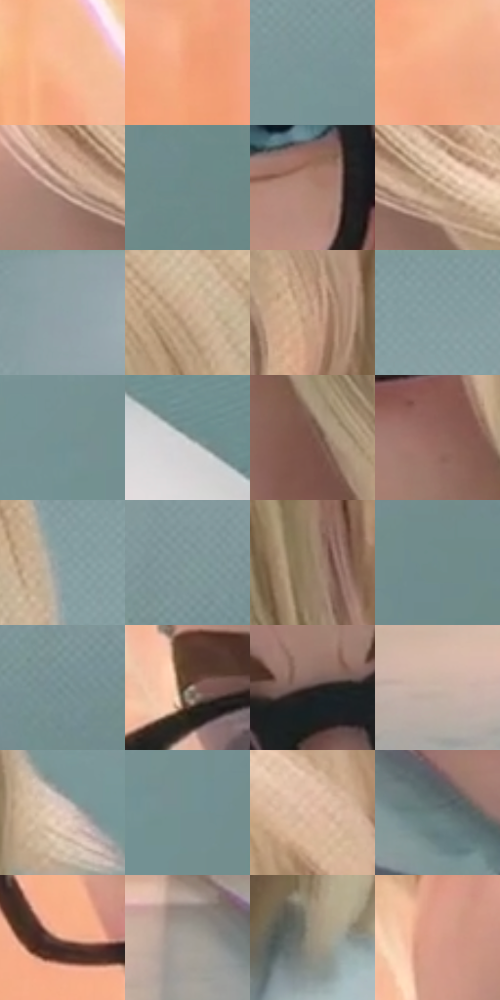

# 电影参考 361

- 状态：常规／活跃；来源世界：miles-home。
- 视角：near-level；景别：close-up；场景：portrait。
- 时段：interior-time-unknown（外观依据，中置信度；具体时间／晨昏未知）；光照：cool-interior。
- 材质候选：skin, hair, fabric, glass（帧级，不是像素分割）。
- 明暗组：light；L* P5/P50/P95：41.73992 / 61.83719 / 80.99811。
- 资格门禁：无附加门禁。
- 原截图 SHA-256：`2a1b83860dfcef44e36412d3c1fbd3b14da0c6d218e002543504bfce1c8c6afc`；尺寸：2880 × 1198。
- sRGB 像素 SHA-256：`b1c4564ce95bf206fd74208435c5411fc6a64f9365c97b9eb181dd5c391fccc4`。

## 观察与迁移

浅色头发、眼镜和白衣细节，眉眼不变统一模板。

361、386金发来访者  /  相对柔和面颊、较短鼻体、有厚度的嘴唇、选择性眼睑线；近景可见少量肤色细节，短发以不对称大束表现，少量细线辅助  /  不是所有电影脸都尖长；参考人物为造型对照，不换发色／发型／年龄。她所在的实验室与森林属于本批场景，不据人物来源排除这些帧

361  /  柔和面部／眼镜短发  /  金发人物较短鼻体、柔和面颊、蓝眼和有厚度的唇；不统一套长鼻尖颌，不改变原照发色

本公开版保存32个128×128原像素色卡上下文；图集格子并非原场景相邻位置。原rect、图集tile和像素SHA见 `data/palette-crops.json`。上下文不足时不得批准替色，不能以小样推断完整构图。

## 实测色卡

颜色比例分母为保留采样像素，不是材料面积；全部 32 色参与全库匹配。表内四舍五入仅用于阅读，原精度在 JSON。

| ID | HEX | Lab | 原图 xy | 像素数 | 比例 | 明度角色 |
| --- | --- | --- | --- | ---: | ---: | --- |
| 361-S01 | #F7BC93 | [80.655807, 16.098737, 28.97263] | [76, 152] | 10675 | 5.541194% | highlight |
| 361-S02 | #F5A17A | [73.747407, 27.060053, 33.079858] | [176, 520] | 9884 | 5.130601% | light |
| 361-S03 | #789597 | [59.636292, -9.650952, -4.411413] | [2468, 412] | 9055 | 4.700282% | midtone |
| 361-S04 | #F5AB87 | [76.24794, 23.023961, 29.426616] | [132, 324] | 9055 | 4.700282% | light |
| 361-S05 | #9D7C6A | [54.684113, 10.096551, 14.705843] | [932, 184] | 8670 | 4.500436% | midtone |
| 361-S06 | #6C898A | [54.983355, -9.983062, -3.916534] | [2768, 700] | 8301 | 4.308895% | midtone |
| 361-S07 | #AB8472 | [58.392998, 12.363618, 15.477744] | [824, 560] | 8143 | 4.226880% | midtone |
| 361-S08 | #BEA084 | [67.840572, 6.867296, 18.729995] | [1036, 200] | 7907 | 4.104377% | light |
| 361-S09 | #8EA2A6 | [65.234636, -6.137073, -4.439064] | [2464, 40] | 7679 | 3.986026% | light |
| 361-S10 | #CBAD94 | [72.709403, 7.091514, 16.895511] | [1704, 312] | 7648 | 3.969935% | light |
| 361-S11 | #B79079 | [62.84045, 11.426515, 17.851011] | [1436, 872] | 7399 | 3.840684% | light |
| 361-S12 | #879EA1 | [63.488964, -7.379745, -4.265976] | [1992, 28] | 7150 | 3.711432% | light |
| 361-S13 | #749294 | [58.422372, -10.001869, -4.523854] | [2548, 516] | 7080 | 3.675097% | midtone |
| 361-S14 | #A6AFAF | [70.775494, -3.149781, -1.088333] | [2080, 1056] | 6939 | 3.601906% | light |
| 361-S15 | #775448 | [39.124037, 12.866836, 12.798736] | [1308, 780] | 6043 | 3.136809% | shadow |
| 361-S16 | #93685E | [48.150223, 15.863086, 12.501267] | [1212, 684] | 5959 | 3.093206% | midtone |
| 361-S17 | #849A9D | [62.040873, -7.070972, -4.172008] | [1796, 128] | 5927 | 3.076596% | light |
| 361-S18 | #7F989A | [61.046223, -8.307662, -3.981001] | [2808, 300] | 5894 | 3.059466% | light |
| 361-S19 | #917A60 | [52.712509, 4.883348, 17.567812] | [1388, 612] | 5739 | 2.979008% | midtone |
| 361-S20 | #708B8C | [55.889747, -9.303182, -3.703467] | [2772, 524] | 5380 | 2.792658% | midtone |
| 361-S21 | #779294 | [58.618192, -9.016979, -4.212598] | [2784, 388] | 5345 | 2.774490% | midtone |
| 361-S22 | #7A6758 | [45.002064, 5.068599, 11.283134] | [628, 412] | 5323 | 2.763070% | midtone |
| 361-S23 | #332725 | [16.933848, 5.232773, 3.457545] | [896, 404] | 4917 | 2.552323% | deep-shadow |
| 361-S24 | #CAB6A8 | [75.352126, 4.833259, 9.723335] | [372, 1032] | 4595 | 2.385179% | light |
| 361-S25 | #E4CCC2 | [83.744614, 6.763387, 8.041457] | [1900, 484] | 4555 | 2.364416% | highlight |
| 361-S26 | #728F91 | [57.333566, -9.699606, -4.430659] | [2600, 548] | 4465 | 2.317699% | midtone |
| 361-S27 | #E2BDA7 | [79.24596, 9.958417, 16.068087] | [1328, 308] | 3681 | 1.910739% | light |
| 361-S28 | #677A7D | [49.837391, -6.254417, -3.969264] | [968, 1072] | 2381 | 1.235933% | midtone |
| 361-S29 | #E3AB92 | [74.530669, 17.222851, 20.864735] | [664, 684] | 2190 | 1.136788% | light |
| 361-S30 | #A49F97 | [65.689017, 0.350059, 4.816002] | [796, 988] | 1915 | 0.994041% | light |
| 361-S31 | #99907D | [60.068998, 0.033008, 11.309251] | [1708, 840] | 1441 | 0.747996% | light |
| 361-S32 | #DA9E88 | [70.273594, 19.511424, 20.326556] | [620, 252] | 1313 | 0.681554% | light |

## 色阶与空间分布

- 采样 ROI：`[0.01, 0.02, 0.98, 0.94]`；步长：4；样本数：192648。
- 排除区：`[]`。
- 深暗、暗、中、亮、高光五段计数：`[3109, 4926, 76937, 95019, 12657]`。
- RGB 各 256 箱、L* 100 箱、13×5 色相明度表和 3×3 空间统计全部保存在 [总数据](../film-library.json)。
- [可视化档案](../../references/library.html)按需绘制直方图，不存 2,094 张重复图表图片。

## 纹理特征占比

**这是分块图像特征的面积占比，不是波点／排线／丝网／错版的精确语义覆盖率。** 窗格、发丝、织物也会产生方向或周期特征。
原图 ROI 像素 3081782；已测块覆盖 3081782（100.0000%）；未测 0。

| 特征 | 块覆盖像素 | 占已测面积 | 阈值敏感范围 |
| --- | ---: | ---: | --- |
| low-contrast | 900608 | 29.2236% | 21.2490% ~ 32.4467% |
| directional-structure | 1082422 | 35.1232% | 22.9851% ~ 44.2857% |
| periodic-structure | 1019648 | 33.0863% | 33.0863% ~ 42.5330% |
| mixed-detail | 79104 | 2.5668% | 0.4403% ~ 2.5668% |

阈值敏感范围不是统计置信区间。逐块坐标、尺度、对比、方向一致性、频谱集中度、频率与角度见 [全量特征记录](../texture-features.jsonl)，以帧号定位。
四种印刷层的真实像素覆盖仍标为 `null`，不能填 0，也不能拿上表代替。不得据这些代理测量删除唯一证据。

[测量方法与保留策略](../../references/library-retention.md) · [分类索引](../archive/README.md)
