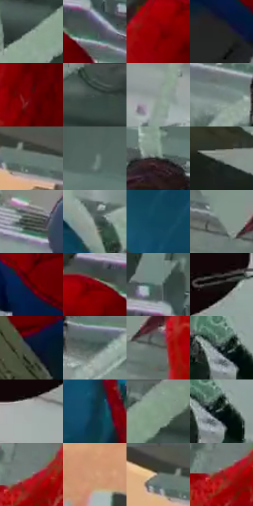

# 电影参考 362

- 状态：条件／活跃；来源世界：miles-home。
- 视角：rolled-or-dutch；景别：medium；场景：interior。
- 时段：interior-time-unknown（外观依据，中置信度；具体时间／晨昏未知）；光照：cool-interior。
- 材质候选：skin, fabric, glass, metal, plastic, paper（帧级，不是像素分割）。
- 明暗组：dark；L* P5/P50/P95：8.73049 / 34.7651 / 66.03953。
- 资格门禁：motion。
- 原截图 SHA-256：`87ae43fbf2519af51f09a1be859795fc3b17544e324b861eda82ba71d6ce9022`；尺寸：2880 × 1208。
- sRGB 像素 SHA-256：`53c8bbda13b6ee389e5fa0baaeed4683e612aba40395cf8e8db812d8724fee8e`。

## 观察与迁移

动作姿态、纸片和玻璃破口是原有内容，非任意装饰线。

362  /  强动作／实体飞散物  /  倾斜镜头、纸片家具与实体软管；物理碎片不同于抽象爆点，原照无物不添物

本公开版保存32个128×128原像素色卡上下文；图集格子并非原场景相邻位置。原rect、图集tile和像素SHA见 `data/palette-crops.json`。上下文不足时不得批准替色，不能以小样推断完整构图。

## 实测色卡

颜色比例分母为保留采样像素，不是材料面积；全部 32 色参与全库匹配。表内四舍五入仅用于阅读，原精度在 JSON。

| ID | HEX | Lab | 原图 xy | 像素数 | 比例 | 明度角色 |
| --- | --- | --- | --- | ---: | ---: | --- |
| 362-S01 | #92A29B | [65.214036, -7.04132, 1.716784] | [2144, 140] | 11364 | 5.877546% | light |
| 362-S02 | #455554 | [34.806627, -6.435022, -1.48648] | [1108, 192] | 8657 | 4.477465% | shadow |
| 362-S03 | #8D0106 | [28.641207, 51.461737, 39.488548] | [944, 240] | 8394 | 4.341440% | shadow |
| 362-S04 | #232421 | [13.994847, -1.185502, 1.846553] | [1412, 1104] | 8144 | 4.212138% | deep-shadow |
| 362-S05 | #660204 | [19.548113, 40.448787, 28.275621] | [956, 428] | 8045 | 4.160934% | deep-shadow |
| 362-S06 | #3E4C48 | [31.02177, -6.508116, 0.525345] | [2464, 28] | 7686 | 3.975257% | shadow |
| 362-S07 | #8B9792 | [61.392085, -5.305228, 1.157184] | [1760, 888] | 7615 | 3.938535% | light |
| 362-S08 | #70827C | [52.801293, -7.830248, 1.039267] | [1876, 588] | 7582 | 3.921467% | midtone |
| 362-S09 | #687874 | [49.052395, -6.776987, 0.19796] | [168, 84] | 7232 | 3.740445% | midtone |
| 362-S10 | #576B64 | [43.450423, -9.0409, 1.444535] | [1316, 72] | 7133 | 3.689241% | midtone |
| 362-S11 | #2E3630 | [21.698969, -4.846411, 2.634929] | [2056, 472] | 7114 | 3.679414% | shadow |
| 362-S12 | #808983 | [56.20678, -4.504634, 2.081855] | [264, 944] | 7011 | 3.626142% | midtone |
| 362-S13 | #394039 | [26.250717, -4.521132, 3.300264] | [336, 496] | 6909 | 3.573387% | shadow |
| 362-S14 | #55615C | [40.003735, -5.729492, 1.2852] | [1588, 416] | 6768 | 3.500460% | midtone |
| 362-S15 | #11455B | [27.102593, -8.364643, -17.866758] | [1388, 600] | 6639 | 3.433741% | shadow |
| 362-S16 | #7F8F88 | [57.974508, -7.198985, 1.769224] | [708, 312] | 6348 | 3.283233% | midtone |
| 362-S17 | #4E0105 | [13.548833, 33.75705, 19.138767] | [624, 872] | 6276 | 3.245994% | deep-shadow |
| 362-S18 | #770002 | [23.43073, 45.633672, 34.471216] | [1008, 184] | 5961 | 3.083074% | shadow |
| 362-S19 | #60736E | [46.808368, -8.133157, 0.414295] | [1072, 84] | 5476 | 2.832228% | midtone |
| 362-S20 | #100E0D | [4.094624, 0.512431, 0.697528] | [152, 644] | 5361 | 2.772749% | deep-shadow |
| 362-S21 | #0C1725 | [7.44729, 0.335036, -11.148529] | [1136, 976] | 5273 | 2.727235% | deep-shadow |
| 362-S22 | #4B5F59 | [38.553193, -8.977955, 0.92978] | [2192, 608] | 5063 | 2.618622% | shadow |
| 362-S23 | #626864 | [43.385428, -3.155234, 1.453917] | [792, 360] | 4921 | 2.545178% | midtone |
| 362-S24 | #364446 | [27.738224, -5.088201, -3.074366] | [2148, 844] | 4710 | 2.436047% | shadow |
| 362-S25 | #A4ADAC | [70.005966, -3.352109, -0.57819] | [72, 740] | 4585 | 2.371396% | light |
| 362-S26 | #0D3144 | [18.796875, -5.214291, -15.54494] | [1532, 608] | 4577 | 2.367259% | deep-shadow |
| 362-S27 | #83978C | [60.650366, -9.353132, 3.406497] | [2300, 32] | 4378 | 2.264334% | light |
| 362-S28 | #142220 | [11.937685, -6.603739, -0.579719] | [2172, 852] | 3263 | 1.687648% | deep-shadow |
| 362-S29 | #7C776F | [50.247495, 0.395507, 5.080732] | [740, 508] | 2928 | 1.514384% | midtone |
| 362-S30 | #CC9774 | [66.698369, 15.47431, 26.207527] | [84, 328] | 2820 | 1.458525% | light |
| 362-S31 | #4E4F44 | [33.198121, -2.666847, 6.371164] | [104, 60] | 2781 | 1.438354% | shadow |
| 362-S32 | #8C1E1D | [30.865302, 45.311977, 29.578658] | [716, 532] | 2332 | 1.206128% | shadow |

## 色阶与空间分布

- 采样 ROI：`[0.01, 0.02, 0.98, 0.94]`；步长：4；样本数：193346。
- 排除区：`[]`。
- 深暗、暗、中、亮、高光五段计数：`[37334, 72491, 56263, 27181, 77]`。
- RGB 各 256 箱、L* 100 箱、13×5 色相明度表和 3×3 空间统计全部保存在 [总数据](../film-library.json)。
- [可视化档案](../../references/library.html)按需绘制直方图，不存 2,094 张重复图表图片。

## 纹理特征占比

**这是分块图像特征的面积占比，不是波点／排线／丝网／错版的精确语义覆盖率。** 窗格、发丝、织物也会产生方向或周期特征。
原图 ROI 像素 3104134；已测块覆盖 3104134（100.0000%）；未测 0。

| 特征 | 块覆盖像素 | 占已测面积 | 阈值敏感范围 |
| --- | ---: | ---: | --- |
| low-contrast | 153344 | 4.9400% | 2.3009% ~ 8.9027% |
| directional-structure | 873856 | 28.1514% | 10.3872% ~ 46.8227% |
| periodic-structure | 2027782 | 65.3252% | 50.8763% ~ 75.9392% |
| mixed-detail | 49152 | 1.5834% | 0.0000% ~ 4.7709% |

阈值敏感范围不是统计置信区间。逐块坐标、尺度、对比、方向一致性、频谱集中度、频率与角度见 [全量特征记录](../texture-features.jsonl)，以帧号定位。
四种印刷层的真实像素覆盖仍标为 `null`，不能填 0，也不能拿上表代替。不得据这些代理测量删除唯一证据。

[测量方法与保留策略](../../references/library-retention.md) · [分类索引](../archive/README.md)
