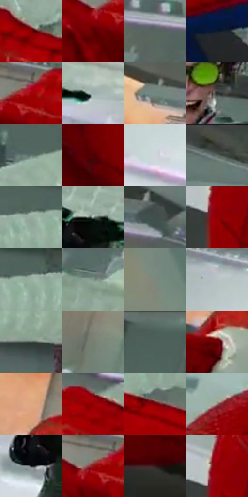

# 电影参考 363

- 状态：条件／活跃；来源世界：miles-home。
- 视角：rolled-or-dutch；景别：medium；场景：interior。
- 时段：interior-time-unknown（外观依据，中置信度；具体时间／晨昏未知）；光照：cool-interior。
- 材质候选：skin, fabric, glass, metal, plastic, paper（帧级，不是像素分割）。
- 明暗组：middle；L* P5/P50/P95：10.16371 / 40.59989 / 77.95578。
- 资格门禁：motion。
- 原截图 SHA-256：`cd3b9ab7ddc287d5ed55221c33ccf608654347957167400dd54060e0de97b7fb`；尺寸：2880 × 1208。
- sRGB 像素 SHA-256：`8d726f6877fe01c57b57873e96c1a2a48c76a4aa88a5034a55121ca649556287`。

## 观察与迁移

动作姿态、纸片和玻璃破口是原有内容，非任意装饰线。

363  /  受力与遮挡／材质  /  实体肋管贴合人物，手抓握与肩臂前后关系清楚；不能改作无落点的装饰长线

本公开版保存32个128×128原像素色卡上下文；图集格子并非原场景相邻位置。原rect、图集tile和像素SHA见 `data/palette-crops.json`。上下文不足时不得批准替色，不能以小样推断完整构图。

## 实测色卡

颜色比例分母为保留采样像素，不是材料面积；全部 32 色参与全库匹配。表内四舍五入仅用于阅读，原精度在 JSON。

| ID | HEX | Lab | 原图 xy | 像素数 | 比例 | 明度角色 |
| --- | --- | --- | --- | ---: | ---: | --- |
| 363-S01 | #840002 | [26.48128, 49.159111, 38.45136] | [1400, 484] | 11494 | 5.944783% | shadow |
| 363-S02 | #5E0002 | [17.389678, 38.654976, 26.06172] | [1040, 512] | 11068 | 5.724453% | deep-shadow |
| 363-S03 | #55645E | [40.982453, -7.055073, 1.483317] | [1208, 240] | 9106 | 4.709691% | midtone |
| 363-S04 | #0E1B30 | [9.723876, 2.43505, -15.701889] | [1712, 940] | 9025 | 4.667798% | deep-shadow |
| 363-S05 | #9F0206 | [32.76631, 56.068811, 44.327072] | [1108, 452] | 8706 | 4.502808% | shadow |
| 363-S06 | #A3B1AE | [71.067886, -5.456456, -0.136732] | [2740, 760] | 8063 | 4.170244% | light |
| 363-S07 | #72877F | [54.487869, -9.26955, 1.767402] | [744, 240] | 7280 | 3.765271% | midtone |
| 363-S08 | #262C28 | [17.304272, -3.632768, 1.705532] | [2636, 428] | 7175 | 3.710964% | deep-shadow |
| 363-S09 | #657A74 | [49.430943, -8.990077, 0.723821] | [1672, 208] | 7125 | 3.685103% | midtone |
| 363-S10 | #4C0102 | [13.003716, 33.045773, 19.544752] | [756, 1068] | 6904 | 3.570801% | deep-shadow |
| 363-S11 | #D0D6DD | [85.363887, -0.716931, -4.143743] | [2268, 892] | 6816 | 3.525286% | highlight |
| 363-S12 | #646E6A | [45.499166, -4.64326, 0.933867] | [1076, 64] | 6783 | 3.508218% | midtone |
| 363-S13 | #93AA9B | [67.515301, -10.981617, 5.055965] | [2064, 160] | 6705 | 3.467876% | light |
| 363-S14 | #8F9E97 | [63.776359, -6.720189, 1.841749] | [2452, 700] | 6377 | 3.298232% | light |
| 363-S15 | #414F4A | [32.280375, -6.705765, 1.108223] | [772, 116] | 6249 | 3.232030% | shadow |
| 363-S16 | #383E39 | [25.507171, -3.671659, 2.219231] | [32, 840] | 6222 | 3.218065% | shadow |
| 363-S17 | #99B0A1 | [69.750373, -10.913209, 5.016659] | [2136, 152] | 6213 | 3.213410% | light |
| 363-S18 | #83988B | [60.90974, -10.096294, 4.347078] | [1904, 464] | 5930 | 3.067040% | light |
| 363-S19 | #7C887E | [55.48154, -6.409807, 3.875366] | [260, 272] | 5757 | 2.977564% | midtone |
| 363-S20 | #B7C2C3 | [77.632599, -3.578605, -1.802756] | [2120, 768] | 5732 | 2.964633% | light |
| 363-S21 | #4F5B55 | [37.481366, -6.012795, 1.883329] | [2400, 224] | 5563 | 2.877225% | shadow |
| 363-S22 | #747A6F | [50.428507, -4.448163, 5.251401] | [52, 312] | 5426 | 2.806368% | midtone |
| 363-S23 | #596D66 | [44.261773, -9.014273, 1.435663] | [1368, 28] | 4955 | 2.562763% | midtone |
| 363-S24 | #720002 | [22.24191, 44.259997, 32.869681] | [752, 536] | 4863 | 2.515180% | shadow |
| 363-S25 | #DEA880 | [72.955273, 14.812154, 28.357954] | [740, 424] | 4482 | 2.318124% | light |
| 363-S26 | #8F0003 | [29.026111, 52.109471, 41.211409] | [1256, 424] | 4182 | 2.162962% | shadow |
| 363-S27 | #720307 | [22.510667, 43.700867, 31.115119] | [1684, 564] | 3720 | 1.924012% | shadow |
| 363-S28 | #93857B | [56.494673, 3.529863, 7.310771] | [200, 568] | 3397 | 1.756954% | midtone |
| 363-S29 | #0F1213 | [5.249729, -0.883901, -0.963002] | [2396, 776] | 2556 | 1.321982% | deep-shadow |
| 363-S30 | #911919 | [31.317315, 48.275419, 32.726862] | [1068, 460] | 2250 | 1.163717% | shadow |
| 363-S31 | #371717 | [12.525747, 15.922432, 7.436666] | [364, 1096] | 1782 | 0.921664% | deep-shadow |
| 363-S32 | #82433B | [36.13237, 26.146765, 17.059591] | [52, 788] | 1440 | 0.744779% | shadow |

## 色阶与空间分布

- 采样 ROI：`[0.01, 0.02, 0.98, 0.94]`；步长：4；样本数：193346。
- 排除区：`[]`。
- 深暗、暗、中、亮、高光五段计数：`[37383, 56808, 50973, 40343, 7839]`。
- RGB 各 256 箱、L* 100 箱、13×5 色相明度表和 3×3 空间统计全部保存在 [总数据](../film-library.json)。
- [可视化档案](../../references/library.html)按需绘制直方图，不存 2,094 张重复图表图片。

## 纹理特征占比

**这是分块图像特征的面积占比，不是波点／排线／丝网／错版的精确语义覆盖率。** 窗格、发丝、织物也会产生方向或周期特征。
原图 ROI 像素 3104134；已测块覆盖 3104134（100.0000%）；未测 0。

| 特征 | 块覆盖像素 | 占已测面积 | 阈值敏感范围 |
| --- | ---: | ---: | --- |
| low-contrast | 247040 | 7.9584% | 4.0741% ~ 10.0697% |
| directional-structure | 1131910 | 36.4646% | 13.2036% ~ 56.9792% |
| periodic-structure | 1648512 | 53.1070% | 38.9468% ~ 74.2568% |
| mixed-detail | 76672 | 2.4700% | 0.0000% ~ 2.4700% |

阈值敏感范围不是统计置信区间。逐块坐标、尺度、对比、方向一致性、频谱集中度、频率与角度见 [全量特征记录](../texture-features.jsonl)，以帧号定位。
四种印刷层的真实像素覆盖仍标为 `null`，不能填 0，也不能拿上表代替。不得据这些代理测量删除唯一证据。

[测量方法与保留策略](../../references/library-retention.md) · [分类索引](../archive/README.md)
