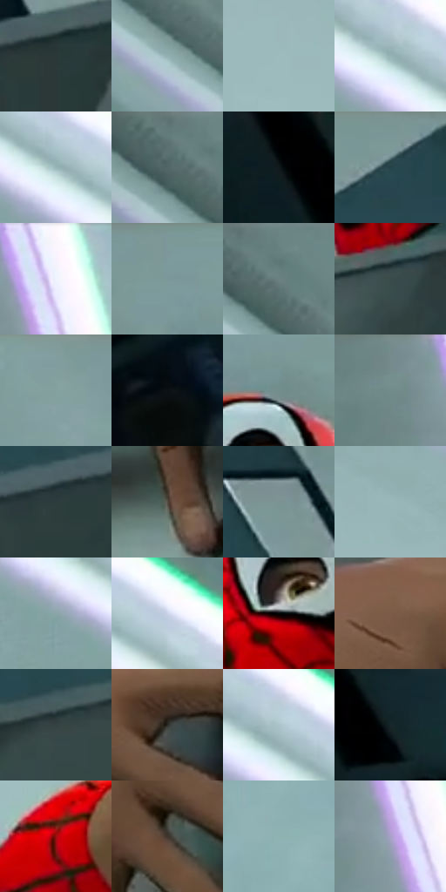

# 电影参考 364

- 状态：常规／活跃；来源世界：miles-home。
- 视角：low-angle；景别：medium；场景：detail。
- 时段：interior-time-unknown（外观依据，中置信度；具体时间／晨昏未知）；光照：cool-interior。
- 材质候选：skin, fabric, plastic, screen, metal（帧级，不是像素分割）。
- 明暗组：middle；L* P5/P50/P95：5.44513 / 55.7328 / 85.49734。
- 资格门禁：无附加门禁。
- 原截图 SHA-256：`9248f71356770ccd2a079e8b2c2bcd9311cafedbe66ec2793ef5d2a0afc25cea`；尺寸：2880 × 1206。
- sRGB 像素 SHA-256：`136636645b84d9d9f8a071f38d7306087a096394b184fec91018fad5c969821e`。

## 观察与迁移

抱持显示器接触和硬壳宽亮面，屏幕反光有载体边界。

364  /  屏面高光／手部接触  /  搬运屏幕，宽浅亮形与暗外壳分开，手指落点明确；抱物不是撞击，不添加爆裂

本公开版保存32个128×128原像素色卡上下文；图集格子并非原场景相邻位置。原rect、图集tile和像素SHA见 `data/palette-crops.json`。上下文不足时不得批准替色，不能以小样推断完整构图。

## 实测色卡

颜色比例分母为保留采样像素，不是材料面积；全部 32 色参与全库匹配。表内四舍五入仅用于阅读，原精度在 JSON。

| ID | HEX | Lab | 原图 xy | 像素数 | 比例 | 明度角色 |
| --- | --- | --- | --- | ---: | ---: | --- |
| 364-S01 | #2A3838 | [22.323605, -5.736662, -1.895044] | [2216, 268] | 13419 | 6.940407% | shadow |
| 364-S02 | #91AFB1 | [69.364662, -9.773412, -4.434328] | [740, 204] | 11235 | 5.810826% | light |
| 364-S03 | #9DBBBD | [73.792529, -9.684899, -4.39901] | [528, 588] | 9020 | 4.665212% | light |
| 364-S04 | #95B2B5 | [70.570291, -9.211913, -4.830338] | [184, 88] | 8650 | 4.473845% | light |
| 364-S05 | #97B5B7 | [71.585391, -9.728702, -4.416529] | [264, 140] | 8243 | 4.263341% | light |
| 364-S06 | #516665 | [41.51857, -8.066486, -2.035911] | [628, 68] | 7589 | 3.925088% | midtone |
| 364-S07 | #10181A | [7.569374, -2.858007, -2.604675] | [2292, 692] | 7325 | 3.788545% | deep-shadow |
| 364-S08 | #2B474C | [28.2251, -9.030341, -6.33168] | [1896, 60] | 7303 | 3.777166% | shadow |
| 364-S09 | #EEF4FC | [95.957855, -0.521375, -4.522356] | [2492, 64] | 7291 | 3.770960% | highlight |
| 364-S10 | #7D989A | [60.912674, -8.970228, -4.193164] | [1368, 28] | 6653 | 3.440981% | light |
| 364-S11 | #6A8281 | [52.524276, -8.830506, -2.330087] | [676, 68] | 6514 | 3.369090% | midtone |
| 364-S12 | #394C4B | [30.751429, -7.636959, -1.836126] | [1328, 452] | 6257 | 3.236167% | shadow |
| 364-S13 | #839E9E | [63.133079, -9.36593, -3.133691] | [1692, 28] | 6173 | 3.192722% | light |
| 364-S14 | #0D1113 | [4.818759, -0.946776, -1.609651] | [2168, 1008] | 6160 | 3.185998% | deep-shadow |
| 364-S15 | #728D8B | [56.575653, -9.966336, -2.103091] | [1436, 140] | 6039 | 3.123416% | midtone |
| 364-S16 | #76908F | [57.828169, -9.377218, -2.525853] | [2372, 48] | 5950 | 3.077385% | midtone |
| 364-S17 | #2C3D3D | [24.353019, -6.809583, -2.232122] | [2004, 308] | 5679 | 2.937221% | shadow |
| 364-S18 | #534C42 | [32.703744, 0.991899, 7.005249] | [1244, 968] | 5458 | 2.822918% | shadow |
| 364-S19 | #7B9394 | [59.173572, -8.233574, -3.363023] | [2072, 116] | 5426 | 2.806368% | midtone |
| 364-S20 | #9BB7B9 | [72.453339, -9.068766, -4.20303] | [504, 460] | 5186 | 2.682238% | light |
| 364-S21 | #8BA5A9 | [65.952842, -8.105873, -5.077161] | [76, 104] | 5010 | 2.591210% | light |
| 364-S22 | #CBD4E9 | [84.825633, 1.070417, -11.345089] | [360, 140] | 5003 | 2.587589% | highlight |
| 364-S23 | #060708 | [1.880693, -0.122577, -0.470331] | [1392, 264] | 4937 | 2.553453% | deep-shadow |
| 364-S24 | #7D5B48 | [41.705977, 11.294843, 16.425571] | [1216, 660] | 4861 | 2.514146% | midtone |
| 364-S25 | #344241 | [26.757572, -5.887735, -1.266303] | [1552, 400] | 4840 | 2.503284% | shadow |
| 364-S26 | #2A2B27 | [17.303696, -1.383793, 2.451316] | [1372, 672] | 4657 | 2.408635% | deep-shadow |
| 364-S27 | #ABC4CB | [77.5482, -6.968623, -6.344132] | [208, 76] | 4631 | 2.395188% | light |
| 364-S28 | #17262A | [14.032846, -5.041074, -4.664622] | [2388, 716] | 4087 | 2.113827% | deep-shadow |
| 364-S29 | #990F0E | [32.141235, 52.651745, 39.896649] | [720, 840] | 3375 | 1.745575% | shadow |
| 364-S30 | #3F352C | [22.947358, 2.756602, 7.328516] | [1312, 772] | 2598 | 1.343705% | shadow |
| 364-S31 | #8DB3B1 | [70.229115, -13.166834, -3.189494] | [2816, 184] | 2040 | 1.055103% | light |
| 364-S32 | #A9A0C9 | [67.867976, 11.54014, -19.784514] | [2512, 276] | 1737 | 0.898389% | light |

## 色阶与空间分布

- 采样 ROI：`[0.01, 0.02, 0.98, 0.94]`；步长：4；样本数：193346。
- 排除区：`[]`。
- 深暗、暗、中、亮、高光五段计数：`[27893, 52828, 30990, 68693, 12942]`。
- RGB 各 256 箱、L* 100 箱、13×5 色相明度表和 3×3 空间统计全部保存在 [总数据](../film-library.json)。
- [可视化档案](../../references/library.html)按需绘制直方图，不存 2,094 张重复图表图片。

## 纹理特征占比

**这是分块图像特征的面积占比，不是波点／排线／丝网／错版的精确语义覆盖率。** 窗格、发丝、织物也会产生方向或周期特征。
原图 ROI 像素 3098546；已测块覆盖 3098546（100.0000%）；未测 0。

| 特征 | 块覆盖像素 | 占已测面积 | 阈值敏感范围 |
| --- | ---: | ---: | --- |
| low-contrast | 717824 | 23.1665% | 22.6377% ~ 26.7769% |
| directional-structure | 1343922 | 43.3727% | 34.3614% ~ 53.5886% |
| periodic-structure | 1009536 | 32.5810% | 23.7737% ~ 37.4530% |
| mixed-detail | 27264 | 0.8799% | 0.0000% ~ 1.4087% |

阈值敏感范围不是统计置信区间。逐块坐标、尺度、对比、方向一致性、频谱集中度、频率与角度见 [全量特征记录](../texture-features.jsonl)，以帧号定位。
四种印刷层的真实像素覆盖仍标为 `null`，不能填 0，也不能拿上表代替。不得据这些代理测量删除唯一证据。

[测量方法与保留策略](../../references/library-retention.md) · [分类索引](../archive/README.md)
