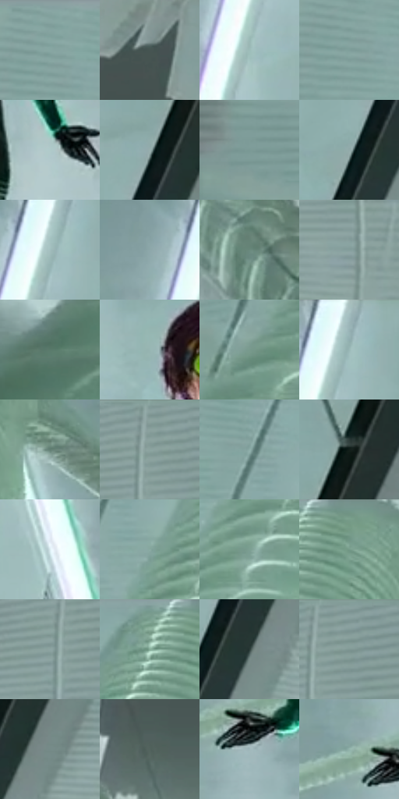

# 电影参考 365

- 状态：条件／活跃；来源世界：miles-home。
- 视角：high-angle；景别：full-body；场景：interior。
- 时段：interior-time-unknown（外观依据，中置信度；具体时间／晨昏未知）；光照：cool-interior。
- 材质候选：skin, fabric, glass, metal, plastic, paper（帧级，不是像素分割）。
- 明暗组：light；L* P5/P50/P95：30.22263 / 64.7382 / 78.52856。
- 资格门禁：motion。
- 原截图 SHA-256：`afeb9e1117296d1da558cf2b861a797dbcf43175c599b8780139a067ecceef43`；尺寸：2880 × 1208。
- sRGB 像素 SHA-256：`2fdd46ae8c5949fd84dcf78bcc02c026ae1161604f1960902fce3611669a6c52`。

## 观察与迁移

动作姿态、纸片和玻璃破口是原有内容，非任意装饰线。

365  /  动作／玻璃破损  /  管线托起人物，右方玻璃有不规则破口；破洞是实体损伤，不作为任意背景爆炸星

本公开版保存32个128×128原像素色卡上下文；图集格子并非原场景相邻位置。原rect、图集tile和像素SHA见 `data/palette-crops.json`。上下文不足时不得批准替色，不能以小样推断完整构图。

## 实测色卡

颜色比例分母为保留采样像素，不是材料面积；全部 32 色参与全库匹配。表内四舍五入仅用于阅读，原精度在 JSON。

| ID | HEX | Lab | 原图 xy | 像素数 | 比例 | 明度角色 |
| --- | --- | --- | --- | ---: | ---: | --- |
| 365-S01 | #86A4A1 | [65.11434, -10.95579, -1.881792] | [260, 28] | 9085 | 4.698830% | light |
| 365-S02 | #465452 | [34.501786, -5.937544, -0.666873] | [2652, 520] | 8387 | 4.337819% | shadow |
| 365-S03 | #9DBCB9 | [73.956463, -11.055461, -1.97762] | [2016, 296] | 8266 | 4.275237% | light |
| 365-S04 | #7F9E9B | [62.786422, -11.345181, -1.984958] | [256, 96] | 8113 | 4.196104% | light |
| 365-S05 | #AFCAC9 | [79.369, -9.232697, -2.552672] | [1568, 568] | 7799 | 4.033701% | light |
| 365-S06 | #98AFAF | [69.774476, -7.906429, -2.6737] | [2268, 180] | 7774 | 4.020771% | light |
| 365-S07 | #7B9693 | [60.005565, -10.098034, -1.57094] | [36, 236] | 7372 | 3.812854% | light |
| 365-S08 | #93AAAA | [67.912865, -7.941944, -2.683023] | [2220, 292] | 7311 | 3.781304% | light |
| 365-S09 | #A3BEBF | [75.060184, -8.906335, -3.575333] | [2072, 84] | 6884 | 3.560456% | light |
| 365-S10 | #8DA7A9 | [66.644922, -8.529527, -4.040341] | [1980, 84] | 6601 | 3.414087% | light |
| 365-S11 | #69887C | [54.09718, -13.600253, 2.86107] | [2360, 1092] | 6463 | 3.342712% | midtone |
| 365-S12 | #849E9C | [63.143026, -9.468832, -1.986072] | [2548, 244] | 6401 | 3.310645% | light |
| 365-S13 | #587668 | [47.014595, -13.994611, 4.212116] | [36, 760] | 6299 | 3.257890% | midtone |
| 365-S14 | #97B6B3 | [71.750554, -11.11046, -1.979833] | [1344, 196] | 6282 | 3.249097% | light |
| 365-S15 | #789A8D | [60.805075, -14.55639, 2.971768] | [312, 508] | 6002 | 3.104279% | light |
| 365-S16 | #9AB5B7 | [71.782191, -8.758231, -4.104016] | [2088, 32] | 5859 | 3.030319% | light |
| 365-S17 | #627F74 | [50.729117, -12.83322, 2.584234] | [844, 132] | 5780 | 2.989459% | midtone |
| 365-S18 | #809895 | [60.970855, -9.065383, -1.25121] | [2576, 32] | 5547 | 2.868950% | light |
| 365-S19 | #8FAEAA | [68.760706, -11.399439, -1.469738] | [432, 128] | 5544 | 2.867398% | light |
| 365-S20 | #121E19 | [10.009793, -6.758633, 1.737979] | [2332, 72] | 5487 | 2.837918% | deep-shadow |
| 365-S21 | #DCECF1 | [92.378727, -4.32624, -4.227613] | [888, 528] | 5476 | 2.832228% | highlight |
| 365-S22 | #89ABA3 | [67.342656, -13.265269, 0.287667] | [484, 224] | 5471 | 2.829642% | light |
| 365-S23 | #7C9F92 | [62.638966, -14.816188, 2.840654] | [484, 360] | 5431 | 2.808954% | light |
| 365-S24 | #709584 | [58.606739, -16.491198, 4.837781] | [720, 48] | 5224 | 2.701892% | midtone |
| 365-S25 | #8DA4A3 | [65.637377, -8.198183, -2.177148] | [2552, 92] | 5202 | 2.690513% | light |
| 365-S26 | #82A696 | [65.136336, -15.671178, 4.260479] | [640, 28] | 4495 | 2.324848% | light |
| 365-S27 | #2D3D3A | [24.324252, -7.237722, -0.270581] | [2288, 300] | 4396 | 2.273644% | shadow |
| 365-S28 | #89A09F | [64.130514, -8.229599, -2.182456] | [2612, 36] | 4351 | 2.250370% | light |
| 365-S29 | #758B88 | [56.112001, -8.502521, -1.033486] | [2356, 224] | 4217 | 2.181064% | midtone |
| 365-S30 | #51645D | [40.660387, -8.769716, 1.589945] | [2496, 988] | 4076 | 2.108138% | midtone |
| 365-S31 | #A0B7BB | [72.844113, -7.017525, -4.683192] | [1280, 512] | 3957 | 2.046590% | light |
| 365-S32 | #92B4AC | [70.685062, -13.159301, 0.264943] | [1220, 464] | 3794 | 1.962285% | light |

## 色阶与空间分布

- 采样 ROI：`[0.01, 0.02, 0.98, 0.94]`；步长：4；样本数：193346。
- 排除区：`[]`。
- 深暗、暗、中、亮、高光五段计数：`[5934, 13617, 35843, 130017, 7935]`。
- RGB 各 256 箱、L* 100 箱、13×5 色相明度表和 3×3 空间统计全部保存在 [总数据](../film-library.json)。
- [可视化档案](../../references/library.html)按需绘制直方图，不存 2,094 张重复图表图片。

## 纹理特征占比

**这是分块图像特征的面积占比，不是波点／排线／丝网／错版的精确语义覆盖率。** 窗格、发丝、织物也会产生方向或周期特征。
原图 ROI 像素 3104134；已测块覆盖 3104134（100.0000%）；未测 0。

| 特征 | 块覆盖像素 | 占已测面积 | 阈值敏感范围 |
| --- | ---: | ---: | --- |
| low-contrast | 136960 | 4.4122% | 2.9978% ~ 7.5791% |
| directional-structure | 1309824 | 42.1961% | 22.1887% ~ 64.5415% |
| periodic-structure | 1608198 | 51.8083% | 32.4606% ~ 66.0631% |
| mixed-detail | 49152 | 1.5834% | 0.0000% ~ 4.1691% |

阈值敏感范围不是统计置信区间。逐块坐标、尺度、对比、方向一致性、频谱集中度、频率与角度见 [全量特征记录](../texture-features.jsonl)，以帧号定位。
四种印刷层的真实像素覆盖仍标为 `null`，不能填 0，也不能拿上表代替。不得据这些代理测量删除唯一证据。

[测量方法与保留策略](../../references/library-retention.md) · [分类索引](../archive/README.md)
