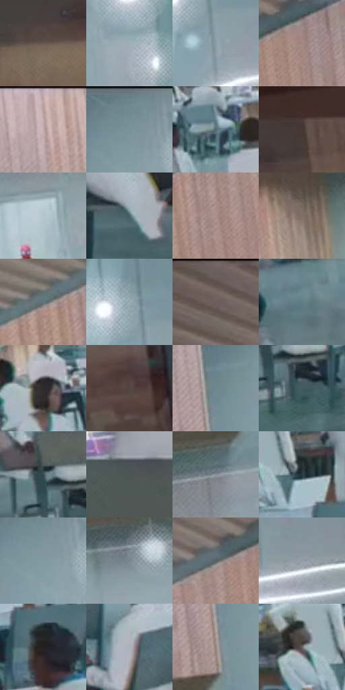

# 电影参考 366

- 状态：常规／活跃；来源世界：miles-home。
- 视角：rolled-or-dutch；景别：environment-wide；场景：interior。
- 时段：interior-time-unknown（外观依据，中置信度；具体时间／晨昏未知）；光照：interior-mixed。
- 材质候选：skin, fabric, glass, metal, plastic, wood（帧级，不是像素分割）。
- 明暗组：middle；L* P5/P50/P95：19.73474 / 51.05761 / 73.02644。
- 资格门禁：无附加门禁。
- 原截图 SHA-256：`dc586c5804fc0d4c954a6d3884809810d14621d5772d09cf3f1e221da7458716`；尺寸：2880 × 1208。
- sRGB 像素 SHA-256：`3b4a167aba430e675646cace38d99fd41937856e0f577df565e93846358981b6`。

## 观察与迁移

冷灰食堂与橙窗外景，地面软映色不复制清晰倒置人物。

366  /  大室内／人群反光  /  灰青地面、白衣、暖木和橙窗外分区，地面人物／桌腿映像柔软不完整；远景脸保持低细节

本公开版保存32个128×128原像素色卡上下文；图集格子并非原场景相邻位置。原rect、图集tile和像素SHA见 `data/palette-crops.json`。上下文不足时不得批准替色，不能以小样推断完整构图。

## 实测色卡

颜色比例分母为保留采样像素，不是材料面积；全部 32 色参与全库匹配。表内四舍五入仅用于阅读，原精度在 JSON。

| ID | HEX | Lab | 原图 xy | 像素数 | 比例 | 明度角色 |
| --- | --- | --- | --- | ---: | ---: | --- |
| 366-S01 | #66554E | [37.612045, 5.76448, 6.693505] | [60, 404] | 10536 | 5.449298% | shadow |
| 366-S02 | #9DAFB7 | [70.348036, -4.562442, -6.199952] | [2080, 180] | 8963 | 4.635731% | light |
| 366-S03 | #8A9EA6 | [63.8434, -5.282871, -6.528899] | [2400, 168] | 8514 | 4.403505% | light |
| 366-S04 | #A48983 | [59.364253, 9.2349, 7.036749] | [1068, 160] | 8260 | 4.272134% | midtone |
| 366-S05 | #B59D9B | [66.752443, 8.48529, 4.305387] | [1468, 32] | 8119 | 4.199208% | light |
| 366-S06 | #7A929A | [58.999928, -6.651871, -7.049004] | [1972, 64] | 7960 | 4.116972% | midtone |
| 366-S07 | #536D73 | [44.252363, -7.978255, -6.45038] | [792, 788] | 7060 | 3.651485% | midtone |
| 366-S08 | #463733 | [24.556279, 5.929522, 5.030654] | [172, 320] | 6996 | 3.618384% | shadow |
| 366-S09 | #B6C5CE | [78.655503, -3.310874, -6.239951] | [1468, 524] | 6970 | 3.604936% | light |
| 366-S10 | #4B6368 | [40.276714, -7.626243, -5.751284] | [2328, 980] | 6855 | 3.545457% | midtone |
| 366-S11 | #AD928D | [62.815462, 9.268435, 6.409811] | [900, 296] | 6397 | 3.308576% | light |
| 366-S12 | #817066 | [48.530147, 4.91551, 8.008336] | [608, 548] | 6210 | 3.211859% | midtone |
| 366-S13 | #607379 | [47.142356, -5.587355, -5.647418] | [812, 240] | 6199 | 3.206169% | midtone |
| 366-S14 | #91A7AF | [67.090143, -5.907226, -6.690741] | [2372, 88] | 5960 | 3.082557% | light |
| 366-S15 | #71645E | [43.409324, 4.074352, 5.293317] | [628, 56] | 5803 | 3.001355% | midtone |
| 366-S16 | #637D85 | [50.70203, -7.399678, -7.421009] | [576, 940] | 5735 | 2.966185% | midtone |
| 366-S17 | #2F2B2D | [18.015908, 2.269763, -0.639835] | [1124, 768] | 5727 | 2.962047% | deep-shadow |
| 366-S18 | #544641 | [30.989422, 5.03125, 5.229911] | [404, 772] | 5426 | 2.806368% | shadow |
| 366-S19 | #6D878F | [54.617862, -7.355543, -7.343341] | [1860, 136] | 5361 | 2.772749% | midtone |
| 366-S20 | #425C61 | [37.253066, -8.32976, -6.005179] | [844, 984] | 5239 | 2.709650% | shadow |
| 366-S21 | #384D53 | [31.283884, -6.447528, -6.176019] | [796, 924] | 5122 | 2.649137% | shadow |
| 366-S22 | #4E5554 | [35.511566, -2.999901, -0.370444] | [2748, 880] | 5112 | 2.643965% | shadow |
| 366-S23 | #899299 | [60.047124, -1.791345, -4.808255] | [1804, 388] | 5082 | 2.628448% | light |
| 366-S24 | #293A42 | [23.306745, -4.509633, -7.152079] | [2684, 596] | 4941 | 2.555522% | shadow |
| 366-S25 | #819AA2 | [61.985949, -6.943085, -7.10041] | [1976, 100] | 4884 | 2.526041% | light |
| 366-S26 | #7A868D | [55.185933, -2.859625, -5.242623] | [868, 508] | 4818 | 2.491906% | midtone |
| 366-S27 | #546264 | [40.475526, -4.869235, -2.936806] | [948, 176] | 4811 | 2.488285% | midtone |
| 366-S28 | #969FA7 | [65.018021, -1.56571, -5.254057] | [2604, 176] | 4534 | 2.345019% | light |
| 366-S29 | #232021 | [12.609131, 1.656591, -0.164349] | [2748, 696] | 4461 | 2.307263% | deep-shadow |
| 366-S30 | #ADB1B9 | [72.115396, 0.152561, -4.556431] | [1924, 860] | 4302 | 2.225027% | light |
| 366-S31 | #93817C | [55.440582, 5.977213, 5.22472] | [1852, 260] | 3712 | 1.919874% | midtone |
| 366-S32 | #61615F | [41.083923, -0.415132, 1.140078] | [2604, 572] | 3277 | 1.694889% | midtone |

## 色阶与空间分布

- 采样 ROI：`[0.01, 0.02, 0.98, 0.94]`；步长：4；样本数：193346。
- 排除区：`[]`。
- 深暗、暗、中、亮、高光五段计数：`[10099, 47741, 69477, 64515, 1514]`。
- RGB 各 256 箱、L* 100 箱、13×5 色相明度表和 3×3 空间统计全部保存在 [总数据](../film-library.json)。
- [可视化档案](../../references/library.html)按需绘制直方图，不存 2,094 张重复图表图片。

## 纹理特征占比

**这是分块图像特征的面积占比，不是波点／排线／丝网／错版的精确语义覆盖率。** 窗格、发丝、织物也会产生方向或周期特征。
原图 ROI 像素 3104134；已测块覆盖 3104134（100.0000%）；未测 0。

| 特征 | 块覆盖像素 | 占已测面积 | 阈值敏感范围 |
| --- | ---: | ---: | --- |
| low-contrast | 62720 | 2.0205% | 0.9649% ~ 2.5483% |
| directional-structure | 603648 | 19.4466% | 12.2263% ~ 27.4627% |
| periodic-structure | 2437766 | 78.5329% | 71.5724% ~ 81.7614% |
| mixed-detail | 0 | 0.0000% | 0.0000% ~ 3.4640% |

阈值敏感范围不是统计置信区间。逐块坐标、尺度、对比、方向一致性、频谱集中度、频率与角度见 [全量特征记录](../texture-features.jsonl)，以帧号定位。
四种印刷层的真实像素覆盖仍标为 `null`，不能填 0，也不能拿上表代替。不得据这些代理测量删除唯一证据。

[测量方法与保留策略](../../references/library-retention.md) · [分类索引](../archive/README.md)
