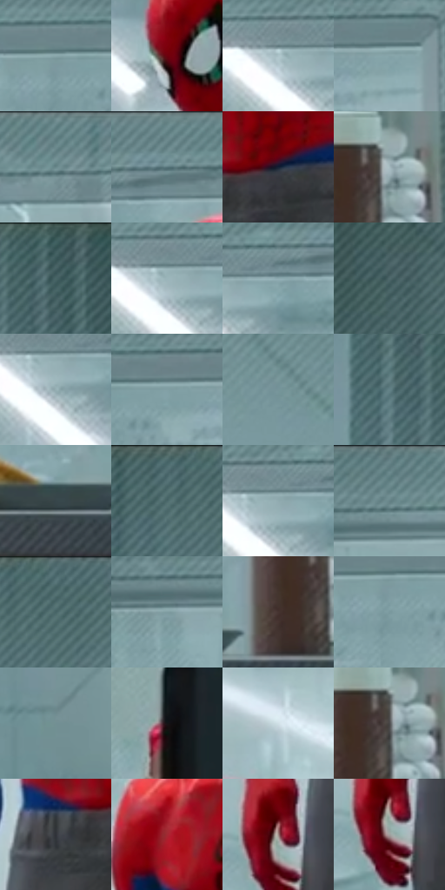

# 电影参考 367

- 状态：常规／活跃；来源世界：miles-home。
- 视角：near-level；景别：medium；场景：interior。
- 时段：interior-time-unknown（外观依据，中置信度；具体时间／晨昏未知）；光照：interior-mixed。
- 材质候选：skin, fabric, glass, metal, plastic, wood（帧级，不是像素分割）。
- 明暗组：middle；L* P5/P50/P95：12.75669 / 56.5249 / 76.63074。
- 资格门禁：无附加门禁。
- 原截图 SHA-256：`8f74e76516b0ddb09b1beeaaf073c7afa23d4bc9e885b3493115a9cbb73893e6`；尺寸：2880 × 1206。
- sRGB 像素 SHA-256：`92dc16a51c23b52132700c8b979d8b14522a1f9c6fa29068c0882d8a38f0319f`。

## 观察与迁移

冷灰食堂与橙窗外景，地面软映色不复制清晰倒置人物。

367  /  人物遮挡／玻璃餐具  /  电脑挡住矮人物身体，门上纹路、食品与容器各有尺度；玻璃纹路不是印刷网点

本公开版保存32个128×128原像素色卡上下文；图集格子并非原场景相邻位置。原rect、图集tile和像素SHA见 `data/palette-crops.json`。上下文不足时不得批准替色，不能以小样推断完整构图。

## 实测色卡

颜色比例分母为保留采样像素，不是材料面积；全部 32 色参与全库匹配。表内四舍五入仅用于阅读，原精度在 JSON。

| ID | HEX | Lab | 原图 xy | 像素数 | 比例 | 明度角色 |
| --- | --- | --- | --- | ---: | ---: | --- |
| 367-S01 | #89A6AB | [66.159285, -8.85125, -5.901793] | [1716, 100] | 8702 | 4.500740% | light |
| 367-S02 | #6D020E | [21.310102, 42.685217, 26.440373] | [1496, 244] | 8656 | 4.476948% | shadow |
| 367-S03 | #ACC3C9 | [77.290913, -6.538898, -5.636653] | [1312, 112] | 8589 | 4.442295% | light |
| 367-S04 | #85A3A8 | [64.968184, -9.191954, -6.019413] | [1912, 104] | 8511 | 4.401953% | light |
| 367-S05 | #69878B | [54.232785, -9.616067, -5.627318] | [1156, 28] | 8404 | 4.346612% | midtone |
| 367-S06 | #6E8D92 | [56.524897, -9.657769, -6.230917] | [1484, 52] | 7994 | 4.134557% | midtone |
| 367-S07 | #152034 | [12.223217, 2.22265, -14.624836] | [1656, 788] | 7577 | 3.918881% | deep-shadow |
| 367-S08 | #A5BABF | [74.111552, -6.137747, -4.958344] | [2668, 832] | 7292 | 3.771477% | light |
| 367-S09 | #445E61 | [38.015979, -8.851596, -4.855752] | [172, 48] | 6885 | 3.560974% | shadow |
| 367-S10 | #9BB5BA | [71.93371, -7.792435, -5.518018] | [1328, 116] | 6389 | 3.304439% | light |
| 367-S11 | #8BA8AE | [66.937421, -8.61519, -6.404973] | [1408, 104] | 6291 | 3.253752% | light |
| 367-S12 | #4E686B | [42.125624, -8.776629, -4.811216] | [2740, 224] | 6274 | 3.244960% | midtone |
| 367-S13 | #96AFB4 | [69.780573, -7.501645, -5.438767] | [1344, 144] | 6224 | 3.219099% | light |
| 367-S14 | #819FA4 | [63.460697, -9.21791, -6.038735] | [1808, 104] | 6219 | 3.216513% | light |
| 367-S15 | #769499 | [59.278894, -9.289959, -6.093373] | [2196, 224] | 6141 | 3.176171% | midtone |
| 367-S16 | #638287 | [52.248993, -9.729859, -6.288363] | [68, 84] | 6122 | 3.166344% | midtone |
| 367-S17 | #37454A | [28.281255, -4.282039, -4.865468] | [2468, 924] | 6111 | 3.160655% | shadow |
| 367-S18 | #537074 | [45.20348, -9.453261, -5.63558] | [376, 28] | 6106 | 3.158069% | midtone |
| 367-S19 | #90ABB0 | [68.159466, -8.174455, -5.669229] | [1352, 112] | 6046 | 3.127037% | light |
| 367-S20 | #5F7D81 | [50.315927, -9.68749, -5.673909] | [984, 28] | 5989 | 3.097556% | midtone |
| 367-S21 | #59777B | [47.939555, -9.729678, -5.702316] | [444, 28] | 5767 | 2.982736% | midtone |
| 367-S22 | #7F9CA1 | [62.390323, -8.915113, -5.950296] | [872, 116] | 5580 | 2.886018% | light |
| 367-S23 | #463430 | [23.577597, 7.392741, 5.653057] | [2600, 884] | 5359 | 2.771715% | shadow |
| 367-S24 | #7A999E | [61.122288, -9.57821, -6.170439] | [1720, 140] | 5276 | 2.728787% | light |
| 367-S25 | #739093 | [57.748451, -9.459905, -4.955777] | [432, 1092] | 5149 | 2.663101% | midtone |
| 367-S26 | #131315 | [5.946658, 0.451738, -1.229765] | [844, 860] | 4953 | 2.561729% | deep-shadow |
| 367-S27 | #D0E0E6 | [88.176794, -4.167276, -4.75273] | [1112, 420] | 4812 | 2.488802% | highlight |
| 367-S28 | #4A494A | [31.149917, 0.630353, -0.448293] | [2656, 844] | 4546 | 2.351225% | shadow |
| 367-S29 | #303239 | [20.846668, 0.892066, -4.71224] | [1560, 824] | 4113 | 2.127274% | shadow |
| 367-S30 | #A32932 | [37.124161, 49.796728, 25.089376] | [1500, 488] | 3909 | 2.021764% | shadow |
| 367-S31 | #9D8781 | [58.114582, 7.308871, 6.303815] | [1456, 1044] | 1755 | 0.907699% | midtone |
| 367-S32 | #A09F9E | [65.544585, 0.168486, 0.650508] | [1456, 1072] | 1605 | 0.830118% | light |

## 色阶与空间分布

- 采样 ROI：`[0.01, 0.02, 0.98, 0.94]`；步长：4；样本数：193346。
- 排除区：`[]`。
- 深暗、暗、中、亮、高光五段计数：`[17797, 32353, 60637, 77033, 5526]`。
- RGB 各 256 箱、L* 100 箱、13×5 色相明度表和 3×3 空间统计全部保存在 [总数据](../film-library.json)。
- [可视化档案](../../references/library.html)按需绘制直方图，不存 2,094 张重复图表图片。

## 纹理特征占比

**这是分块图像特征的面积占比，不是波点／排线／丝网／错版的精确语义覆盖率。** 窗格、发丝、织物也会产生方向或周期特征。
原图 ROI 像素 3098546；已测块覆盖 3098546（100.0000%）；未测 0。

| 特征 | 块覆盖像素 | 占已测面积 | 阈值敏感范围 |
| --- | ---: | ---: | --- |
| low-contrast | 163840 | 5.2876% | 4.2301% ~ 6.6963% |
| directional-structure | 1487872 | 48.0184% | 30.1313% ~ 65.1826% |
| periodic-structure | 1419570 | 45.8141% | 30.5873% ~ 61.2350% |
| mixed-detail | 27264 | 0.8799% | 0.0000% ~ 1.9374% |

阈值敏感范围不是统计置信区间。逐块坐标、尺度、对比、方向一致性、频谱集中度、频率与角度见 [全量特征记录](../texture-features.jsonl)，以帧号定位。
四种印刷层的真实像素覆盖仍标为 `null`，不能填 0，也不能拿上表代替。不得据这些代理测量删除唯一证据。

[测量方法与保留策略](../../references/library-retention.md) · [分类索引](../archive/README.md)
