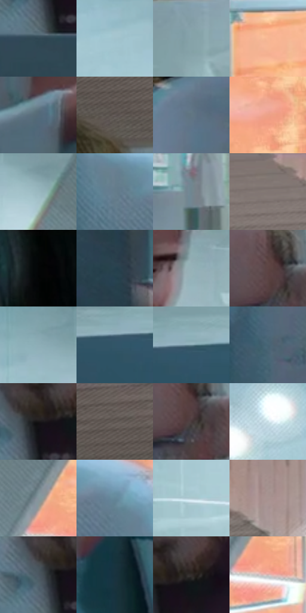

# 电影参考 368

- 状态：常规／活跃；来源世界：miles-home。
- 视角：near-level；景别：environment-wide；场景：interior。
- 时段：interior-time-unknown（外观依据，中置信度；具体时间／晨昏未知）；光照：interior-mixed。
- 材质候选：skin, fabric, glass, metal, plastic, wood（帧级，不是像素分割）。
- 明暗组：middle；L* P5/P50/P95：8.41434 / 51.16027 / 80.24185。
- 资格门禁：无附加门禁。
- 原截图 SHA-256：`13d6a56a30a748e4517f7a805a0e186a944d56088f794e2b01734a19d54dddea`；尺寸：2880 × 1200。
- sRGB 像素 SHA-256：`c4da5ac7e8e29dbeecefd8acfc321d46d8a8d32a42b70e140bbac047c7977dad`。

## 观察与迁移

冷灰食堂与橙窗外景，地面软映色不复制清晰倒置人物。

368、369、373研究人员  /  圆／长脸、胡须、发际、鼻形、年龄与眼镜形状不同；远景与被电脑遮挡的脸减少信息  /  多人不能共用一套脸模；逐人保持可见差异。远景不凭空增高清五官，遮挡处不补整脸

368  /  多样面部／轻动作  /  倒饮料、电脑后的眼镜胡须脸与背景步行；局部淡移位轮廓不据此认定整个人发生故障

本公开版保存32个128×128原像素色卡上下文；图集格子并非原场景相邻位置。原rect、图集tile和像素SHA见 `data/palette-crops.json`。上下文不足时不得批准替色，不能以小样推断完整构图。

## 实测色卡

颜色比例分母为保留采样像素，不是材料面积；全部 32 色参与全库匹配。表内四舍五入仅用于阅读，原精度在 JSON。

| ID | HEX | Lab | 原图 xy | 像素数 | 比例 | 明度角色 |
| --- | --- | --- | --- | ---: | ---: | --- |
| 368-S01 | #2F4652 | [28.36295, -5.322208, -9.991826] | [1740, 796] | 11285 | 5.857834% | shadow |
| 368-S02 | #A3C3CD | [76.813922, -8.537786, -8.571164] | [1572, 168] | 10167 | 5.277501% | light |
| 368-S03 | #85A2A9 | [64.716372, -8.423265, -6.952569] | [972, 276] | 9339 | 4.847702% | light |
| 368-S04 | #F7B794 | [79.49018, 18.837931, 26.878823] | [2264, 508] | 8705 | 4.518604% | light |
| 368-S05 | #546A79 | [43.61397, -4.324731, -11.01614] | [64, 764] | 7461 | 3.872867% | midtone |
| 368-S06 | #635A58 | [39.018554, 3.242176, 2.471563] | [368, 184] | 7306 | 3.792409% | shadow |
| 368-S07 | #617682 | [48.397575, -4.78126, -9.111481] | [2736, 448] | 6886 | 3.574395% | midtone |
| 368-S08 | #ECA187 | [72.941681, 24.813071, 24.828212] | [2368, 264] | 6788 | 3.523525% | light |
| 368-S09 | #9AB8C0 | [72.862595, -8.402617, -7.434395] | [1816, 164] | 6779 | 3.518853% | light |
| 368-S10 | #647D8C | [51.000771, -5.321282, -11.072085] | [1996, 628] | 6619 | 3.435800% | midtone |
| 368-S11 | #718690 | [54.630677, -5.237219, -7.874366] | [1216, 812] | 6420 | 3.332503% | midtone |
| 368-S12 | #827370 | [49.710744, 5.276391, 3.790273] | [1064, 24] | 6276 | 3.257755% | midtone |
| 368-S13 | #040607 | [1.54821, -0.384059, -0.562503] | [2568, 48] | 6260 | 3.249450% | deep-shadow |
| 368-S14 | #26404D | [25.606636, -5.832225, -10.972975] | [2016, 984] | 6246 | 3.242183% | shadow |
| 368-S15 | #97B1B8 | [70.513164, -7.380634, -6.551407] | [416, 456] | 6169 | 3.202213% | light |
| 368-S16 | #5D4445 | [31.558466, 10.937711, 3.60993] | [1836, 388] | 6140 | 3.187160% | shadow |
| 368-S17 | #8DADB6 | [68.697649, -8.862124, -8.214203] | [1692, 100] | 6086 | 3.159130% | light |
| 368-S18 | #315668 | [34.61513, -7.671122, -14.447578] | [816, 1060] | 5980 | 3.104107% | shadow |
| 368-S19 | #7596A1 | [60.039086, -8.798055, -9.518151] | [868, 1040] | 5565 | 2.888688% | light |
| 368-S20 | #466474 | [40.697719, -6.51655, -12.482505] | [460, 1032] | 5355 | 2.779681% | midtone |
| 368-S21 | #181617 | [7.496212, 1.206221, -0.341311] | [1768, 704] | 5213 | 2.705972% | deep-shadow |
| 368-S22 | #706764 | [44.326796, 2.969794, 2.971852] | [104, 24] | 5109 | 2.651987% | midtone |
| 368-S23 | #47393A | [25.477306, 6.357918, 1.704604] | [1852, 424] | 4972 | 2.580873% | shadow |
| 368-S24 | #C5D9E0 | [85.441652, -5.280251, -5.706733] | [1420, 148] | 4957 | 2.573087% | highlight |
| 368-S25 | #85959C | [60.676612, -4.19284, -5.614988] | [2096, 272] | 4752 | 2.466675% | light |
| 368-S26 | #648799 | [54.381839, -7.634596, -13.540046] | [2128, 632] | 4736 | 2.458370% | midtone |
| 368-S27 | #B1CAD1 | [79.72206, -6.941395, -6.314042] | [1408, 480] | 4456 | 2.313027% | light |
| 368-S28 | #A79391 | [62.615505, 7.08181, 3.787654] | [1272, 84] | 4244 | 2.202982% | light |
| 368-S29 | #4A5862 | [36.587322, -2.919583, -7.565106] | [1732, 712] | 4012 | 2.082555% | shadow |
| 368-S30 | #18313E | [18.964239, -5.167469, -11.150729] | [212, 884] | 3208 | 1.665213% | deep-shadow |
| 368-S31 | #332D2C | [19.066391, 2.501324, 1.636988] | [1820, 688] | 2755 | 1.430069% | deep-shadow |
| 368-S32 | #D1B4B1 | [75.683094, 9.91785, 5.384996] | [2136, 336] | 2402 | 1.246834% | light |

## 色阶与空间分布

- 采样 ROI：`[0.01, 0.02, 0.98, 0.94]`；步长：4；样本数：192648。
- 排除区：`[]`。
- 深暗、暗、中、亮、高光五段计数：`[14944, 48356, 54114, 64713, 10521]`。
- RGB 各 256 箱、L* 100 箱、13×5 色相明度表和 3×3 空间统计全部保存在 [总数据](../film-library.json)。
- [可视化档案](../../references/library.html)按需绘制直方图，不存 2,094 张重复图表图片。

## 纹理特征占比

**这是分块图像特征的面积占比，不是波点／排线／丝网／错版的精确语义覆盖率。** 窗格、发丝、织物也会产生方向或周期特征。
原图 ROI 像素 3084576；已测块覆盖 3084576（100.0000%）；未测 0。

| 特征 | 块覆盖像素 | 占已测面积 | 阈值敏感范围 |
| --- | ---: | ---: | --- |
| low-contrast | 265472 | 8.6064% | 7.1042% ~ 9.5775% |
| directional-structure | 814336 | 26.4003% | 11.7270% ~ 42.2437% |
| periodic-structure | 1942048 | 62.9600% | 50.6520% ~ 71.6411% |
| mixed-detail | 62720 | 2.0333% | 0.0000% ~ 7.0545% |

阈值敏感范围不是统计置信区间。逐块坐标、尺度、对比、方向一致性、频谱集中度、频率与角度见 [全量特征记录](../texture-features.jsonl)，以帧号定位。
四种印刷层的真实像素覆盖仍标为 `null`，不能填 0，也不能拿上表代替。不得据这些代理测量删除唯一证据。

[测量方法与保留策略](../../references/library-retention.md) · [分类索引](../archive/README.md)
