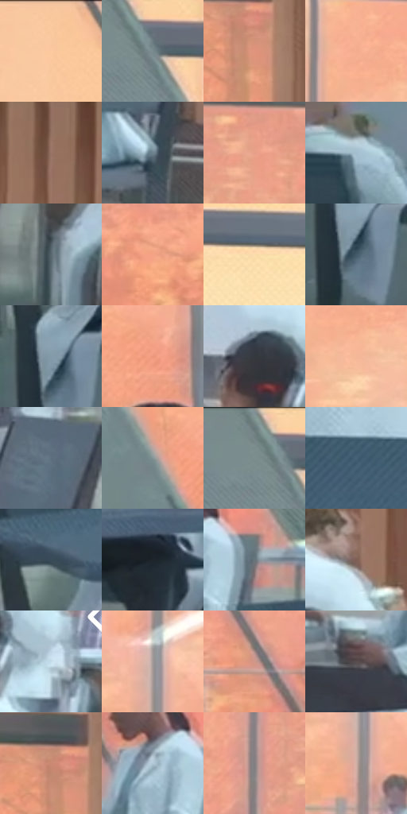

# 电影参考 369

- 状态：常规／活跃；来源世界：miles-home。
- 视角：near-level；景别：environment-wide；场景：interior。
- 时段：interior-time-unknown（外观依据，中置信度；具体时间／晨昏未知）；光照：interior-mixed。
- 材质候选：skin, fabric, glass, metal, plastic, wood（帧级，不是像素分割）。
- 明暗组：light；L* P5/P50/P95：25.04572 / 60.86435 / 86.32649。
- 资格门禁：无附加门禁。
- 原截图 SHA-256：`a85353ce10065f034fff65a601c6da56cb01de492e293473432fe64b6a3ffc32`；尺寸：2880 × 1208。
- sRGB 像素 SHA-256：`5940455200745d7abad563b57c0cf29eae486ffed2bb12592dd44add4d2edbaa`。

## 观察与迁移

冷灰食堂与橙窗外景，地面软映色不复制清晰倒置人物。

369  /  人群与遮挡／冷暖  /  橙窗外与灰青桌椅、不同年龄脸型；电脑后仅露出的眼额保持不完整，不补全脸

本公开版保存32个128×128原像素色卡上下文；图集格子并非原场景相邻位置。原rect、图集tile和像素SHA见 `data/palette-crops.json`。上下文不足时不得批准替色，不能以小样推断完整构图。

## 实测色卡

颜色比例分母为保留采样像素，不是材料面积；全部 32 色参与全库匹配。表内四舍五入仅用于阅读，原精度在 JSON。

| ID | HEX | Lab | 原图 xy | 像素数 | 比例 | 明度角色 |
| --- | --- | --- | --- | ---: | ---: | --- |
| 369-S01 | #FACA9E | [84.502819, 11.160803, 28.415104] | [80, 36] | 11333 | 5.861513% | highlight |
| 369-S02 | #788A8E | [56.210235, -5.586898, -4.320731] | [768, 72] | 9057 | 4.684348% | midtone |
| 369-S03 | #E0947D | [68.395735, 26.020769, 23.933107] | [2500, 188] | 8252 | 4.267996% | light |
| 369-S04 | #F4AD8E | [76.725715, 22.302471, 26.302373] | [1340, 212] | 8038 | 4.157314% | light |
| 369-S05 | #9A7667 | [52.737963, 11.884698, 13.69921] | [2764, 212] | 7563 | 3.911640% | midtone |
| 369-S06 | #6D838E | [53.423558, -5.336284, -8.544942] | [2776, 984] | 7422 | 3.838714% | midtone |
| 369-S07 | #E69F88 | [71.825831, 23.654902, 22.659995] | [1892, 168] | 7375 | 3.814405% | light |
| 369-S08 | #9BB4C3 | [71.9267, -5.283731, -10.463015] | [48, 740] | 7321 | 3.786476% | light |
| 369-S09 | #58666E | [42.312161, -3.406921, -6.28101] | [2432, 996] | 7139 | 3.692344% | midtone |
| 369-S10 | #F3A285 | [73.928675, 26.794471, 27.373175] | [2020, 428] | 7075 | 3.659243% | light |
| 369-S11 | #FBDCAC | [89.241429, 3.898221, 27.56657] | [1032, 96] | 6805 | 3.519597% | highlight |
| 369-S12 | #425967 | [36.52138, -4.857151, -10.832197] | [748, 1108] | 6681 | 3.455463% | shadow |
| 369-S13 | #829AA9 | [62.271115, -4.998266, -10.619567] | [740, 1072] | 6446 | 3.333920% | light |
| 369-S14 | #EC977C | [70.472949, 29.004024, 27.506648] | [1228, 460] | 6413 | 3.316852% | light |
| 369-S15 | #34383D | [23.322156, -0.458205, -3.689064] | [2672, 604] | 6227 | 3.220651% | shadow |
| 369-S16 | #F4B898 | [79.491075, 17.598668, 24.700514] | [1376, 284] | 6152 | 3.181860% | light |
| 369-S17 | #5B6F7F | [45.804631, -3.425568, -11.266652] | [2332, 812] | 6030 | 3.118761% | midtone |
| 369-S18 | #849496 | [60.147018, -5.280532, -2.995976] | [1012, 476] | 6001 | 3.103762% | light |
| 369-S19 | #708082 | [52.391633, -5.395223, -3.060448] | [728, 36] | 5828 | 3.014285% | midtone |
| 369-S20 | #456276 | [40.094374, -5.032581, -14.625642] | [1316, 828] | 5590 | 2.891190% | midtone |
| 369-S21 | #394C58 | [31.214579, -4.065575, -9.46869] | [748, 928] | 5578 | 2.884983% | shadow |
| 369-S22 | #1D242B | [13.811203, -1.065363, -5.669224] | [1720, 1000] | 5216 | 2.697754% | deep-shadow |
| 369-S23 | #69757C | [48.486966, -2.900354, -5.361691] | [692, 708] | 5133 | 2.654826% | midtone |
| 369-S24 | #7F5F55 | [43.290516, 11.507355, 10.783672] | [2752, 512] | 4872 | 2.519835% | midtone |
| 369-S25 | #C4DDEB | [86.724071, -5.418637, -9.627622] | [2788, 660] | 4428 | 2.290195% | highlight |
| 369-S26 | #A19998 | [63.857592, 2.733564, 1.572154] | [1496, 476] | 4381 | 2.265886% | light |
| 369-S27 | #D09789 | [67.540076, 19.523978, 15.831865] | [468, 588] | 4294 | 2.220889% | light |
| 369-S28 | #584E4E | [34.135896, 4.144279, 1.517129] | [492, 812] | 4230 | 2.187788% | shadow |
| 369-S29 | #CC8A73 | [63.552975, 22.465125, 22.554487] | [2476, 148] | 4102 | 2.121585% | light |
| 369-S30 | #B1C8D7 | [79.363124, -4.621646, -10.070112] | [600, 696] | 3977 | 2.056934% | light |
| 369-S31 | #827E81 | [53.224831, 2.094409, -1.086814] | [1720, 240] | 2802 | 1.449215% | midtone |
| 369-S32 | #D0AFA5 | [74.053993, 10.37729, 9.581806] | [1492, 552] | 1585 | 0.819774% | light |

## 色阶与空间分布

- 采样 ROI：`[0.01, 0.02, 0.98, 0.94]`；步长：4；样本数：193346。
- 排除区：`[]`。
- 深暗、暗、中、亮、高光五段计数：`[5873, 26408, 62393, 72415, 26257]`。
- RGB 各 256 箱、L* 100 箱、13×5 色相明度表和 3×3 空间统计全部保存在 [总数据](../film-library.json)。
- [可视化档案](../../references/library.html)按需绘制直方图，不存 2,094 张重复图表图片。

## 纹理特征占比

**这是分块图像特征的面积占比，不是波点／排线／丝网／错版的精确语义覆盖率。** 窗格、发丝、织物也会产生方向或周期特征。
原图 ROI 像素 3104134；已测块覆盖 3104134（100.0000%）；未测 0。

| 特征 | 块覆盖像素 | 占已测面积 | 阈值敏感范围 |
| --- | ---: | ---: | --- |
| low-contrast | 93056 | 2.9978% | 2.1112% ~ 4.5812% |
| directional-structure | 1003392 | 32.3244% | 19.2775% ~ 45.2599% |
| periodic-structure | 1958534 | 63.0944% | 52.1010% ~ 70.3353% |
| mixed-detail | 49152 | 1.5834% | 0.5278% ~ 5.8059% |

阈值敏感范围不是统计置信区间。逐块坐标、尺度、对比、方向一致性、频谱集中度、频率与角度见 [全量特征记录](../texture-features.jsonl)，以帧号定位。
四种印刷层的真实像素覆盖仍标为 `null`，不能填 0，也不能拿上表代替。不得据这些代理测量删除唯一证据。

[测量方法与保留策略](../../references/library-retention.md) · [分类索引](../archive/README.md)
