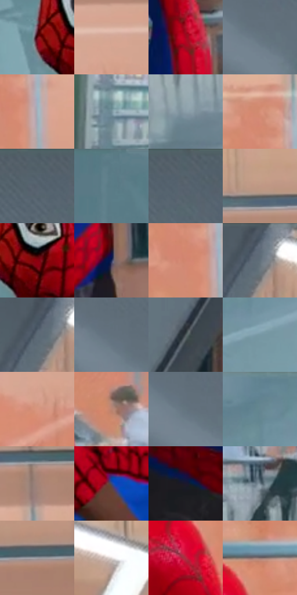

# 电影参考 370

- 状态：常规／活跃；来源世界：miles-home。
- 视角：near-level；景别：medium；场景：interior。
- 时段：interior-time-unknown（外观依据，中置信度；具体时间／晨昏未知）；光照：interior-mixed。
- 材质候选：skin, fabric, glass, metal, plastic, wood（帧级，不是像素分割）。
- 明暗组：middle；L* P5/P50/P95：14.15363 / 49.11354 / 72.27912。
- 资格门禁：无附加门禁。
- 原截图 SHA-256：`0baec53a704bc6489665ce238e73819b195a2a5edc657ae7e412b889641c98db`；尺寸：2880 × 1206。
- sRGB 像素 SHA-256：`203f3cba363f2354fb06db53a2e3edceba0ccceb98fc355c63fd2bdc4503534e`。

## 观察与迁移

冷灰食堂与橙窗外景，地面软映色不复制清晰倒置人物。

370  /  姿态／建筑构图  /  人物倾身与斜向结构形成动势，画面并非满布速度线；不是所有动作都要额外符号

本公开版保存32个128×128原像素色卡上下文；图集格子并非原场景相邻位置。原rect、图集tile和像素SHA见 `data/palette-crops.json`。上下文不足时不得批准替色，不能以小样推断完整构图。

## 实测色卡

颜色比例分母为保留采样像素，不是材料面积；全部 32 色参与全库匹配。表内四舍五入仅用于阅读，原精度在 JSON。

| ID | HEX | Lab | 原图 xy | 像素数 | 比例 | 明度角色 |
| --- | --- | --- | --- | ---: | ---: | --- |
| 370-S01 | #55030C | [15.610578, 35.399364, 19.250463] | [336, 504] | 10545 | 5.453953% | deep-shadow |
| 370-S02 | #D5A795 | [72.198904, 14.333429, 15.783494] | [2484, 244] | 10223 | 5.287412% | light |
| 370-S03 | #A5061E | [34.449078, 57.575852, 34.362448] | [1920, 932] | 9685 | 5.009155% | shadow |
| 370-S04 | #657681 | [48.645878, -3.687177, -8.118651] | [928, 344] | 7665 | 3.964395% | midtone |
| 370-S05 | #A2B0BB | [71.090434, -2.602024, -7.262833] | [2016, 376] | 7580 | 3.920433% | light |
| 370-S06 | #738D99 | [57.069246, -6.372255, -9.405507] | [284, 820] | 7534 | 3.896641% | midtone |
| 370-S07 | #899DA8 | [63.556101, -4.617105, -8.087519] | [2260, 1100] | 7461 | 3.858885% | light |
| 370-S08 | #D88F77 | [66.196961, 24.940603, 24.127272] | [1956, 272] | 7450 | 3.853196% | light |
| 370-S09 | #55636E | [41.184995, -2.665084, -7.98875] | [1060, 48] | 6834 | 3.534596% | midtone |
| 370-S10 | #597A85 | [49.173803, -8.863567, -9.7729] | [220, 36] | 6603 | 3.415121% | midtone |
| 370-S11 | #5B6670 | [42.606805, -1.85646, -7.032003] | [1128, 56] | 6548 | 3.386675% | midtone |
| 370-S12 | #C09785 | [65.775842, 12.728213, 15.349359] | [2104, 84] | 6438 | 3.329782% | light |
| 370-S13 | #89010F | [27.781077, 50.55143, 34.436126] | [416, 516] | 6355 | 3.286854% | shadow |
| 370-S14 | #182554 | [16.29117, 12.195204, -30.343785] | [1724, 1020] | 6016 | 3.111520% | deep-shadow |
| 370-S15 | #D2866E | [63.244211, 26.512741, 25.05417] | [1960, 372] | 5971 | 3.088246% | light |
| 370-S16 | #606E79 | [45.659864, -2.66449, -7.85702] | [1688, 64] | 5961 | 3.083074% | midtone |
| 370-S17 | #5C6B76 | [44.373601, -3.011222, -8.009991] | [1664, 76] | 5910 | 3.056696% | midtone |
| 370-S18 | #62717C | [46.792575, -3.008232, -7.941236] | [868, 288] | 5886 | 3.044283% | midtone |
| 370-S19 | #4E585A | [36.625516, -3.444698, -2.487136] | [1124, 948] | 5819 | 3.009630% | shadow |
| 370-S20 | #7798A4 | [60.832474, -8.549017, -10.02016] | [656, 176] | 5819 | 3.009630% | light |
| 370-S21 | #D99680 | [68.113345, 22.522944, 21.762419] | [2460, 328] | 5819 | 3.009630% | light |
| 370-S22 | #BA8572 | [60.276222, 17.87827, 18.326778] | [1984, 752] | 5700 | 2.948083% | light |
| 370-S23 | #64747F | [47.920517, -3.348694, -8.024846] | [900, 324] | 5621 | 2.907223% | midtone |
| 370-S24 | #62838F | [52.742625, -8.592533, -10.219801] | [636, 48] | 5310 | 2.746372% | midtone |
| 370-S25 | #A38379 | [57.463776, 10.692343, 10.050614] | [2320, 152] | 4444 | 2.298470% | midtone |
| 370-S26 | #3A4978 | [31.852727, 8.352273, -28.711949] | [692, 1100] | 4416 | 2.283988% | shadow |
| 370-S27 | #1A182D | [9.499988, 7.351339, -13.791837] | [1452, 1060] | 4246 | 2.196063% | deep-shadow |
| 370-S28 | #71818D | [53.095599, -3.099366, -8.423648] | [2612, 948] | 4132 | 2.137101% | midtone |
| 370-S29 | #A0A0A5 | [66.006125, 0.965923, -2.58976] | [2528, 112] | 3769 | 1.949355% | light |
| 370-S30 | #E2DBDA | [87.917609, 2.205643, 1.342229] | [1864, 104] | 3305 | 1.709371% | highlight |
| 370-S31 | #B22B40 | [40.517539, 54.533127, 21.250208] | [1808, 572] | 2539 | 1.313190% | midtone |
| 370-S32 | #836E6C | [48.336034, 7.907784, 4.195187] | [1860, 480] | 1742 | 0.900975% | midtone |

## 色阶与空间分布

- 采样 ROI：`[0.01, 0.02, 0.98, 0.94]`；步长：4；样本数：193346。
- 排除区：`[]`。
- 深暗、暗、中、亮、高光五段计数：`[16901, 30227, 80000, 63892, 2326]`。
- RGB 各 256 箱、L* 100 箱、13×5 色相明度表和 3×3 空间统计全部保存在 [总数据](../film-library.json)。
- [可视化档案](../../references/library.html)按需绘制直方图，不存 2,094 张重复图表图片。

## 纹理特征占比

**这是分块图像特征的面积占比，不是波点／排线／丝网／错版的精确语义覆盖率。** 窗格、发丝、织物也会产生方向或周期特征。
原图 ROI 像素 3098546；已测块覆盖 3098546（100.0000%）；未测 0。

| 特征 | 块覆盖像素 | 占已测面积 | 阈值敏感范围 |
| --- | ---: | ---: | --- |
| low-contrast | 409600 | 13.2191% | 8.9890% ~ 15.6853% |
| directional-structure | 786866 | 25.3947% | 14.3551% ~ 38.1676% |
| periodic-structure | 1836544 | 59.2712% | 52.8434% ~ 66.2582% |
| mixed-detail | 65536 | 2.1151% | 0.0000% ~ 3.7013% |

阈值敏感范围不是统计置信区间。逐块坐标、尺度、对比、方向一致性、频谱集中度、频率与角度见 [全量特征记录](../texture-features.jsonl)，以帧号定位。
四种印刷层的真实像素覆盖仍标为 `null`，不能填 0，也不能拿上表代替。不得据这些代理测量删除唯一证据。

[测量方法与保留策略](../../references/library-retention.md) · [分类索引](../archive/README.md)
