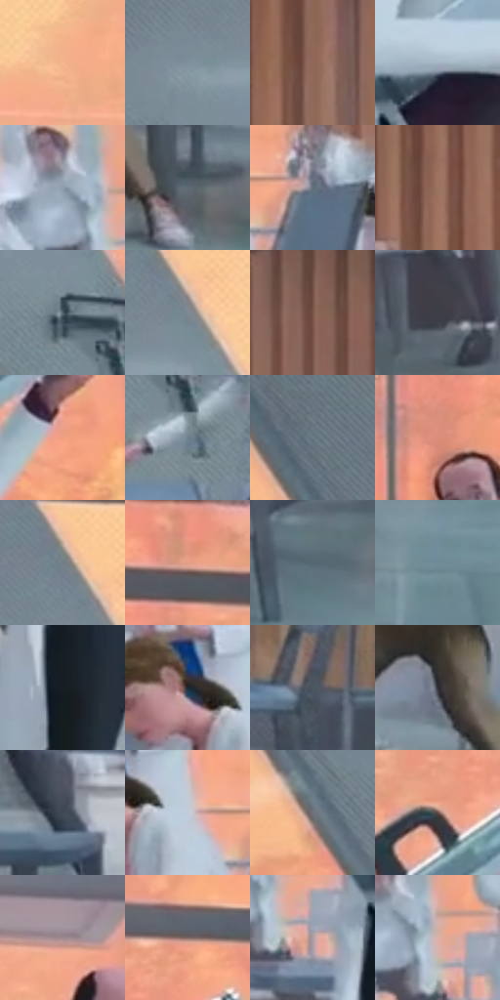

# 电影参考 371

- 状态：条件／活跃；来源世界：miles-home。
- 视角：near-level；景别：environment-wide；场景：interior。
- 时段：interior-time-unknown（外观依据，中置信度；具体时间／晨昏未知）；光照：interior-mixed。
- 材质候选：skin, fabric, glass, metal, plastic（帧级，不是像素分割）。
- 明暗组：middle；L* P5/P50/P95：17.36029 / 51.96868 / 78.75176。
- 资格门禁：motion。
- 原截图 SHA-256：`e9fe3fb3d3a17ec9d893864c75135c980f3d353a6010e5b9814b74e130fed52d`；尺寸：2880 × 1206。
- sRGB 像素 SHA-256：`3a061ccc57d644c3fd0a6edce4a0d97859f45db90568b6a602ea42615b4a4f51`。

## 观察与迁移

原有动作与器物保持，强弱由接触和姿态决定。

371  /  动作准备／衣物  /  多种站姿、白衣翻折与已有虚构武器；此帧未见明显发射束，不从持物姿态创造打击事件

本公开版保存32个128×128原像素色卡上下文；图集格子并非原场景相邻位置。原rect、图集tile和像素SHA见 `data/palette-crops.json`。上下文不足时不得批准替色，不能以小样推断完整构图。

## 实测色卡

颜色比例分母为保留采样像素，不是材料面积；全部 32 色参与全库匹配。表内四舍五入仅用于阅读，原精度在 JSON。

| ID | HEX | Lab | 原图 xy | 像素数 | 比例 | 明度角色 |
| --- | --- | --- | --- | ---: | ---: | --- |
| 371-S01 | #F4B68E | [78.836749, 17.55087, 29.130568] | [840, 212] | 13849 | 7.162807% | light |
| 371-S02 | #7F919C | [59.124408, -3.981108, -7.967445] | [540, 236] | 10673 | 5.520156% | midtone |
| 371-S03 | #8F6859 | [47.57568, 13.531921, 14.600975] | [2508, 168] | 8995 | 4.652281% | midtone |
| 371-S04 | #A6B4C3 | [72.686526, -1.751012, -9.249454] | [1216, 516] | 8933 | 4.620215% | light |
| 371-S05 | #8E9DAC | [64.033239, -2.073869, -9.586272] | [1020, 532] | 8017 | 4.146452% | light |
| 371-S06 | #5E6972 | [43.795871, -2.096151, -6.444671] | [2300, 892] | 7905 | 4.088525% | midtone |
| 371-S07 | #60717C | [46.647202, -3.692475, -8.173753] | [1968, 540] | 7489 | 3.873367% | midtone |
| 371-S08 | #9D7361 | [52.167966, 14.065325, 16.455618] | [2368, 300] | 7382 | 3.818026% | midtone |
| 371-S09 | #51616A | [40.145643, -3.869375, -7.128185] | [704, 408] | 7183 | 3.715101% | midtone |
| 371-S10 | #7C8890 | [55.994162, -2.633953, -5.761219] | [636, 192] | 6801 | 3.517528% | midtone |
| 371-S11 | #795549 | [39.654099, 13.26793, 12.951148] | [2108, 92] | 6672 | 3.450808% | shadow |
| 371-S12 | #3C3D46 | [25.981652, 1.748732, -5.636005] | [464, 804] | 6264 | 3.239788% | shadow |
| 371-S13 | #F1A081 | [73.17513, 26.678626, 28.487615] | [1596, 336] | 6232 | 3.223237% | light |
| 371-S14 | #70828F | [53.376503, -3.532323, -9.175019] | [760, 504] | 5925 | 3.064454% | midtone |
| 371-S15 | #6A7A85 | [50.306217, -3.342657, -7.960686] | [288, 128] | 5679 | 2.937221% | midtone |
| 371-S16 | #DB8F7B | [66.625513, 26.536562, 22.549882] | [1724, 276] | 5659 | 2.926877% | light |
| 371-S17 | #728087 | [52.690896, -3.572192, -5.520537] | [600, 136] | 5616 | 2.904637% | midtone |
| 371-S18 | #E49E87 | [71.351124, 23.301344, 22.523916] | [1848, 84] | 5454 | 2.820850% | light |
| 371-S19 | #536873 | [42.728513, -5.047818, -8.729033] | [2028, 928] | 5388 | 2.786714% | midtone |
| 371-S20 | #718B99 | [56.362092, -5.888791, -10.478121] | [2264, 1112] | 5200 | 2.689479% | midtone |
| 371-S21 | #161E21 | [10.622739, -2.708146, -3.242818] | [1164, 768] | 5182 | 2.680169% | deep-shadow |
| 371-S22 | #1F2932 | [16.040975, -1.615832, -7.249356] | [1784, 504] | 5046 | 2.609829% | deep-shadow |
| 371-S23 | #4B5660 | [35.976064, -1.850473, -7.225173] | [2476, 748] | 5017 | 2.594830% | shadow |
| 371-S24 | #2E2F37 | [19.596508, 1.586227, -5.233918] | [2148, 744] | 4975 | 2.573107% | deep-shadow |
| 371-S25 | #3F4956 | [30.624944, -0.657048, -9.037001] | [976, 716] | 4925 | 2.547247% | shadow |
| 371-S26 | #C2CCDA | [81.683721, -0.659712, -8.100164] | [1864, 532] | 4309 | 2.228647% | highlight |
| 371-S27 | #70737B | [48.431095, 0.56493, -4.790609] | [352, 312] | 4299 | 2.223475% | midtone |
| 371-S28 | #614C47 | [34.325345, 7.997101, 6.343731] | [1496, 216] | 3668 | 1.897117% | shadow |
| 371-S29 | #9D878D | [58.433331, 9.367584, -0.123199] | [1256, 140] | 3335 | 1.724887% | midtone |
| 371-S30 | #7D6662 | [45.283083, 8.509419, 5.719846] | [1584, 112] | 3156 | 1.632307% | midtone |
| 371-S31 | #A99DA6 | [65.983441, 6.028415, -3.096788] | [1100, 604] | 2717 | 1.405253% | light |
| 371-S32 | #D8B1A7 | [75.348657, 12.598361, 10.436573] | [1068, 560] | 1401 | 0.724608% | light |

## 色阶与空间分布

- 采样 ROI：`[0.01, 0.02, 0.98, 0.94]`；步长：4；样本数：193346。
- 排除区：`[]`。
- 深暗、暗、中、亮、高光五段计数：`[12421, 29033, 92876, 52155, 6861]`。
- RGB 各 256 箱、L* 100 箱、13×5 色相明度表和 3×3 空间统计全部保存在 [总数据](../film-library.json)。
- [可视化档案](../../references/library.html)按需绘制直方图，不存 2,094 张重复图表图片。

## 纹理特征占比

**这是分块图像特征的面积占比，不是波点／排线／丝网／错版的精确语义覆盖率。** 窗格、发丝、织物也会产生方向或周期特征。
原图 ROI 像素 3098546；已测块覆盖 3098546（100.0000%）；未测 0。

| 特征 | 块覆盖像素 | 占已测面积 | 阈值敏感范围 |
| --- | ---: | ---: | --- |
| low-contrast | 27264 | 0.8799% | 0.3511% ~ 3.1685% |
| directional-structure | 868096 | 28.0162% | 19.0355% ~ 40.6116% |
| periodic-structure | 2186802 | 70.5751% | 59.0373% ~ 73.7436% |
| mixed-detail | 16384 | 0.5288% | 0.0000% ~ 4.0525% |

阈值敏感范围不是统计置信区间。逐块坐标、尺度、对比、方向一致性、频谱集中度、频率与角度见 [全量特征记录](../texture-features.jsonl)，以帧号定位。
四种印刷层的真实像素覆盖仍标为 `null`，不能填 0，也不能拿上表代替。不得据这些代理测量删除唯一证据。

[测量方法与保留策略](../../references/library-retention.md) · [分类索引](../archive/README.md)
