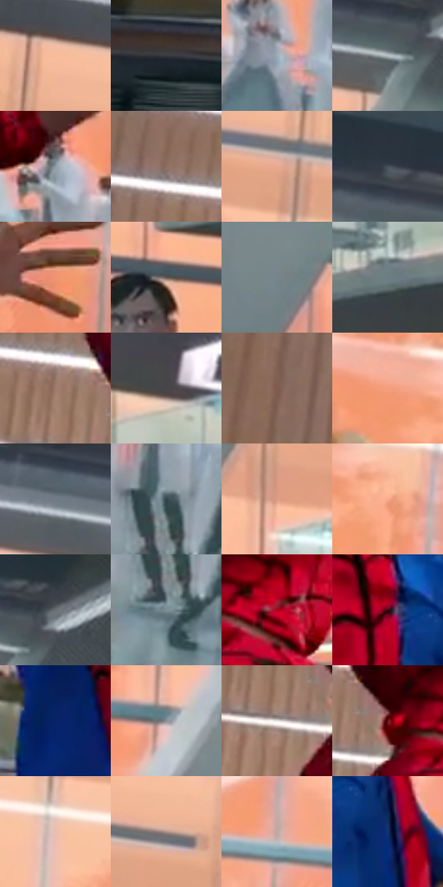

# 电影参考 372

- 状态：条件／活跃；来源世界：miles-home。
- 视角：near-level；景别：medium；场景：interior。
- 时段：interior-time-unknown（外观依据，中置信度；具体时间／晨昏未知）；光照：interior-mixed。
- 材质候选：skin, fabric, glass, metal, plastic（帧级，不是像素分割）。
- 明暗组：middle；L* P5/P50/P95：17.19969 / 54.87415 / 81.86963。
- 资格门禁：motion。
- 原截图 SHA-256：`10f1fcbbfe6a90a64a48bd3f6813f6020068bdf192188c69f448dcbf20707adc`；尺寸：2880 × 1208。
- sRGB 像素 SHA-256：`ff4e06ca4d8b8eb022a9bfdd8b91413729c8ade14fd04e1199fef8f6c9982a30`。

## 观察与迁移

原有动作与器物保持，强弱由接触和姿态决定。

372  /  手势／动作准备  /  人物拿着食物、另一手展开，后方人群；姿势不证明已经击中，不能默认加碰撞爆点

本公开版保存32个128×128原像素色卡上下文；图集格子并非原场景相邻位置。原rect、图集tile和像素SHA见 `data/palette-crops.json`。上下文不足时不得批准替色，不能以小样推断完整构图。

## 实测色卡

颜色比例分母为保留采样像素，不是材料面积；全部 32 色参与全库匹配。表内四舍五入仅用于阅读，原精度在 JSON。

| ID | HEX | Lab | 原图 xy | 像素数 | 比例 | 明度角色 |
| --- | --- | --- | --- | ---: | ---: | --- |
| 372-S01 | #F6BC9C | [80.718255, 16.722517, 24.27642] | [932, 76] | 12739 | 6.588706% | highlight |
| 372-S02 | #2F3337 | [21.010083, -0.716704, -3.114847] | [40, 880] | 9542 | 4.935194% | shadow |
| 372-S03 | #9BACB7 | [69.392337, -3.59864, -7.632919] | [1560, 860] | 8701 | 4.500222% | light |
| 372-S04 | #B5BFC4 | [76.721615, -2.466122, -3.698996] | [2124, 196] | 7494 | 3.875953% | light |
| 372-S05 | #8F9DA5 | [63.892508, -3.274612, -5.855039] | [1020, 768] | 7436 | 3.845955% | light |
| 372-S06 | #8A6D60 | [48.493434, 9.468661, 11.641725] | [372, 268] | 7389 | 3.821646% | midtone |
| 372-S07 | #E6AB92 | [74.842104, 18.386093, 21.341777] | [1136, 208] | 7028 | 3.634934% | light |
| 372-S08 | #444E57 | [32.625236, -1.739086, -6.62737] | [1856, 68] | 6738 | 3.484944% | shadow |
| 372-S09 | #F09471 | [70.10708, 31.149117, 33.080089] | [1332, 628] | 6688 | 3.459084% | light |
| 372-S10 | #615552 | [37.202762, 4.344483, 3.550729] | [2316, 636] | 6629 | 3.428568% | shadow |
| 372-S11 | #77858B | [54.616877, -3.781058, -4.951976] | [2044, 632] | 6622 | 3.424948% | midtone |
| 372-S12 | #6E7C83 | [51.11568, -3.584145, -5.548996] | [2692, 504] | 6612 | 3.419776% | midtone |
| 372-S13 | #9F7B6B | [54.657492, 11.625703, 14.124486] | [464, 336] | 6548 | 3.386675% | midtone |
| 372-S14 | #474548 | [29.572671, 1.495975, -1.504515] | [2732, 324] | 6505 | 3.364435% | shadow |
| 372-S15 | #7E5C4E | [42.216939, 11.902837, 13.517005] | [136, 604] | 6341 | 3.279613% | midtone |
| 372-S16 | #F49E7D | [73.004942, 28.520009, 30.48191] | [988, 332] | 6203 | 3.208238% | light |
| 372-S17 | #515F69 | [39.501802, -2.918326, -7.477488] | [1404, 52] | 6194 | 3.203583% | shadow |
| 372-S18 | #34434D | [27.517996, -3.246476, -7.987252] | [1024, 936] | 6170 | 3.191170% | shadow |
| 372-S19 | #DB9C83 | [69.809127, 20.407312, 22.45293] | [2312, 416] | 5875 | 3.038594% | light |
| 372-S20 | #F8AB8B | [76.649072, 24.594468, 27.882351] | [1096, 368] | 5673 | 2.934118% | light |
| 372-S21 | #666F75 | [46.281747, -2.067769, -4.487555] | [2184, 152] | 5520 | 2.854985% | midtone |
| 372-S22 | #7D8F97 | [58.262894, -4.667366, -6.407849] | [1016, 1016] | 5453 | 2.820332% | midtone |
| 372-S23 | #AD0224 | [36.095607, 60.308304, 33.039348] | [676, 384] | 5432 | 2.809471% | shadow |
| 372-S24 | #360912 | [9.186095, 22.921257, 6.130946] | [672, 552] | 5386 | 2.785680% | deep-shadow |
| 372-S25 | #062467 | [16.889424, 18.893397, -42.033313] | [540, 776] | 5369 | 2.776887% | deep-shadow |
| 372-S26 | #8A9195 | [59.729161, -1.719433, -2.990217] | [1880, 588] | 4507 | 2.331054% | midtone |
| 372-S27 | #EBE5E5 | [91.396151, 2.021077, 0.723099] | [488, 412] | 4190 | 2.167099% | highlight |
| 372-S28 | #671518 | [21.896419, 36.039718, 20.59024] | [560, 376] | 3627 | 1.875912% | shadow |
| 372-S29 | #E9BEAF | [80.318933, 13.166982, 13.379953] | [1416, 364] | 3279 | 1.695923% | highlight |
| 372-S30 | #AC9289 | [62.621912, 8.247877, 8.380399] | [1808, 272] | 3247 | 1.679373% | light |
| 372-S31 | #BDA9A3 | [70.760457, 6.217076, 5.734943] | [1640, 532] | 2308 | 1.193715% | light |
| 372-S32 | #103472 | [22.931834, 12.771514, -39.307201] | [764, 608] | 1901 | 0.983211% | shadow |

## 色阶与空间分布

- 采样 ROI：`[0.01, 0.02, 0.98, 0.94]`；步长：4；样本数：193346。
- 排除区：`[]`。
- 深暗、暗、中、亮、高光五段计数：`[14419, 43879, 52212, 67691, 15145]`。
- RGB 各 256 箱、L* 100 箱、13×5 色相明度表和 3×3 空间统计全部保存在 [总数据](../film-library.json)。
- [可视化档案](../../references/library.html)按需绘制直方图，不存 2,094 张重复图表图片。

## 纹理特征占比

**这是分块图像特征的面积占比，不是波点／排线／丝网／错版的精确语义覆盖率。** 窗格、发丝、织物也会产生方向或周期特征。
原图 ROI 像素 3104134；已测块覆盖 3104134（100.0000%）；未测 0。

| 特征 | 块覆盖像素 | 占已测面积 | 阈值敏感范围 |
| --- | ---: | ---: | --- |
| low-contrast | 11136 | 0.3587% | 0.0000% ~ 0.3587% |
| directional-structure | 1193728 | 38.4561% | 21.9949% ~ 52.7443% |
| periodic-structure | 1882886 | 60.6574% | 47.2557% ~ 76.5907% |
| mixed-detail | 16384 | 0.5278% | 0.0000% ~ 1.0556% |

阈值敏感范围不是统计置信区间。逐块坐标、尺度、对比、方向一致性、频谱集中度、频率与角度见 [全量特征记录](../texture-features.jsonl)，以帧号定位。
四种印刷层的真实像素覆盖仍标为 `null`，不能填 0，也不能拿上表代替。不得据这些代理测量删除唯一证据。

[测量方法与保留策略](../../references/library-retention.md) · [分类索引](../archive/README.md)
