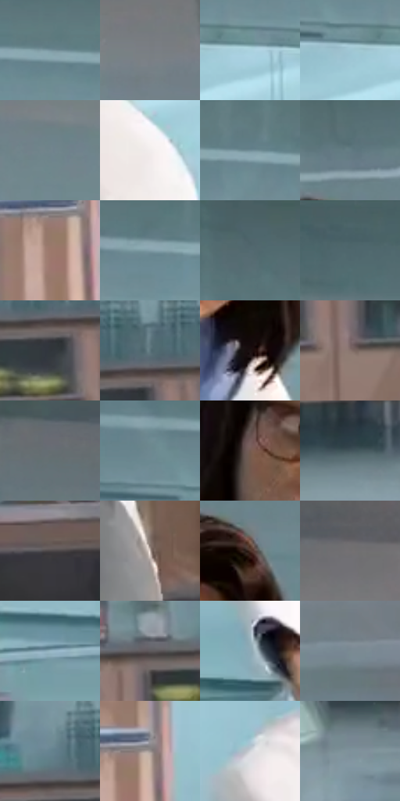

# 电影参考 373

- 状态：条件／活跃；来源世界：miles-home。
- 视角：near-level；景别：medium；场景：interior。
- 时段：interior-time-unknown（外观依据，中置信度；具体时间／晨昏未知）；光照：interior-mixed。
- 材质候选：skin, fabric, glass, metal, plastic（帧级，不是像素分割）。
- 明暗组：middle；L* P5/P50/P95：21.57149 / 53.45226 / 84.81748。
- 资格门禁：motion。
- 原截图 SHA-256：`c6437ba95cc4068f8314a7eae4793e0541d39992309eb359de4b2619aac8adbd`；尺寸：2878 × 1204。
- sRGB 像素 SHA-256：`fe2b484e5ca5230f3729c56c51bb89356e305d7fb7039578d1ffe201d7ecdd45`。

## 观察与迁移

原有动作与器物保持，强弱由接触和姿态决定。

368、369、373研究人员  /  圆／长脸、胡须、发际、鼻形、年龄与眼镜形状不同；远景与被电脑遮挡的脸减少信息  /  多人不能共用一套脸模；逐人保持可见差异。远景不凭空增高清五官，遮挡处不补整脸

373  /  表情／人脸差异  /  短发眼镜人物倾头张口、眉睑不对称，旁侧胡须人物不同脸型；学习表情组织而非换脸

本公开版保存32个128×128原像素色卡上下文；图集格子并非原场景相邻位置。原rect、图集tile和像素SHA见 `data/palette-crops.json`。上下文不足时不得批准替色，不能以小样推断完整构图。

## 实测色卡

颜色比例分母为保留采样像素，不是材料面积；全部 32 色参与全库匹配。表内四舍五入仅用于阅读，原精度在 JSON。

| ID | HEX | Lab | 原图 xy | 像素数 | 比例 | 明度角色 |
| --- | --- | --- | --- | ---: | ---: | --- |
| 373-S01 | #77949E | [59.497739, -7.789232, -8.607744] | [804, 192] | 12874 | 6.682654% | midtone |
| 373-S02 | #787D82 | [52.143164, -0.816758, -3.357094] | [2260, 208] | 8985 | 4.663947% | midtone |
| 373-S03 | #ABD2DF | [81.879944, -9.95026, -10.643569] | [532, 292] | 8919 | 4.629687% | highlight |
| 373-S04 | #9FC6D4 | [77.585232, -9.767363, -11.228763] | [456, 292] | 8570 | 4.448528% | light |
| 373-S05 | #72848C | [53.99818, -4.704646, -6.489526] | [2000, 252] | 7442 | 3.863004% | midtone |
| 373-S06 | #F2EDED | [94.124043, 1.671553, 0.598111] | [332, 452] | 7345 | 3.812653% | highlight |
| 373-S07 | #718C97 | [56.585369, -6.937016, -8.994112] | [976, 200] | 6924 | 3.594120% | midtone |
| 373-S08 | #637B84 | [50.077829, -6.505168, -7.764643] | [1524, 204] | 6780 | 3.519372% | midtone |
| 373-S09 | #9D796C | [53.949163, 12.087332, 12.52795] | [540, 948] | 6663 | 3.458640% | midtone |
| 373-S10 | #819CA7 | [62.703928, -6.888183, -8.852137] | [568, 192] | 6647 | 3.450334% | light |
| 373-S11 | #546A71 | [43.337239, -6.404854, -6.601149] | [408, 76] | 6515 | 3.381816% | midtone |
| 373-S12 | #4C6269 | [40.066945, -6.438188, -6.669566] | [36, 40] | 6372 | 3.307587% | midtone |
| 373-S13 | #31363B | [22.327177, -0.86206, -3.851319] | [2016, 844] | 6340 | 3.290976% | shadow |
| 373-S14 | #5A737B | [46.796362, -7.11321, -7.397899] | [2040, 780] | 6143 | 3.188717% | midtone |
| 373-S15 | #1B1210 | [6.350795, 3.833567, 2.572848] | [1468, 660] | 6044 | 3.137328% | deep-shadow |
| 373-S16 | #87736D | [50.117324, 6.761137, 6.209588] | [2104, 912] | 6015 | 3.122275% | midtone |
| 373-S17 | #666D73 | [45.633737, -1.342293, -4.248764] | [2000, 80] | 5929 | 3.077634% | midtone |
| 373-S18 | #6D8890 | [54.940643, -7.676159, -7.441001] | [384, 212] | 5774 | 2.997176% | midtone |
| 373-S19 | #765B51 | [41.102123, 9.472385, 10.008709] | [1340, 476] | 5706 | 2.961879% | midtone |
| 373-S20 | #42555B | [34.823138, -5.728289, -5.884872] | [1668, 1080] | 5654 | 2.934886% | shadow |
| 373-S21 | #4C4748 | [30.666513, 2.300404, 0.154397] | [2384, 824] | 5305 | 2.753727% | shadow |
| 373-S22 | #C1B1AA | [73.340537, 4.519875, 5.649047] | [344, 1112] | 5197 | 2.697666% | light |
| 373-S23 | #4C3127 | [23.270476, 10.874889, 11.370134] | [1536, 312] | 5162 | 2.679498% | shadow |
| 373-S24 | #727072 | [47.470017, 1.171056, -0.83267] | [2436, 76] | 4650 | 2.413729% | midtone |
| 373-S25 | #97B7C5 | [72.545562, -7.685729, -10.66128] | [696, 1112] | 4353 | 2.259561% | light |
| 373-S26 | #5E5A5C | [38.663981, 2.013179, -0.576369] | [1764, 812] | 4327 | 2.246065% | shadow |
| 373-S27 | #8DAAB7 | [67.895048, -7.016825, -9.964173] | [896, 1036] | 4285 | 2.224264% | light |
| 373-S28 | #7A8A92 | [56.47551, -4.00498, -6.215581] | [2628, 352] | 3872 | 2.009883% | midtone |
| 373-S29 | #66838F | [52.992954, -7.34673, -9.818846] | [1932, 768] | 3828 | 1.987044% | midtone |
| 373-S30 | #97908D | [60.292385, 2.024249, 2.516319] | [576, 904] | 3787 | 1.965761% | light |
| 373-S31 | #D0D4DA | [84.770707, -0.24168, -3.425135] | [856, 768] | 3490 | 1.811594% | highlight |
| 373-S32 | #7F919A | [59.062425, -4.435302, -6.918715] | [2128, 1112] | 2751 | 1.427993% | midtone |

## 色阶与空间分布

- 采样 ROI：`[0.01, 0.02, 0.98, 0.94]`；步长：4；样本数：192648。
- 排除区：`[]`。
- 深暗、暗、中、亮、高光五段计数：`[8260, 29029, 99013, 36434, 19912]`。
- RGB 各 256 箱、L* 100 箱、13×5 色相明度表和 3×3 空间统计全部保存在 [总数据](../film-library.json)。
- [可视化档案](../../references/library.html)按需绘制直方图，不存 2,094 张重复图表图片。

## 纹理特征占比

**这是分块图像特征的面积占比，不是波点／排线／丝网／错版的精确语义覆盖率。** 窗格、发丝、织物也会产生方向或周期特征。
原图 ROI 像素 3090744；已测块覆盖 3090744（100.0000%）；未测 0。

| 特征 | 块覆盖像素 | 占已测面积 | 阈值敏感范围 |
| --- | ---: | ---: | --- |
| low-contrast | 242688 | 7.8521% | 4.2408% ~ 10.5026% |
| directional-structure | 1064064 | 34.4274% | 22.3635% ~ 44.6567% |
| periodic-structure | 1767608 | 57.1904% | 51.1025% ~ 65.1998% |
| mixed-detail | 16384 | 0.5301% | 0.0000% ~ 1.9340% |

阈值敏感范围不是统计置信区间。逐块坐标、尺度、对比、方向一致性、频谱集中度、频率与角度见 [全量特征记录](../texture-features.jsonl)，以帧号定位。
四种印刷层的真实像素覆盖仍标为 `null`，不能填 0，也不能拿上表代替。不得据这些代理测量删除唯一证据。

[测量方法与保留策略](../../references/library-retention.md) · [分类索引](../archive/README.md)
