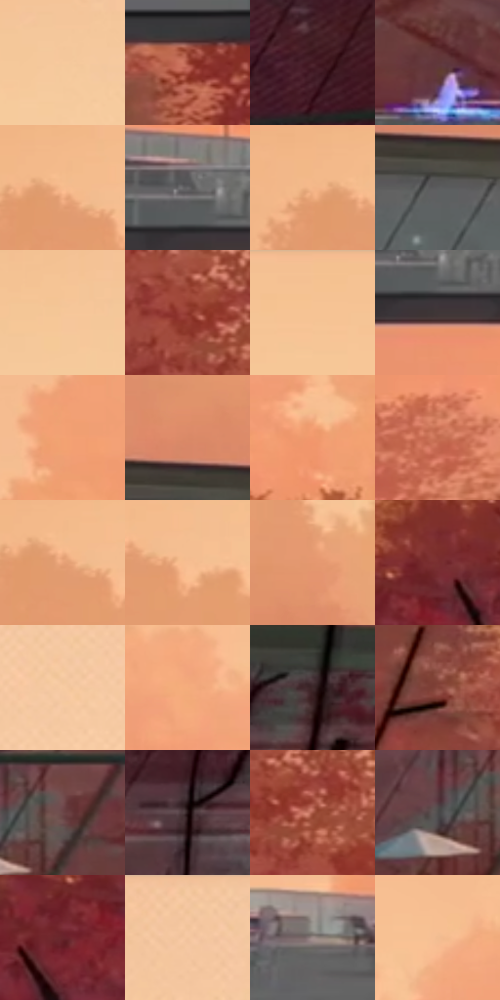

# 电影参考 374

- 状态：常规／活跃；来源世界：miles-home。
- 视角：near-level；景别：environment-wide；场景：landscape。
- 时段：daylight-time-unspecified（外观依据，中置信度；具体时间／晨昏未知）；光照：warm-day。
- 材质候选：glass, metal, foliage, sky（帧级，不是像素分割）。
- 明暗组：middle；L* P5/P50/P95：16.33787 / 56.95487 / 83.86341。
- 资格门禁：无附加门禁。
- 原截图 SHA-256：`2fa1522967d0945dac2efaf1c831057732048ae3606c04aeba44c4797f66040d`；尺寸：2880 × 1208。
- sRGB 像素 SHA-256：`824c09dabee7ef9d313a8f1beb4108a7d2790f9250c10260c5cbc3b1ae9f0520`。

## 观察与迁移

悬挑楼体与暖林空气层，玻璃不能画成纸板。

374  /  建筑远景／事件轨迹  /  悬挑平台、玻璃与暖林，蓝色轨迹横贯平台；事件能量线不是普通走路速度线，不移植武器或新光源

本公开版保存32个128×128原像素色卡上下文；图集格子并非原场景相邻位置。原rect、图集tile和像素SHA见 `data/palette-crops.json`。上下文不足时不得批准替色，不能以小样推断完整构图。

## 实测色卡

颜色比例分母为保留采样像素，不是材料面积；全部 32 色参与全库匹配。表内四舍五入仅用于阅读，原精度在 JSON。

| ID | HEX | Lab | 原图 xy | 像素数 | 比例 | 明度角色 |
| --- | --- | --- | --- | ---: | ---: | --- |
| 374-S01 | #F6C99C | [83.845664, 9.90846, 28.51041] | [2348, 132] | 9148 | 4.731414% | highlight |
| 374-S02 | #9F4736 | [41.446979, 35.299016, 27.778446] | [1124, 908] | 8892 | 4.599009% | midtone |
| 374-S03 | #441B24 | [16.20793, 20.828031, 3.485157] | [188, 972] | 8704 | 4.501774% | deep-shadow |
| 374-S04 | #60373A | [28.181542, 18.685436, 6.007005] | [720, 740] | 8181 | 4.231275% | shadow |
| 374-S05 | #F6BB8E | [80.230295, 15.700769, 31.019626] | [804, 76] | 7981 | 4.127833% | highlight |
| 374-S06 | #69686A | [44.153228, 0.800044, -0.982077] | [1760, 816] | 7814 | 4.041459% | midtone |
| 374-S07 | #F3B588 | [78.393905, 17.061938, 31.694138] | [756, 72] | 7755 | 4.010944% | light |
| 374-S08 | #5B5C5D | [39.016826, -0.183287, -0.710051] | [932, 424] | 7616 | 3.939052% | shadow |
| 374-S09 | #F6C698 | [83.046883, 11.01968, 29.529551] | [2216, 112] | 7542 | 3.900779% | highlight |
| 374-S10 | #8E372C | [35.334486, 36.195952, 25.703085] | [432, 248] | 7383 | 3.818543% | shadow |
| 374-S11 | #F6C294 | [82.010726, 12.669459, 30.238526] | [1656, 52] | 7041 | 3.641658% | highlight |
| 374-S12 | #3F3737 | [23.885357, 3.514849, 1.289761] | [1788, 876] | 6844 | 3.539768% | shadow |
| 374-S13 | #F3A273 | [73.634692, 25.134586, 36.599086] | [1648, 584] | 6831 | 3.533044% | light |
| 374-S14 | #DA8967 | [64.787231, 27.437351, 31.119953] | [912, 344] | 6556 | 3.390812% | light |
| 374-S15 | #F2986D | [71.174882, 29.506696, 36.629761] | [2552, 644] | 6511 | 3.367538% | light |
| 374-S16 | #C16A4F | [54.252281, 32.082752, 30.355469] | [1956, 1008] | 6395 | 3.307542% | midtone |
| 374-S17 | #E9A379 | [72.827468, 21.166316, 32.154505] | [808, 92] | 6166 | 3.189101% | light |
| 374-S18 | #F7BD91 | [80.859493, 15.358409, 30.296938] | [868, 104] | 6048 | 3.128071% | highlight |
| 374-S19 | #E5976F | [69.428743, 25.049517, 33.020091] | [976, 268] | 5662 | 2.928429% | light |
| 374-S20 | #7A2E30 | [30.172069, 33.326807, 15.952011] | [2724, 924] | 5638 | 2.916016% | shadow |
| 374-S21 | #F6CBA2 | [84.440624, 9.571307, 26.174974] | [2696, 80] | 5471 | 2.829642% | highlight |
| 374-S22 | #F4AC7B | [76.174936, 20.95643, 35.663392] | [1860, 520] | 5419 | 2.802747% | light |
| 374-S23 | #3D282A | [18.701013, 10.198674, 2.658825] | [264, 404] | 4945 | 2.557591% | deep-shadow |
| 374-S24 | #84453A | [36.871169, 25.753273, 18.706736] | [168, 216] | 4845 | 2.505870% | shadow |
| 374-S25 | #6C4748 | [34.320304, 16.014866, 5.887618] | [600, 660] | 4503 | 2.328985% | shadow |
| 374-S26 | #211213 | [7.253674, 7.889242, 2.203598] | [144, 472] | 4085 | 2.112793% | deep-shadow |
| 374-S27 | #A75844 | [46.464563, 30.467158, 26.067802] | [484, 264] | 3939 | 2.037280% | midtone |
| 374-S28 | #4E4B4B | [32.16818, 1.23754, 0.443261] | [524, 680] | 3895 | 2.014523% | shadow |
| 374-S29 | #69262B | [25.456924, 30.443343, 12.446649] | [2668, 996] | 3473 | 1.796262% | shadow |
| 374-S30 | #F2C59C | [82.493165, 10.454119, 26.621294] | [2500, 40] | 2928 | 1.514384% | highlight |
| 374-S31 | #9C8B8A | [59.314035, 6.189799, 2.865333] | [1480, 788] | 2838 | 1.467835% | midtone |
| 374-S32 | #F2BC91 | [80.118492, 13.930439, 29.220188] | [2420, 500] | 2297 | 1.188026% | highlight |

## 色阶与空间分布

- 采样 ROI：`[0.01, 0.02, 0.98, 0.94]`；步长：4；样本数：193346。
- 排除区：`[]`。
- 深暗、暗、中、亮、高光五段计数：`[15983, 53715, 29034, 49423, 45191]`。
- RGB 各 256 箱、L* 100 箱、13×5 色相明度表和 3×3 空间统计全部保存在 [总数据](../film-library.json)。
- [可视化档案](../../references/library.html)按需绘制直方图，不存 2,094 张重复图表图片。

## 纹理特征占比

**这是分块图像特征的面积占比，不是波点／排线／丝网／错版的精确语义覆盖率。** 窗格、发丝、织物也会产生方向或周期特征。
原图 ROI 像素 3104134；已测块覆盖 3104134（100.0000%）；未测 0。

| 特征 | 块覆盖像素 | 占已测面积 | 阈值敏感范围 |
| --- | ---: | ---: | --- |
| low-contrast | 515840 | 16.6178% | 13.0139% ~ 18.2013% |
| directional-structure | 442368 | 14.2509% | 8.4450% ~ 23.3227% |
| periodic-structure | 1885958 | 60.7563% | 54.5131% ~ 60.7563% |
| mixed-detail | 259968 | 8.3749% | 5.6369% ~ 18.8406% |

阈值敏感范围不是统计置信区间。逐块坐标、尺度、对比、方向一致性、频谱集中度、频率与角度见 [全量特征记录](../texture-features.jsonl)，以帧号定位。
四种印刷层的真实像素覆盖仍标为 `null`，不能填 0，也不能拿上表代替。不得据这些代理测量删除唯一证据。

[测量方法与保留策略](../../references/library-retention.md) · [分类索引](../archive/README.md)
