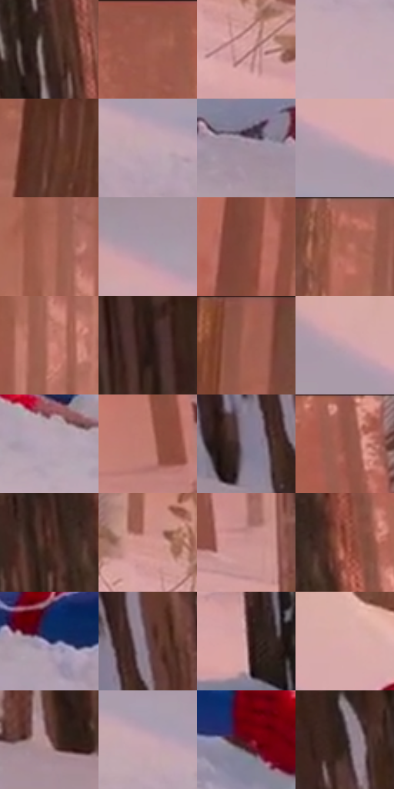

# 电影参考 375

- 状态：常规／活跃；来源世界：miles-home。
- 视角：high-angle；景别：full-body；场景：landscape。
- 时段：daylight-time-unspecified（外观依据，中置信度；具体时间／晨昏未知）；光照：warm-day。
- 材质候选：skin, hair, fabric, foliage, snow, stone, sky（帧级，不是像素分割）。
- 明暗组：middle；L* P5/P50/P95：15.08626 / 55.14499 / 72.52742。
- 资格门禁：无附加门禁。
- 原截图 SHA-256：`b6dd1d1f819dc6421af67158eed1c5c93e2c9a915463576001d6af5b08819764`；尺寸：2880 × 1208。
- sRGB 像素 SHA-256：`33d7458ee032c2cefaa04e317f6aa080ae6087e7c3e3cf199da520b2a29358a8`。

## 观察与迁移

暖林、冷雪、发束、布料与半透明软管分别表达；线状实体不叫动作线。

375  /  雪地接触／暖冷光  /  人物躺在树旁雪面，接触凹痕与冷灰阴影；身上白色环线来源不单凭本帧断言，不用作通用击打条纹

本公开版保存32个128×128原像素色卡上下文；图集格子并非原场景相邻位置。原rect、图集tile和像素SHA见 `data/palette-crops.json`。上下文不足时不得批准替色，不能以小样推断完整构图。

## 实测色卡

颜色比例分母为保留采样像素，不是材料面积；全部 32 色参与全库匹配。表内四舍五入仅用于阅读，原精度在 JSON。

| ID | HEX | Lab | 原图 xy | 像素数 | 比例 | 明度角色 |
| --- | --- | --- | --- | ---: | ---: | --- |
| 375-S01 | #3B2620 | [17.555216, 9.003133, 7.98369] | [2512, 80] | 16543 | 8.556164% | deep-shadow |
| 375-S02 | #9D5B4C | [45.87136, 25.416372, 20.314227] | [1756, 52] | 9918 | 5.129664% | midtone |
| 375-S03 | #D6A2A2 | [71.383357, 19.221314, 7.494179] | [1212, 632] | 9730 | 5.032429% | light |
| 375-S04 | #C5AAB6 | [72.227209, 11.82583, -2.513739] | [612, 920] | 9458 | 4.891748% | light |
| 375-S05 | #60382D | [28.128135, 16.461504, 14.420639] | [432, 160] | 9079 | 4.695727% | shadow |
| 375-S06 | #C1A7B3 | [71.029484, 11.505075, -2.661206] | [572, 680] | 8239 | 4.261273% | light |
| 375-S07 | #A18F9D | [61.356874, 9.270708, -4.924021] | [1832, 972] | 7899 | 4.085422% | light |
| 375-S08 | #B79FAB | [67.876309, 10.883963, -2.963001] | [676, 580] | 7634 | 3.948362% | light |
| 375-S09 | #AF695B | [51.808477, 26.451057, 19.828701] | [1288, 96] | 7223 | 3.735790% | midtone |
| 375-S10 | #AA99A8 | [65.086234, 8.992628, -5.532458] | [324, 524] | 7185 | 3.716136% | light |
| 375-S11 | #834B3D | [38.19114, 22.164163, 18.564615] | [280, 100] | 7103 | 3.673725% | shadow |
| 375-S12 | #BD7062 | [55.371421, 28.919265, 20.871677] | [896, 32] | 6902 | 3.569766% | midtone |
| 375-S13 | #CA8276 | [61.509485, 26.363301, 18.051759] | [1324, 188] | 6832 | 3.533562% | light |
| 375-S14 | #291A16 | [11.051418, 6.795929, 5.775143] | [2032, 72] | 6725 | 3.478220% | deep-shadow |
| 375-S15 | #A66353 | [49.077593, 25.321695, 20.651349] | [744, 28] | 6603 | 3.415121% | midtone |
| 375-S16 | #C4A1A9 | [69.534536, 14.170315, 0.720394] | [576, 520] | 6184 | 3.198411% | light |
| 375-S17 | #B7A5B4 | [69.663729, 9.225595, -5.328088] | [924, 888] | 6122 | 3.166344% | light |
| 375-S18 | #BE7B6F | [58.285978, 24.671831, 17.383624] | [2764, 600] | 5858 | 3.029801% | midtone |
| 375-S19 | #857A91 | [52.894681, 8.830033, -10.891734] | [2380, 960] | 5373 | 2.778956% | midtone |
| 375-S20 | #915547 | [42.722724, 23.327998, 18.83558] | [2708, 32] | 5340 | 2.761888% | midtone |
| 375-S21 | #4F2E26 | [22.849811, 14.113148, 11.547458] | [2504, 368] | 5316 | 2.749475% | shadow |
| 375-S22 | #D1958F | [67.303914, 21.771023, 12.17486] | [1172, 552] | 4770 | 2.467080% | light |
| 375-S23 | #C48E8E | [64.190661, 20.485061, 8.125358] | [1900, 680] | 4717 | 2.439668% | light |
| 375-S24 | #833728 | [33.376311, 31.644417, 25.332034] | [2588, 352] | 3583 | 1.853154% | shadow |
| 375-S25 | #2B2D56 | [20.290616, 11.703702, -25.198838] | [1164, 836] | 3561 | 1.841776% | shadow |
| 375-S26 | #5F454D | [32.314417, 12.564183, -0.405415] | [2444, 908] | 2922 | 1.511280% | shadow |
| 375-S27 | #AC8486 | [58.97033, 15.640535, 4.860385] | [1976, 844] | 2497 | 1.291467% | midtone |
| 375-S28 | #DDACAD | [74.759613, 18.032011, 6.385576] | [744, 512] | 2338 | 1.209231% | light |
| 375-S29 | #876464 | [45.888116, 14.118068, 5.526097] | [2580, 1048] | 2192 | 1.133719% | midtone |
| 375-S30 | #C8A8B2 | [71.893112, 13.305947, -0.768167] | [540, 644] | 2125 | 1.099066% | light |
| 375-S31 | #5A0614 | [17.250273, 36.324836, 17.096134] | [1516, 860] | 1818 | 0.940283% | deep-shadow |
| 375-S32 | #2F2222 | [14.756573, 6.223281, 2.406075] | [2324, 200] | 1557 | 0.805292% | deep-shadow |

## 色阶与空间分布

- 采样 ROI：`[0.01, 0.02, 0.98, 0.94]`；步长：4；样本数：193346。
- 排除区：`[]`。
- 深暗、暗、中、亮、高光五段计数：`[26799, 30118, 53336, 83077, 16]`。
- RGB 各 256 箱、L* 100 箱、13×5 色相明度表和 3×3 空间统计全部保存在 [总数据](../film-library.json)。
- [可视化档案](../../references/library.html)按需绘制直方图，不存 2,094 张重复图表图片。

## 纹理特征占比

**这是分块图像特征的面积占比，不是波点／排线／丝网／错版的精确语义覆盖率。** 窗格、发丝、织物也会产生方向或周期特征。
原图 ROI 像素 3104134；已测块覆盖 3104134（100.0000%）；未测 0。

| 特征 | 块覆盖像素 | 占已测面积 | 阈值敏感范围 |
| --- | ---: | ---: | --- |
| low-contrast | 374784 | 12.0737% | 10.8284% ~ 13.6161% |
| directional-structure | 1545600 | 49.7917% | 32.1058% ~ 59.1109% |
| periodic-structure | 1134598 | 36.5512% | 28.6464% ~ 48.2825% |
| mixed-detail | 49152 | 1.5834% | 1.4144% ~ 5.9956% |

阈值敏感范围不是统计置信区间。逐块坐标、尺度、对比、方向一致性、频谱集中度、频率与角度见 [全量特征记录](../texture-features.jsonl)，以帧号定位。
四种印刷层的真实像素覆盖仍标为 `null`，不能填 0，也不能拿上表代替。不得据这些代理测量删除唯一证据。

[测量方法与保留策略](../../references/library-retention.md) · [分类索引](../archive/README.md)
