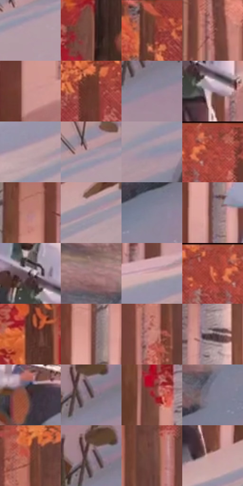

# 电影参考 376

- 状态：常规／活跃；来源世界：miles-home。
- 视角：near-level；景别：environment-wide；场景：landscape。
- 时段：daylight-time-unspecified（外观依据，中置信度；具体时间／晨昏未知）；光照：warm-day。
- 材质候选：skin, hair, fabric, foliage, snow, stone, sky（帧级，不是像素分割）。
- 明暗组：middle；L* P5/P50/P95：25.92353 / 53.68228 / 69.70122。
- 资格门禁：无附加门禁。
- 原截图 SHA-256：`d74d04d0d55245a5a586196ea785402c4e4626553e3003d70f120f514c157911`；尺寸：2880 × 1206。
- sRGB 像素 SHA-256：`353c365ce36acb9c7c5614bc15913d3a379c7f257959fbaae7c7ec8dc5fbf984`。

## 观察与迁移

暖林、冷雪、发束、布料与半透明软管分别表达；线状实体不叫动作线。

376  /  跑动姿态／林雪材质  /  三个人物下坡，暖树冠、白桦与冷雪；仅靠姿态也能读出行动，不强加全图线束

本公开版保存32个128×128原像素色卡上下文；图集格子并非原场景相邻位置。原rect、图集tile和像素SHA见 `data/palette-crops.json`。上下文不足时不得批准替色，不能以小样推断完整构图。

## 实测色卡

颜色比例分母为保留采样像素，不是材料面积；全部 32 色参与全库匹配。表内四舍五入仅用于阅读，原精度在 JSON。

| ID | HEX | Lab | 原图 xy | 像素数 | 比例 | 明度角色 |
| --- | --- | --- | --- | ---: | ---: | --- |
| 376-S01 | #B49DA5 | [66.926376, 9.830939, -1.04033] | [2120, 608] | 10365 | 5.360856% | light |
| 376-S02 | #7A4A3F | [36.733886, 19.081131, 15.17102] | [2108, 140] | 10188 | 5.269310% | shadow |
| 376-S03 | #734237 | [33.600902, 19.929806, 15.806096] | [516, 68] | 10114 | 5.231037% | shadow |
| 376-S04 | #A66861 | [50.537668, 24.029221, 14.388743] | [1284, 236] | 8522 | 4.407642% | midtone |
| 376-S05 | #CC938F | [66.282567, 20.943873, 10.655106] | [236, 632] | 8137 | 4.208517% | light |
| 376-S06 | #693A2E | [29.979016, 19.395715, 16.457892] | [712, 104] | 7814 | 4.041459% | shadow |
| 376-S07 | #91879B | [57.764838, 7.684486, -9.274966] | [2748, 360] | 7590 | 3.925605% | midtone |
| 376-S08 | #A18792 | [58.956742, 11.765188, -2.18096] | [1004, 640] | 7416 | 3.835611% | midtone |
| 376-S09 | #BDA3A8 | [69.35634, 10.336976, 0.936351] | [1136, 940] | 7089 | 3.666484% | light |
| 376-S10 | #9D92A3 | [61.972437, 7.317018, -7.455186] | [2096, 564] | 6816 | 3.525286% | light |
| 376-S11 | #8F8FA4 | [60.037152, 4.34734, -11.035677] | [2108, 752] | 6733 | 3.482358% | light |
| 376-S12 | #A1493F | [42.312511, 35.673441, 23.568295] | [904, 36] | 6383 | 3.301335% | midtone |
| 376-S13 | #B67A74 | [57.199056, 22.650023, 12.858751] | [544, 328] | 6241 | 3.227892% | midtone |
| 376-S14 | #AC959F | [63.973757, 10.282956, -2.086426] | [1768, 684] | 6231 | 3.222720% | light |
| 376-S15 | #86869A | [56.536899, 4.191945, -10.633927] | [2532, 820] | 6143 | 3.177206% | midtone |
| 376-S16 | #87696C | [47.414132, 12.458857, 2.918725] | [780, 624] | 6120 | 3.165310% | midtone |
| 376-S17 | #625059 | [36.090928, 9.197045, -2.4383] | [960, 576] | 6046 | 3.127037% | shadow |
| 376-S18 | #A0787A | [54.357337, 15.922359, 5.002451] | [2648, 588] | 5674 | 2.934635% | midtone |
| 376-S19 | #D8AEAF | [74.804762, 15.410621, 5.293842] | [1316, 792] | 5610 | 2.901534% | light |
| 376-S20 | #C6604C | [52.836176, 39.039361, 30.435814] | [836, 52] | 5461 | 2.824470% | midtone |
| 376-S21 | #583128 | [25.029572, 16.614776, 13.362488] | [1928, 112] | 4890 | 2.529145% | shadow |
| 376-S22 | #8D5850 | [43.096761, 20.905005, 13.809577] | [772, 456] | 4869 | 2.518283% | midtone |
| 376-S23 | #C9857A | [62.168768, 24.791938, 16.675732] | [1064, 276] | 4830 | 2.498112% | light |
| 376-S24 | #544246 | [29.969883, 8.499482, 0.533708] | [388, 504] | 4773 | 2.468631% | shadow |
| 376-S25 | #402B2C | [20.04302, 9.918289, 3.248123] | [480, 916] | 4542 | 2.349156% | shadow |
| 376-S26 | #4A393C | [25.887685, 8.070989, 1.014319] | [2728, 304] | 4486 | 2.320193% | shadow |
| 376-S27 | #91242E | [32.876894, 45.626628, 21.576877] | [1728, 312] | 3843 | 1.987628% | shadow |
| 376-S28 | #7F7D8F | [53.126625, 4.515699, -9.429499] | [2720, 676] | 3730 | 1.929184% | midtone |
| 376-S29 | #894135 | [36.663602, 29.62484, 21.668284] | [1084, 68] | 3456 | 1.787469% | shadow |
| 376-S30 | #927E89 | [54.906398, 9.648097, -3.107836] | [2708, 284] | 3338 | 1.726439% | midtone |
| 376-S31 | #694640 | [33.46594, 14.186609, 9.711379] | [1140, 160] | 3238 | 1.674718% | shadow |
| 376-S32 | #CA9D9D | [68.828427, 16.702817, 6.441105] | [1584, 684] | 2658 | 1.374738% | light |

## 色阶与空间分布

- 采样 ROI：`[0.01, 0.02, 0.98, 0.94]`；步长：4；样本数：193346。
- 排除区：`[]`。
- 深暗、暗、中、亮、高光五段计数：`[2048, 61232, 72536, 57002, 528]`。
- RGB 各 256 箱、L* 100 箱、13×5 色相明度表和 3×3 空间统计全部保存在 [总数据](../film-library.json)。
- [可视化档案](../../references/library.html)按需绘制直方图，不存 2,094 张重复图表图片。

## 纹理特征占比

**这是分块图像特征的面积占比，不是波点／排线／丝网／错版的精确语义覆盖率。** 窗格、发丝、织物也会产生方向或周期特征。
原图 ROI 像素 3098546；已测块覆盖 3098546（100.0000%）；未测 0。

| 特征 | 块覆盖像素 | 占已测面积 | 阈值敏感范围 |
| --- | ---: | ---: | --- |
| low-contrast | 207794 | 6.7062% | 3.9575% ~ 7.9372% |
| directional-structure | 933760 | 30.1354% | 15.1565% ~ 48.0101% |
| periodic-structure | 1875072 | 60.5146% | 46.2462% ~ 64.9223% |
| mixed-detail | 81920 | 2.6438% | 1.7862% ~ 11.9839% |

阈值敏感范围不是统计置信区间。逐块坐标、尺度、对比、方向一致性、频谱集中度、频率与角度见 [全量特征记录](../texture-features.jsonl)，以帧号定位。
四种印刷层的真实像素覆盖仍标为 `null`，不能填 0，也不能拿上表代替。不得据这些代理测量删除唯一证据。

[测量方法与保留策略](../../references/library-retention.md) · [分类索引](../archive/README.md)
