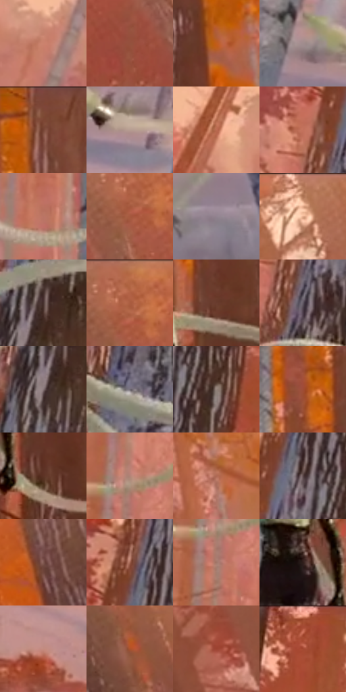

# 电影参考 377

- 状态：常规／活跃；来源世界：miles-home。
- 视角：low-angle；景别：full-body；场景：landscape。
- 时段：daylight-time-unspecified（外观依据，中置信度；具体时间／晨昏未知）；光照：warm-day。
- 材质候选：skin, hair, fabric, foliage, snow, stone, sky（帧级，不是像素分割）。
- 明暗组：middle；L* P5/P50/P95：24.68817 / 50.94517 / 67.95205。
- 资格门禁：无附加门禁。
- 原截图 SHA-256：`41aaced3df0541eec179e14a1c11702a0ab358dddf7dc1032343e62007a8d9c4`；尺寸：2880 × 1208。
- sRGB 像素 SHA-256：`1692d4eb4c35d8b9ace13cc1d0dae6a3fcd5d55c356263bcda10af1fbd1a0cd4`。

## 观察与迁移

暖林、冷雪、发束、布料与半透明软管分别表达；线状实体不叫动作线。

377  /  管线动作／雪林空间  /  人物与装置弯曲曲线、树干及端部实体清楚；与图形化插帧378比较，不能将管线抽象成随机轨迹

本公开版保存32个128×128原像素色卡上下文；图集格子并非原场景相邻位置。原rect、图集tile和像素SHA见 `data/palette-crops.json`。上下文不足时不得批准替色，不能以小样推断完整构图。

## 实测色卡

颜色比例分母为保留采样像素，不是材料面积；全部 32 色参与全库匹配。表内四舍五入仅用于阅读，原精度在 JSON。

| ID | HEX | Lab | 原图 xy | 像素数 | 比例 | 明度角色 |
| --- | --- | --- | --- | ---: | ---: | --- |
| 377-S01 | #CB826E | [61.472974, 25.899356, 22.538457] | [408, 316] | 10388 | 5.372751% | light |
| 377-S02 | #94513D | [42.02985, 25.940028, 23.99672] | [2712, 228] | 9850 | 5.094494% | midtone |
| 377-S03 | #C25D1B | [51.129463, 36.726815, 52.827203] | [1696, 368] | 8215 | 4.248860% | midtone |
| 377-S04 | #A18D8E | [60.409548, 7.659672, 2.2275] | [396, 1040] | 8042 | 4.159383% | light |
| 377-S05 | #7D4735 | [36.223067, 21.148844, 20.735875] | [1548, 52] | 7786 | 4.026978% | shadow |
| 377-S06 | #B69C91 | [66.341867, 7.811557, 9.31259] | [532, 1088] | 7578 | 3.919398% | light |
| 377-S07 | #BB6C51 | [53.906557, 28.74846, 28.619276] | [216, 252] | 7563 | 3.911640% | midtone |
| 377-S08 | #C3725D | [56.515679, 29.747573, 25.39149] | [760, 244] | 7529 | 3.894055% | midtone |
| 377-S09 | #BA7564 | [56.171961, 25.182142, 20.731219] | [1304, 784] | 7450 | 3.853196% | midtone |
| 377-S10 | #A5593F | [46.318369, 28.722206, 28.71719] | [2772, 100] | 7314 | 3.782856% | midtone |
| 377-S11 | #928390 | [56.443944, 8.115017, -4.893888] | [2344, 1028] | 7310 | 3.780787% | midtone |
| 377-S12 | #EBB595 | [77.805846, 15.356237, 23.858712] | [2460, 52] | 7229 | 3.738893% | light |
| 377-S13 | #483330 | [23.535455, 8.982405, 5.62948] | [800, 560] | 6890 | 3.563560% | shadow |
| 377-S14 | #B26246 | [50.269285, 29.659746, 30.017182] | [2784, 56] | 6686 | 3.458049% | midtone |
| 377-S15 | #6A3C2E | [30.625832, 18.634956, 17.326997] | [1564, 456] | 6473 | 3.347884% | shadow |
| 377-S16 | #635B66 | [39.738651, 5.491277, -5.116676] | [804, 340] | 6124 | 3.167379% | shadow |
| 377-S17 | #857375 | [50.136057, 7.356229, 1.486016] | [772, 620] | 5768 | 2.983253% | midtone |
| 377-S18 | #726C76 | [46.459368, 4.367145, -4.711938] | [692, 892] | 5614 | 2.903603% | midtone |
| 377-S19 | #94837A | [56.021885, 4.893141, 7.225088] | [940, 256] | 5582 | 2.887052% | midtone |
| 377-S20 | #9F4D35 | [42.669343, 32.082147, 29.832313] | [1484, 208] | 5567 | 2.879294% | midtone |
| 377-S21 | #5D3325 | [26.241834, 17.366153, 17.034853] | [1568, 652] | 5327 | 2.755164% | shadow |
| 377-S22 | #B08376 | [58.762994, 15.475916, 13.791255] | [1272, 532] | 5230 | 2.704995% | midtone |
| 377-S23 | #AF6A55 | [51.927643, 25.305804, 23.466597] | [1868, 320] | 4992 | 2.581900% | midtone |
| 377-S24 | #5B4849 | [32.569146, 8.249034, 2.470027] | [860, 208] | 4396 | 2.273644% | shadow |
| 377-S25 | #7F5850 | [41.329577, 14.987072, 11.094292] | [2180, 144] | 4363 | 2.256576% | midtone |
| 377-S26 | #9E614E | [47.456559, 22.638026, 21.249628] | [828, 140] | 4322 | 2.235371% | midtone |
| 377-S27 | #A27669 | [53.663927, 15.441965, 13.955801] | [1264, 596] | 4235 | 2.190374% | midtone |
| 377-S28 | #2F1E1B | [13.303861, 7.809518, 5.392215] | [1464, 588] | 4003 | 2.070382% | deep-shadow |
| 377-S29 | #C18D82 | [63.343664, 18.24122, 13.653198] | [40, 928] | 3909 | 2.021764% | light |
| 377-S30 | #AA512C | [45.102588, 33.904834, 38.03562] | [2360, 188] | 2710 | 1.401632% | midtone |
| 377-S31 | #9E4432 | [40.631217, 36.196379, 29.107318] | [2572, 376] | 2505 | 1.295605% | midtone |
| 377-S32 | #C96E56 | [56.331754, 33.671419, 29.274176] | [1064, 40] | 2396 | 1.239229% | midtone |

## 色阶与空间分布

- 采样 ROI：`[0.01, 0.02, 0.98, 0.94]`；步长：4；样本数：193346。
- 排除区：`[]`。
- 深暗、暗、中、亮、高光五段计数：`[4113, 37686, 120402, 30421, 724]`。
- RGB 各 256 箱、L* 100 箱、13×5 色相明度表和 3×3 空间统计全部保存在 [总数据](../film-library.json)。
- [可视化档案](../../references/library.html)按需绘制直方图，不存 2,094 张重复图表图片。

## 纹理特征占比

**这是分块图像特征的面积占比，不是波点／排线／丝网／错版的精确语义覆盖率。** 窗格、发丝、织物也会产生方向或周期特征。
原图 ROI 像素 3104134；已测块覆盖 3104134（100.0000%）；未测 0。

| 特征 | 块覆盖像素 | 占已测面积 | 阈值敏感范围 |
| --- | ---: | ---: | --- |
| low-contrast | 11136 | 0.3587% | 0.0000% ~ 0.3587% |
| directional-structure | 486272 | 15.6653% | 7.3894% ~ 28.7699% |
| periodic-structure | 2368134 | 76.2897% | 68.0550% ~ 76.2897% |
| mixed-detail | 238592 | 7.6863% | 3.1751% ~ 21.7681% |

阈值敏感范围不是统计置信区间。逐块坐标、尺度、对比、方向一致性、频谱集中度、频率与角度见 [全量特征记录](../texture-features.jsonl)，以帧号定位。
四种印刷层的真实像素覆盖仍标为 `null`，不能填 0，也不能拿上表代替。不得据这些代理测量删除唯一证据。

[测量方法与保留策略](../../references/library-retention.md) · [分类索引](../archive/README.md)
