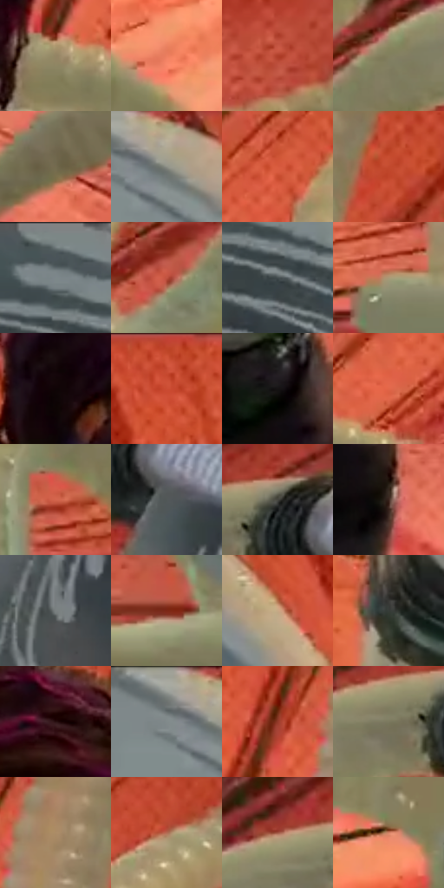

# 电影参考 378

- 状态：条件／活跃；来源世界：miles-home。
- 视角：graphic-nonphysical；景别：medium；场景：graphic。
- 时段：graphic-no-physical-time（外观依据，中置信度；具体时间／晨昏未知）；光照：graphic-field。
- 材质候选：skin, fabric, plastic, metal（帧级，不是像素分割）。
- 明暗组：middle；L* P5/P50/P95：4.89463 / 49.58921 / 66.43584。
- 资格门禁：motion。
- 原截图 SHA-256：`2f45b0ff97ab20193fc2f34b0226ed257f723bf3e92ace456ab391f8e991750a`；尺寸：2880 × 1210。
- sRGB 像素 SHA-256：`52b0b3e75cd05d2cafd0621e2e3f6c9386c57f32924610e3752704fc2d6f6a08`。

## 观察与迁移

径向推进线和圆盘旋转弧不同机制，背景橙色属插帧。

378  /  图形动作插帧／旋转  /  橙色面上黑色径向推进线，圆盘上另有白色短弧表旋转；两种机制分开，圆盘道具不借入照片

本公开版保存32个128×128原像素色卡上下文；图集格子并非原场景相邻位置。原rect、图集tile和像素SHA见 `data/palette-crops.json`。上下文不足时不得批准替色，不能以小样推断完整构图。

## 实测色卡

颜色比例分母为保留采样像素，不是材料面积；全部 32 色参与全库匹配。表内四舍五入仅用于阅读，原精度在 JSON。

| ID | HEX | Lab | 原图 xy | 像素数 | 比例 | 明度角色 |
| --- | --- | --- | --- | ---: | ---: | --- |
| 378-S01 | #948564 | [56.07961, 0.440488, 19.896424] | [1708, 396] | 13285 | 6.846385% | midtone |
| 378-S02 | #ED7E5F | [64.769453, 39.973059, 35.968346] | [988, 1128] | 13167 | 6.785574% | light |
| 378-S03 | #AF3E2A | [42.352283, 44.99046, 36.397472] | [2596, 432] | 7761 | 3.999608% | midtone |
| 378-S04 | #837F5E | [52.743791, -4.111152, 18.537973] | [2520, 240] | 7719 | 3.977964% | midtone |
| 378-S05 | #746B4F | [45.349803, -1.191062, 17.008605] | [2028, 1116] | 7718 | 3.977448% | midtone |
| 378-S06 | #8D8F86 | [59.001091, -2.456158, 4.533074] | [876, 68] | 6982 | 3.598153% | midtone |
| 378-S07 | #D85B3E | [54.483661, 47.373167, 40.827432] | [2164, 268] | 6922 | 3.567232% | midtone |
| 378-S08 | #C2492F | [47.550579, 47.057885, 40.226238] | [2028, 108] | 6889 | 3.550226% | midtone |
| 378-S09 | #576264 | [40.705362, -3.764992, -2.57183] | [508, 32] | 6862 | 3.536311% | midtone |
| 378-S10 | #C05441 | [49.413518, 42.056941, 32.286432] | [2340, 380] | 6786 | 3.497145% | midtone |
| 378-S11 | #444D4E | [32.003325, -3.363223, -1.817341] | [568, 152] | 6740 | 3.473439% | shadow |
| 378-S12 | #AB9876 | [63.691352, 1.757393, 20.495492] | [2240, 756] | 6675 | 3.439941% | light |
| 378-S13 | #0E0405 | [1.726859, 2.876361, 0.586219] | [1356, 280] | 6573 | 3.387376% | deep-shadow |
| 378-S14 | #CF5337 | [51.532513, 47.510254, 40.891609] | [1192, 28] | 6389 | 3.292552% | midtone |
| 378-S15 | #161313 | [6.172608, 1.301495, 0.459417] | [1596, 808] | 6290 | 3.241533% | deep-shadow |
| 378-S16 | #E26648 | [58.17352, 46.315123, 40.085751] | [2012, 428] | 6240 | 3.215765% | midtone |
| 378-S17 | #D4654D | [55.93142, 41.894416, 34.158846] | [2424, 688] | 6134 | 3.161139% | midtone |
| 378-S18 | #515758 | [36.499405, -2.148294, -1.396493] | [2796, 264] | 5882 | 3.031271% | shadow |
| 378-S19 | #44443F | [28.70022, -1.076466, 3.030174] | [2728, 176] | 5723 | 2.949331% | shadow |
| 378-S20 | #39241D | [16.604302, 8.952157, 8.733524] | [1668, 936] | 5648 | 2.910680% | deep-shadow |
| 378-S21 | #7A8080 | [53.096143, -2.226092, -0.770162] | [2816, 428] | 5537 | 2.853477% | midtone |
| 378-S22 | #7D2816 | [29.252533, 35.858439, 31.035688] | [2572, 868] | 5467 | 2.817402% | shadow |
| 378-S23 | #C8A984 | [71.093069, 5.958236, 23.324638] | [1072, 164] | 5292 | 2.727217% | light |
| 378-S24 | #363C38 | [24.644046, -3.462108, 1.612157] | [328, 652] | 5177 | 2.667952% | shadow |
| 378-S25 | #291012 | [8.001303, 13.262198, 4.077494] | [1536, 88] | 4683 | 2.413370% | deep-shadow |
| 378-S26 | #676E6E | [45.854022, -2.659948, -0.916972] | [816, 48] | 4320 | 2.226299% | midtone |
| 378-S27 | #943929 | [36.71358, 37.330515, 29.376616] | [1796, 172] | 4022 | 2.072726% | shadow |
| 378-S28 | #7A785E | [49.952547, -3.882279, 14.599081] | [2652, 212] | 3726 | 1.920183% | midtone |
| 378-S29 | #AC8C67 | [60.34454, 6.916106, 24.333264] | [1904, 148] | 3252 | 1.675909% | light |
| 378-S30 | #B36B52 | [52.631346, 26.117869, 26.204408] | [2340, 184] | 2598 | 1.338872% | midtone |
| 378-S31 | #9F5543 | [44.6249, 28.769713, 24.076448] | [2620, 168] | 2255 | 1.162108% | midtone |
| 378-S32 | #CF7F64 | [61.104542, 28.151235, 27.739828] | [596, 1040] | 1330 | 0.685412% | light |

## 色阶与空间分布

- 采样 ROI：`[0.01, 0.02, 0.98, 0.94]`；步长：4；样本数：194044。
- 排除区：`[]`。
- 深暗、暗、中、亮、高光五段计数：`[22199, 36942, 106211, 28490, 202]`。
- RGB 各 256 箱、L* 100 箱、13×5 色相明度表和 3×3 空间统计全部保存在 [总数据](../film-library.json)。
- [可视化档案](../../references/library.html)按需绘制直方图，不存 2,094 张重复图表图片。

## 纹理特征占比

**这是分块图像特征的面积占比，不是波点／排线／丝网／错版的精确语义覆盖率。** 窗格、发丝、织物也会产生方向或周期特征。
原图 ROI 像素 3109722；已测块覆盖 3109722（100.0000%）；未测 0。

| 特征 | 块覆盖像素 | 占已测面积 | 阈值敏感范围 |
| --- | ---: | ---: | --- |
| low-contrast | 16384 | 0.5269% | 0.0000% ~ 1.0537% |
| directional-structure | 1120090 | 36.0190% | 15.7882% ~ 50.5654% |
| periodic-structure | 1956864 | 62.9273% | 49.4346% ~ 80.5237% |
| mixed-detail | 16384 | 0.5269% | 0.0000% ~ 2.6343% |

阈值敏感范围不是统计置信区间。逐块坐标、尺度、对比、方向一致性、频谱集中度、频率与角度见 [全量特征记录](../texture-features.jsonl)，以帧号定位。
四种印刷层的真实像素覆盖仍标为 `null`，不能填 0，也不能拿上表代替。不得据这些代理测量删除唯一证据。

[测量方法与保留策略](../../references/library-retention.md) · [分类索引](../archive/README.md)
