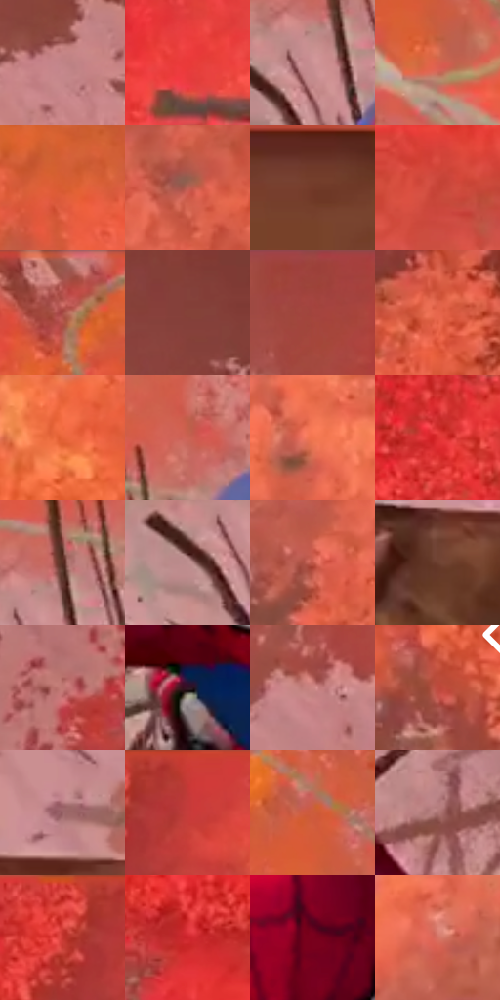

# 电影参考 379

- 状态：条件／活跃；来源世界：miles-home。
- 视角：high-angle；景别：medium；场景：landscape。
- 时段：daylight-time-unspecified（外观依据，中置信度；具体时间／晨昏未知）；光照：warm-day。
- 材质候选：fabric, foliage, wood, sky（帧级，不是像素分割）。
- 明暗组：middle；L* P5/P50/P95：23.0198 / 52.57333 / 64.67671。
- 资格门禁：sense。
- 原截图 SHA-256：`ea8c0d7f848d04553cd57db3db6687b501cbf85a6f2f50d811539c5c9a58c07b`；尺寸：2880 × 1202。
- sRGB 像素 SHA-256：`f1fa6198fd28ef5dd46095627d1fc4c7c8584ba40750652c52a79e5bdc86a18b`。

## 观察与迁移

树枝是真结构，头周警觉线另属感应门槛。

379  /  俯视攀爬／实体枝条  /  高视角、近大手与树干，周围枝条呈放射排列；放射形不必是画出的冲击线

本公开版保存32个128×128原像素色卡上下文；图集格子并非原场景相邻位置。原rect、图集tile和像素SHA见 `data/palette-crops.json`。上下文不足时不得批准替色，不能以小样推断完整构图。

## 实测色卡

颜色比例分母为保留采样像素，不是材料面积；全部 32 色参与全库匹配。表内四舍五入仅用于阅读，原精度在 JSON。

| ID | HEX | Lab | 原图 xy | 像素数 | 比例 | 明度角色 |
| --- | --- | --- | --- | ---: | ---: | --- |
| 379-S01 | #C08486 | [61.16128, 23.361255, 8.288296] | [2176, 284] | 9138 | 4.743366% | light |
| 379-S02 | #EB3A39 | [52.937771, 66.339882, 42.75754] | [556, 412] | 8782 | 4.558573% | midtone |
| 379-S03 | #CC9294 | [66.163456, 22.177959, 7.68103] | [1340, 616] | 7982 | 4.143308% | light |
| 379-S04 | #D8614D | [55.774361, 45.340942, 34.105697] | [1044, 368] | 7782 | 4.039492% | midtone |
| 379-S05 | #D95E33 | [55.072867, 45.847752, 47.194804] | [1416, 232] | 7538 | 3.912836% | midtone |
| 379-S06 | #BB6155 | [51.579389, 34.980024, 23.318367] | [2480, 564] | 7492 | 3.888958% | midtone |
| 379-S07 | #733928 | [31.173143, 23.861661, 22.051886] | [2604, 984] | 7257 | 3.766974% | shadow |
| 379-S08 | #D45042 | [51.986016, 51.153967, 35.577241] | [52, 636] | 7173 | 3.723371% | midtone |
| 379-S09 | #9D524A | [43.798046, 30.224843, 18.762552] | [872, 28] | 7133 | 3.702608% | midtone |
| 379-S10 | #844238 | [36.154676, 27.266098, 19.009577] | [2164, 128] | 7106 | 3.688593% | shadow |
| 379-S11 | #9F433B | [40.74031, 37.672152, 23.918127] | [1848, 28] | 7098 | 3.684440% | midtone |
| 379-S12 | #E7664C | [58.991343, 48.352374, 39.071668] | [2728, 340] | 7081 | 3.675616% | midtone |
| 379-S13 | #E8643A | [58.584216, 48.797806, 48.09467] | [144, 936] | 6581 | 3.416075% | midtone |
| 379-S14 | #CC6355 | [54.470279, 40.443376, 27.550128] | [1452, 480] | 6509 | 3.378701% | midtone |
| 379-S15 | #F17450 | [63.15735, 45.514035, 42.200503] | [580, 936] | 6297 | 3.268656% | light |
| 379-S16 | #DE3030 | [49.328149, 65.224703, 43.113934] | [460, 156] | 6223 | 3.230244% | midtone |
| 379-S17 | #562C22 | [23.323931, 18.190169, 15.028697] | [1364, 556] | 6128 | 3.180931% | shadow |
| 379-S18 | #BE8E8F | [63.572022, 18.331881, 6.589795] | [1284, 652] | 5864 | 3.043894% | light |
| 379-S19 | #C15748 | [50.245473, 41.398511, 29.33057] | [2372, 652] | 5863 | 3.043374% | midtone |
| 379-S20 | #6D4030 | [32.10597, 17.758275, 18.071525] | [1684, 964] | 5404 | 2.805116% | shadow |
| 379-S21 | #C17975 | [58.319801, 27.642343, 14.045143] | [2512, 144] | 5398 | 2.802002% | midtone |
| 379-S22 | #331526 | [11.825383, 17.715596, -4.752475] | [1628, 752] | 5315 | 2.758918% | deep-shadow |
| 379-S23 | #CC8785 | [63.228135, 26.195651, 11.977353] | [1828, 252] | 4843 | 2.513911% | light |
| 379-S24 | #BE4B3E | [47.404922, 45.443625, 31.509416] | [2788, 656] | 4835 | 2.509759% | midtone |
| 379-S25 | #986367 | [47.725985, 22.01507, 6.618891] | [1856, 868] | 4475 | 2.322889% | midtone |
| 379-S26 | #C53936 | [45.72528, 54.973445, 34.458509] | [720, 40] | 4456 | 2.313027% | midtone |
| 379-S27 | #CD5C3C | [52.909458, 42.735309, 39.655714] | [1024, 264] | 4385 | 2.276172% | midtone |
| 379-S28 | #AC7473 | [54.554528, 21.925699, 9.551156] | [2008, 660] | 4051 | 2.102799% | midtone |
| 379-S29 | #E54A43 | [53.990842, 59.33559, 38.094254] | [636, 36] | 3978 | 2.064906% | midtone |
| 379-S30 | #CD252C | [44.925228, 63.193406, 39.718101] | [76, 400] | 3684 | 1.912296% | midtone |
| 379-S31 | #79011C | [24.231516, 46.679303, 21.669399] | [1776, 496] | 3501 | 1.817304% | shadow |
| 379-S32 | #D67263 | [59.191527, 37.672998, 25.976568] | [952, 1076] | 3296 | 1.710892% | midtone |

## 色阶与空间分布

- 采样 ROI：`[0.01, 0.02, 0.98, 0.94]`；步长：4；样本数：192648。
- 排除区：`[]`。
- 深暗、暗、中、亮、高光五段计数：`[7474, 30529, 117026, 37618, 1]`。
- RGB 各 256 箱、L* 100 箱、13×5 色相明度表和 3×3 空间统计全部保存在 [总数据](../film-library.json)。
- [可视化档案](../../references/library.html)按需绘制直方图，不存 2,094 张重复图表图片。

## 纹理特征占比

**这是分块图像特征的面积占比，不是波点／排线／丝网／错版的精确语义覆盖率。** 窗格、发丝、织物也会产生方向或周期特征。
原图 ROI 像素 3087370；已测块覆盖 3087370（100.0000%）；未测 0。

| 特征 | 块覆盖像素 | 占已测面积 | 阈值敏感范围 |
| --- | ---: | ---: | --- |
| low-contrast | 51722 | 1.6753% | 0.6139% ~ 1.6753% |
| directional-structure | 329216 | 10.6633% | 5.5514% ~ 14.9087% |
| periodic-structure | 2196608 | 71.1482% | 70.1407% ~ 77.1391% |
| mixed-detail | 509824 | 16.5132% | 7.3383% ~ 22.6326% |

阈值敏感范围不是统计置信区间。逐块坐标、尺度、对比、方向一致性、频谱集中度、频率与角度见 [全量特征记录](../texture-features.jsonl)，以帧号定位。
四种印刷层的真实像素覆盖仍标为 `null`，不能填 0，也不能拿上表代替。不得据这些代理测量删除唯一证据。

[测量方法与保留策略](../../references/library-retention.md) · [分类索引](../archive/README.md)
