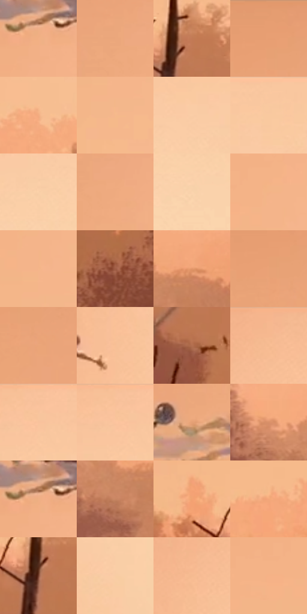

# 电影参考 380

- 状态：条件／活跃；来源世界：miles-home。
- 视角：near-level；景别：environment-wide；场景：landscape。
- 时段：daylight-time-unspecified（外观依据，中置信度；具体时间／晨昏未知）；光照：warm-day。
- 材质候选：fabric, foliage, sky（帧级，不是像素分割）。
- 明暗组：light；L* P5/P50/P95：50.02245 / 76.39664 / 86.32839。
- 资格门禁：motion。
- 原截图 SHA-256：`ad85811bca70d0f908d15f1e3837e94acc39c120b3f5afd33e0d18b6aff23c58`；尺寸：2880 × 1206。
- sRGB 像素 SHA-256：`131e38f87c47c40d0cf8aaa7926e3680d9663b3de1ce65bea06a75807c2b2b98`。

## 观察与迁移

路径残影属于多时刻效果，单照默认不复制完整人物。

380  /  轨迹与残影／留白  /  大片橙天空下，空中人物沿路径出现不同色的姿态残影；不是多人，不把时间叠影混为数字块片故障

本公开版保存32个128×128原像素色卡上下文；图集格子并非原场景相邻位置。原rect、图集tile和像素SHA见 `data/palette-crops.json`。上下文不足时不得批准替色，不能以小样推断完整构图。

## 实测色卡

颜色比例分母为保留采样像素，不是材料面积；全部 32 色参与全库匹配。表内四舍五入仅用于阅读，原精度在 JSON。

| ID | HEX | Lab | 原图 xy | 像素数 | 比例 | 明度角色 |
| --- | --- | --- | --- | ---: | ---: | --- |
| 380-S01 | #F2B084 | [77.039663, 18.905988, 32.004883] | [1672, 356] | 9201 | 4.758826% | light |
| 380-S02 | #EBA77B | [74.018917, 20.024896, 32.68255] | [1604, 140] | 9106 | 4.709691% | light |
| 380-S03 | #C27A55 | [58.081681, 24.296933, 31.851636] | [752, 912] | 8809 | 4.556081% | midtone |
| 380-S04 | #E59C70 | [70.600177, 22.470899, 33.988823] | [1372, 28] | 8710 | 4.504877% | light |
| 380-S05 | #F2AC80 | [76.035361, 20.6304, 32.805639] | [1852, 928] | 8685 | 4.491947% | light |
| 380-S06 | #F5B98B | [79.601424, 16.048493, 31.745648] | [1632, 724] | 8506 | 4.399367% | light |
| 380-S07 | #FACDA6 | [85.373982, 10.540249, 25.411714] | [2456, 152] | 8491 | 4.391609% | highlight |
| 380-S08 | #F8C89F | [83.846655, 11.549488, 26.973684] | [2640, 48] | 8299 | 4.292305% | highlight |
| 380-S09 | #FAD0A8 | [86.139258, 9.223607, 25.409044] | [2360, 212] | 8033 | 4.154728% | highlight |
| 380-S10 | #EEAB7F | [75.35109, 19.478968, 32.359347] | [1656, 172] | 7832 | 4.050769% | light |
| 380-S11 | #FAD4AD | [87.207796, 7.768669, 24.25954] | [2464, 308] | 7653 | 3.958189% | highlight |
| 380-S12 | #F4B487 | [78.244748, 17.882333, 32.044129] | [1596, 596] | 7571 | 3.915778% | light |
| 380-S13 | #F5B58A | [78.635787, 18.052646, 30.996959] | [1620, 652] | 7188 | 3.717687% | light |
| 380-S14 | #9F5C45 | [46.253527, 25.044499, 24.983492] | [336, 1064] | 6903 | 3.570283% | midtone |
| 380-S15 | #E3976B | [69.13303, 23.900215, 34.735951] | [2536, 1040] | 6381 | 3.300301% | light |
| 380-S16 | #EAA276 | [72.657476, 21.817133, 33.553471] | [1368, 100] | 5962 | 3.083591% | light |
| 380-S17 | #EBA579 | [73.517437, 20.89888, 33.093538] | [1416, 152] | 5831 | 3.015837% | light |
| 380-S18 | #F8C096 | [81.762769, 14.715397, 28.89275] | [1948, 312] | 5825 | 3.012734% | highlight |
| 380-S19 | #B16F4F | [53.257565, 22.808686, 28.652964] | [836, 1088] | 4955 | 2.562763% | midtone |
| 380-S20 | #F7BC92 | [80.638401, 15.99079, 29.476296] | [2008, 60] | 4653 | 2.406566% | highlight |
| 380-S21 | #F8C59D | [83.086837, 12.885369, 26.995783] | [2328, 52] | 4614 | 2.386395% | highlight |
| 380-S22 | #F8C39A | [82.55221, 13.589575, 27.850801] | [2304, 44] | 4581 | 2.369328% | highlight |
| 380-S23 | #E4A075 | [71.503016, 20.391013, 32.462083] | [1524, 272] | 4513 | 2.334157% | light |
| 380-S24 | #D99068 | [66.2909, 23.363035, 32.482268] | [2124, 1036] | 4384 | 2.267438% | light |
| 380-S25 | #EFAF83 | [76.46838, 18.149661, 31.724296] | [1672, 344] | 4197 | 2.170720% | light |
| 380-S26 | #C98664 | [61.989789, 21.926934, 28.749084] | [2472, 1100] | 3912 | 2.023316% | light |
| 380-S27 | #F3A273 | [73.634692, 25.134586, 36.599086] | [616, 876] | 3781 | 1.955562% | light |
| 380-S28 | #F4A87A | [75.231662, 22.977232, 34.975811] | [1396, 888] | 3750 | 1.939528% | light |
| 380-S29 | #75402D | [33.219753, 21.052056, 21.583323] | [724, 956] | 3541 | 1.831432% | shadow |
| 380-S30 | #F8CCA4 | [84.907393, 10.056169, 25.792827] | [2180, 620] | 2677 | 1.384564% | highlight |
| 380-S31 | #F4BA8F | [79.805621, 15.54953, 29.89293] | [1940, 128] | 2673 | 1.382496% | light |
| 380-S32 | #F6B287 | [77.985217, 19.72376, 31.742045] | [1524, 616] | 2129 | 1.101135% | light |

## 色阶与空间分布

- 采样 ROI：`[0.01, 0.02, 0.98, 0.94]`；步长：4；样本数：193346。
- 排除区：`[]`。
- 深暗、暗、中、亮、高光五段计数：`[634, 2082, 22090, 112301, 56239]`。
- RGB 各 256 箱、L* 100 箱、13×5 色相明度表和 3×3 空间统计全部保存在 [总数据](../film-library.json)。
- [可视化档案](../../references/library.html)按需绘制直方图，不存 2,094 张重复图表图片。

## 纹理特征占比

**这是分块图像特征的面积占比，不是波点／排线／丝网／错版的精确语义覆盖率。** 窗格、发丝、织物也会产生方向或周期特征。
原图 ROI 像素 3098546；已测块覆盖 3098546（100.0000%）；未测 0。

| 特征 | 块覆盖像素 | 占已测面积 | 阈值敏感范围 |
| --- | ---: | ---: | --- |
| low-contrast | 1736192 | 56.0325% | 49.6873% ~ 58.1475% |
| directional-structure | 212992 | 6.8739% | 5.8164% ~ 9.5178% |
| periodic-structure | 919552 | 29.6769% | 24.3975% ~ 37.0755% |
| mixed-detail | 229810 | 7.4167% | 3.7195% ~ 11.6386% |

阈值敏感范围不是统计置信区间。逐块坐标、尺度、对比、方向一致性、频谱集中度、频率与角度见 [全量特征记录](../texture-features.jsonl)，以帧号定位。
四种印刷层的真实像素覆盖仍标为 `null`，不能填 0，也不能拿上表代替。不得据这些代理测量删除唯一证据。

[测量方法与保留策略](../../references/library-retention.md) · [分类索引](../archive/README.md)
