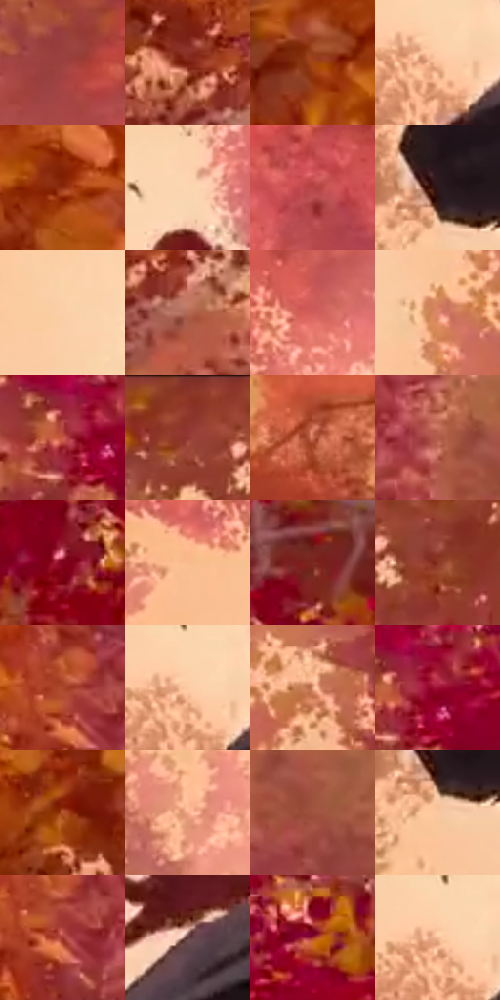

# 电影参考 381

- 状态：常规／活跃；来源世界：miles-home。
- 视角：low-angle；景别：environment-wide；场景：landscape。
- 时段：daylight-time-unspecified（外观依据，中置信度；具体时间／晨昏未知）；光照：warm-day。
- 材质候选：skin, hair, fabric, foliage, snow, stone, sky（帧级，不是像素分割）。
- 明暗组：middle；L* P5/P50/P95：22.99143 / 45.68688 / 86.67773。
- 资格门禁：无附加门禁。
- 原截图 SHA-256：`c1098347960a4c2dcdad935c3594307a6f5454a6b00bc0f6f50850f581cef297`；尺寸：2880 × 1206。
- sRGB 像素 SHA-256：`881579fec0739139c51fa90d1d17da30c16fa6c6e5046dd1c9b4d1a6b158c1b4`。

## 观察与迁移

暖林、冷雪、发束、布料与半透明软管分别表达；线状实体不叫动作线。

381  /  腾空透视／负形  /  仰看伸手人物与电脑，树冠围出天空；动作清楚而不靠处处加线，不添加原照没有的抛物

本公开版保存32个128×128原像素色卡上下文；图集格子并非原场景相邻位置。原rect、图集tile和像素SHA见 `data/palette-crops.json`。上下文不足时不得批准替色，不能以小样推断完整构图。

## 实测色卡

颜色比例分母为保留采样像素，不是材料面积；全部 32 色参与全库匹配。表内四舍五入仅用于阅读，原精度在 JSON。

| ID | HEX | Lab | 原图 xy | 像素数 | 比例 | 明度角色 |
| --- | --- | --- | --- | ---: | ---: | --- |
| 381-S01 | #9B423E | [39.93984, 36.879436, 20.934992] | [1932, 176] | 10462 | 5.411025% | shadow |
| 381-S02 | #781C0E | [26.322127, 38.879942, 32.240572] | [540, 1008] | 10107 | 5.227416% | shadow |
| 381-S03 | #A24517 | [41.218962, 36.096618, 43.99864] | [140, 592] | 9342 | 4.831752% | midtone |
| 381-S04 | #FAC198 | [82.23586, 15.187404, 28.510616] | [1192, 624] | 8791 | 4.546771% | highlight |
| 381-S05 | #8E2E0F | [33.437684, 39.262146, 39.496183] | [420, 688] | 8789 | 4.545737% | shadow |
| 381-S06 | #FCD6B1 | [87.952109, 7.993255, 23.223872] | [1448, 252] | 8261 | 4.272651% | highlight |
| 381-S07 | #B74547 | [45.333304, 46.285246, 23.355882] | [1668, 164] | 7569 | 3.914744% | midtone |
| 381-S08 | #2E181B | [11.368637, 11.528461, 2.640482] | [1228, 764] | 7211 | 3.729583% | deep-shadow |
| 381-S09 | #FBCFA9 | [86.007735, 10.24537, 24.721753] | [1100, 484] | 7124 | 3.684586% | highlight |
| 381-S10 | #B46B57 | [52.849938, 26.981007, 23.646951] | [612, 1072] | 6896 | 3.566663% | midtone |
| 381-S11 | #D25D5B | [54.332814, 46.06048, 24.081963] | [1156, 136] | 6867 | 3.551664% | midtone |
| 381-S12 | #DB856C | [64.097267, 30.412562, 27.495986] | [2024, 700] | 6628 | 3.428051% | light |
| 381-S13 | #C75943 | [51.49129, 42.339753, 33.914779] | [2284, 800] | 6432 | 3.326679% | midtone |
| 381-S14 | #92382D | [36.234542, 37.284498, 26.343422] | [2316, 36] | 6243 | 3.228926% | shadow |
| 381-S15 | #CF745A | [58.506556, 33.177675, 29.968979] | [248, 76] | 6144 | 3.177723% | midtone |
| 381-S16 | #AF5948 | [47.916796, 33.446037, 25.819875] | [836, 848] | 6054 | 3.131174% | midtone |
| 381-S17 | #83021C | [26.603665, 49.155333, 24.98845] | [2612, 788] | 6027 | 3.117210% | shadow |
| 381-S18 | #F9BB8E | [80.536706, 16.875432, 31.481015] | [892, 328] | 5886 | 3.044283% | highlight |
| 381-S19 | #7A281F | [28.786629, 35.129401, 25.060562] | [2716, 676] | 5532 | 2.861192% | shadow |
| 381-S20 | #893725 | [34.367041, 33.857088, 28.539736] | [2428, 96] | 5525 | 2.857571% | shadow |
| 381-S21 | #AC482E | [43.661375, 39.367139, 35.470521] | [704, 812] | 5277 | 2.729304% | midtone |
| 381-S22 | #FCCAA3 | [84.78391, 12.509208, 26.211572] | [1184, 608] | 5115 | 2.645516% | highlight |
| 381-S23 | #E69C7A | [70.876955, 23.803412, 28.999012] | [2152, 700] | 5049 | 2.611381% | light |
| 381-S24 | #9F0F36 | [33.943797, 55.742359, 18.359563] | [2324, 788] | 4860 | 2.513628% | shadow |
| 381-S25 | #B6572F | [48.22166, 35.727044, 40.363168] | [416, 908] | 4808 | 2.486734% | midtone |
| 381-S26 | #F6AD8A | [76.87186, 22.662302, 28.675115] | [900, 500] | 4345 | 2.247267% | light |
| 381-S27 | #9F523E | [43.879924, 30.015237, 26.076971] | [912, 900] | 4024 | 2.081243% | midtone |
| 381-S28 | #F9C69F | [83.460528, 12.978912, 26.466996] | [1228, 816] | 3831 | 1.981422% | highlight |
| 381-S29 | #A2392E | [39.253848, 42.76428, 30.00782] | [720, 848] | 3407 | 1.762126% | shadow |
| 381-S30 | #5E3B3C | [28.990604, 15.616565, 5.800485] | [1360, 548] | 3314 | 1.714026% | shadow |
| 381-S31 | #9B2B27 | [35.684073, 45.910763, 29.731181] | [2448, 736] | 2404 | 1.243367% | shadow |
| 381-S32 | #F2BC96 | [80.20717, 14.488042, 26.698203] | [1172, 604] | 1022 | 0.528586% | highlight |

## 色阶与空间分布

- 采样 ROI：`[0.01, 0.02, 0.98, 0.94]`；步长：4；样本数：193346。
- 排除区：`[]`。
- 深暗、暗、中、亮、高光五段计数：`[7217, 63786, 65308, 18263, 38772]`。
- RGB 各 256 箱、L* 100 箱、13×5 色相明度表和 3×3 空间统计全部保存在 [总数据](../film-library.json)。
- [可视化档案](../../references/library.html)按需绘制直方图，不存 2,094 张重复图表图片。

## 纹理特征占比

**这是分块图像特征的面积占比，不是波点／排线／丝网／错版的精确语义覆盖率。** 窗格、发丝、织物也会产生方向或周期特征。
原图 ROI 像素 3098546；已测块覆盖 3098546（100.0000%）；未测 0。

| 特征 | 块覆盖像素 | 占已测面积 | 阈值敏感范围 |
| --- | ---: | ---: | --- |
| low-contrast | 201856 | 6.5145% | 4.3995% ~ 8.1008% |
| directional-structure | 114688 | 3.7013% | 2.6438% ~ 6.3452% |
| periodic-structure | 2224946 | 71.8061% | 63.6144% ~ 79.2088% |
| mixed-detail | 557056 | 17.9780% | 10.0465% ~ 25.6409% |

阈值敏感范围不是统计置信区间。逐块坐标、尺度、对比、方向一致性、频谱集中度、频率与角度见 [全量特征记录](../texture-features.jsonl)，以帧号定位。
四种印刷层的真实像素覆盖仍标为 `null`，不能填 0，也不能拿上表代替。不得据这些代理测量删除唯一证据。

[测量方法与保留策略](../../references/library-retention.md) · [分类索引](../archive/README.md)
