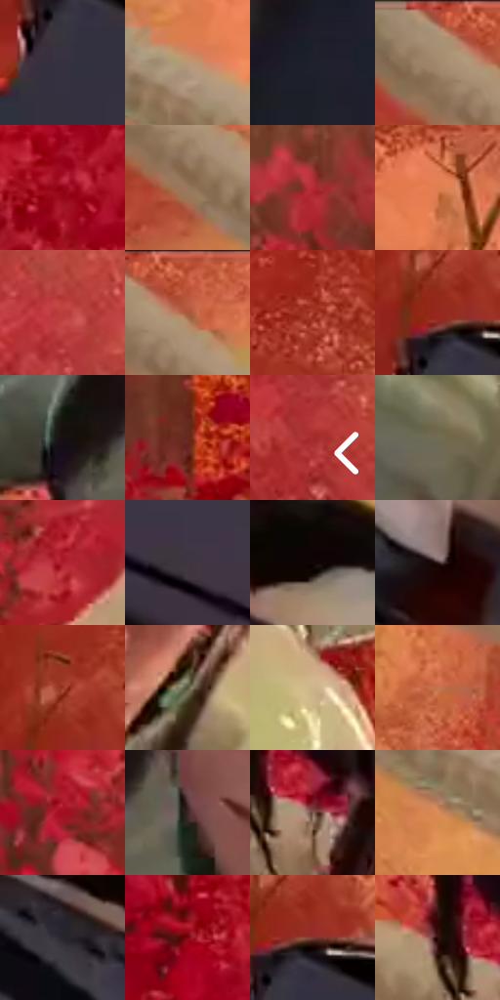

# 电影参考 382

- 状态：常规／活跃；来源世界：miles-home。
- 视角：rolled-or-dutch；景别：close-up；场景：landscape。
- 时段：daylight-time-unspecified（外观依据，中置信度；具体时间／晨昏未知）；光照：warm-day。
- 材质候选：skin, hair, fabric, foliage, snow, stone, sky（帧级，不是像素分割）。
- 明暗组：dark；L* P5/P50/P95：4.8824 / 37.17793 / 66.0729。
- 资格门禁：无附加门禁。
- 原截图 SHA-256：`73f4827ad05f72e1d3ff866423fc30fda3192b63bca5c843d2421e5ae5602be8`；尺寸：2880 × 1208。
- sRGB 像素 SHA-256：`d470a6a2552186951a1e536c13069a1566439c44cd9956ab4be36c38d3e5a17e`。

## 观察与迁移

暖林、冷雪、发束、布料与半透明软管分别表达；线状实体不叫动作线。

382  /  材料与脸部／遮挡  /  护目镜、浅色管线亮形、黑色部件、暖叶层；按表面处理高光，不给护目镜编清楚眼神

本公开版保存32个128×128原像素色卡上下文；图集格子并非原场景相邻位置。原rect、图集tile和像素SHA见 `data/palette-crops.json`。上下文不足时不得批准替色，不能以小样推断完整构图。

## 实测色卡

颜色比例分母为保留采样像素，不是材料面积；全部 32 色参与全库匹配。表内四舍五入仅用于阅读，原精度在 JSON。

| ID | HEX | Lab | 原图 xy | 像素数 | 比例 | 明度角色 |
| --- | --- | --- | --- | ---: | ---: | --- |
| 382-S01 | #37303D | [21.068045, 6.166729, -7.036586] | [40, 480] | 8614 | 4.455225% | shadow |
| 382-S02 | #B99874 | [64.989044, 7.193214, 23.578792] | [812, 208] | 7900 | 4.085939% | light |
| 382-S03 | #1F212C | [12.989644, 2.203715, -7.618642] | [248, 972] | 7752 | 4.009392% | deep-shadow |
| 382-S04 | #A68D70 | [60.183679, 5.008889, 18.987447] | [536, 56] | 7517 | 3.887849% | light |
| 382-S05 | #960618 | [31.072568, 53.449841, 33.436359] | [2500, 780] | 7441 | 3.848541% | shadow |
| 382-S06 | #98775E | [52.595654, 9.294533, 18.682451] | [572, 140] | 6947 | 3.593040% | midtone |
| 382-S07 | #B42B35 | [40.720944, 54.539814, 28.374605] | [2100, 96] | 6908 | 3.572869% | midtone |
| 382-S08 | #DE7D51 | [62.334212, 33.72604, 40.042171] | [368, 352] | 6843 | 3.539251% | light |
| 382-S09 | #BA3D3B | [44.36961, 50.049022, 29.437687] | [2676, 172] | 6822 | 3.528390% | midtone |
| 382-S10 | #C65B40 | [51.680298, 40.79918, 35.774545] | [600, 28] | 6554 | 3.389778% | midtone |
| 382-S11 | #A93D2C | [41.147545, 43.374641, 33.652931] | [96, 176] | 6551 | 3.388226% | midtone |
| 382-S12 | #95261E | [33.713909, 45.449553, 32.544105] | [60, 380] | 6317 | 3.267200% | shadow |
| 382-S13 | #170F12 | [5.126197, 3.848596, -0.434355] | [1140, 640] | 6306 | 3.261510% | deep-shadow |
| 382-S14 | #65281F | [24.902375, 26.830764, 19.510974] | [1768, 440] | 6285 | 3.250649% | shadow |
| 382-S15 | #A52C2C | [37.815565, 49.052183, 29.676028] | [2812, 588] | 6106 | 3.158069% | shadow |
| 382-S16 | #716C53 | [45.442773, -2.465195, 14.729831] | [1344, 928] | 6071 | 3.139967% | midtone |
| 382-S17 | #AC1C2B | [37.441721, 56.068169, 30.218663] | [2292, 292] | 5962 | 3.083591% | shadow |
| 382-S18 | #403641 | [24.031906, 6.809572, -5.186999] | [400, 784] | 5961 | 3.083074% | shadow |
| 382-S19 | #0F0607 | [2.232647, 2.685459, 0.519033] | [760, 656] | 5799 | 2.999286% | deep-shadow |
| 382-S20 | #2E1917 | [11.53934, 10.210737, 5.838781] | [912, 884] | 5371 | 2.777921% | deep-shadow |
| 382-S21 | #B25640 | [47.615207, 35.626353, 30.169595] | [48, 320] | 5366 | 2.775335% | midtone |
| 382-S22 | #58533B | [35.157165, -2.233135, 14.832296] | [1488, 656] | 5364 | 2.774301% | shadow |
| 382-S23 | #CDB38A | [74.225611, 3.331812, 24.409955] | [1720, 712] | 5248 | 2.714305% | light |
| 382-S24 | #C4744F | [56.874189, 27.914383, 33.702256] | [936, 444] | 5197 | 2.687927% | midtone |
| 382-S25 | #A30F22 | [34.49046, 55.924572, 31.885952] | [2088, 268] | 5068 | 2.621208% | shadow |
| 382-S26 | #3D2725 | [18.262888, 10.048124, 5.524134] | [1268, 648] | 5029 | 2.601036% | deep-shadow |
| 382-S27 | #7D5C50 | [42.145382, 11.741075, 12.188228] | [1152, 352] | 4948 | 2.559143% | midtone |
| 382-S28 | #D88C58 | [65.012707, 23.810447, 39.393495] | [756, 288] | 4864 | 2.515697% | light |
| 382-S29 | #29252E | [15.444196, 4.0735, -5.234147] | [604, 700] | 4752 | 2.457770% | deep-shadow |
| 382-S30 | #7E0710 | [25.642851, 46.48433, 31.037426] | [2280, 732] | 4577 | 2.367259% | shadow |
| 382-S31 | #7D3D35 | [33.890373, 26.903582, 17.721986] | [96, 388] | 4479 | 2.316572% | shadow |
| 382-S32 | #2F100E | [9.047907, 15.66892, 7.961729] | [1080, 316] | 4427 | 2.289678% | deep-shadow |

## 色阶与空间分布

- 采样 ROI：`[0.01, 0.02, 0.98, 0.94]`；步长：4；样本数：193346。
- 排除区：`[]`。
- 深暗、暗、中、亮、高光五段计数：`[40386, 69885, 54978, 27407, 690]`。
- RGB 各 256 箱、L* 100 箱、13×5 色相明度表和 3×3 空间统计全部保存在 [总数据](../film-library.json)。
- [可视化档案](../../references/library.html)按需绘制直方图，不存 2,094 张重复图表图片。

## 纹理特征占比

**这是分块图像特征的面积占比，不是波点／排线／丝网／错版的精确语义覆盖率。** 窗格、发丝、织物也会产生方向或周期特征。
原图 ROI 像素 3104134；已测块覆盖 3104134（100.0000%）；未测 0。

| 特征 | 块覆盖像素 | 占已测面积 | 阈值敏感范围 |
| --- | ---: | ---: | --- |
| low-contrast | 121216 | 3.9050% | 3.0184% ~ 4.2637% |
| directional-structure | 530176 | 17.0797% | 8.8037% ~ 27.6565% |
| periodic-structure | 2113152 | 68.0754% | 63.6098% ~ 68.0754% |
| mixed-detail | 339590 | 10.9399% | 5.7152% ~ 20.6385% |

阈值敏感范围不是统计置信区间。逐块坐标、尺度、对比、方向一致性、频谱集中度、频率与角度见 [全量特征记录](../texture-features.jsonl)，以帧号定位。
四种印刷层的真实像素覆盖仍标为 `null`，不能填 0，也不能拿上表代替。不得据这些代理测量删除唯一证据。

[测量方法与保留策略](../../references/library-retention.md) · [分类索引](../archive/README.md)
