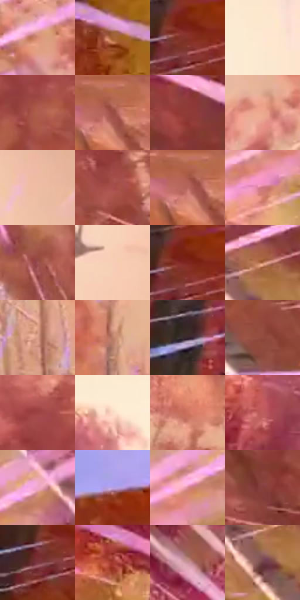

# 电影参考 383

- 状态：条件／活跃；来源世界：miles-home。
- 视角：low-angle；景别：environment-wide；场景：landscape。
- 时段：daylight-time-unspecified（外观依据，中置信度；具体时间／晨昏未知）；光照：warm-day。
- 材质候选：skin, fabric, foliage, sky（帧级，不是像素分割）。
- 明暗组：middle；L* P5/P50/P95：26.44046 / 51.3391 / 90.48886。
- 资格门禁：motion。
- 原截图 SHA-256：`bc085d8bec73477e73dee5799ad13011986497acd570069a6137dfb776ce89ea`；尺寸：2880 × 1206。
- sRGB 像素 SHA-256：`5068ad38137b867ace13b619b3ab557674a07530a51db2789f272f033f6dc120`。

## 观察与迁移

画幅边缘线束朝主体收束，脸手和焦点留净。

383  /  高速位移／方向线  /  边缘粉紫尖细长线向主体附近透视中心汇聚，长短粗细有梯度；主体剪影留净，不是头周感应波

本公开版保存32个128×128原像素色卡上下文；图集格子并非原场景相邻位置。原rect、图集tile和像素SHA见 `data/palette-crops.json`。上下文不足时不得批准替色，不能以小样推断完整构图。

## 实测色卡

颜色比例分母为保留采样像素，不是材料面积；全部 32 色参与全库匹配。表内四舍五入仅用于阅读，原精度在 JSON。

| ID | HEX | Lab | 原图 xy | 像素数 | 比例 | 明度角色 |
| --- | --- | --- | --- | ---: | ---: | --- |
| 383-S01 | #D58D73 | [65.307823, 24.421993, 25.089038] | [2092, 336] | 8949 | 4.628490% | light |
| 383-S02 | #A25F32 | [47.102928, 23.251279, 36.735175] | [152, 200] | 8280 | 4.282478% | midtone |
| 383-S03 | #863329 | [33.130321, 34.931607, 24.553518] | [108, 912] | 8251 | 4.267479% | shadow |
| 383-S04 | #FEE8D4 | [93.250035, 4.329615, 12.445708] | [1364, 96] | 7933 | 4.103007% | highlight |
| 383-S05 | #AE5D4D | [48.717344, 31.312818, 23.899231] | [1820, 756] | 7885 | 4.078181% | midtone |
| 383-S06 | #9B4D44 | [42.300846, 31.604216, 20.355951] | [2392, 704] | 7712 | 3.988704% | midtone |
| 383-S07 | #903B38 | [36.639153, 35.777882, 20.015632] | [2644, 1132] | 7564 | 3.912157% | shadow |
| 383-S08 | #EAA88F | [74.49848, 21.188606, 22.565041] | [1880, 264] | 7406 | 3.830439% | light |
| 383-S09 | #EEBDA3 | [80.302939, 13.983598, 19.851909] | [1764, 84] | 7160 | 3.703206% | highlight |
| 383-S10 | #A94E4C | [44.812297, 37.205921, 19.229063] | [1932, 756] | 6522 | 3.373227% | midtone |
| 383-S11 | #BA6962 | [53.413296, 31.534287, 18.161506] | [2376, 708] | 6506 | 3.364952% | midtone |
| 383-S12 | #CC7782 | [59.567185, 34.458357, 8.5131] | [2240, 264] | 6424 | 3.322541% | midtone |
| 383-S13 | #9F555B | [45.116283, 31.139423, 10.305561] | [1660, 1084] | 6350 | 3.284268% | midtone |
| 383-S14 | #F8CDB7 | [85.524522, 11.962673, 16.646716] | [1580, 400] | 6224 | 3.219099% | highlight |
| 383-S15 | #80261F | [29.602808, 38.241196, 26.295673] | [112, 900] | 6014 | 3.110486% | shadow |
| 383-S16 | #B3714F | [53.985357, 22.531768, 29.625962] | [2596, 212] | 5951 | 3.077902% | midtone |
| 383-S17 | #DA9F89 | [70.532224, 19.08988, 20.13251] | [1296, 1108] | 5928 | 3.066006% | light |
| 383-S18 | #BC7D68 | [58.377565, 21.991518, 21.456838] | [1108, 1004] | 5812 | 3.006010% | midtone |
| 383-S19 | #322229 | [15.394365, 9.041207, -1.629852] | [604, 800] | 5786 | 2.992563% | deep-shadow |
| 383-S20 | #914B3E | [40.248267, 28.133463, 21.026986] | [2812, 468] | 5637 | 2.915499% | midtone |
| 383-S21 | #9F4344 | [40.903945, 38.356997, 18.635481] | [1780, 636] | 5601 | 2.896879% | midtone |
| 383-S22 | #FBDBC6 | [89.510785, 7.880789, 14.408175] | [1108, 96] | 5575 | 2.883432% | highlight |
| 383-S23 | #CD735E | [58.086429, 33.251052, 27.127777] | [1492, 912] | 5523 | 2.856537% | midtone |
| 383-S24 | #BD5C5D | [50.997283, 39.051572, 17.894305] | [792, 464] | 5392 | 2.788783% | midtone |
| 383-S25 | #F0A6CA | [76.109018, 32.447017, -7.274988] | [2376, 128] | 5209 | 2.694134% | light |
| 383-S26 | #B69FE1 | [69.595555, 21.546999, -30.285575] | [200, 756] | 5075 | 2.624828% | light |
| 383-S27 | #DB8B96 | [66.313388, 31.849628, 6.998934] | [2304, 172] | 4843 | 2.504836% | light |
| 383-S28 | #85403B | [35.927297, 29.057201, 16.872766] | [2692, 792] | 4784 | 2.474321% | shadow |
| 383-S29 | #582723 | [22.470621, 22.194387, 13.317227] | [48, 944] | 4270 | 2.208476% | shadow |
| 383-S30 | #A33A31 | [39.642263, 42.829724, 28.731441] | [560, 276] | 3108 | 1.607481% | shadow |
| 383-S31 | #99685A | [48.77565, 17.858634, 15.84298] | [824, 52] | 2975 | 1.538692% | midtone |
| 383-S32 | #6F3E44 | [32.35353, 22.16124, 5.709776] | [2572, 280] | 2697 | 1.394909% | shadow |

## 色阶与空间分布

- 采样 ROI：`[0.01, 0.02, 0.98, 0.94]`；步长：4；样本数：193346。
- 排除区：`[]`。
- 深暗、暗、中、亮、高光五段计数：`[5827, 40220, 77774, 44868, 24657]`。
- RGB 各 256 箱、L* 100 箱、13×5 色相明度表和 3×3 空间统计全部保存在 [总数据](../film-library.json)。
- [可视化档案](../../references/library.html)按需绘制直方图，不存 2,094 张重复图表图片。

## 纹理特征占比

**这是分块图像特征的面积占比，不是波点／排线／丝网／错版的精确语义覆盖率。** 窗格、发丝、织物也会产生方向或周期特征。
原图 ROI 像素 3098546；已测块覆盖 3098546（100.0000%）；未测 0。

| 特征 | 块覆盖像素 | 占已测面积 | 阈值敏感范围 |
| --- | ---: | ---: | --- |
| low-contrast | 98304 | 3.1726% | 1.5863% ~ 3.7013% |
| directional-structure | 1111730 | 35.8791% | 24.2323% ~ 50.5936% |
| periodic-structure | 1872128 | 60.4196% | 47.8201% ~ 70.1290% |
| mixed-detail | 16384 | 0.5288% | 0.0000% ~ 1.9374% |

阈值敏感范围不是统计置信区间。逐块坐标、尺度、对比、方向一致性、频谱集中度、频率与角度见 [全量特征记录](../texture-features.jsonl)，以帧号定位。
四种印刷层的真实像素覆盖仍标为 `null`，不能填 0，也不能拿上表代替。不得据这些代理测量删除唯一证据。

[测量方法与保留策略](../../references/library-retention.md) · [分类索引](../archive/README.md)
