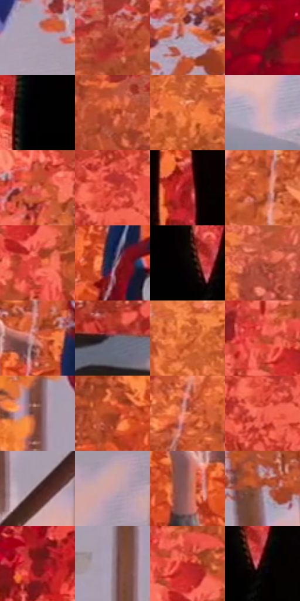

# 电影参考 384

- 状态：常规／活跃；来源世界：miles-home。
- 视角：high-angle；景别：full-body；场景：landscape。
- 时段：daylight-time-unspecified（外观依据，中置信度；具体时间／晨昏未知）；光照：warm-day。
- 材质候选：skin, hair, fabric, foliage, snow, stone, sky（帧级，不是像素分割）。
- 明暗组：middle；L* P5/P50/P95：0.7618 / 48.2418 / 72.05843。
- 资格门禁：无附加门禁。
- 原截图 SHA-256：`5e852a9dc7498c625059dc987c7d82a33bfbaf1f477e03c1e2549b81cb78982c`；尺寸：2878 × 1202。
- sRGB 像素 SHA-256：`8c59da4cebe3aaabf272bc39ab568ddf8b68c0df2f50b6e678fa7d376f1020c8`。

## 观察与迁移

暖林、冷雪、发束、布料与半透明软管分别表达；线状实体不叫动作线。

384  /  悬挂动作／遮挡  /  前景腿部、两名悬挂人物与承重蛛丝，暖树叶对冷雪；蛛丝是场景实体联系，不算运动线

本公开版保存32个128×128原像素色卡上下文；图集格子并非原场景相邻位置。原rect、图集tile和像素SHA见 `data/palette-crops.json`。上下文不足时不得批准替色，不能以小样推断完整构图。

## 实测色卡

颜色比例分母为保留采样像素，不是材料面积；全部 32 色参与全库匹配。表内四舍五入仅用于阅读，原精度在 JSON。

| ID | HEX | Lab | 原图 xy | 像素数 | 比例 | 明度角色 |
| --- | --- | --- | --- | ---: | ---: | --- |
| 384-S01 | #A89CAC | [65.811287, 7.383549, -6.720486] | [2496, 644] | 9814 | 5.094265% | light |
| 384-S02 | #A33728 | [39.026729, 43.726387, 33.283909] | [1460, 112] | 9047 | 4.696130% | shadow |
| 384-S03 | #B1A5B7 | [69.238441, 7.698317, -7.677221] | [1044, 692] | 8663 | 4.496802% | light |
| 384-S04 | #750A17 | [23.875611, 43.532065, 24.314062] | [192, 32] | 8546 | 4.436070% | shadow |
| 384-S05 | #010000 | [0.058309, 0.261499, 0.092139] | [660, 404] | 8402 | 4.361322% | deep-shadow |
| 384-S06 | #C05431 | [49.218587, 41.219945, 40.853178] | [1164, 100] | 7653 | 3.972530% | midtone |
| 384-S07 | #DF6C32 | [58.647021, 41.254449, 51.572464] | [2256, 76] | 7492 | 3.888958% | midtone |
| 384-S08 | #DBB3B4 | [76.434472, 14.591974, 4.954367] | [1120, 1080] | 7303 | 3.790852% | light |
| 384-S09 | #E86A57 | [60.030179, 47.46551, 34.314489] | [1092, 540] | 7243 | 3.759707% | light |
| 384-S10 | #C53927 | [45.561235, 54.401414, 42.578518] | [488, 896] | 7188 | 3.731157% | midtone |
| 384-S11 | #9C2320 | [34.755035, 48.84513, 32.906972] | [792, 212] | 6735 | 3.496013% | shadow |
| 384-S12 | #D05C30 | [53.256264, 43.330319, 46.365787] | [1880, 252] | 6313 | 3.276961% | midtone |
| 384-S13 | #D74637 | [50.812958, 55.843339, 40.490935] | [1196, 416] | 6135 | 3.184565% | midtone |
| 384-S14 | #36354F | [23.320784, 7.356544, -15.710875] | [1700, 632] | 6123 | 3.178336% | shadow |
| 384-S15 | #090505 | [1.604102, 1.04591, 0.368719] | [740, 356] | 6071 | 3.151343% | deep-shadow |
| 384-S16 | #AE4936 | [44.279825, 40.054422, 31.752733] | [2520, 76] | 6067 | 3.149267% | midtone |
| 384-S17 | #C55F46 | [52.398151, 38.765414, 33.251858] | [1656, 420] | 5914 | 3.069848% | midtone |
| 384-S18 | #676571 | [43.334917, 3.352298, -6.4481] | [364, 1124] | 5608 | 2.911009% | midtone |
| 384-S19 | #ED7D46 | [64.257113, 38.99221, 48.436232] | [2096, 36] | 5532 | 2.871558% | light |
| 384-S20 | #C2472F | [47.21567, 47.950364, 39.869023] | [1124, 308] | 5433 | 2.820169% | midtone |
| 384-S21 | #74433B | [34.07427, 20.201433, 13.947509] | [2208, 692] | 5398 | 2.802002% | shadow |
| 384-S22 | #AD4725 | [43.546723, 39.846785, 40.203968] | [1444, 464] | 5378 | 2.791620% | midtone |
| 384-S23 | #F18864 | [67.452261, 36.751398, 36.730718] | [1828, 184] | 5278 | 2.739712% | light |
| 384-S24 | #E65846 | [56.336912, 54.046578, 39.19875] | [472, 948] | 5245 | 2.722582% | midtone |
| 384-S25 | #3B1F23 | [15.650822, 14.171715, 3.200861] | [2272, 1064] | 4876 | 2.531041% | deep-shadow |
| 384-S26 | #CBA3A8 | [70.677173, 15.491193, 3.018331] | [2532, 1040] | 4251 | 2.206615% | light |
| 384-S27 | #9B605C | [47.116568, 23.510088, 12.408961] | [1560, 488] | 4006 | 2.079440% | midtone |
| 384-S28 | #B88B8E | [62.177112, 17.555432, 5.070584] | [1224, 800] | 3917 | 2.033242% | light |
| 384-S29 | #781B1B | [26.324352, 39.719181, 24.655923] | [452, 368] | 3827 | 1.986525% | shadow |
| 384-S30 | #917E8B | [54.87185, 9.65473, -4.33195] | [2336, 864] | 3735 | 1.938769% | midtone |
| 384-S31 | #BA271F | [41.204091, 56.777675, 41.834827] | [1172, 328] | 3616 | 1.876998% | midtone |
| 384-S32 | #230D06 | [5.947446, 9.990537, 6.628028] | [784, 380] | 1839 | 0.954591% | deep-shadow |

## 色阶与空间分布

- 采样 ROI：`[0.01, 0.02, 0.98, 0.94]`；步长：4；样本数：192648。
- 排除区：`[]`。
- 深暗、暗、中、亮、高光五段计数：`[23641, 37242, 81572, 49846, 347]`。
- RGB 各 256 箱、L* 100 箱、13×5 色相明度表和 3×3 空间统计全部保存在 [总数据](../film-library.json)。
- [可视化档案](../../references/library.html)按需绘制直方图，不存 2,094 张重复图表图片。

## 纹理特征占比

**这是分块图像特征的面积占比，不是波点／排线／丝网／错版的精确语义覆盖率。** 窗格、发丝、织物也会产生方向或周期特征。
原图 ROI 像素 3085160；已测块覆盖 3085160（100.0000%）；未测 0。

| 特征 | 块覆盖像素 | 占已测面积 | 阈值敏感范围 |
| --- | ---: | ---: | --- |
| low-contrast | 49152 | 1.5932% | 1.5932% ~ 2.1242% |
| directional-structure | 336000 | 10.8908% | 4.8667% ~ 19.1713% |
| periodic-structure | 2230888 | 72.3103% | 64.1950% ~ 77.1113% |
| mixed-detail | 469120 | 15.2057% | 2.1242% ~ 28.8141% |

阈值敏感范围不是统计置信区间。逐块坐标、尺度、对比、方向一致性、频谱集中度、频率与角度见 [全量特征记录](../texture-features.jsonl)，以帧号定位。
四种印刷层的真实像素覆盖仍标为 `null`，不能填 0，也不能拿上表代替。不得据这些代理测量删除唯一证据。

[测量方法与保留策略](../../references/library-retention.md) · [分类索引](../archive/README.md)
