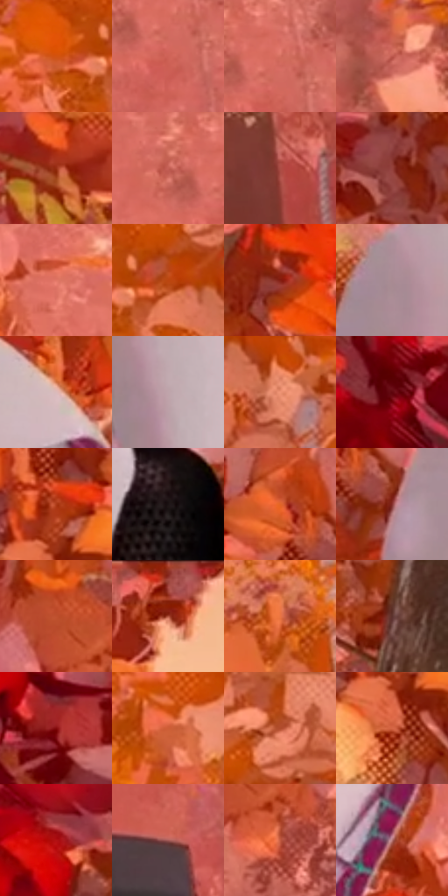

# 电影参考 385

- 状态：常规／活跃；来源世界：miles-home。
- 视角：near-level；景别：medium；场景：landscape。
- 时段：daylight-time-unspecified（外观依据，中置信度；具体时间／晨昏未知）；光照：warm-day。
- 材质候选：skin, hair, fabric, foliage, snow, stone, sky（帧级，不是像素分割）。
- 明暗组：middle；L* P5/P50/P95：19.81514 / 49.91946 / 72.32833。
- 资格门禁：无附加门禁。
- 原截图 SHA-256：`36396f94122c9f24fbd39c336c37e4c2bd7aa70086efb1be595c764019a17184`；尺寸：2880 × 1202。
- sRGB 像素 SHA-256：`5cc564318d0dff4212054ce005e150f868747c0e65abfdb4a0fbf788923a6a58`。

## 观察与迁移

暖林、冷雪、发束、布料与半透明软管分别表达；线状实体不叫动作线。

385  /  衣物／林间光  /  白兜帽用浅灰紫转折、黑色躯干有细纹、内衬有色；面罩不是裸脸模板，白布不画成发光塑料

本公开版保存32个128×128原像素色卡上下文；图集格子并非原场景相邻位置。原rect、图集tile和像素SHA见 `data/palette-crops.json`。上下文不足时不得批准替色，不能以小样推断完整构图。

## 实测色卡

颜色比例分母为保留采样像素，不是材料面积；全部 32 色参与全库匹配。表内四舍五入仅用于阅读，原精度在 JSON。

| ID | HEX | Lab | 原图 xy | 像素数 | 比例 | 明度角色 |
| --- | --- | --- | --- | ---: | ---: | --- |
| 385-S01 | #D25310 | [51.757721, 47.494724, 58.006174] | [2548, 504] | 10866 | 5.640339% | midtone |
| 385-S02 | #CE6357 | [54.800607, 41.343925, 26.886709] | [2020, 300] | 10050 | 5.216768% | midtone |
| 385-S03 | #D46E5F | [58.016949, 38.643212, 26.657194] | [2028, 252] | 10010 | 5.196005% | midtone |
| 385-S04 | #BE594E | [50.269242, 39.6983, 25.783845] | [2232, 304] | 9340 | 4.848221% | midtone |
| 385-S05 | #962D11 | [34.809107, 42.634581, 40.359152] | [624, 292] | 9195 | 4.772954% | shadow |
| 385-S06 | #C46055 | [52.686431, 38.949068, 25.013586] | [1952, 248] | 8942 | 4.641626% | midtone |
| 385-S07 | #AC4D45 | [44.956367, 38.289714, 23.710849] | [2428, 1028] | 8730 | 4.531581% | midtone |
| 385-S08 | #94413A | [38.522523, 34.394997, 21.334475] | [792, 704] | 8203 | 4.258025% | shadow |
| 385-S09 | #E17866 | [62.001238, 39.008099, 28.24618] | [1716, 460] | 7449 | 3.866638% | light |
| 385-S10 | #BB4610 | [45.61473, 44.998944, 51.898423] | [2644, 496] | 7368 | 3.824592% | midtone |
| 385-S11 | #841E12 | [29.105935, 42.329098, 33.564216] | [972, 916] | 7098 | 3.684440% | shadow |
| 385-S12 | #A98A92 | [60.505464, 13.065216, 0.178688] | [1252, 172] | 6977 | 3.621631% | light |
| 385-S13 | #DCBABA | [78.391838, 12.145516, 4.537906] | [1544, 164] | 6499 | 3.373510% | light |
| 385-S14 | #BFA4AB | [69.872547, 11.03259, 0.048014] | [1240, 736] | 6374 | 3.308625% | light |
| 385-S15 | #EF9475 | [70.049119, 31.104933, 30.820104] | [2744, 560] | 5880 | 3.052199% | light |
| 385-S16 | #5F040D | [18.141376, 38.114321, 22.436426] | [132, 132] | 5800 | 3.010672% | deep-shadow |
| 385-S17 | #AC3A17 | [40.994925, 45.050784, 44.495226] | [928, 356] | 5759 | 2.989390% | midtone |
| 385-S18 | #1B1314 | [6.768306, 4.053145, 0.748361] | [1468, 744] | 5542 | 2.876749% | deep-shadow |
| 385-S19 | #E26427 | [57.49625, 45.941518, 55.49519] | [1048, 300] | 5367 | 2.785910% | midtone |
| 385-S20 | #87322F | [33.219117, 36.192834, 20.969282] | [1124, 376] | 4994 | 2.592293% | shadow |
| 385-S21 | #BF502E | [48.27797, 42.657198, 41.372154] | [592, 912] | 4614 | 2.395042% | midtone |
| 385-S22 | #A73E28 | [40.922857, 42.007232, 35.550582] | [1780, 44] | 4607 | 2.391408% | midtone |
| 385-S23 | #EA7543 | [62.189963, 41.714228, 47.545477] | [2608, 100] | 4402 | 2.284996% | light |
| 385-S24 | #5C332E | [26.276201, 17.861365, 11.185276] | [244, 944] | 4305 | 2.234646% | shadow |
| 385-S25 | #820A0D | [26.716318, 47.005722, 33.901748] | [464, 436] | 4086 | 2.120967% | shadow |
| 385-S26 | #CD5E37 | [53.237383, 41.510015, 42.660108] | [2536, 652] | 3660 | 1.899838% | midtone |
| 385-S27 | #B04C2C | [45.05845, 38.826755, 38.269651] | [2692, 400] | 3351 | 1.739442% | midtone |
| 385-S28 | #D56646 | [56.18286, 41.351124, 38.344196] | [920, 456] | 2984 | 1.548939% | midtone |
| 385-S29 | #B11213 | [37.535248, 58.841484, 43.925327] | [404, 148] | 2910 | 1.510527% | shadow |
| 385-S30 | #A45A57 | [46.836289, 29.917604, 15.210689] | [1812, 1024] | 2666 | 1.383871% | midtone |
| 385-S31 | #C25A41 | [50.881523, 39.835184, 34.121074] | [652, 1000] | 2557 | 1.327291% | midtone |
| 385-S32 | #B37271 | [54.878786, 25.545342, 11.295243] | [1572, 388] | 2063 | 1.070865% | midtone |

## 色阶与空间分布

- 采样 ROI：`[0.01, 0.02, 0.98, 0.94]`；步长：4；样本数：192648。
- 排除区：`[]`。
- 深暗、暗、中、亮、高光五段计数：`[9820, 42639, 105880, 32701, 1608]`。
- RGB 各 256 箱、L* 100 箱、13×5 色相明度表和 3×3 空间统计全部保存在 [总数据](../film-library.json)。
- [可视化档案](../../references/library.html)按需绘制直方图，不存 2,094 张重复图表图片。

## 纹理特征占比

**这是分块图像特征的面积占比，不是波点／排线／丝网／错版的精确语义覆盖率。** 窗格、发丝、织物也会产生方向或周期特征。
原图 ROI 像素 3087370；已测块覆盖 3087370（100.0000%）；未测 0。

| 特征 | 块覆盖像素 | 占已测面积 | 阈值敏感范围 |
| --- | ---: | ---: | --- |
| low-contrast | 10368 | 0.3358% | 0.3358% ~ 0.3358% |
| directional-structure | 178560 | 5.7836% | 1.5920% ~ 9.7802% |
| periodic-structure | 2554378 | 82.7364% | 71.4387% ~ 87.2306% |
| mixed-detail | 344064 | 11.1442% | 2.6534% ~ 26.6334% |

阈值敏感范围不是统计置信区间。逐块坐标、尺度、对比、方向一致性、频谱集中度、频率与角度见 [全量特征记录](../texture-features.jsonl)，以帧号定位。
四种印刷层的真实像素覆盖仍标为 `null`，不能填 0，也不能拿上表代替。不得据这些代理测量删除唯一证据。

[测量方法与保留策略](../../references/library-retention.md) · [分类索引](../archive/README.md)
