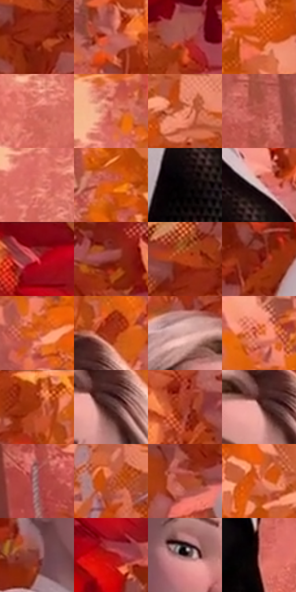

# 电影参考 386

- 状态：常规／活跃；来源世界：miles-home。
- 视角：near-level；景别：medium；场景：landscape。
- 时段：daylight-time-unspecified（外观依据，中置信度；具体时间／晨昏未知）；光照：warm-day。
- 材质候选：skin, hair, fabric, foliage, snow, stone, sky（帧级，不是像素分割）。
- 明暗组：middle；L* P5/P50/P95：15.51675 / 49.10271 / 72.22281。
- 资格门禁：无附加门禁。
- 原截图 SHA-256：`9f1af85e570fd4e0ca383322c8fae325e8dd112bb4ef90b7b6443720d45ad230`；尺寸：2880 × 1206。
- sRGB 像素 SHA-256：`635b61bd54053096aba88ed6594462b2715161a484783376877380e1ff46c822`。

## 观察与迁移

暖林、冷雪、发束、布料与半透明软管分别表达；线状实体不叫动作线。

361、386金发来访者  /  相对柔和面颊、较短鼻体、有厚度的嘴唇、选择性眼睑线；近景可见少量肤色细节，短发以不对称大束表现，少量细线辅助  /  不是所有电影脸都尖长；参考人物为造型对照，不换发色／发型／年龄。她所在的实验室与森林属于本批场景，不据人物来源排除这些帧

386  /  少年面部／暖环境  /  柔和面颊、细眼睑、短鼻与适度唇体积，短发分束，林色温暖；身份、年龄与头向仍由用户照片决定

本公开版保存32个128×128原像素色卡上下文；图集格子并非原场景相邻位置。原rect、图集tile和像素SHA见 `data/palette-crops.json`。上下文不足时不得批准替色，不能以小样推断完整构图。

## 实测色卡

颜色比例分母为保留采样像素，不是材料面积；全部 32 色参与全库匹配。表内四舍五入仅用于阅读，原精度在 JSON。

| ID | HEX | Lab | 原图 xy | 像素数 | 比例 | 明度角色 |
| --- | --- | --- | --- | ---: | ---: | --- |
| 386-S01 | #922A12 | [33.589351, 42.491004, 38.571986] | [896, 700] | 9852 | 5.095528% | shadow |
| 386-S02 | #C35D54 | [51.920841, 40.018515, 24.570191] | [1000, 180] | 9676 | 5.004500% | midtone |
| 386-S03 | #A94B44 | [44.070268, 38.090256, 23.074841] | [224, 608] | 8720 | 4.510049% | midtone |
| 386-S04 | #CA4E13 | [49.564226, 46.897063, 54.945626] | [2496, 672] | 8710 | 4.504877% | midtone |
| 386-S05 | #CD6257 | [54.455333, 41.472558, 26.411475] | [1792, 408] | 8549 | 4.421607% | midtone |
| 386-S06 | #D46C5D | [57.574973, 39.506689, 27.218944] | [1972, 72] | 8264 | 4.274203% | midtone |
| 386-S07 | #F08C6C | [68.291565, 34.910022, 33.450423] | [2656, 460] | 8060 | 4.168692% | light |
| 386-S08 | #BA574C | [49.228394, 39.049586, 25.494043] | [2148, 840] | 7909 | 4.090594% | midtone |
| 386-S09 | #DE7465 | [60.749886, 39.839207, 27.096522] | [1940, 192] | 7474 | 3.865609% | light |
| 386-S10 | #E05F16 | [56.182234, 47.187652, 60.454153] | [2480, 924] | 7425 | 3.840266% | midtone |
| 386-S11 | #0A0506 | [1.682198, 1.446453, 0.082434] | [1404, 796] | 6808 | 3.521149% | deep-shadow |
| 386-S12 | #DEBEBA | [79.558742, 10.738816, 6.243756] | [1452, 700] | 6677 | 3.453394% | light |
| 386-S13 | #6E030C | [21.608057, 42.681117, 27.791074] | [336, 40] | 6660 | 3.444602% | shadow |
| 386-S14 | #923D36 | [37.328845, 35.380588, 22.20248] | [628, 624] | 6590 | 3.408397% | shadow |
| 386-S15 | #B74115 | [44.096588, 45.880853, 48.665537] | [876, 640] | 6590 | 3.408397% | midtone |
| 386-S16 | #801C11 | [28.011455, 41.680145, 32.798877] | [1068, 572] | 6485 | 3.354091% | shadow |
| 386-S17 | #E8713A | [61.024869, 42.538149, 50.639223] | [2212, 264] | 6199 | 3.206169% | light |
| 386-S18 | #A53417 | [38.759428, 45.136113, 42.077939] | [1564, 144] | 6152 | 3.181860% | shadow |
| 386-S19 | #D3A49C | [71.420522, 16.149591, 10.815195] | [1376, 160] | 5672 | 2.933601% | light |
| 386-S20 | #D05D34 | [53.482153, 43.006261, 44.599676] | [2244, 452] | 5249 | 2.714822% | midtone |
| 386-S21 | #BE4F2B | [47.901204, 42.641264, 42.475245] | [1484, 40] | 4861 | 2.514146% | midtone |
| 386-S22 | #4F2E2B | [22.968252, 14.741135, 8.348541] | [1528, 232] | 4654 | 2.407084% | shadow |
| 386-S23 | #A43C29 | [40.059231, 41.87669, 33.90085] | [564, 784] | 4388 | 2.269506% | midtone |
| 386-S24 | #BB8684 | [61.0304, 20.045478, 9.165689] | [1496, 220] | 3998 | 2.067796% | light |
| 386-S25 | #955C5D | [45.408107, 23.490143, 9.304199] | [2440, 1096] | 3794 | 1.962285% | midtone |
| 386-S26 | #C2583C | [50.426842, 40.548796, 36.363993] | [2776, 688] | 3751 | 1.940045% | midtone |
| 386-S27 | #AE482A | [43.949425, 39.944908, 38.05471] | [828, 876] | 3721 | 1.924529% | midtone |
| 386-S28 | #D86545 | [56.426745, 42.92465, 39.283844] | [2544, 416] | 3690 | 1.908496% | midtone |
| 386-S29 | #7B332F | [31.312425, 31.051216, 18.111166] | [1284, 472] | 3607 | 1.865567% | shadow |
| 386-S30 | #B01416 | [37.465367, 58.272995, 42.340269] | [372, 196] | 3152 | 1.630238% | shadow |
| 386-S31 | #341616 | [11.702358, 15.04251, 6.954265] | [1412, 348] | 3074 | 1.589896% | deep-shadow |
| 386-S32 | #B46E6A | [53.918546, 27.314272, 14.058312] | [1564, 944] | 2935 | 1.518004% | midtone |

## 色阶与空间分布

- 采样 ROI：`[0.01, 0.02, 0.98, 0.94]`；步长：4；样本数：193346。
- 排除区：`[]`。
- 深暗、暗、中、亮、高光五段计数：`[13255, 43609, 104139, 28947, 3396]`。
- RGB 各 256 箱、L* 100 箱、13×5 色相明度表和 3×3 空间统计全部保存在 [总数据](../film-library.json)。
- [可视化档案](../../references/library.html)按需绘制直方图，不存 2,094 张重复图表图片。

## 纹理特征占比

**这是分块图像特征的面积占比，不是波点／排线／丝网／错版的精确语义覆盖率。** 窗格、发丝、织物也会产生方向或周期特征。
原图 ROI 像素 3098546；已测块覆盖 3098546（100.0000%）；未测 0。

| 特征 | 块覆盖像素 | 占已测面积 | 阈值敏感范围 |
| --- | ---: | ---: | --- |
| low-contrast | 0 | 0.0000% | 0.0000% ~ 0.3511% |
| directional-structure | 185600 | 5.9899% | 1.5863% ~ 11.8063% |
| periodic-structure | 2650930 | 85.5540% | 74.3715% ~ 87.3138% |
| mixed-detail | 262016 | 8.4561% | 0.8799% ~ 23.6911% |

阈值敏感范围不是统计置信区间。逐块坐标、尺度、对比、方向一致性、频谱集中度、频率与角度见 [全量特征记录](../texture-features.jsonl)，以帧号定位。
四种印刷层的真实像素覆盖仍标为 `null`，不能填 0，也不能拿上表代替。不得据这些代理测量删除唯一证据。

[测量方法与保留策略](../../references/library-retention.md) · [分类索引](../archive/README.md)
