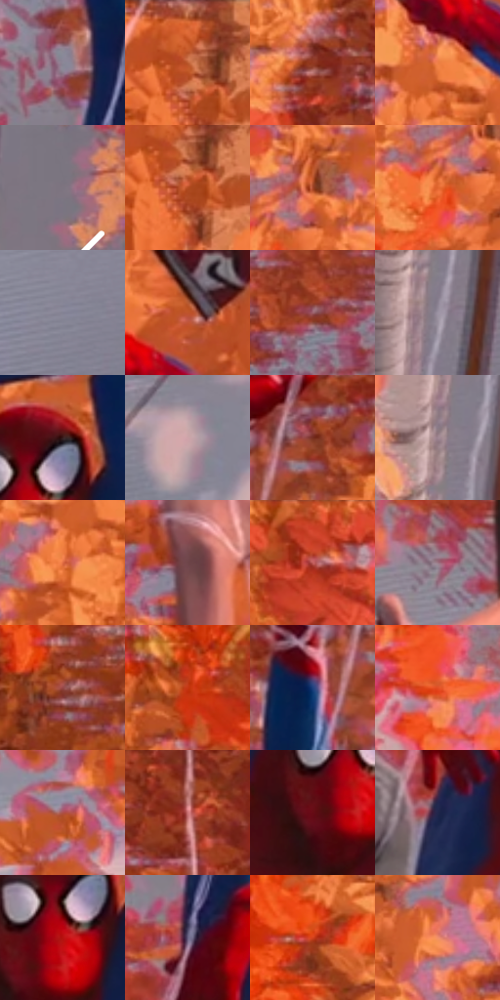

# 电影参考 387

- 状态：常规／活跃；来源世界：miles-home。
- 视角：high-angle；景别：full-body；场景：landscape。
- 时段：daylight-time-unspecified（外观依据，中置信度；具体时间／晨昏未知）；光照：warm-day。
- 材质候选：skin, hair, fabric, foliage, snow, stone, sky（帧级，不是像素分割）。
- 明暗组：middle；L* P5/P50/P95：17.93259 / 50.63802 / 67.34915。
- 资格门禁：无附加门禁。
- 原截图 SHA-256：`d1a0d6426a249448f742c3bbafe68fe65b948677b56481540481e7f9b7349eea`；尺寸：2880 × 1206。
- sRGB 像素 SHA-256：`6c1eed8b36a7cdfa78910d3678451ac17ab227e0dfbcff15d3168c9962684a65`。

## 观察与迁移

暖林、冷雪、发束、布料与半透明软管分别表达；线状实体不叫动作线。

387  /  姿态对照／投影  /  两人不同悬挂姿势，树叶、丝线、雪面投影分层；姿态足够清楚，不必再加冲击星

本公开版保存32个128×128原像素色卡上下文；图集格子并非原场景相邻位置。原rect、图集tile和像素SHA见 `data/palette-crops.json`。上下文不足时不得批准替色，不能以小样推断完整构图。

## 实测色卡

颜色比例分母为保留采样像素，不是材料面积；全部 32 色参与全库匹配。表内四舍五入仅用于阅读，原精度在 JSON。

| ID | HEX | Lab | 原图 xy | 像素数 | 比例 | 明度角色 |
| --- | --- | --- | --- | ---: | ---: | --- |
| 387-S01 | #8B8796 | [57.093773, 4.507616, -7.455566] | [1348, 432] | 10919 | 5.647389% | midtone |
| 387-S02 | #CA5E2D | [52.680407, 39.935793, 46.940249] | [2740, 48] | 9673 | 5.002948% | midtone |
| 387-S03 | #923821 | [36.082264, 36.667673, 33.163373] | [996, 100] | 9611 | 4.970881% | shadow |
| 387-S04 | #EF8046 | [65.149731, 38.247424, 49.493391] | [1944, 440] | 9571 | 4.950193% | light |
| 387-S05 | #807682 | [50.871412, 6.196846, -5.161403] | [2820, 536] | 8314 | 4.300063% | midtone |
| 387-S06 | #B44C22 | [45.621287, 39.973548, 44.115594] | [2752, 104] | 8248 | 4.265927% | midtone |
| 387-S07 | #A44428 | [41.504397, 37.995095, 36.023538] | [844, 288] | 7704 | 3.984567% | midtone |
| 387-S08 | #E0652E | [57.421229, 44.926397, 52.262583] | [796, 344] | 7556 | 3.908020% | midtone |
| 387-S09 | #838293 | [54.96604, 3.907913, -8.967935] | [2196, 1064] | 7259 | 3.754409% | midtone |
| 387-S10 | #BF542B | [49.000788, 40.587067, 43.64926] | [2016, 332] | 7252 | 3.750789% | midtone |
| 387-S11 | #9E616D | [48.164248, 26.352217, 3.74787] | [252, 884] | 6902 | 3.569766% | midtone |
| 387-S12 | #9D94A4 | [62.531518, 6.39123, -7.190153] | [2640, 940] | 6712 | 3.471497% | light |
| 387-S13 | #381E1E | [14.752455, 12.685408, 5.453829] | [1572, 588] | 6586 | 3.406329% | deep-shadow |
| 387-S14 | #CEA4A9 | [71.240936, 16.211622, 3.31881] | [576, 872] | 6309 | 3.263062% | light |
| 387-S15 | #762F20 | [29.387208, 30.125579, 24.94778] | [1500, 232] | 5905 | 3.054110% | shadow |
| 387-S16 | #9F8693 | [58.53516, 11.771536, -3.397225] | [2632, 760] | 5148 | 2.662584% | midtone |
| 387-S17 | #E06B43 | [58.763121, 42.875457, 43.334098] | [1908, 504] | 5037 | 2.605174% | midtone |
| 387-S18 | #6E4549 | [34.092901, 18.231918, 4.963454] | [1128, 324] | 4825 | 2.495526% | shadow |
| 387-S19 | #C15E5C | [51.971013, 39.430991, 19.898169] | [720, 64] | 4750 | 2.456736% | midtone |
| 387-S20 | #9B7985 | [54.383384, 15.213503, -1.443807] | [1068, 768] | 4723 | 2.442771% | midtone |
| 387-S21 | #944746 | [39.992134, 32.250415, 15.874605] | [88, 532] | 4705 | 2.433461% | shadow |
| 387-S22 | #C53612 | [45.020141, 55.005582, 51.623361] | [440, 272] | 4654 | 2.407084% | midtone |
| 387-S23 | #1D407E | [27.935992, 10.854263, -38.802875] | [1420, 292] | 4628 | 2.393636% | shadow |
| 387-S24 | #E34D24 | [53.783318, 56.409515, 53.575641] | [680, 572] | 4628 | 2.393636% | midtone |
| 387-S25 | #AD5047 | [45.74213, 37.29405, 23.561413] | [1684, 980] | 4567 | 2.362087% | midtone |
| 387-S26 | #CD7477 | [58.793296, 35.15396, 13.784503] | [1144, 116] | 4524 | 2.339847% | midtone |
| 387-S27 | #660A14 | [20.413663, 38.926533, 21.496311] | [1500, 692] | 4390 | 2.270541% | shadow |
| 387-S28 | #21264C | [16.656436, 10.36182, -24.301124] | [1368, 728] | 4262 | 2.204338% | deep-shadow |
| 387-S29 | #B6120F | [38.577996, 60.13089, 46.908305] | [1544, 660] | 3917 | 2.025902% | shadow |
| 387-S30 | #665F80 | [42.104255, 10.213152, -17.414735] | [1368, 576] | 3545 | 1.833501% | midtone |
| 387-S31 | #D0411C | [48.609124, 54.661757, 51.305689] | [288, 352] | 3281 | 1.696958% | midtone |
| 387-S32 | #F19069 | [69.235203, 32.983649, 36.28793] | [924, 420] | 3241 | 1.676269% | light |

## 色阶与空间分布

- 采样 ROI：`[0.01, 0.02, 0.98, 0.94]`；步长：4；样本数：193346。
- 排除区：`[]`。
- 深暗、暗、中、亮、高光五段计数：`[11759, 35379, 116103, 29474, 631]`。
- RGB 各 256 箱、L* 100 箱、13×5 色相明度表和 3×3 空间统计全部保存在 [总数据](../film-library.json)。
- [可视化档案](../../references/library.html)按需绘制直方图，不存 2,094 张重复图表图片。

## 纹理特征占比

**这是分块图像特征的面积占比，不是波点／排线／丝网／错版的精确语义覆盖率。** 窗格、发丝、织物也会产生方向或周期特征。
原图 ROI 像素 3098546；已测块覆盖 3098546（100.0000%）；未测 0。

| 特征 | 块覆盖像素 | 占已测面积 | 阈值敏感范围 |
| --- | ---: | ---: | --- |
| low-contrast | 24448 | 0.7890% | 0.4379% ~ 0.7890% |
| directional-structure | 306226 | 9.8829% | 5.0414% ~ 18.3349% |
| periodic-structure | 2560384 | 82.6318% | 77.4268% ~ 82.6318% |
| mixed-detail | 207488 | 6.6963% | 3.5237% ~ 16.7428% |

阈值敏感范围不是统计置信区间。逐块坐标、尺度、对比、方向一致性、频谱集中度、频率与角度见 [全量特征记录](../texture-features.jsonl)，以帧号定位。
四种印刷层的真实像素覆盖仍标为 `null`，不能填 0，也不能拿上表代替。不得据这些代理测量删除唯一证据。

[测量方法与保留策略](../../references/library-retention.md) · [分类索引](../archive/README.md)
