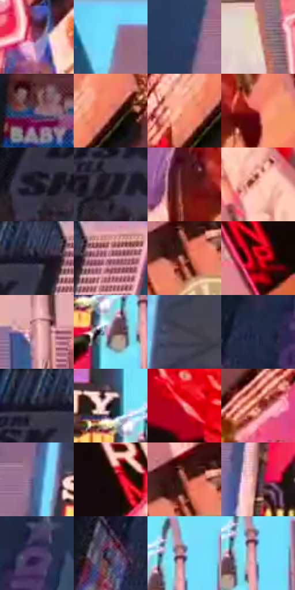

# 电影参考 388

- 状态：常规／活跃；来源世界：miles-home。
- 视角：low-angle；景别：environment-wide；场景：city。
- 时段：daylight-time-unspecified（外观依据，中置信度；具体时间／晨昏未知）；光照：neutral-day。
- 材质候选：glass, stone, metal, screen, sky（帧级，不是像素分割）。
- 明暗组：middle；L* P5/P50/P95：6.24136 / 41.14934 / 84.69264。
- 资格门禁：无附加门禁。
- 原截图 SHA-256：`43e5c8439c6887a7e8ab333352f502df1fe251268690e6a46d07ad1e6deb799a`；尺寸：2880 × 1204。
- sRGB 像素 SHA-256：`786290ce6f623228ec16134995410f16d25434ebc1d124bf708d6c548d7584da`。

## 观察与迁移

同机位日光城市，广告内容变化与材质换光分开。

388  /  明亮青蓝天空，右侧暖桃色立面，左侧大块冷暗楼体；灯杆浅灰  /  日光先建立整块建筑明暗，广告仍有颜色但不是所有表面的主光；冷暖跟随空间分区

本公开版保存32个128×128原像素色卡上下文；图集格子并非原场景相邻位置。原rect、图集tile和像素SHA见 `data/palette-crops.json`。上下文不足时不得批准替色，不能以小样推断完整构图。

## 实测色卡

颜色比例分母为保留采样像素，不是材料面积；全部 32 色参与全库匹配。表内四舍五入仅用于阅读，原精度在 JSON。

| ID | HEX | Lab | 原图 xy | 像素数 | 比例 | 明度角色 |
| --- | --- | --- | --- | ---: | ---: | --- |
| 388-S01 | #724064 | [34.323963, 27.285499, -11.83252] | [2108, 908] | 11588 | 6.015116% | shadow |
| 388-S02 | #70DEFB | [83.256601, -23.644156, -23.718202] | [968, 64] | 11312 | 5.871849% | highlight |
| 388-S03 | #2B3E68 | [26.614388, 6.330926, -26.928553] | [904, 400] | 9799 | 5.086479% | shadow |
| 388-S04 | #F3D3C3 | [86.793123, 8.687363, 12.037369] | [1896, 596] | 9252 | 4.802541% | highlight |
| 388-S05 | #8B6D87 | [49.708867, 16.568964, -9.736447] | [1140, 1064] | 8978 | 4.660313% | midtone |
| 388-S06 | #E87C6E | [63.918347, 40.262199, 26.462935] | [2336, 560] | 7787 | 4.042087% | light |
| 388-S07 | #F49671 | [71.037952, 31.662266, 34.373421] | [2272, 592] | 7603 | 3.946576% | light |
| 388-S08 | #D65F5A | [55.301035, 46.458212, 26.043428] | [2260, 400] | 7338 | 3.809020% | midtone |
| 388-S09 | #151421 | [6.951055, 4.195859, -8.828066] | [436, 192] | 7137 | 3.704684% | deep-shadow |
| 388-S10 | #2A2533 | [15.770078, 5.851495, -8.27176] | [600, 188] | 7063 | 3.666272% | deep-shadow |
| 388-S11 | #551714 | [18.343719, 28.446404, 18.146376] | [2152, 392] | 6935 | 3.599830% | deep-shadow |
| 388-S12 | #F7BBA6 | [80.778477, 18.82984, 19.045293] | [2744, 696] | 6879 | 3.570761% | highlight |
| 388-S13 | #30344C | [22.323668, 5.042432, -15.299271] | [716, 44] | 6793 | 3.526120% | shadow |
| 388-S14 | #B67A87 | [57.669995, 25.234775, 2.546814] | [808, 56] | 6361 | 3.301877% | midtone |
| 388-S15 | #7A392E | [32.396556, 27.303377, 20.093621] | [2772, 924] | 6184 | 3.210000% | shadow |
| 388-S16 | #C40A1C | [41.280505, 65.066561, 44.229534] | [2816, 460] | 6158 | 3.196503% | midtone |
| 388-S17 | #D9A09E | [71.121438, 20.86554, 9.371806] | [1488, 1004] | 5936 | 3.081267% | light |
| 388-S18 | #7B5F6E | [43.538921, 14.01581, -4.111282] | [1424, 488] | 5529 | 2.870001% | midtone |
| 388-S19 | #434151 | [28.295039, 4.667373, -9.297971] | [1212, 172] | 4882 | 2.534156% | shadow |
| 388-S20 | #202A47 | [17.542484, 5.307926, -19.487736] | [608, 728] | 4839 | 2.511835% | deep-shadow |
| 388-S21 | #1B1C2C | [10.887588, 4.341669, -10.885113] | [648, 60] | 4743 | 2.462003% | deep-shadow |
| 388-S22 | #180F12 | [5.234915, 4.336168, -0.262561] | [1384, 404] | 4695 | 2.437087% | deep-shadow |
| 388-S23 | #F3A096 | [73.805834, 29.662486, 17.959747] | [2576, 232] | 4600 | 2.387775% | light |
| 388-S24 | #AA463D | [43.160969, 40.453608, 26.142669] | [2360, 812] | 4452 | 2.310951% | midtone |
| 388-S25 | #456895 | [43.263289, 1.022876, -28.429976] | [1104, 372] | 4196 | 2.178066% | midtone |
| 388-S26 | #1A0908 | [3.907396, 6.406816, 2.68519] | [2612, 392] | 4124 | 2.140692% | deep-shadow |
| 388-S27 | #A46258 | [48.678527, 25.580861, 17.122715] | [2772, 892] | 3888 | 2.018189% | midtone |
| 388-S28 | #4F3038 | [23.875386, 15.41134, 0.84764] | [1124, 560] | 3701 | 1.921120% | shadow |
| 388-S29 | #53406E | [30.95286, 18.678987, -23.688321] | [708, 664] | 3665 | 1.902433% | shadow |
| 388-S30 | #4F516D | [35.303477, 6.136973, -16.340213] | [520, 792] | 2906 | 1.508451% | shadow |
| 388-S31 | #9C95BB | [63.466899, 10.393132, -18.760637] | [1488, 428] | 1708 | 0.886591% | light |
| 388-S32 | #83D6F0 | [81.404652, -18.580628, -20.625408] | [1492, 456] | 1617 | 0.839355% | highlight |

## 色阶与空间分布

- 采样 ROI：`[0.01, 0.02, 0.98, 0.94]`；步长：4；样本数：192648。
- 排除区：`[]`。
- 深暗、暗、中、亮、高光五段计数：`[37635, 57031, 39761, 33024, 25197]`。
- RGB 各 256 箱、L* 100 箱、13×5 色相明度表和 3×3 空间统计全部保存在 [总数据](../film-library.json)。
- [可视化档案](../../references/library.html)按需绘制直方图，不存 2,094 张重复图表图片。

## 纹理特征占比

**这是分块图像特征的面积占比，不是波点／排线／丝网／错版的精确语义覆盖率。** 窗格、发丝、织物也会产生方向或周期特征。
原图 ROI 像素 3092958；已测块覆盖 3092958（100.0000%）；未测 0。

| 特征 | 块覆盖像素 | 占已测面积 | 阈值敏感范围 |
| --- | ---: | ---: | --- |
| low-contrast | 81920 | 2.6486% | 2.6486% ~ 4.2378% |
| directional-structure | 507904 | 16.4213% | 6.8864% ~ 30.0740% |
| periodic-structure | 2402782 | 77.6856% | 66.4042% ~ 83.5125% |
| mixed-detail | 100352 | 3.2445% | 0.8732% ~ 5.3634% |

阈值敏感范围不是统计置信区间。逐块坐标、尺度、对比、方向一致性、频谱集中度、频率与角度见 [全量特征记录](../texture-features.jsonl)，以帧号定位。
四种印刷层的真实像素覆盖仍标为 `null`，不能填 0，也不能拿上表代替。不得据这些代理测量删除唯一证据。

[测量方法与保留策略](../../references/library-retention.md) · [分类索引](../archive/README.md)
