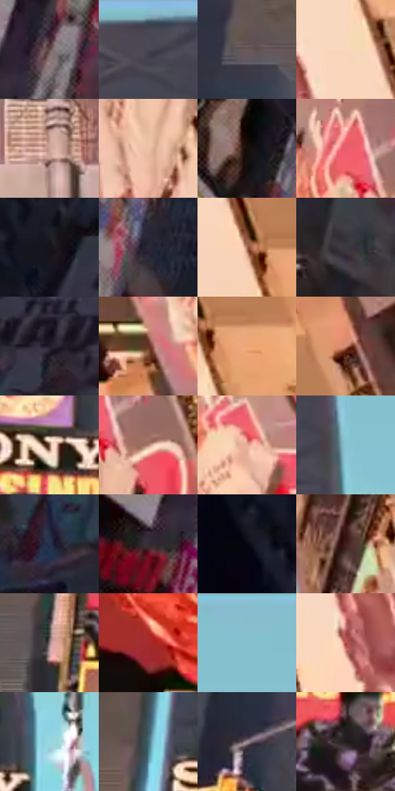

# 电影参考 389

- 状态：常规／活跃；来源世界：miles-home。
- 视角：low-angle；景别：environment-wide；场景：city。
- 时段：daylight-time-unspecified（外观依据，中置信度；具体时间／晨昏未知）；光照：neutral-day。
- 材质候选：glass, stone, metal, screen, sky（帧级，不是像素分割）。
- 明暗组：middle；L* P5/P50/P95：4.11779 / 40.28313 / 84.17887。
- 资格门禁：无附加门禁。
- 原截图 SHA-256：`91ee2b8f893c209006b8d80c4605d0c904b2defc42cb4a98c010a53e181d99ca`；尺寸：2880 × 1206。
- sRGB 像素 SHA-256：`90f977417a35f8e78e684f105c2011415cf1b784c05fb7b36f2df9b2f09050f4`。

## 观察与迁移

同机位日光城市，广告内容变化与材质换光分开。

389  /  晴亮日光，中心偏中性灰暖；右中广告变成洋红人物画面  /  广告色块变化有内容原因，不能说同一表面因天色而突然变洋红；保留与388的稳定楼体对照

本公开版保存32个128×128原像素色卡上下文；图集格子并非原场景相邻位置。原rect、图集tile和像素SHA见 `data/palette-crops.json`。上下文不足时不得批准替色，不能以小样推断完整构图。

## 实测色卡

颜色比例分母为保留采样像素，不是材料面积；全部 32 色参与全库匹配。表内四舍五入仅用于阅读，原精度在 JSON。

| ID | HEX | Lab | 原图 xy | 像素数 | 比例 | 明度角色 |
| --- | --- | --- | --- | ---: | ---: | --- |
| 389-S01 | #624A4B | [33.988307, 10.349305, 3.343722] | [424, 1028] | 8743 | 4.521945% | shadow |
| 389-S02 | #43434F | [28.829915, 2.852942, -7.190836] | [1300, 36] | 8643 | 4.470224% | shadow |
| 389-S03 | #6C5B5B | [40.288845, 6.902444, 2.57191] | [932, 540] | 8169 | 4.225068% | midtone |
| 389-S04 | #F9D7BA | [88.10716, 7.540812, 18.694333] | [2480, 944] | 8084 | 4.181105% | highlight |
| 389-S05 | #CCA194 | [69.800983, 13.981866, 12.840457] | [1480, 892] | 7700 | 3.982498% | light |
| 389-S06 | #EDC1A7 | [81.25704, 12.006891, 19.026466] | [2092, 392] | 7694 | 3.979394% | highlight |
| 389-S07 | #180C08 | [4.288001, 4.12983, 3.213404] | [440, 756] | 7672 | 3.968016% | deep-shadow |
| 389-S08 | #EC5D6A | [58.702367, 56.139026, 21.907201] | [2100, 80] | 7668 | 3.965947% | midtone |
| 389-S09 | #15141D | [6.76057, 2.857297, -6.059527] | [396, 92] | 7666 | 3.964913% | deep-shadow |
| 389-S10 | #282835 | [16.629718, 3.477028, -8.387054] | [548, 868] | 7294 | 3.772511% | deep-shadow |
| 389-S11 | #A96D59 | [51.944968, 21.553075, 21.037883] | [2560, 1048] | 7132 | 3.688724% | midtone |
| 389-S12 | #3B3941 | [24.442191, 2.738621, -4.627937] | [680, 1120] | 6837 | 3.536148% | shadow |
| 389-S13 | #221E2A | [12.193854, 5.04436, -7.355302] | [552, 208] | 6778 | 3.505632% | deep-shadow |
| 389-S14 | #663326 | [27.663503, 21.514688, 18.488504] | [2620, 688] | 6228 | 3.221168% | shadow |
| 389-S15 | #EEA677 | [74.052332, 21.379617, 34.908623] | [2628, 1076] | 6138 | 3.174620% | light |
| 389-S16 | #CF8871 | [63.399792, 24.53944, 23.525602] | [2680, 916] | 6043 | 3.125485% | light |
| 389-S17 | #8A6651 | [46.313044, 11.55728, 17.521518] | [1316, 388] | 5755 | 2.976529% | midtone |
| 389-S18 | #B18272 | [58.535793, 15.918928, 15.775687] | [2180, 132] | 5749 | 2.973426% | midtone |
| 389-S19 | #E8AB97 | [75.151187, 19.756941, 19.090755] | [2736, 556] | 5719 | 2.957910% | light |
| 389-S20 | #87C4D3 | [75.657031, -15.799502, -13.714161] | [1400, 144] | 5668 | 2.931532% | light |
| 389-S21 | #27354E | [22.043002, 2.120345, -17.12564] | [460, 356] | 5615 | 2.904120% | shadow |
| 389-S22 | #382E36 | [20.287119, 6.269467, -3.405129] | [336, 1104] | 5521 | 2.855503% | shadow |
| 389-S23 | #070710 | [2.118488, 1.400192, -3.810882] | [208, 156] | 5216 | 2.697754% | deep-shadow |
| 389-S24 | #3E1F1B | [15.919436, 14.497225, 9.346602] | [1924, 112] | 4967 | 2.568970% | deep-shadow |
| 389-S25 | #8D7678 | [51.810334, 9.277046, 2.245175] | [1088, 608] | 4795 | 2.480010% | midtone |
| 389-S26 | #A62B2A | [37.850418, 49.651422, 30.96326] | [2572, 256] | 4786 | 2.475355% | shadow |
| 389-S27 | #87BDCB | [73.451815, -14.135607, -12.677699] | [1516, 32] | 4110 | 2.125723% | light |
| 389-S28 | #B34A47 | [45.550436, 42.518526, 23.503926] | [2372, 1096] | 3732 | 1.930218% | midtone |
| 389-S29 | #96D7DF | [82.060418, -18.531003, -10.499832] | [1424, 340] | 3638 | 1.881601% | highlight |
| 389-S30 | #3F6772 | [41.17071, -10.886597, -10.586947] | [1116, 340] | 3388 | 1.752299% | midtone |
| 389-S31 | #9E8E96 | [60.620235, 7.417647, -2.056821] | [896, 884] | 3121 | 1.614205% | light |
| 389-S32 | #241C1B | [11.168426, 3.70192, 2.162089] | [1256, 528] | 3077 | 1.591447% | deep-shadow |

## 色阶与空间分布

- 采样 ROI：`[0.01, 0.02, 0.98, 0.94]`；步长：4；样本数：193346。
- 排除区：`[]`。
- 深暗、暗、中、亮、高光五段计数：`[45842, 50290, 37904, 42959, 16351]`。
- RGB 各 256 箱、L* 100 箱、13×5 色相明度表和 3×3 空间统计全部保存在 [总数据](../film-library.json)。
- [可视化档案](../../references/library.html)按需绘制直方图，不存 2,094 张重复图表图片。

## 纹理特征占比

**这是分块图像特征的面积占比，不是波点／排线／丝网／错版的精确语义覆盖率。** 窗格、发丝、织物也会产生方向或周期特征。
原图 ROI 像素 3098546；已测块覆盖 3098546（100.0000%）；未测 0。

| 特征 | 块覆盖像素 | 占已测面积 | 阈值敏感范围 |
| --- | ---: | ---: | --- |
| low-contrast | 81920 | 2.6438% | 2.1151% ~ 3.1726% |
| directional-structure | 442368 | 14.2766% | 7.4027% ~ 32.6016% |
| periodic-structure | 2421426 | 78.1472% | 64.0523% ~ 80.9686% |
| mixed-detail | 152832 | 4.9324% | 1.2310% ~ 8.4561% |

阈值敏感范围不是统计置信区间。逐块坐标、尺度、对比、方向一致性、频谱集中度、频率与角度见 [全量特征记录](../texture-features.jsonl)，以帧号定位。
四种印刷层的真实像素覆盖仍标为 `null`，不能填 0，也不能拿上表代替。不得据这些代理测量删除唯一证据。

[测量方法与保留策略](../../references/library-retention.md) · [分类索引](../archive/README.md)
