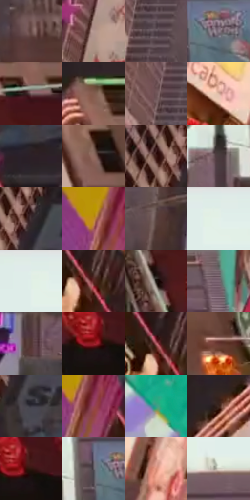

# 电影参考 390

- 状态：常规／活跃；来源世界：miles-home。
- 视角：low-angle；景别：environment-wide；场景：city。
- 时段：daylight-time-unspecified（外观依据，中置信度；具体时间／晨昏未知）；光照：neutral-day。
- 材质候选：glass, stone, metal, screen, sky（帧级，不是像素分割）。
- 明暗组：dark；L* P5/P50/P95：11.5836 / 38.60685 / 92.28545。
- 资格门禁：无附加门禁。
- 原截图 SHA-256：`6453bf8091651afcd98fd7e032de17716039372e9b29374c8a513848b650723a`；尺寸：2880 × 1210。
- sRGB 像素 SHA-256：`b59bde192e9c57b92062ab4137bc587d2ab8a864a9afb163457cd75b50f196e1`。

## 观察与迁移

同机位日光城市，广告内容变化与材质换光分开。

390  /  天空趋浅，楼群呈较柔的灰粉中间调，局部明暗分布改变  /  不仅有强日照与霓虹两种模式；弱直射观感保留材质色与建筑层次，不武断标为阴天

本公开版保存32个128×128原像素色卡上下文；图集格子并非原场景相邻位置。原rect、图集tile和像素SHA见 `data/palette-crops.json`。上下文不足时不得批准替色，不能以小样推断完整构图。

## 实测色卡

颜色比例分母为保留采样像素，不是材料面积；全部 32 色参与全库匹配。表内四舍五入仅用于阅读，原精度在 JSON。

| ID | HEX | Lab | 原图 xy | 像素数 | 比例 | 明度角色 |
| --- | --- | --- | --- | ---: | ---: | --- |
| 390-S01 | #694B47 | [34.984957, 12.109198, 7.408297] | [1664, 1108] | 10988 | 5.662633% | shadow |
| 390-S02 | #B49791 | [64.86878, 9.808103, 7.185917] | [712, 888] | 10606 | 5.465771% | light |
| 390-S03 | #56474F | [31.919535, 7.928707, -2.387107] | [912, 768] | 10108 | 5.209128% | shadow |
| 390-S04 | #8D808D | [55.097413, 7.411008, -5.200659] | [1652, 608] | 9006 | 4.641215% | midtone |
| 390-S05 | #755E60 | [42.2039, 9.674997, 2.394978] | [2428, 100] | 8131 | 4.190287% | midtone |
| 390-S06 | #835C4E | [42.809304, 14.06175, 14.423434] | [2480, 692] | 7755 | 3.996516% | midtone |
| 390-S07 | #6E5355 | [38.124283, 11.56776, 3.189245] | [868, 688] | 7683 | 3.959411% | shadow |
| 390-S08 | #D9B6A3 | [76.590409, 9.721587, 14.375196] | [284, 1020] | 7284 | 3.753788% | light |
| 390-S09 | #2B2026 | [13.748345, 6.575975, -2.007644] | [416, 444] | 6862 | 3.536311% | deep-shadow |
| 390-S10 | #916A60 | [48.477794, 14.137962, 11.735495] | [2548, 840] | 6338 | 3.266270% | midtone |
| 390-S11 | #3B1916 | [13.728537, 16.402339, 9.898369] | [320, 120] | 6172 | 3.180722% | deep-shadow |
| 390-S12 | #493B3E | [26.425833, 6.711317, 0.457888] | [1484, 640] | 6108 | 3.147740% | shadow |
| 390-S13 | #3B2C31 | [19.854824, 7.884453, -0.558183] | [396, 108] | 6071 | 3.128672% | deep-shadow |
| 390-S14 | #BF8A26 | [61.12944, 11.446288, 57.392144] | [252, 444] | 6040 | 3.112696% | light |
| 390-S15 | #57413E | [29.800064, 9.031645, 5.52217] | [1040, 868] | 5835 | 3.007050% | shadow |
| 390-S16 | #E2EEE8 | [93.077226, -5.062263, 1.528213] | [1580, 44] | 5828 | 3.003443% | highlight |
| 390-S17 | #DEECE7 | [92.260307, -5.548914, 0.82415] | [1548, 28] | 5751 | 2.963761% | highlight |
| 390-S18 | #582521 | [21.974051, 23.176902, 14.016067] | [472, 664] | 5710 | 2.942632% | shadow |
| 390-S19 | #18100C | [5.341611, 2.715523, 3.076772] | [2316, 184] | 5641 | 2.907073% | deep-shadow |
| 390-S20 | #7E6573 | [45.608457, 12.53284, -4.040825] | [1904, 428] | 5514 | 2.841624% | midtone |
| 390-S21 | #513633 | [25.644559, 11.641107, 6.761936] | [1400, 884] | 5459 | 2.813279% | shadow |
| 390-S22 | #9C222B | [34.779458, 49.632118, 26.290906] | [2448, 260] | 5367 | 2.765868% | shadow |
| 390-S23 | #B9656D | [52.650762, 34.481887, 10.625586] | [440, 636] | 5258 | 2.709695% | midtone |
| 390-S24 | #693733 | [29.350311, 21.711342, 12.408705] | [2708, 1136] | 5035 | 2.594772% | shadow |
| 390-S25 | #3D3A45 | [25.099989, 3.879307, -6.285867] | [416, 212] | 4419 | 2.277319% | shadow |
| 390-S26 | #964355 | [39.841776, 36.66985, 6.373553] | [292, 476] | 3903 | 2.011399% | shadow |
| 390-S27 | #399F8A | [59.433595, -34.491156, 2.329407] | [96, 748] | 3834 | 1.975841% | midtone |
| 390-S28 | #3F281F | [18.685773, 9.486484, 10.300451] | [2352, 752] | 3783 | 1.949558% | deep-shadow |
| 390-S29 | #2E160E | [10.457519, 11.179497, 9.938188] | [2476, 252] | 3671 | 1.891839% | deep-shadow |
| 390-S30 | #615F67 | [40.743448, 2.496911, -4.260334] | [1588, 600] | 3578 | 1.843912% | midtone |
| 390-S31 | #DA8F7A | [66.488405, 26.039955, 22.898959] | [448, 948] | 3448 | 1.776917% | light |
| 390-S32 | #D8D3C7 | [84.643987, -0.365316, 6.548759] | [1628, 392] | 2858 | 1.472862% | highlight |

## 色阶与空间分布

- 采样 ROI：`[0.01, 0.02, 0.98, 0.94]`；步长：4；样本数：194044。
- 排除区：`[]`。
- 深暗、暗、中、亮、高光五段计数：`[29795, 72500, 49454, 25879, 16416]`。
- RGB 各 256 箱、L* 100 箱、13×5 色相明度表和 3×3 空间统计全部保存在 [总数据](../film-library.json)。
- [可视化档案](../../references/library.html)按需绘制直方图，不存 2,094 张重复图表图片。

## 纹理特征占比

**这是分块图像特征的面积占比，不是波点／排线／丝网／错版的精确语义覆盖率。** 窗格、发丝、织物也会产生方向或周期特征。
原图 ROI 像素 3109722；已测块覆盖 3109722（100.0000%）；未测 0。

| 特征 | 块覆盖像素 | 占已测面积 | 阈值敏感范围 |
| --- | ---: | ---: | --- |
| low-contrast | 114688 | 3.6880% | 3.6880% ~ 4.2149% |
| directional-structure | 624000 | 20.0661% | 8.4298% ~ 36.9710% |
| periodic-structure | 2274138 | 73.1299% | 57.9209% ~ 79.6581% |
| mixed-detail | 96896 | 3.1159% | 1.4201% ~ 7.6972% |

阈值敏感范围不是统计置信区间。逐块坐标、尺度、对比、方向一致性、频谱集中度、频率与角度见 [全量特征记录](../texture-features.jsonl)，以帧号定位。
四种印刷层的真实像素覆盖仍标为 `null`，不能填 0，也不能拿上表代替。不得据这些代理测量删除唯一证据。

[测量方法与保留策略](../../references/library-retention.md) · [分类索引](../archive/README.md)
