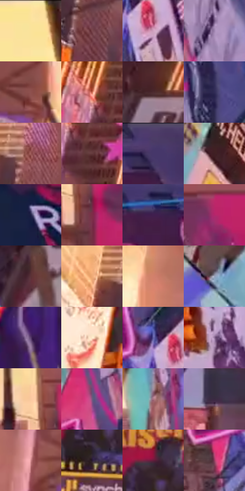

# 电影参考 391

- 状态：常规／活跃；来源世界：miles-home。
- 视角：low-angle；景别：environment-wide；场景：city。
- 时段：daylight-time-unspecified（外观依据，中置信度；具体时间／晨昏未知）；光照：warm-day。
- 材质候选：glass, stone, metal, screen, sky（帧级，不是像素分割）。
- 明暗组：middle；L* P5/P50/P95：15.11751 / 41.02025 / 90.54349。
- 资格门禁：无附加门禁。
- 原截图 SHA-256：`ee03785576e8405f09f625a1bead2f011d4871cdaa87cb5a038093002420f9ff`；尺寸：2880 × 1202。
- sRGB 像素 SHA-256：`81823f4797a2ca38c2eea820b5ca9156ee1c5e2c039c3f3d4f012cf15c6fda39`。

## 观察与迁移

暖光楼面与窄高亮，不能把所有窗组点亮。

391  /  左侧楼间强暖亮光，玻璃格面出现成片金色强亮，天空暖黄；右楼仍偏蓝紫暗面，灯杆近剪影  /  低角度暖光通过有方向的亮面与冷暗面建立戏剧性。玻璃强亮可含反射与直接受光贡献，不能从截图分解比例；不是全图橙色滤镜

本公开版保存32个128×128原像素色卡上下文；图集格子并非原场景相邻位置。原rect、图集tile和像素SHA见 `data/palette-crops.json`。上下文不足时不得批准替色，不能以小样推断完整构图。

## 实测色卡

颜色比例分母为保留采样像素，不是材料面积；全部 32 色参与全库匹配。表内四舍五入仅用于阅读，原精度在 JSON。

| ID | HEX | Lab | 原图 xy | 像素数 | 比例 | 明度角色 |
| --- | --- | --- | --- | ---: | ---: | --- |
| 391-S01 | #FCE29C | [90.547264, -0.645407, 37.495564] | [1800, 28] | 10722 | 5.565591% | highlight |
| 391-S02 | #77444A | [35.105946, 22.720738, 5.938081] | [956, 916] | 10211 | 5.300341% | shadow |
| 391-S03 | #D0A0BE | [71.057148, 22.583185, -8.541301] | [2184, 936] | 9539 | 4.951518% | light |
| 391-S04 | #A285B1 | [59.553921, 19.328806, -19.009036] | [2132, 452] | 9361 | 4.859121% | midtone |
| 391-S05 | #8F514E | [41.651366, 25.528492, 13.088119] | [1344, 208] | 8436 | 4.378971% | midtone |
| 391-S06 | #CA6850 | [55.113272, 36.751766, 31.143509] | [544, 780] | 8057 | 4.182239% | midtone |
| 391-S07 | #4C2C30 | [22.129876, 15.37969, 3.710745] | [464, 68] | 7941 | 4.122026% | shadow |
| 391-S08 | #302C56 | [20.445692, 13.856557, -24.924698] | [2292, 516] | 7401 | 3.841722% | shadow |
| 391-S09 | #9F5D5B | [46.917577, 26.701261, 12.813587] | [968, 712] | 7199 | 3.736867% | midtone |
| 391-S10 | #643A3C | [29.569044, 18.842551, 6.735992] | [596, 860] | 7127 | 3.699493% | shadow |
| 391-S11 | #46376A | [26.947127, 19.275192, -27.541548] | [2816, 56] | 7004 | 3.635646% | shadow |
| 391-S12 | #3F1F24 | [16.327145, 16.147745, 3.53723] | [296, 672] | 6995 | 3.630975% | deep-shadow |
| 391-S13 | #1F2145 | [14.448615, 10.875804, -23.024736] | [2596, 340] | 6689 | 3.472136% | deep-shadow |
| 391-S14 | #7C2E47 | [31.102551, 36.327659, 2.241637] | [1588, 664] | 6353 | 3.297724% | shadow |
| 391-S15 | #401F4E | [18.453253, 25.109518, -22.588584] | [2468, 112] | 6243 | 3.240625% | deep-shadow |
| 391-S16 | #B3256B | [41.17007, 60.139343, -4.868965] | [1800, 584] | 6092 | 3.162244% | midtone |
| 391-S17 | #5B3136 | [25.825592, 19.670708, 5.221366] | [360, 272] | 5625 | 2.919833% | shadow |
| 391-S18 | #EFAA75 | [75.069307, 19.480747, 37.280536] | [860, 704] | 5577 | 2.894917% | light |
| 391-S19 | #D2806C | [61.84868, 29.548041, 24.316836] | [968, 340] | 5543 | 2.877268% | light |
| 391-S20 | #98A3BC | [66.900078, 1.464327, -14.155696] | [100, 740] | 5504 | 2.857024% | light |
| 391-S21 | #5E4271 | [32.850364, 21.83823, -22.526063] | [88, 160] | 5361 | 2.782796% | shadow |
| 391-S22 | #FFE9C9 | [93.344815, 2.575637, 18.289656] | [800, 916] | 5136 | 2.666002% | highlight |
| 391-S23 | #605DA2 | [42.647609, 18.946954, -37.004417] | [2128, 880] | 4818 | 2.500934% | midtone |
| 391-S24 | #8E6E97 | [50.84751, 20.32174, -17.423425] | [2356, 936] | 4640 | 2.408538% | midtone |
| 391-S25 | #FAC8A0 | [84.056281, 12.434771, 26.765339] | [1532, 580] | 4204 | 2.182218% | highlight |
| 391-S26 | #7B5780 | [42.133037, 22.433187, -17.184306] | [2016, 508] | 4088 | 2.122005% | midtone |
| 391-S27 | #AB7585 | [55.149932, 23.5762, -0.113964] | [1952, 332] | 4071 | 2.113181% | midtone |
| 391-S28 | #3A2A40 | [19.743777, 12.247958, -11.072245] | [1396, 984] | 3662 | 1.900876% | deep-shadow |
| 391-S29 | #D48C91 | [65.592888, 28.056586, 8.676161] | [1152, 200] | 3490 | 1.811594% | light |
| 391-S30 | #28192F | [11.63194, 12.564533, -11.796801] | [1224, 612] | 2205 | 1.144575% | deep-shadow |
| 391-S31 | #641D3C | [23.388471, 34.804779, -2.179647] | [1244, 500] | 1682 | 0.873095% | shadow |
| 391-S32 | #953D5F | [38.8204, 40.524317, -1.401363] | [2020, 980] | 1672 | 0.867904% | shadow |

## 色阶与空间分布

- 采样 ROI：`[0.01, 0.02, 0.98, 0.94]`；步长：4；样本数：192648。
- 排除区：`[]`。
- 深暗、暗、中、亮、高光五段计数：`[26997, 66506, 45541, 33461, 20143]`。
- RGB 各 256 箱、L* 100 箱、13×5 色相明度表和 3×3 空间统计全部保存在 [总数据](../film-library.json)。
- [可视化档案](../../references/library.html)按需绘制直方图，不存 2,094 张重复图表图片。

## 纹理特征占比

**这是分块图像特征的面积占比，不是波点／排线／丝网／错版的精确语义覆盖率。** 窗格、发丝、织物也会产生方向或周期特征。
原图 ROI 像素 3087370；已测块覆盖 3087370（100.0000%）；未测 0。

| 特征 | 块覆盖像素 | 占已测面积 | 阈值敏感范围 |
| --- | ---: | ---: | --- |
| low-contrast | 114688 | 3.7147% | 3.7147% ~ 3.7147% |
| directional-structure | 729600 | 23.6318% | 11.6749% ~ 38.8763% |
| periodic-structure | 2186378 | 70.8168% | 56.8782% ~ 80.1203% |
| mixed-detail | 56704 | 1.8366% | 0.5307% ~ 4.4900% |

阈值敏感范围不是统计置信区间。逐块坐标、尺度、对比、方向一致性、频谱集中度、频率与角度见 [全量特征记录](../texture-features.jsonl)，以帧号定位。
四种印刷层的真实像素覆盖仍标为 `null`，不能填 0，也不能拿上表代替。不得据这些代理测量删除唯一证据。

[测量方法与保留策略](../../references/library-retention.md) · [分类索引](../archive/README.md)
