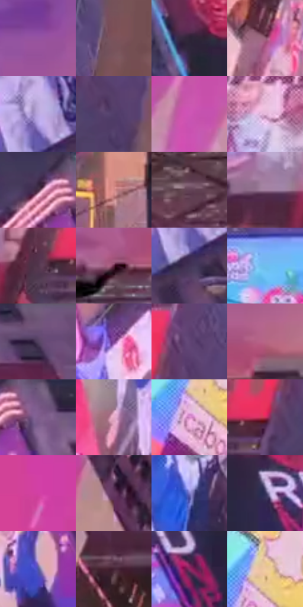

# 电影参考 392

- 状态：常规／活跃；来源世界：miles-home。
- 视角：low-angle；景别：environment-wide；场景：city。
- 时段：twilight-appearance（外观依据，中置信度；具体时间／晨昏未知）；光照：dusk。
- 材质候选：glass, stone, metal, screen, sky（帧级，不是像素分割）。
- 明暗组：middle；L* P5/P50/P95：18.47593 / 42.00373 / 79.80945。
- 资格门禁：无附加门禁。
- 原截图 SHA-256：`3449cf9ae9da6623f94c16a329f095fde8db19757a606a21caab68183c3e9e66`；尺寸：2880 × 1206。
- sRGB 像素 SHA-256：`3d60ccecfa067e28b04a67300fb7e15455ddbcd63c45506caf589b336251546d`。

## 观察与迁移

暮光天空和广告局部亮色，建筑体块仍可读。

392  /  紫色暮天空，青／粉屏幕相对突出，路灯出现小暖亮点  /  自然光减弱后，发光体的相对亮度地位上升；保留暗建筑与局部暖灯，不平均染紫

本公开版保存32个128×128原像素色卡上下文；图集格子并非原场景相邻位置。原rect、图集tile和像素SHA见 `data/palette-crops.json`。上下文不足时不得批准替色，不能以小样推断完整构图。

## 实测色卡

颜色比例分母为保留采样像素，不是材料面积；全部 32 色参与全库匹配。表内四舍五入仅用于阅读，原精度在 JSON。

| ID | HEX | Lab | 原图 xy | 像素数 | 比例 | 明度角色 |
| --- | --- | --- | --- | ---: | ---: | --- |
| 392-S01 | #9553A2 | [45.887059, 40.2773, -31.523371] | [1608, 224] | 10524 | 5.443092% | midtone |
| 392-S02 | #7C525B | [39.707799, 18.926815, 1.959939] | [980, 260] | 10454 | 5.406887% | shadow |
| 392-S03 | #2E2437 | [16.096898, 9.290444, -10.550455] | [2380, 268] | 8440 | 4.365231% | deep-shadow |
| 392-S04 | #956078 | [47.121679, 25.157138, -4.521618] | [460, 832] | 8348 | 4.317648% | midtone |
| 392-S05 | #BAA7E0 | [71.864717, 18.110652, -26.219922] | [2796, 764] | 8283 | 4.284030% | light |
| 392-S06 | #513E69 | [29.947192, 17.972235, -22.100674] | [876, 428] | 8212 | 4.247308% | shadow |
| 392-S07 | #CD56B5 | [55.044968, 58.342457, -27.793666] | [96, 596] | 7854 | 4.062148% | midtone |
| 392-S08 | #EBBDE0 | [81.533251, 22.161892, -11.176381] | [512, 260] | 7120 | 3.682517% | highlight |
| 392-S09 | #442B42 | [21.395079, 16.017232, -9.798945] | [2396, 720] | 7117 | 3.680966% | shadow |
| 392-S10 | #D78C8A | [65.780734, 28.307591, 12.931249] | [1420, 640] | 7015 | 3.628211% | light |
| 392-S11 | #644457 | [32.988716, 17.098942, -5.747244] | [1304, 136] | 6969 | 3.604419% | shadow |
| 392-S12 | #A884A4 | [59.441985, 19.359925, -11.700008] | [540, 420] | 6919 | 3.578559% | midtone |
| 392-S13 | #51344B | [25.90255, 17.260459, -8.832862] | [668, 428] | 6758 | 3.495288% | shadow |
| 392-S14 | #682847 | [26.494889, 32.289899, -4.930145] | [1672, 388] | 6548 | 3.386675% | shadow |
| 392-S15 | #443357 | [24.591156, 15.909775, -18.91566] | [2788, 856] | 6226 | 3.220134% | shadow |
| 392-S16 | #6FBEEE | [73.788777, -11.09734, -31.267972] | [1720, 588] | 6156 | 3.183929% | light |
| 392-S17 | #6D5576 | [39.67526, 16.470689, -14.966776] | [2800, 28] | 5828 | 3.014285% | shadow |
| 392-S18 | #7A3F93 | [37.480063, 40.095734, -36.017648] | [2144, 880] | 5585 | 2.888604% | shadow |
| 392-S19 | #614575 | [34.153171, 21.954663, -22.976666] | [840, 312] | 5362 | 2.773267% | shadow |
| 392-S20 | #B76685 | [53.238939, 36.271935, -2.741667] | [1800, 328] | 5248 | 2.714305% | midtone |
| 392-S21 | #7F5E8E | [44.90047, 22.683319, -21.340802] | [2484, 744] | 5070 | 2.622242% | midtone |
| 392-S22 | #E4AAC7 | [75.680367, 25.675722, -6.408422] | [2048, 488] | 4994 | 2.582934% | light |
| 392-S23 | #D589C6 | [66.608954, 38.127571, -19.630187] | [236, 956] | 4878 | 2.522938% | light |
| 392-S24 | #C3315A | [44.998092, 59.353442, 11.637349] | [764, 412] | 4871 | 2.519318% | midtone |
| 392-S25 | #D2419D | [51.746496, 64.846734, -18.767978] | [48, 112] | 4542 | 2.349156% | midtone |
| 392-S26 | #643860 | [30.357873, 26.212179, -15.514064] | [216, 140] | 4157 | 2.150032% | shadow |
| 392-S27 | #7C78C8 | [53.906955, 20.947798, -41.140433] | [2128, 320] | 3997 | 2.067278% | midtone |
| 392-S28 | #333159 | [22.37847, 12.267012, -23.832556] | [2604, 356] | 3879 | 2.006248% | shadow |
| 392-S29 | #4F53A5 | [38.836962, 21.951194, -44.937761] | [2448, 968] | 3837 | 1.984525% | shadow |
| 392-S30 | #442233 | [18.418878, 18.832133, -3.932936] | [400, 504] | 3592 | 1.857809% | deep-shadow |
| 392-S31 | #8A2C65 | [34.284135, 45.615289, -12.181556] | [2788, 408] | 2580 | 1.334395% | shadow |
| 392-S32 | #F0CAA1 | [83.62213, 7.670975, 25.494813] | [260, 896] | 1983 | 1.025622% | highlight |

## 色阶与空间分布

- 采样 ROI：`[0.01, 0.02, 0.98, 0.94]`；步长：4；样本数：193346。
- 排除区：`[]`。
- 深暗、暗、中、亮、高光五段计数：`[13713, 73461, 62544, 34226, 9402]`。
- RGB 各 256 箱、L* 100 箱、13×5 色相明度表和 3×3 空间统计全部保存在 [总数据](../film-library.json)。
- [可视化档案](../../references/library.html)按需绘制直方图，不存 2,094 张重复图表图片。

## 纹理特征占比

**这是分块图像特征的面积占比，不是波点／排线／丝网／错版的精确语义覆盖率。** 窗格、发丝、织物也会产生方向或周期特征。
原图 ROI 像素 3098546；已测块覆盖 3098546（100.0000%）；未测 0。

| 特征 | 块覆盖像素 | 占已测面积 | 阈值敏感范围 |
| --- | ---: | ---: | --- |
| low-contrast | 16384 | 0.5288% | 0.5288% ~ 1.0575% |
| directional-structure | 491520 | 15.8629% | 2.6438% ~ 34.3655% |
| periodic-structure | 2508722 | 80.9645% | 64.0482% ~ 88.5267% |
| mixed-detail | 81920 | 2.6438% | 1.0575% ~ 7.7720% |

阈值敏感范围不是统计置信区间。逐块坐标、尺度、对比、方向一致性、频谱集中度、频率与角度见 [全量特征记录](../texture-features.jsonl)，以帧号定位。
四种印刷层的真实像素覆盖仍标为 `null`，不能填 0，也不能拿上表代替。不得据这些代理测量删除唯一证据。

[测量方法与保留策略](../../references/library-retention.md) · [分类索引](../archive/README.md)
