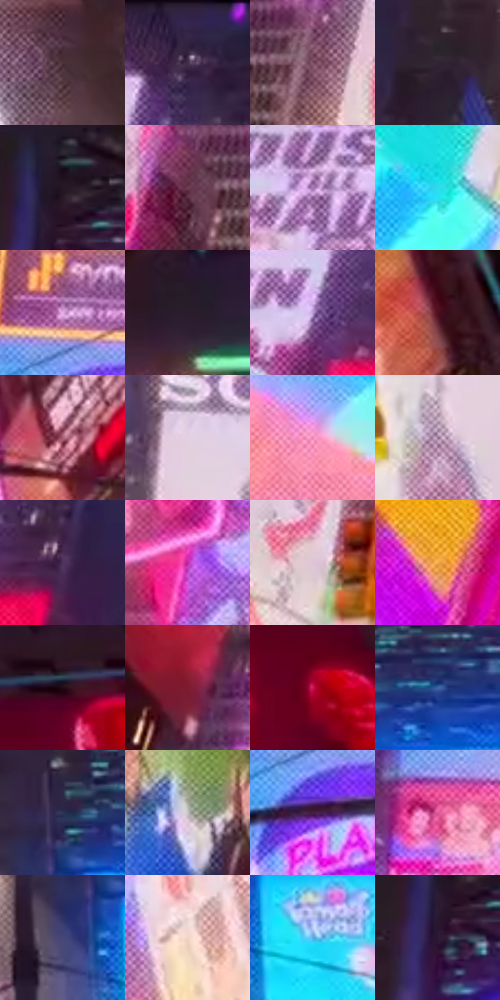

# 电影参考 393

- 状态：常规／活跃；来源世界：miles-home。
- 视角：low-angle；景别：environment-wide；场景：city。
- 时段：night-appearance（外观依据，中置信度；具体时间／晨昏未知）；光照：night-mixed。
- 材质候选：glass, stone, metal, screen, sky（帧级，不是像素分割）。
- 明暗组：dark；L* P5/P50/P95：10.06805 / 39.85085 / 84.77707。
- 资格门禁：无附加门禁。
- 原截图 SHA-256：`916dfab8358a43a0d738a80eed3fd5c42c5ad40efe79b10c94f28f49e9062202`；尺寸：2880 × 1208。
- sRGB 像素 SHA-256：`6544ed36f638bce44a3f50f450cac0c040c32bfcfd612a2b961f294dcb66fdf4`。

## 观察与迁移

入夜显示色更显眼，雾层与楼体分别记录，不宣称光强实测变化。

393  /  暗紫黑天空，青屏与粉灯边突出，窗列出现疏密不同的亮点／短线  /  城市靠暗楼体、窗组与显示屏分层，不把整栋建筑提亮；窗内亮点不能全部称为外部反射

本公开版保存32个128×128原像素色卡上下文；图集格子并非原场景相邻位置。原rect、图集tile和像素SHA见 `data/palette-crops.json`。上下文不足时不得批准替色，不能以小样推断完整构图。

## 实测色卡

颜色比例分母为保留采样像素，不是材料面积；全部 32 色参与全库匹配。表内四舍五入仅用于阅读，原精度在 JSON。

| ID | HEX | Lab | 原图 xy | 像素数 | 比例 | 明度角色 |
| --- | --- | --- | --- | ---: | ---: | --- |
| 393-S01 | #4D333C | [24.550801, 13.305477, -0.892312] | [2608, 964] | 9203 | 4.759861% | shadow |
| 393-S02 | #312242 | [16.456089, 14.923762, -17.643993] | [776, 44] | 8830 | 4.566942% | deep-shadow |
| 393-S03 | #7F5165 | [40.142769, 22.338399, -3.559938] | [652, 948] | 8243 | 4.263341% | midtone |
| 393-S04 | #312433 | [16.274428, 9.482719, -7.429208] | [944, 556] | 8221 | 4.251963% | deep-shadow |
| 393-S05 | #261724 | [10.200603, 10.331021, -5.925752] | [1176, 100] | 8150 | 4.215241% | deep-shadow |
| 393-S06 | #6E3E55 | [32.737432, 24.325524, -4.69943] | [552, 948] | 8011 | 4.143349% | shadow |
| 393-S07 | #A577B1 | [56.454256, 28.310815, -23.72642] | [544, 168] | 7786 | 4.026978% | midtone |
| 393-S08 | #2BDCED | [80.632538, -36.081851, -20.4261] | [180, 828] | 7425 | 3.840266% | highlight |
| 393-S09 | #E5ABE5 | [76.946269, 30.695411, -20.835078] | [1192, 716] | 7423 | 3.839231% | light |
| 393-S10 | #291D2B | [12.763591, 9.040794, -7.137172] | [2452, 620] | 7391 | 3.822681% | deep-shadow |
| 393-S11 | #B899D2 | [67.744123, 22.239561, -24.844012] | [688, 216] | 6971 | 3.605453% | light |
| 393-S12 | #4E101F | [15.951061, 29.802706, 7.025749] | [2364, 480] | 6854 | 3.544940% | deep-shadow |
| 393-S13 | #A95F74 | [49.352924, 32.602732, 1.454137] | [2128, 728] | 6564 | 3.394950% | midtone |
| 393-S14 | #E3D0E1 | [85.443049, 9.54651, -5.981444] | [1176, 448] | 6095 | 3.152380% | highlight |
| 393-S15 | #E583B0 | [66.541704, 43.123788, -7.183893] | [68, 948] | 6000 | 3.103245% | light |
| 393-S16 | #886A86 | [48.590933, 17.038335, -10.854327] | [2392, 944] | 5821 | 3.010665% | midtone |
| 393-S17 | #4F335C | [26.165145, 21.026809, -19.639189] | [820, 232] | 5733 | 2.965151% | shadow |
| 393-S18 | #BE26A6 | [45.755782, 69.685509, -33.667222] | [2052, 944] | 5550 | 2.870502% | midtone |
| 393-S19 | #DEC5D6 | [82.010736, 11.697087, -5.229979] | [796, 992] | 5506 | 2.847744% | highlight |
| 393-S20 | #F2AA4C | [74.92131, 17.822886, 57.339529] | [240, 432] | 5505 | 2.847227% | light |
| 393-S21 | #200A12 | [5.129821, 11.209213, -0.293661] | [2512, 96] | 5411 | 2.798610% | deep-shadow |
| 393-S22 | #7D1B30 | [27.732809, 42.587062, 12.820867] | [604, 640] | 5401 | 2.793438% | shadow |
| 393-S23 | #CC1550 | [44.171051, 67.778886, 17.012413] | [2792, 192] | 5055 | 2.614484% | midtone |
| 393-S24 | #3E63A5 | [42.251176, 8.089297, -39.55057] | [1700, 480] | 4988 | 2.579831% | midtone |
| 393-S25 | #2E3355 | [22.317076, 8.024553, -21.31289] | [1564, 484] | 4677 | 2.418979% | shadow |
| 393-S26 | #C3C1C1 | [78.223447, 0.692629, 0.249305] | [2120, 260] | 4545 | 2.350708% | light |
| 393-S27 | #482045 | [19.393992, 25.088957, -14.881379] | [1196, 820] | 4464 | 2.308814% | deep-shadow |
| 393-S28 | #D85794 | [55.641511, 56.524747, -7.488904] | [1132, 1032] | 3973 | 2.054865% | midtone |
| 393-S29 | #454677 | [31.754588, 13.03661, -28.186201] | [1524, 588] | 3890 | 2.011937% | shadow |
| 393-S30 | #F2D5C6 | [87.263404, 7.728074, 11.112167] | [2184, 972] | 3796 | 1.963320% | highlight |
| 393-S31 | #5BABE3 | [67.196489, -8.122659, -35.548578] | [1640, 620] | 3265 | 1.688682% | light |
| 393-S32 | #2E1935 | [12.817522, 16.461597, -14.217289] | [1156, 172] | 2599 | 1.344222% | deep-shadow |

## 色阶与空间分布

- 采样 ROI：`[0.01, 0.02, 0.98, 0.94]`；步长：4；样本数：193346。
- 排除区：`[]`。
- 深暗、暗、中、亮、高光五段计数：`[51893, 45105, 38509, 36308, 21531]`。
- RGB 各 256 箱、L* 100 箱、13×5 色相明度表和 3×3 空间统计全部保存在 [总数据](../film-library.json)。
- [可视化档案](../../references/library.html)按需绘制直方图，不存 2,094 张重复图表图片。

## 纹理特征占比

**这是分块图像特征的面积占比，不是波点／排线／丝网／错版的精确语义覆盖率。** 窗格、发丝、织物也会产生方向或周期特征。
原图 ROI 像素 3104134；已测块覆盖 3104134（100.0000%）；未测 0。

| 特征 | 块覆盖像素 | 占已测面积 | 阈值敏感范围 |
| --- | ---: | ---: | --- |
| low-contrast | 16384 | 0.5278% | 0.5278% ~ 3.1669% |
| directional-structure | 81920 | 2.6391% | 1.5834% ~ 10.0284% |
| periodic-structure | 2830854 | 91.1963% | 84.4831% ~ 91.1963% |
| mixed-detail | 174976 | 5.6369% | 2.1112% ~ 10.7665% |

阈值敏感范围不是统计置信区间。逐块坐标、尺度、对比、方向一致性、频谱集中度、频率与角度见 [全量特征记录](../texture-features.jsonl)，以帧号定位。
四种印刷层的真实像素覆盖仍标为 `null`，不能填 0，也不能拿上表代替。不得据这些代理测量删除唯一证据。

[测量方法与保留策略](../../references/library-retention.md) · [分类索引](../archive/README.md)
