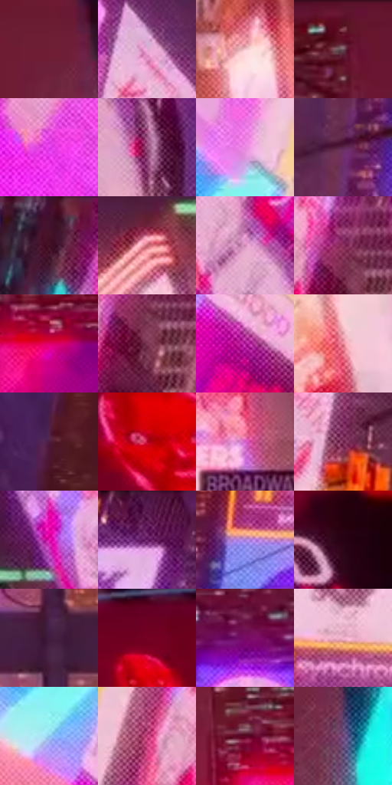

# 电影参考 394

- 状态：常规／活跃；来源世界：miles-home。
- 视角：low-angle；景别：environment-wide；场景：city。
- 时段：night-appearance（外观依据，中置信度；具体时间／晨昏未知）；光照：night-mixed。
- 材质候选：glass, stone, metal, screen, sky（帧级，不是像素分割）。
- 明暗组：middle；L* P5/P50/P95：14.94247 / 41.38506 / 82.13176。
- 资格门禁：无附加门禁。
- 原截图 SHA-256：`202b4c9b8b616b358340973dc464b8aa212cf32c607d2b828dbe43eed0f101d4`；尺寸：2880 × 1206。
- sRGB 像素 SHA-256：`708139b6b6d6bdaa2c2abac153ef4c3eab372ca72f37f98524df28b5aef74e91`。

## 观察与迁移

入夜显示色更显眼，雾层与楼体分别记录，不宣称光强实测变化。

394  /  空气与大屏偏红粉，仍有黑楼体、白亮面及黄信号灯  /  高彩区域多也需要深暗隔开；广告本身换画与环境染色分别解释，不能推断所有实体换成红色材质

本公开版保存32个128×128原像素色卡上下文；图集格子并非原场景相邻位置。原rect、图集tile和像素SHA见 `data/palette-crops.json`。上下文不足时不得批准替色，不能以小样推断完整构图。

## 实测色卡

颜色比例分母为保留采样像素，不是材料面积；全部 32 色参与全库匹配。表内四舍五入仅用于阅读，原精度在 JSON。

| ID | HEX | Lab | 原图 xy | 像素数 | 比例 | 明度角色 |
| --- | --- | --- | --- | ---: | ---: | --- |
| 394-S01 | #6F1E35 | [25.460886, 37.290468, 5.868343] | [1800, 136] | 13183 | 6.818346% | shadow |
| 394-S02 | #E3AAD4 | [75.968252, 27.525281, -13.086731] | [788, 720] | 10134 | 5.241381% | light |
| 394-S03 | #F4C8CB | [84.409327, 16.011211, 4.388809] | [1760, 1092] | 8451 | 4.370921% | highlight |
| 394-S04 | #591B2C | [20.401377, 30.027784, 4.316259] | [1372, 56] | 8245 | 4.264376% | shadow |
| 394-S05 | #E33DE9 | [57.611567, 81.027415, -53.154964] | [172, 356] | 7708 | 3.986635% | midtone |
| 394-S06 | #964F7C | [43.554817, 35.711552, -12.271747] | [2248, 500] | 7640 | 3.951465% | midtone |
| 394-S07 | #E98AE1 | [70.133355, 48.602873, -29.023153] | [196, 800] | 7495 | 3.876470% | light |
| 394-S08 | #5C244D | [23.91245, 31.209597, -13.05719] | [1028, 848] | 7386 | 3.820095% | shadow |
| 394-S09 | #461027 | [14.51003, 27.854176, -1.100102] | [1940, 52] | 7049 | 3.645796% | deep-shadow |
| 394-S10 | #C1636F | [53.397084, 38.733513, 10.655738] | [2424, 716] | 7045 | 3.643727% | midtone |
| 394-S11 | #CD88B5 | [64.903448, 33.083041, -12.750129] | [2760, 672] | 6441 | 3.331333% | light |
| 394-S12 | #913763 | [37.214957, 42.591395, -6.374839] | [552, 904] | 6359 | 3.288922% | shadow |
| 394-S13 | #DD0067 | [47.438306, 75.369185, 7.747883] | [1664, 544] | 6342 | 3.280130% | midtone |
| 394-S14 | #7E3954 | [33.989155, 33.026573, -1.938953] | [564, 964] | 6182 | 3.197377% | shadow |
| 394-S15 | #AB1895 | [40.382414, 66.485769, -32.137492] | [256, 1044] | 5930 | 3.067040% | midtone |
| 394-S16 | #EC889D | [67.93166, 40.457975, 5.65629] | [2292, 1088] | 5845 | 3.023078% | light |
| 394-S17 | #4D1C40 | [19.135203, 28.10344, -11.768165] | [952, 296] | 5779 | 2.988942% | deep-shadow |
| 394-S18 | #B50229 | [37.897076, 62.481473, 32.468267] | [2588, 184] | 5607 | 2.899982% | shadow |
| 394-S19 | #D75EC4 | [58.452988, 59.889643, -31.011878] | [1380, 1092] | 5459 | 2.823436% | midtone |
| 394-S20 | #752850 | [29.106671, 37.966748, -6.756328] | [852, 916] | 5377 | 2.781025% | shadow |
| 394-S21 | #E714B3 | [52.67276, 82.837236, -29.979258] | [2612, 620] | 5344 | 2.763957% | midtone |
| 394-S22 | #5B144F | [21.167682, 38.612126, -18.678876] | [708, 44] | 4572 | 2.364673% | shadow |
| 394-S23 | #A379D1 | [58.098301, 33.611688, -39.405263] | [1144, 740] | 4516 | 2.335709% | midtone |
| 394-S24 | #270213 | [4.714191, 19.392698, -1.387553] | [2812, 324] | 4400 | 2.275713% | deep-shadow |
| 394-S25 | #411C3F | [17.052709, 23.75575, -14.459443] | [1488, 948] | 4287 | 2.217269% | deep-shadow |
| 394-S26 | #750123 | [23.425863, 45.951137, 15.697228] | [2420, 148] | 4287 | 2.217269% | shadow |
| 394-S27 | #780C64 | [27.233303, 51.080306, -22.705451] | [1268, 208] | 3910 | 2.022281% | shadow |
| 394-S28 | #F2B1CC | [78.858803, 27.625644, -4.275769] | [1260, 632] | 3813 | 1.972112% | light |
| 394-S29 | #89C3E7 | [76.139926, -9.635508, -23.779158] | [160, 940] | 3777 | 1.953493% | light |
| 394-S30 | #C43F7A | [47.878558, 57.578206, -3.84282] | [436, 912] | 3767 | 1.948321% | midtone |
| 394-S31 | #5A0624 | [17.608005, 37.355162, 6.10802] | [1592, 492] | 3694 | 1.910564% | deep-shadow |
| 394-S32 | #653F72 | [32.999025, 26.254764, -22.860504] | [1872, 264] | 3322 | 1.718163% | shadow |

## 色阶与空间分布

- 采样 ROI：`[0.01, 0.02, 0.98, 0.94]`；步长：4；样本数：193346。
- 排除区：`[]`。
- 深暗、暗、中、亮、高光五段计数：`[28059, 65399, 48133, 38741, 13014]`。
- RGB 各 256 箱、L* 100 箱、13×5 色相明度表和 3×3 空间统计全部保存在 [总数据](../film-library.json)。
- [可视化档案](../../references/library.html)按需绘制直方图，不存 2,094 张重复图表图片。

## 纹理特征占比

**这是分块图像特征的面积占比，不是波点／排线／丝网／错版的精确语义覆盖率。** 窗格、发丝、织物也会产生方向或周期特征。
原图 ROI 像素 3098546；已测块覆盖 3098546（100.0000%）；未测 0。

| 特征 | 块覆盖像素 | 占已测面积 | 阈值敏感范围 |
| --- | ---: | ---: | --- |
| low-contrast | 81920 | 2.6438% | 2.1151% ~ 3.7013% |
| directional-structure | 98304 | 3.1726% | 1.0575% ~ 8.8981% |
| periodic-structure | 2759986 | 89.0736% | 86.1431% ~ 89.0736% |
| mixed-detail | 158336 | 5.1100% | 1.0575% ~ 9.0980% |

阈值敏感范围不是统计置信区间。逐块坐标、尺度、对比、方向一致性、频谱集中度、频率与角度见 [全量特征记录](../texture-features.jsonl)，以帧号定位。
四种印刷层的真实像素覆盖仍标为 `null`，不能填 0，也不能拿上表代替。不得据这些代理测量删除唯一证据。

[测量方法与保留策略](../../references/library-retention.md) · [分类索引](../archive/README.md)
