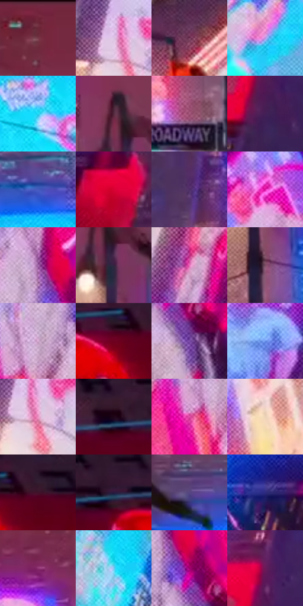

# 电影参考 395

- 状态：常规／活跃；来源世界：miles-home。
- 视角：low-angle；景别：environment-wide；场景：city。
- 时段：night-appearance（外观依据，中置信度；具体时间／晨昏未知）；光照：night-mixed。
- 材质候选：glass, stone, metal, screen, sky（帧级，不是像素分割）。
- 明暗组：middle；L* P5/P50/P95：13.31974 / 40.72155 / 83.02751。
- 资格门禁：无附加门禁。
- 原截图 SHA-256：`f88246f018f94ef48ca1868755e5df77559b6fd29c86d051a6faf37d265794d0`；尺寸：2880 × 1208。
- sRGB 像素 SHA-256：`9552c2089ff7d687f73ee6b9e82a80d53acc0a64134ea1799712756198cba3fd`。

## 观察与迁移

入夜显示色更显眼，雾层与楼体分别记录，不宣称光强实测变化。

395  /  左侧和右中青蓝屏与右侧粉光对置，中央天空偏暗，灯杆仍黑  /  多色光保持源位置和作用区域；青、粉、白、黄有层级，不把所有颜色等量铺满

本公开版保存32个128×128原像素色卡上下文；图集格子并非原场景相邻位置。原rect、图集tile和像素SHA见 `data/palette-crops.json`。上下文不足时不得批准替色，不能以小样推断完整构图。

## 实测色卡

颜色比例分母为保留采样像素，不是材料面积；全部 32 色参与全库匹配。表内四舍五入仅用于阅读，原精度在 JSON。

| ID | HEX | Lab | 原图 xy | 像素数 | 比例 | 明度角色 |
| --- | --- | --- | --- | ---: | ---: | --- |
| 395-S01 | #71303F | [29.373065, 30.318995, 4.772031] | [1376, 44] | 13261 | 6.858689% | shadow |
| 395-S02 | #DDC4E5 | [82.114425, 14.648435, -13.117987] | [704, 984] | 10785 | 5.578083% | highlight |
| 395-S03 | #743857 | [32.325449, 30.365979, -6.508908] | [2292, 788] | 10439 | 5.399129% | shadow |
| 395-S04 | #B893DE | [66.77258, 28.191882, -32.982979] | [68, 648] | 9456 | 4.890714% | light |
| 395-S05 | #22D6F4 | [79.017927, -31.685435, -26.619837] | [1680, 628] | 8749 | 4.525048% | light |
| 395-S06 | #52293D | [22.71289, 21.906273, -4.20682] | [1460, 404] | 8503 | 4.397815% | shadow |
| 395-S07 | #A5587B | [47.50852, 35.935986, -5.524845] | [1420, 1116] | 6684 | 3.457015% | midtone |
| 395-S08 | #431F56 | [19.412985, 28.024828, -26.432456] | [808, 408] | 6668 | 3.448740% | deep-shadow |
| 395-S09 | #455ABE | [41.679089, 23.970228, -55.123179] | [1824, 500] | 6661 | 3.445119% | midtone |
| 395-S10 | #D80231 | [45.454076, 71.32519, 38.094304] | [608, 540] | 6514 | 3.369090% | midtone |
| 395-S11 | #4F2D67 | [25.315936, 27.533906, -28.129262] | [1012, 948] | 6494 | 3.358745% | shadow |
| 395-S12 | #D916A1 | [49.377674, 77.725558, -24.678248] | [2704, 512] | 6236 | 3.225306% | midtone |
| 395-S13 | #A56AAC | [53.261933, 34.608666, -25.761295] | [2144, 292] | 6095 | 3.152380% | midtone |
| 395-S14 | #342440 | [17.282639, 14.065767, -14.937798] | [1488, 480] | 6061 | 3.134795% | deep-shadow |
| 395-S15 | #E970BC | [63.791929, 55.552418, -18.046049] | [432, 1016] | 5846 | 3.023595% | light |
| 395-S16 | #7D4D65 | [38.91236, 23.928928, -5.413117] | [1504, 624] | 5817 | 3.008596% | shadow |
| 395-S17 | #D8ACD3 | [75.331932, 22.547244, -13.605187] | [2092, 404] | 5703 | 2.949634% | light |
| 395-S18 | #6D001F | [21.398772, 43.839778, 15.517091] | [2676, 120] | 5554 | 2.872570% | shadow |
| 395-S19 | #7C4DA7 | [41.818157, 37.591218, -41.117308] | [2220, 440] | 5326 | 2.754647% | midtone |
| 395-S20 | #6891E7 | [60.746972, 10.577607, -47.828514] | [604, 320] | 5196 | 2.687410% | light |
| 395-S21 | #EC92C3 | [71.100507, 40.517371, -10.925029] | [728, 1016] | 5033 | 2.603105% | light |
| 395-S22 | #1E0617 | [4.229113, 12.706987, -5.023315] | [2396, 80] | 4820 | 2.492940% | deep-shadow |
| 395-S23 | #E24FA6 | [56.602535, 64.983966, -16.417036] | [2044, 468] | 4817 | 2.491388% | midtone |
| 395-S24 | #ECD3B7 | [85.927471, 4.387314, 17.054498] | [2184, 980] | 4565 | 2.361052% | highlight |
| 395-S25 | #40122A | [13.768482, 25.160155, -4.527179] | [2744, 100] | 4371 | 2.260714% | deep-shadow |
| 395-S26 | #2A183D | [12.495817, 17.99717, -20.464694] | [2528, 76] | 4141 | 2.141756% | deep-shadow |
| 395-S27 | #554681 | [33.766001, 20.725498, -31.137591] | [1652, 480] | 4032 | 2.085381% | shadow |
| 395-S28 | #2E2A7E | [22.801498, 28.681237, -47.081382] | [432, 500] | 3870 | 2.001593% | shadow |
| 395-S29 | #8D3272 | [36.290678, 45.782321, -17.293697] | [1320, 212] | 3571 | 1.846948% | shadow |
| 395-S30 | #7BC4F0 | [76.05611, -11.092066, -28.814168] | [268, 544] | 3325 | 1.719715% | light |
| 395-S31 | #9C006C | [34.298539, 61.654887, -16.324351] | [2188, 348] | 2381 | 1.231471% | shadow |
| 395-S32 | #6C1958 | [25.529325, 42.764004, -17.656446] | [816, 272] | 2372 | 1.226816% | shadow |

## 色阶与空间分布

- 采样 ROI：`[0.01, 0.02, 0.98, 0.94]`；步长：4；样本数：193346。
- 排除区：`[]`。
- 深暗、暗、中、亮、高光五段计数：`[27925, 67070, 42532, 39276, 16543]`。
- RGB 各 256 箱、L* 100 箱、13×5 色相明度表和 3×3 空间统计全部保存在 [总数据](../film-library.json)。
- [可视化档案](../../references/library.html)按需绘制直方图，不存 2,094 张重复图表图片。

## 纹理特征占比

**这是分块图像特征的面积占比，不是波点／排线／丝网／错版的精确语义覆盖率。** 窗格、发丝、织物也会产生方向或周期特征。
原图 ROI 像素 3104134；已测块覆盖 3104134（100.0000%）；未测 0。

| 特征 | 块覆盖像素 | 占已测面积 | 阈值敏感范围 |
| --- | ---: | ---: | --- |
| low-contrast | 81920 | 2.6391% | 1.5834% ~ 4.7503% |
| directional-structure | 131072 | 4.2225% | 2.1112% ~ 12.6675% |
| periodic-structure | 2748934 | 88.5572% | 81.5060% ~ 88.5572% |
| mixed-detail | 142208 | 4.5812% | 1.0556% ~ 11.6325% |

阈值敏感范围不是统计置信区间。逐块坐标、尺度、对比、方向一致性、频谱集中度、频率与角度见 [全量特征记录](../texture-features.jsonl)，以帧号定位。
四种印刷层的真实像素覆盖仍标为 `null`，不能填 0，也不能拿上表代替。不得据这些代理测量删除唯一证据。

[测量方法与保留策略](../../references/library-retention.md) · [分类索引](../archive/README.md)
