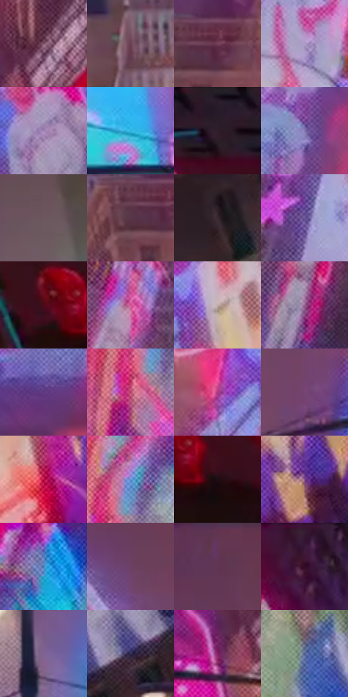

# 电影参考 396

- 状态：常规／活跃；来源世界：miles-home。
- 视角：low-angle；景别：environment-wide；场景：city。
- 时段：night-appearance（外观依据，中置信度；具体时间／晨昏未知）；光照：night-mixed。
- 材质候选：glass, stone, metal, screen, sky（帧级，不是像素分割）。
- 明暗组：dark；L* P5/P50/P95：11.2387 / 38.99306 / 70.41303。
- 资格门禁：无附加门禁。
- 原截图 SHA-256：`288c713822d8e2c7708b5c2e98a5fd4cf236d46c4ef4a8428b09b247bd562d62`；尺寸：2880 × 1202。
- sRGB 像素 SHA-256：`07028f873bb508160eef1f5d248af3e8949037dff197e81bf0af811f614d0395`。

## 观察与迁移

入夜显示色更显眼，雾层与楼体分别记录，不宣称光强实测变化。

396  /  粉灰空气遮蔽远处高楼，屏幕边缘更柔，近灯杆仍相对清楚  /  空气散射／遮蔽改变纵深，不代表玻璃更粗糙，也不是把建筑画成透明物体

本公开版保存32个128×128原像素色卡上下文；图集格子并非原场景相邻位置。原rect、图集tile和像素SHA见 `data/palette-crops.json`。上下文不足时不得批准替色，不能以小样推断完整构图。

## 实测色卡

颜色比例分母为保留采样像素，不是材料面积；全部 32 色参与全库匹配。表内四舍五入仅用于阅读，原精度在 JSON。

| ID | HEX | Lab | 原图 xy | 像素数 | 比例 | 明度角色 |
| --- | --- | --- | --- | ---: | ---: | --- |
| 396-S01 | #7D5368 | [40.486316, 20.892063, -4.934165] | [2132, 648] | 10643 | 5.524584% | midtone |
| 396-S02 | #693F52 | [32.186368, 21.257064, -3.662926] | [1648, 1036] | 10584 | 5.493958% | shadow |
| 396-S03 | #74425A | [34.69803, 25.107863, -4.889785] | [1884, 952] | 9467 | 4.914144% | shadow |
| 396-S04 | #AF9CC9 | [67.357861, 15.728287, -20.513716] | [756, 1000] | 9376 | 4.866908% | light |
| 396-S05 | #9F80B2 | [58.059673, 21.402924, -21.887845] | [2696, 592] | 8301 | 4.308895% | midtone |
| 396-S06 | #31B5E0 | [68.808157, -20.498099, -31.498932] | [1884, 692] | 8237 | 4.275674% | light |
| 396-S07 | #281B29 | [11.925099, 9.545389, -6.96847] | [2720, 28] | 8036 | 4.171338% | deep-shadow |
| 396-S08 | #8378B2 | [53.46232, 17.104258, -29.192468] | [660, 300] | 7136 | 3.704165% | midtone |
| 396-S09 | #6C575E | [39.263753, 9.898546, -0.772017] | [1820, 132] | 6994 | 3.630456% | shadow |
| 396-S10 | #573546 | [26.777411, 18.061701, -4.123053] | [1832, 972] | 6864 | 3.562975% | shadow |
| 396-S11 | #382830 | [18.240443, 9.065118, -2.283283] | [2676, 964] | 6649 | 3.451372% | deep-shadow |
| 396-S12 | #6E599A | [42.448998, 23.181794, -32.471665] | [700, 864] | 6486 | 3.366762% | midtone |
| 396-S13 | #4C0A19 | [14.536458, 30.910819, 9.418179] | [2388, 224] | 6379 | 3.311220% | deep-shadow |
| 396-S14 | #CE5997 | [54.557679, 52.92713, -11.030079] | [504, 852] | 6326 | 3.283709% | midtone |
| 396-S15 | #C2AEAB | [72.682397, 6.676067, 4.1629] | [2160, 960] | 5946 | 3.086458% | light |
| 396-S16 | #93618B | [47.774176, 27.223439, -14.949452] | [460, 1032] | 5707 | 2.962398% | midtone |
| 396-S17 | #5C367E | [30.448207, 31.813705, -34.493422] | [540, 448] | 5683 | 2.949940% | shadow |
| 396-S18 | #CB80AD | [62.637475, 35.396334, -11.647224] | [36, 468] | 5541 | 2.876230% | light |
| 396-S19 | #B23881 | [44.061246, 55.98755, -14.146009] | [2040, 992] | 5506 | 2.858062% | midtone |
| 396-S20 | #764473 | [36.412279, 29.248673, -18.020867] | [1044, 780] | 5197 | 2.697666% | shadow |
| 396-S21 | #B81044 | [39.549273, 62.824873, 17.68424] | [2276, 1072] | 4716 | 2.447988% | shadow |
| 396-S22 | #6695D3 | [60.799755, 1.579577, -36.623323] | [100, 388] | 4681 | 2.429820% | light |
| 396-S23 | #1E0C12 | [5.263432, 9.10444, -0.132223] | [2480, 260] | 4662 | 2.419958% | deep-shadow |
| 396-S24 | #7D4B86 | [39.771472, 31.4526, -24.467624] | [2412, 1008] | 4606 | 2.390889% | shadow |
| 396-S25 | #4D79B6 | [50.249392, 3.359416, -36.79055] | [232, 300] | 4553 | 2.363378% | midtone |
| 396-S26 | #6C4064 | [33.510897, 25.107308, -13.145097] | [864, 688] | 4543 | 2.358187% | shadow |
| 396-S27 | #63355B | [29.297647, 26.64023, -13.924566] | [900, 40] | 3868 | 2.007807% | shadow |
| 396-S28 | #3E1A3B | [15.895738, 23.044334, -13.494013] | [248, 40] | 3788 | 1.966280% | deep-shadow |
| 396-S29 | #7E6493 | [46.520715, 19.895723, -21.835341] | [1508, 576] | 3719 | 1.930464% | midtone |
| 396-S30 | #363057 | [22.253148, 13.249071, -22.689605] | [2800, 832] | 3325 | 1.725946% | shadow |
| 396-S31 | #852165 | [31.841135, 48.503509, -15.999191] | [2056, 720] | 2715 | 1.409306% | shadow |
| 396-S32 | #4C5A86 | [38.845596, 6.800632, -26.271037] | [2060, 272] | 2414 | 1.253063% | shadow |

## 色阶与空间分布

- 采样 ROI：`[0.01, 0.02, 0.98, 0.94]`；步长：4；样本数：192648。
- 排除区：`[]`。
- 深暗、暗、中、亮、高光五段计数：`[27332, 73776, 56783, 34425, 332]`。
- RGB 各 256 箱、L* 100 箱、13×5 色相明度表和 3×3 空间统计全部保存在 [总数据](../film-library.json)。
- [可视化档案](../../references/library.html)按需绘制直方图，不存 2,094 张重复图表图片。

## 纹理特征占比

**这是分块图像特征的面积占比，不是波点／排线／丝网／错版的精确语义覆盖率。** 窗格、发丝、织物也会产生方向或周期特征。
原图 ROI 像素 3087370；已测块覆盖 3087370（100.0000%）；未测 0。

| 特征 | 块覆盖像素 | 占已测面积 | 阈值敏感范围 |
| --- | ---: | ---: | --- |
| low-contrast | 278528 | 9.0215% | 7.4295% ~ 13.2670% |
| directional-structure | 180224 | 5.8375% | 2.1227% ~ 8.9303% |
| periodic-structure | 2442506 | 79.1128% | 74.0548% ~ 81.8035% |
| mixed-detail | 186112 | 6.0282% | 1.8366% ~ 10.5555% |

阈值敏感范围不是统计置信区间。逐块坐标、尺度、对比、方向一致性、频谱集中度、频率与角度见 [全量特征记录](../texture-features.jsonl)，以帧号定位。
四种印刷层的真实像素覆盖仍标为 `null`，不能填 0，也不能拿上表代替。不得据这些代理测量删除唯一证据。

[测量方法与保留策略](../../references/library-retention.md) · [分类索引](../archive/README.md)
