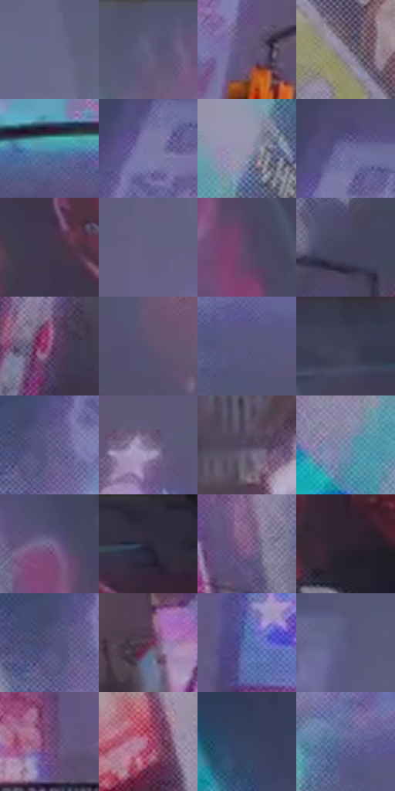

# 电影参考 397

- 状态：常规／活跃；来源世界：miles-home。
- 视角：low-angle；景别：environment-wide；场景：city。
- 时段：night-appearance（外观依据，中置信度；具体时间／晨昏未知）；光照：night-mixed。
- 材质候选：glass, stone, metal, screen, sky（帧级，不是像素分割）。
- 明暗组：middle；L* P5/P50/P95：21.44205 / 41.53732 / 60.69003。
- 资格门禁：无附加门禁。
- 原截图 SHA-256：`0c27d6b7953f05915451c5fe76a4670715e3b052785d0ac431f9df3fa9a8116f`；尺寸：2880 × 1208。
- sRGB 像素 SHA-256：`05994ef80c0beb2b9090aeaca49aff810584ac81271f4d210708878b41f5a120`。

## 观察与迁移

入夜显示色更显眼，雾层与楼体分别记录，不宣称光强实测变化。

397  /  更厚的冷灰蓝雾化观感，远楼细节与对比下降，近杆与局部信号灯仍可读  /  按深度削弱远处细节和对比，不全图统一模糊；彩光穿过空气仍可保留色块，但不能推断湿路或降雨

本公开版保存32个128×128原像素色卡上下文；图集格子并非原场景相邻位置。原rect、图集tile和像素SHA见 `data/palette-crops.json`。上下文不足时不得批准替色，不能以小样推断完整构图。

## 实测色卡

颜色比例分母为保留采样像素，不是材料面积；全部 32 色参与全库匹配。表内四舍五入仅用于阅读，原精度在 JSON。

| ID | HEX | Lab | 原图 xy | 像素数 | 比例 | 明度角色 |
| --- | --- | --- | --- | ---: | ---: | --- |
| 397-S01 | #69688B | [45.314254, 8.501149, -19.087322] | [1836, 164] | 11030 | 5.704799% | midtone |
| 397-S02 | #625E7D | [41.346988, 8.702479, -16.784622] | [2020, 56] | 10235 | 5.293619% | midtone |
| 397-S03 | #62577A | [39.272372, 12.289884, -18.136308] | [852, 904] | 9625 | 4.978122% | shadow |
| 397-S04 | #8F839A | [56.491398, 9.067669, -10.624385] | [352, 764] | 8427 | 4.358508% | midtone |
| 397-S05 | #4C94B0 | [57.89333, -14.311557, -21.488985] | [1824, 776] | 8391 | 4.339888% | midtone |
| 397-S06 | #7A7BA7 | [53.051024, 9.740962, -23.534689] | [432, 140] | 8362 | 4.324889% | midtone |
| 397-S07 | #9C8FAB | [61.35376, 10.313375, -12.925505] | [288, 588] | 8283 | 4.284030% | light |
| 397-S08 | #6F6C9E | [47.717091, 12.954105, -26.6023] | [452, 84] | 7953 | 4.113351% | midtone |
| 397-S09 | #42384E | [25.371668, 9.465987, -11.78953] | [2520, 204] | 7568 | 3.914226% | shadow |
| 397-S10 | #645F81 | [41.96671, 9.783563, -18.247174] | [1160, 188] | 7457 | 3.856816% | midtone |
| 397-S11 | #574A69 | [33.865318, 12.353535, -15.978824] | [2276, 252] | 6909 | 3.573387% | shadow |
| 397-S12 | #43445F | [29.796654, 6.509823, -16.046444] | [2228, 752] | 6709 | 3.469945% | shadow |
| 397-S13 | #9A638E | [49.1886, 29.095696, -14.5088] | [496, 984] | 6481 | 3.352022% | midtone |
| 397-S14 | #595371 | [36.93425, 9.385139, -16.249626] | [552, 624] | 6425 | 3.323058% | shadow |
| 397-S15 | #58567D | [38.217848, 10.353147, -21.678755] | [468, 468] | 6188 | 3.200480% | shadow |
| 397-S16 | #35354A | [22.99002, 5.52219, -12.896734] | [2348, 28] | 6182 | 3.197377% | shadow |
| 397-S17 | #655F8C | [42.527584, 12.980325, -24.016028] | [364, 236] | 6055 | 3.131691% | midtone |
| 397-S18 | #7D7092 | [49.524664, 12.151528, -16.647371] | [740, 604] | 5556 | 2.873605% | midtone |
| 397-S19 | #4E4358 | [30.251153, 9.323049, -10.75984] | [1708, 1068] | 5452 | 2.819815% | shadow |
| 397-S20 | #8292B4 | [60.425106, 2.161869, -19.626007] | [64, 668] | 5159 | 2.668273% | light |
| 397-S21 | #71648B | [44.926199, 13.614046, -19.622753] | [2208, 136] | 4959 | 2.564832% | midtone |
| 397-S22 | #322D3E | [19.649746, 6.48316, -9.924168] | [2700, 52] | 4903 | 2.535868% | deep-shadow |
| 397-S23 | #7D5781 | [42.402027, 23.347392, -17.359924] | [2104, 684] | 4760 | 2.461908% | midtone |
| 397-S24 | #2E2431 | [15.82151, 7.707663, -6.736752] | [2780, 264] | 4486 | 2.320193% | deep-shadow |
| 397-S25 | #4B4971 | [32.816516, 11.089103, -22.72263] | [336, 236] | 4417 | 2.284505% | shadow |
| 397-S26 | #603752 | [28.97633, 22.606274, -8.594169] | [1940, 1128] | 4267 | 2.206924% | shadow |
| 397-S27 | #5270A9 | [47.294908, 5.718924, -33.865589] | [1104, 936] | 3597 | 1.860395% | midtone |
| 397-S28 | #585C83 | [40.192262, 8.25449, -22.281865] | [732, 108] | 3318 | 1.716094% | midtone |
| 397-S29 | #734C76 | [38.060671, 24.092538, -17.380227] | [1392, 1076] | 3250 | 1.680924% | shadow |
| 397-S30 | #933E60 | [38.715411, 39.468481, -2.222046] | [2268, 1108] | 3004 | 1.553691% | shadow |
| 397-S31 | #354460 | [28.734621, 2.267324, -18.420416] | [240, 84] | 2202 | 1.138891% | shadow |
| 397-S32 | #5A6494 | [43.397377, 8.768227, -27.524767] | [404, 420] | 1736 | 0.897872% | midtone |

## 色阶与空间分布

- 采样 ROI：`[0.01, 0.02, 0.98, 0.94]`；步长：4；样本数：193346。
- 排除区：`[]`。
- 深暗、暗、中、亮、高光五段计数：`[7504, 73679, 99975, 12188, 0]`。
- RGB 各 256 箱、L* 100 箱、13×5 色相明度表和 3×3 空间统计全部保存在 [总数据](../film-library.json)。
- [可视化档案](../../references/library.html)按需绘制直方图，不存 2,094 张重复图表图片。

## 纹理特征占比

**这是分块图像特征的面积占比，不是波点／排线／丝网／错版的精确语义覆盖率。** 窗格、发丝、织物也会产生方向或周期特征。
原图 ROI 像素 3104134；已测块覆盖 3104134（100.0000%）；未测 0。

| 特征 | 块覆盖像素 | 占已测面积 | 阈值敏感范围 |
| --- | ---: | ---: | --- |
| low-contrast | 376832 | 12.1397% | 11.6119% ~ 13.1953% |
| directional-structure | 212992 | 6.8616% | 2.6391% ~ 11.8799% |
| periodic-structure | 2284934 | 73.6094% | 69.2673% ~ 74.3970% |
| mixed-detail | 229376 | 7.3894% | 2.1112% ~ 14.8983% |

阈值敏感范围不是统计置信区间。逐块坐标、尺度、对比、方向一致性、频谱集中度、频率与角度见 [全量特征记录](../texture-features.jsonl)，以帧号定位。
四种印刷层的真实像素覆盖仍标为 `null`，不能填 0，也不能拿上表代替。不得据这些代理测量删除唯一证据。

[测量方法与保留策略](../../references/library-retention.md) · [分类索引](../archive/README.md)
