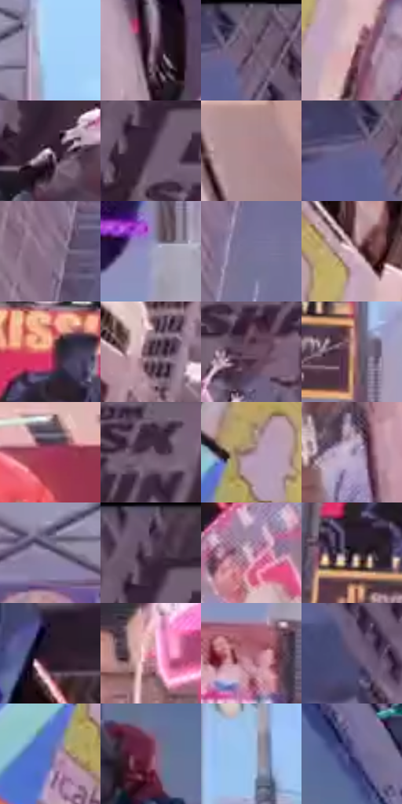

# 电影参考 398

- 状态：常规／活跃；来源世界：miles-home。
- 视角：low-angle；景别：environment-wide；场景：city。
- 时段：daylight-time-unspecified（外观依据，中置信度；具体时间／晨昏未知）；光照：neutral-day。
- 材质候选：glass, stone, metal, screen, sky（帧级，不是像素分割）。
- 明暗组：middle；L* P5/P50/P95：15.59473 / 49.94726 / 81.74661。
- 资格门禁：无附加门禁。
- 原截图 SHA-256：`0f41d0cce202f42094b0efd72330ed4e546dc34811dfde4a3f2262d9918bebc5`；尺寸：2880 × 1210。
- sRGB 像素 SHA-256：`7aea6408da1bacf038632370d18c5416bb10bd552c1e8bb28560fee4c358f200`。

## 观察与迁移

同机位日光城市，广告内容变化与材质换光分开。

398  /  明亮较冷日光，浅蓝天空，楼体网格与中央交叉支撑重新清楚，杆体变浅  /  日间结构可见度回升，屏幕光晕相对不突出；不是证明材料换了，也不指定是次日早晨

本公开版保存32个128×128原像素色卡上下文；图集格子并非原场景相邻位置。原rect、图集tile和像素SHA见 `data/palette-crops.json`。上下文不足时不得批准替色，不能以小样推断完整构图。

## 实测色卡

颜色比例分母为保留采样像素，不是材料面积；全部 32 色参与全库匹配。表内四舍五入仅用于阅读，原精度在 JSON。

| ID | HEX | Lab | 原图 xy | 像素数 | 比例 | 明度角色 |
| --- | --- | --- | --- | ---: | ---: | --- |
| 398-S01 | #A5D1FA | [82.108965, -4.802171, -24.711013] | [1408, 176] | 10809 | 5.570386% | highlight |
| 398-S02 | #7C6276 | [44.700879, 14.143593, -7.223338] | [2252, 540] | 9502 | 4.896828% | midtone |
| 398-S03 | #5A455D | [32.303401, 13.801241, -10.728789] | [196, 60] | 9056 | 4.666983% | shadow |
| 398-S04 | #DBB5BB | [77.099492, 14.621625, 2.11168] | [424, 912] | 8658 | 4.461875% | light |
| 398-S05 | #B29CAF | [66.777042, 11.495769, -6.870187] | [348, 328] | 8195 | 4.223269% | light |
| 398-S06 | #4E3A50 | [27.366746, 13.288971, -9.943541] | [416, 136] | 7896 | 4.069180% | shadow |
| 398-S07 | #AE8A91 | [60.976243, 14.78467, 1.495607] | [2604, 968] | 7506 | 3.868195% | light |
| 398-S08 | #676289 | [43.396423, 10.993147, -20.853519] | [140, 76] | 7190 | 3.705345% | midtone |
| 398-S09 | #877087 | [50.083715, 13.33318, -9.215852] | [864, 640] | 7143 | 3.681124% | midtone |
| 398-S10 | #9C9DBB | [65.568569, 5.884023, -15.576378] | [1372, 928] | 6936 | 3.574447% | light |
| 398-S11 | #787396 | [50.044876, 9.612478, -18.247323] | [948, 468] | 6485 | 3.342026% | midtone |
| 398-S12 | #EBC9D5 | [84.091117, 13.906262, -1.506029] | [388, 804] | 6360 | 3.277607% | highlight |
| 398-S13 | #CA5165 | [51.134008, 49.734464, 13.64215] | [1244, 480] | 6278 | 3.235349% | midtone |
| 398-S14 | #3D2734 | [18.762216, 12.778621, -4.227553] | [588, 996] | 5956 | 3.069407% | deep-shadow |
| 398-S15 | #6B4F64 | [37.185099, 15.58648, -7.599371] | [480, 236] | 5947 | 3.064769% | shadow |
| 398-S16 | #CEA394 | [70.494446, 13.664718, 13.844046] | [1384, 692] | 5773 | 2.975098% | light |
| 398-S17 | #A53860 | [40.693812, 48.206928, 1.030215] | [2692, 116] | 5735 | 2.955515% | midtone |
| 398-S18 | #6F5A6E | [40.925164, 12.417332, -8.140898] | [644, 148] | 5730 | 2.952939% | midtone |
| 398-S19 | #997989 | [54.29538, 15.164021, -3.930749] | [280, 852] | 5555 | 2.862753% | midtone |
| 398-S20 | #9A89A5 | [59.41426, 11.785026, -12.446926] | [1780, 1108] | 5507 | 2.838016% | midtone |
| 398-S21 | #8880A0 | [55.288444, 9.696295, -15.962278] | [1288, 216] | 5495 | 2.831832% | midtone |
| 398-S22 | #422E48 | [22.231996, 14.646141, -12.602326] | [416, 40] | 5376 | 2.770506% | shadow |
| 398-S23 | #CAA1BA | [70.589201, 19.230382, -7.087183] | [2688, 500] | 5265 | 2.713302% | light |
| 398-S24 | #1D1318 | [7.16253, 6.114619, -1.515311] | [1176, 616] | 5062 | 2.608687% | deep-shadow |
| 398-S25 | #2B192B | [11.846232, 12.748988, -8.51459] | [360, 484] | 4193 | 2.160850% | deep-shadow |
| 398-S26 | #D87692 | [61.337465, 41.30174, 2.051342] | [1956, 908] | 4067 | 2.095916% | light |
| 398-S27 | #A86676 | [50.847416, 28.639596, 2.413373] | [1348, 1044] | 4009 | 2.066026% | midtone |
| 398-S28 | #5C5374 | [37.339985, 11.199023, -17.460741] | [228, 196] | 3909 | 2.014492% | shadow |
| 398-S29 | #5E6CAE | [47.183295, 12.731767, -36.909767] | [216, 928] | 3900 | 2.009853% | midtone |
| 398-S30 | #72354F | [31.088011, 30.081117, -3.201875] | [120, 624] | 3661 | 1.886685% | shadow |
| 398-S31 | #9EC2E6 | [77.019194, -3.687432, -21.793063] | [1468, 572] | 3635 | 1.873286% | light |
| 398-S32 | #464477 | [31.272525, 14.642396, -28.941792] | [184, 496] | 3255 | 1.677455% | shadow |

## 色阶与空间分布

- 采样 ROI：`[0.01, 0.02, 0.98, 0.94]`；步长：4；样本数：194044。
- 排除区：`[]`。
- 深暗、暗、中、亮、高光五段计数：`[14237, 44481, 69973, 50156, 15197]`。
- RGB 各 256 箱、L* 100 箱、13×5 色相明度表和 3×3 空间统计全部保存在 [总数据](../film-library.json)。
- [可视化档案](../../references/library.html)按需绘制直方图，不存 2,094 张重复图表图片。

## 纹理特征占比

**这是分块图像特征的面积占比，不是波点／排线／丝网／错版的精确语义覆盖率。** 窗格、发丝、织物也会产生方向或周期特征。
原图 ROI 像素 3109722；已测块覆盖 3109722（100.0000%）；未测 0。

| 特征 | 块覆盖像素 | 占已测面积 | 阈值敏感范围 |
| --- | ---: | ---: | --- |
| low-contrast | 65536 | 2.1075% | 2.1075% ~ 2.1075% |
| directional-structure | 497920 | 16.0117% | 5.2686% ~ 33.9704% |
| periodic-structure | 2452954 | 78.8802% | 63.9222% ~ 86.3468% |
| mixed-detail | 93312 | 3.0007% | 0.0000% ~ 6.2771% |

阈值敏感范围不是统计置信区间。逐块坐标、尺度、对比、方向一致性、频谱集中度、频率与角度见 [全量特征记录](../texture-features.jsonl)，以帧号定位。
四种印刷层的真实像素覆盖仍标为 `null`，不能填 0，也不能拿上表代替。不得据这些代理测量删除唯一证据。

[测量方法与保留策略](../../references/library-retention.md) · [分类索引](../archive/README.md)
