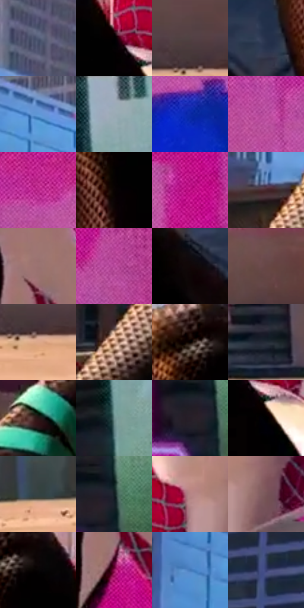

# 电影参考 399

- 状态：常规／活跃；来源世界：miles-home。
- 视角：low-angle；景别：medium；场景：portrait。
- 时段：daylight-time-unspecified（外观依据，中置信度；具体时间／晨昏未知）；光照：neutral-day。
- 材质候选：fabric, stone, glass, screen, sky（帧级，不是像素分割）。
- 明暗组：dark；L* P5/P50/P95：0.23324 / 32.54914 / 74.91149。
- 资格门禁：无附加门禁。
- 原截图 SHA-256：`cbbb0b328640f89847677b5bfdbb73de98ffdc6c26e22fe8d20a00482bf4cc07`；尺寸：2880 × 1204。
- sRGB 像素 SHA-256：`e086864281ab9e8370ae8f251d13417cf699665284eb9873ab250ed9be50a1e3`。

## 观察与迁移

屋顶黑白衣料日光，黑布保暗形、白布保转折。

399  /  白衣大面偏浅暖，阴面偏冷；黑衣膝／小腿局部有细密金铜色亮纹，主体仍深黑；屋面偏暖且有碎粒  /  黑布用局部微表面亮纹呈现触感，白布用宽缓明暗与色温表达体积；屋顶碎粒是物体细节，不是印刷波点

本公开版保存32个128×128原像素色卡上下文；图集格子并非原场景相邻位置。原rect、图集tile和像素SHA见 `data/palette-crops.json`。上下文不足时不得批准替色，不能以小样推断完整构图。

## 实测色卡

颜色比例分母为保留采样像素，不是材料面积；全部 32 色参与全库匹配。表内四舍五入仅用于阅读，原精度在 JSON。

| ID | HEX | Lab | 原图 xy | 像素数 | 比例 | 明度角色 |
| --- | --- | --- | --- | ---: | ---: | --- |
| 399-S01 | #515A75 | [38.455749, 3.342053, -16.445275] | [692, 140] | 10868 | 5.641377% | shadow |
| 399-S02 | #010001 | [0.078096, 0.400543, -0.286285] | [1332, 372] | 8667 | 4.498879% | deep-shadow |
| 399-S03 | #524143 | [29.36168, 7.710667, 1.570481] | [2624, 988] | 8420 | 4.370666% | shadow |
| 399-S04 | #26314B | [20.504518, 3.549335, -17.520993] | [1096, 592] | 8234 | 4.274117% | shadow |
| 399-S05 | #5E97D6 | [61.102778, -0.380855, -37.852582] | [520, 164] | 8097 | 4.203002% | light |
| 399-S06 | #A0ACBA | [69.840512, -1.304999, -8.584993] | [2600, 36] | 7871 | 4.085690% | light |
| 399-S07 | #0A2AA8 | [25.401068, 40.83374, -68.797612] | [2088, 440] | 7662 | 3.977202% | shadow |
| 399-S08 | #BF54A4 | [51.949571, 52.602899, -22.836999] | [1824, 268] | 7246 | 3.761264% | midtone |
| 399-S09 | #B92689 | [43.520749, 64.727043, -19.747714] | [1948, 204] | 7118 | 3.694822% | midtone |
| 399-S10 | #090202 | [0.956508, 1.83046, 0.645036] | [1184, 408] | 7047 | 3.657967% | deep-shadow |
| 399-S11 | #B8097F | [41.089906, 68.614583, -17.353297] | [2252, 216] | 6864 | 3.562975% | midtone |
| 399-S12 | #45272B | [19.601688, 14.706965, 3.405087] | [408, 628] | 6794 | 3.526639% | deep-shadow |
| 399-S13 | #9A7271 | [51.94785, 15.618367, 6.735444] | [1740, 516] | 6651 | 3.452411% | midtone |
| 399-S14 | #B14295 | [46.198029, 54.404438, -22.987538] | [2328, 380] | 6620 | 3.436319% | midtone |
| 399-S15 | #100707 | [2.506443, 2.633444, 0.92816] | [972, 624] | 6538 | 3.393754% | deep-shadow |
| 399-S16 | #674646 | [33.364233, 14.181544, 5.714183] | [1744, 964] | 6537 | 3.393235% | shadow |
| 399-S17 | #DDA88C | [73.071698, 15.774186, 22.021012] | [2648, 1052] | 6479 | 3.363129% | light |
| 399-S18 | #F4C5A9 | [82.931037, 12.812482, 20.386116] | [356, 784] | 5737 | 2.977970% | highlight |
| 399-S19 | #040000 | [0.233235, 1.045997, 0.368554] | [1172, 280] | 5715 | 2.966550% | deep-shadow |
| 399-S20 | #242B37 | [17.36029, 0.423079, -8.70307] | [2228, 988] | 5690 | 2.953573% | deep-shadow |
| 399-S21 | #281515 | [9.334001, 9.717462, 4.035513] | [240, 964] | 5186 | 2.691956% | deep-shadow |
| 399-S22 | #6D8F8D | [56.898031, -12.256199, -2.814681] | [2572, 264] | 5020 | 2.605789% | midtone |
| 399-S23 | #271E27 | [12.648651, 6.425178, -4.42632] | [2540, 532] | 4933 | 2.560629% | deep-shadow |
| 399-S24 | #000000 | [0.0, 0.0, 0.0] | [1380, 448] | 4693 | 2.436049% | deep-shadow |
| 399-S25 | #354343 | [27.231238, -5.619177, -1.871198] | [524, 1068] | 4492 | 2.331714% | shadow |
| 399-S26 | #131E23 | [10.470665, -3.234122, -4.971823] | [2580, 508] | 4486 | 2.328599% | deep-shadow |
| 399-S27 | #B78586 | [60.39601, 19.33491, 7.060493] | [1448, 312] | 4423 | 2.295897% | light |
| 399-S28 | #785659 | [40.19772, 14.566892, 3.843441] | [1540, 340] | 4003 | 2.077883% | midtone |
| 399-S29 | #060404 | [1.213311, 0.522929, 0.184409] | [1236, 300] | 3645 | 1.892052% | deep-shadow |
| 399-S30 | #901455 | [32.004494, 53.264521, -5.168845] | [1728, 640] | 2775 | 1.440451% | shadow |
| 399-S31 | #4378B8 | [49.599146, 2.660738, -39.000233] | [392, 212] | 2309 | 1.198559% | midtone |
| 399-S32 | #394074 | [28.894805, 12.744057, -30.889406] | [104, 380] | 1828 | 0.948881% | shadow |

## 色阶与空间分布

- 采样 ROI：`[0.01, 0.02, 0.98, 0.94]`；步长：4；样本数：192648。
- 排除区：`[]`。
- 深暗、暗、中、亮、高光五段计数：`[64194, 52061, 46819, 25407, 4167]`。
- RGB 各 256 箱、L* 100 箱、13×5 色相明度表和 3×3 空间统计全部保存在 [总数据](../film-library.json)。
- [可视化档案](../../references/library.html)按需绘制直方图，不存 2,094 张重复图表图片。

## 纹理特征占比

**这是分块图像特征的面积占比，不是波点／排线／丝网／错版的精确语义覆盖率。** 窗格、发丝、织物也会产生方向或周期特征。
原图 ROI 像素 3092958；已测块覆盖 3092958（100.0000%）；未测 0。

| 特征 | 块覆盖像素 | 占已测面积 | 阈值敏感范围 |
| --- | ---: | ---: | --- |
| low-contrast | 158080 | 5.1110% | 5.1110% ~ 6.1704% |
| directional-structure | 400128 | 12.9367% | 5.8931% ~ 26.4062% |
| periodic-structure | 2398686 | 77.5531% | 66.8936% ~ 79.9203% |
| mixed-detail | 136064 | 4.3992% | 1.5892% ~ 8.0161% |

阈值敏感范围不是统计置信区间。逐块坐标、尺度、对比、方向一致性、频谱集中度、频率与角度见 [全量特征记录](../texture-features.jsonl)，以帧号定位。
四种印刷层的真实像素覆盖仍标为 `null`，不能填 0，也不能拿上表代替。不得据这些代理测量删除唯一证据。

[测量方法与保留策略](../../references/library-retention.md) · [分类索引](../archive/README.md)
