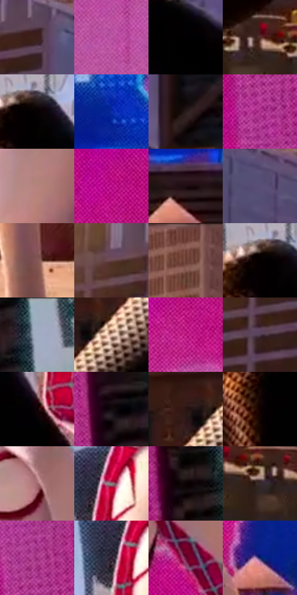

# 电影参考 400

- 状态：常规／活跃；来源世界：miles-home。
- 视角：low-angle；景别：medium；场景：portrait。
- 时段：daylight-time-unspecified（外观依据，中置信度；具体时间／晨昏未知）；光照：warm-day。
- 材质候选：fabric, stone, glass, screen, sky（帧级，不是像素分割）。
- 明暗组：dark；L* P5/P50/P95：0.25302 / 25.89835 / 69.2619。
- 资格门禁：无附加门禁。
- 原截图 SHA-256：`2bd1926dabc01eb21e578058fe0d5992ed7c5795a71ace19a2936c2525e1b9b7`；尺寸：2880 × 1210。
- sRGB 像素 SHA-256：`e750421b44c827b7cc3faa1156bf54e1c3e12f24ae6218f9b13ffecee97b310a`。

## 观察与迁移

同屋顶暖光衣料与楼面，材质身份不随光色替换。

400  /  左上暖亮增强，腿部窄暖亮区与胸前白面突出，背景仍有冷灰紫楼体和粉色屏  /  暖光没有把黑衣涂成金属，也没有把白布改成黄色固有色；大屏存在不等于白天全部由粉光主导

本公开版保存32个128×128原像素色卡上下文；图集格子并非原场景相邻位置。原rect、图集tile和像素SHA见 `data/palette-crops.json`。上下文不足时不得批准替色，不能以小样推断完整构图。

## 实测色卡

颜色比例分母为保留采样像素，不是材料面积；全部 32 色参与全库匹配。表内四舍五入仅用于阅读，原精度在 JSON。

| ID | HEX | Lab | 原图 xy | 像素数 | 比例 | 明度角色 |
| --- | --- | --- | --- | ---: | ---: | --- |
| 400-S01 | #3D1E1B | [15.487368, 14.67576, 8.7368] | [496, 212] | 11803 | 6.082641% | deep-shadow |
| 400-S02 | #BB54A4 | [51.367933, 51.425803, -23.781659] | [1984, 396] | 9591 | 4.942693% | midtone |
| 400-S03 | #010001 | [0.078096, 0.400543, -0.286285] | [792, 512] | 9553 | 4.923110% | deep-shadow |
| 400-S04 | #512C26 | [22.622611, 16.315571, 11.295703] | [688, 924] | 9443 | 4.866422% | shadow |
| 400-S05 | #060102 | [0.585504, 1.446523, 0.082302] | [1260, 256] | 9326 | 4.806126% | deep-shadow |
| 400-S06 | #0F2EAA | [26.610491, 39.284098, -67.998991] | [2412, 776] | 8530 | 4.395910% | shadow |
| 400-S07 | #281C1D | [11.7592, 6.100758, 1.60573] | [980, 472] | 8283 | 4.268619% | deep-shadow |
| 400-S08 | #B53A94 | [45.620745, 58.612066, -23.227046] | [2516, 220] | 8095 | 4.171734% | midtone |
| 400-S09 | #B7847D | [59.93594, 18.637721, 11.549444] | [1560, 244] | 8077 | 4.162458% | midtone |
| 400-S10 | #BF108B | [43.232467, 70.638728, -21.318932] | [2320, 128] | 7724 | 3.980540% | midtone |
| 400-S11 | #1C0C10 | [4.943558, 7.526145, 0.532992] | [2304, 912] | 7560 | 3.896024% | deep-shadow |
| 400-S12 | #594F75 | [35.984316, 12.957216, -20.195721] | [648, 268] | 7342 | 3.783678% | shadow |
| 400-S13 | #855953 | [42.394546, 17.336646, 10.85673] | [2072, 1120] | 7148 | 3.683701% | midtone |
| 400-S14 | #68454A | [33.337824, 15.849517, 3.13947] | [328, 224] | 6944 | 3.578570% | shadow |
| 400-S15 | #683B30 | [30.120652, 18.548406, 15.341707] | [772, 56] | 6523 | 3.361609% | shadow |
| 400-S16 | #040001 | [0.253022, 1.185041, -0.009869] | [1228, 256] | 6458 | 3.328111% | deep-shadow |
| 400-S17 | #A0ACC3 | [70.118374, 0.653097, -13.134828] | [2740, 56] | 6003 | 3.093628% | light |
| 400-S18 | #E3BFAD | [79.960697, 10.113553, 13.867656] | [356, 824] | 5928 | 3.054977% | light |
| 400-S19 | #AC0A6F | [38.088726, 64.214412, -12.148456] | [2180, 204] | 5546 | 2.858115% | shadow |
| 400-S20 | #513C4E | [28.197703, 12.739509, -7.34371] | [408, 372] | 5048 | 2.601472% | shadow |
| 400-S21 | #090101 | [0.740644, 2.091977, 0.737141] | [1368, 376] | 4937 | 2.544268% | deep-shadow |
| 400-S22 | #10090C | [2.999762, 2.543202, -0.43394] | [2680, 432] | 4856 | 2.502525% | deep-shadow |
| 400-S23 | #2C1512 | [9.919599, 11.311374, 6.906474] | [292, 804] | 4470 | 2.303601% | deep-shadow |
| 400-S24 | #100200 | [1.387546, 3.66294, 2.145535] | [1212, 392] | 3629 | 1.870194% | deep-shadow |
| 400-S25 | #A0696D | [50.313442, 22.594208, 6.861625] | [1640, 88] | 3545 | 1.826905% | midtone |
| 400-S26 | #897D7E | [53.48409, 4.750773, 1.116376] | [1428, 100] | 3249 | 1.674363% | midtone |
| 400-S27 | #0A0203 | [1.034604, 2.231003, 0.358751] | [2672, 208] | 3186 | 1.641896% | deep-shadow |
| 400-S28 | #372A2B | [18.551953, 6.214693, 1.646599] | [752, 964] | 3179 | 1.638288% | deep-shadow |
| 400-S29 | #992A79 | [37.499765, 53.390987, -19.639319] | [2532, 108] | 3038 | 1.565624% | shadow |
| 400-S30 | #281D2E | [12.779439, 9.409267, -9.297781] | [1392, 124] | 2427 | 1.250747% | deep-shadow |
| 400-S31 | #690D3A | [22.293308, 41.834319, -2.304376] | [1872, 672] | 2063 | 1.063161% | shadow |
| 400-S32 | #162668 | [18.169222, 19.406981, -40.571327] | [2096, 752] | 540 | 0.278287% | deep-shadow |

## 色阶与空间分布

- 采样 ROI：`[0.01, 0.02, 0.98, 0.94]`；步长：4；样本数：194044。
- 排除区：`[]`。
- 深暗、暗、中、亮、高光五段计数：`[82254, 51156, 45154, 12899, 2581]`。
- RGB 各 256 箱、L* 100 箱、13×5 色相明度表和 3×3 空间统计全部保存在 [总数据](../film-library.json)。
- [可视化档案](../../references/library.html)按需绘制直方图，不存 2,094 张重复图表图片。

## 纹理特征占比

**这是分块图像特征的面积占比，不是波点／排线／丝网／错版的精确语义覆盖率。** 窗格、发丝、织物也会产生方向或周期特征。
原图 ROI 像素 3109722；已测块覆盖 3109722（100.0000%）；未测 0。

| 特征 | 块覆盖像素 | 占已测面积 | 阈值敏感范围 |
| --- | ---: | ---: | --- |
| low-contrast | 274944 | 8.8414% | 7.4214% ~ 8.8414% |
| directional-structure | 401242 | 12.9028% | 6.7793% ~ 24.4280% |
| periodic-structure | 2400768 | 77.2020% | 67.6238% ~ 79.6375% |
| mixed-detail | 32768 | 1.0537% | 0.5269% ~ 4.7418% |

阈值敏感范围不是统计置信区间。逐块坐标、尺度、对比、方向一致性、频谱集中度、频率与角度见 [全量特征记录](../texture-features.jsonl)，以帧号定位。
四种印刷层的真实像素覆盖仍标为 `null`，不能填 0，也不能拿上表代替。不得据这些代理测量删除唯一证据。

[测量方法与保留策略](../../references/library-retention.md) · [分类索引](../archive/README.md)
