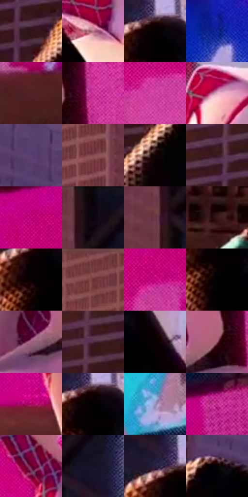

# 电影参考 401

- 状态：常规／活跃；来源世界：miles-home。
- 视角：low-angle；景别：medium；场景：portrait。
- 时段：daylight-time-unspecified（外观依据，中置信度；具体时间／晨昏未知）；光照：warm-day。
- 材质候选：fabric, stone, glass, screen, sky（帧级，不是像素分割）。
- 明暗组：dark；L* P5/P50/P95：0.25302 / 25.85372 / 63.8695。
- 资格门禁：无附加门禁。
- 原截图 SHA-256：`ba8162104025207a72c3425584a82785f031d8604c95333ec4c2f18320f04a5a`；尺寸：2880 × 1208。
- sRGB 像素 SHA-256：`7618011ad7b6ae1cf126f2a9e5f89bc61e93f74960476cadbad9246d5fb73bce`。

## 观察与迁移

同屋顶暖光衣料与楼面，材质身份不随光色替换。

401  /  背景趋暖粉，白衣开始带粉，黑衣仍保持大暗形  /  灯光比例变化可先出现在浅色受光面与背景中间调，不需要每种材料同步同幅度变色

本公开版保存32个128×128原像素色卡上下文；图集格子并非原场景相邻位置。原rect、图集tile和像素SHA见 `data/palette-crops.json`。上下文不足时不得批准替色，不能以小样推断完整构图。

## 实测色卡

颜色比例分母为保留采样像素，不是材料面积；全部 32 色参与全库匹配。表内四舍五入仅用于阅读，原精度在 JSON。

| ID | HEX | Lab | 原图 xy | 像素数 | 比例 | 明度角色 |
| --- | --- | --- | --- | ---: | ---: | --- |
| 401-S01 | #331319 | [10.848642, 16.894823, 3.513907] | [572, 520] | 10946 | 5.661353% | deep-shadow |
| 401-S02 | #B87488 | [56.546081, 29.452958, 0.361685] | [1528, 496] | 10226 | 5.288964% | midtone |
| 401-S03 | #050001 | [0.311331, 1.44654, 0.082269] | [1248, 288] | 8769 | 4.535393% | deep-shadow |
| 401-S04 | #102394 | [21.760597, 38.054355, -62.606644] | [2504, 648] | 8690 | 4.494533% | shadow |
| 401-S05 | #512327 | [20.433476, 21.956572, 7.631834] | [2732, 1064] | 8625 | 4.460915% | shadow |
| 401-S06 | #C93095 | [47.885445, 67.206282, -20.052424] | [1900, 360] | 7478 | 3.867678% | midtone |
| 401-S07 | #D143A1 | [52.001911, 64.3645, -20.753783] | [2320, 364] | 7385 | 3.819577% | midtone |
| 401-S08 | #DDA9C2 | [74.600468, 22.939163, -5.347717] | [1548, 76] | 7249 | 3.749237% | light |
| 401-S09 | #5B3D70 | [31.18777, 23.713197, -24.521265] | [780, 392] | 7081 | 3.662346% | shadow |
| 401-S10 | #844954 | [38.396334, 26.402577, 4.571956] | [912, 132] | 6967 | 3.603385% | shadow |
| 401-S11 | #120203 | [1.613521, 4.827296, 1.273547] | [528, 692] | 6942 | 3.590454% | deep-shadow |
| 401-S12 | #3D1A22 | [14.660838, 18.160655, 2.551385] | [528, 420] | 6773 | 3.503046% | deep-shadow |
| 401-S13 | #C10579 | [42.505458, 70.298485, -11.315696] | [2504, 156] | 6754 | 3.493219% | midtone |
| 401-S14 | #0A0208 | [1.133538, 2.926223, -1.533367] | [1112, 28] | 6682 | 3.455980% | deep-shadow |
| 401-S15 | #693748 | [29.921816, 24.438073, -0.508487] | [1064, 156] | 6659 | 3.444085% | shadow |
| 401-S16 | #23080E | [5.083664, 13.282614, 1.917535] | [52, 1028] | 6497 | 3.360297% | deep-shadow |
| 401-S17 | #090002 | [0.564352, 2.631581, 0.0724] | [1224, 340] | 6415 | 3.317886% | deep-shadow |
| 401-S18 | #6B3234 | [28.526783, 25.580691, 10.688478] | [772, 64] | 6345 | 3.281682% | shadow |
| 401-S19 | #CF0B8A | [46.100922, 74.41453, -16.041647] | [2468, 288] | 6254 | 3.234616% | midtone |
| 401-S20 | #010001 | [0.078096, 0.400543, -0.286285] | [1240, 380] | 5934 | 3.069109% | deep-shadow |
| 401-S21 | #A1627F | [49.308936, 29.605223, -5.309196] | [1728, 436] | 5918 | 3.060834% | midtone |
| 401-S22 | #522D47 | [24.08318, 21.26848, -8.909023] | [452, 484] | 4796 | 2.480527% | shadow |
| 401-S23 | #090000 | [0.524779, 2.353494, 0.829247] | [1368, 400] | 4672 | 2.416393% | deep-shadow |
| 401-S24 | #955568 | [44.070983, 28.958068, 0.696484] | [1828, 392] | 4614 | 2.386395% | midtone |
| 401-S25 | #A6085E | [36.15922, 61.423584, -4.340499] | [2008, 1040] | 4462 | 2.307780% | shadow |
| 401-S26 | #020003 | [0.175978, 0.94013, -0.950994] | [1252, 296] | 4453 | 2.303125% | deep-shadow |
| 401-S27 | #9896C2 | [63.657741, 10.150398, -22.426257] | [1868, 88] | 4101 | 2.121068% | light |
| 401-S28 | #B42282 | [41.94046, 63.738961, -17.966237] | [2636, 96] | 3833 | 1.982456% | midtone |
| 401-S29 | #5F062F | [19.094371, 39.727694, 0.478744] | [2020, 820] | 2866 | 1.482317% | deep-shadow |
| 401-S30 | #141125 | [6.170943, 7.10427, -13.081679] | [1180, 144] | 1891 | 0.978039% | deep-shadow |
| 401-S31 | #271D39 | [13.26326, 12.233264, -16.437069] | [1200, 260] | 1789 | 0.925284% | deep-shadow |
| 401-S32 | #090303 | [1.172373, 1.568944, 0.55293] | [712, 492] | 1280 | 0.662026% | deep-shadow |

## 色阶与空间分布

- 采样 ROI：`[0.01, 0.02, 0.98, 0.94]`；步长：4；样本数：193346。
- 排除区：`[]`。
- 深暗、暗、中、亮、高光五段计数：`[83254, 45203, 51600, 11568, 1721]`。
- RGB 各 256 箱、L* 100 箱、13×5 色相明度表和 3×3 空间统计全部保存在 [总数据](../film-library.json)。
- [可视化档案](../../references/library.html)按需绘制直方图，不存 2,094 张重复图表图片。

## 纹理特征占比

**这是分块图像特征的面积占比，不是波点／排线／丝网／错版的精确语义覆盖率。** 窗格、发丝、织物也会产生方向或周期特征。
原图 ROI 像素 3104134；已测块覆盖 3104134（100.0000%）；未测 0。

| 特征 | 块覆盖像素 | 占已测面积 | 阈值敏感范围 |
| --- | ---: | ---: | --- |
| low-contrast | 328320 | 10.5769% | 10.0491% ~ 11.4018% |
| directional-structure | 219520 | 7.0719% | 5.4884% ~ 17.1003% |
| periodic-structure | 2392454 | 77.0732% | 69.6838% ~ 77.0732% |
| mixed-detail | 163840 | 5.2781% | 3.1669% ~ 9.3316% |

阈值敏感范围不是统计置信区间。逐块坐标、尺度、对比、方向一致性、频谱集中度、频率与角度见 [全量特征记录](../texture-features.jsonl)，以帧号定位。
四种印刷层的真实像素覆盖仍标为 `null`，不能填 0，也不能拿上表代替。不得据这些代理测量删除唯一证据。

[测量方法与保留策略](../../references/library-retention.md) · [分类索引](../archive/README.md)
